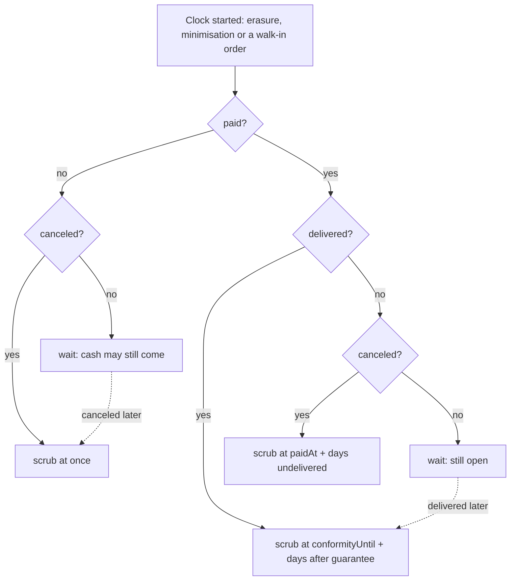
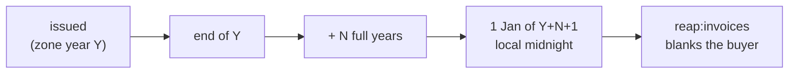

# Data retention: orders and invoices

What happens to an order and its invoice after the account goes.

## Orders after the account

Once erasure, inactivity minimisation or a [walk-in order](#walk-in-orders)'s creation has started an order's clock, `reap:orders` scrubs the buyer
(email, both addresses with their country, notes) when the order is past its claim window. The due date
is derived on every run from the order's current fields, so an order delivered after the erasure follows
its delivery.

| Order                                              | Due                                                           |
| -------------------------------------------------- | ------------------------------------------------------------- |
| never paid and canceled                            | at once                                                       |
| never paid, still open                             | not due: its cash may still come                              |
| delivered                                          | `conformityUntil` + `NODE_ORDER_PII_DAYS_AFTER_GUARANTEE` (0) |
| paid, ended without delivery (cancelled, refunded) | `paidAt` + `NODE_ORDER_PII_DAYS_UNDELIVERED` (540)            |
| paid, still open                                   | not due: it still has to be shipped, delivered or returned    |

### Walk-in orders {#walk-in-orders}

A walk-in order is one staff placed with no `userId`: a counter sale, or money taken outside the app.
No erasure will ever detach it, so `placeOrder` starts its clock at creation and its email follows the
same table as an erased buyer's. The "never paid" row is why that is safe: an unpaid walk-in order
waiting for its cash is _not_ due, and the reservation sweep cancelling it after the hold (about 15
minutes) is what makes it due. A paid one waits for delivery, like any other.

**Why these dates.** The invoice already keeps the tax copy of the buyer (and the place of supply for
OSS), so the order's copy has no tax purpose (Art. 5(1)(c)(e)). What still needs the buyer on the order is
a claim: the EU legal guarantee (Directive 2019/771; Italy art. 132 bars claims 26 months after delivery,
which `conformityUntil` stores), the 14-day withdrawal inside it, and card disputes (Visa's ceiling is about
540 days, which is why an undelivered paid order gets that long). Solidus keeps order PII forever; Shopify's
roughly six months is shorter than the guarantee, so the law decides here.

**Knobs.** `NODE_ORDER_PII_DAYS_AFTER_GUARANTEE` extends the delivered row where national law keeps
claims open longer (a 10-year limitation period, say). `NODE_ORDER_PII_DAYS_UNDELIVERED` is the card-dispute
ceiling for the undelivered row.

### How long a deployment must keep the records

The invoice buyer clock (`NODE_INVOICE_BUYER_RETENTION_YEARS`) defaults to the longest common EU
period, so the boilerplate is safe anywhere in the EU. A single-country shop may lower it.

| Where        | Bookkeeping period                 | Source                                                                                                                                                                                                 |
| ------------ | ---------------------------------- | ------------------------------------------------------------------------------------------------------------------------------------------------------------------------------------------------------ |
| EU OSS sales | 10 years                           | [VAT Directive art. 369k](https://vat-one-stop-shop.ec.europa.eu/one-stop-shop/record-keeping-and-audits-oss_en)                                                                                       |
| Italy        | 10 years                           | Codice civile art. 2220                                                                                                                                                                                |
| France       | 10 years                           | [Code de commerce L123-22](https://bofip.impots.gouv.fr/bofip/2837-PGP.html)                                                                                                                           |
| Germany      | 8 years for vouchers, 10 for books | [BEG IV, §147 AO](https://www.haufe.de/steuern/gesetzgebung-politik/viertes-buerokratieentlastungsgesetz_168_613390.html)                                                                              |
| Netherlands  | 7 years                            | AWR art. 52                                                                                                                                                                                            |
| Spain        | 6 years                            | [Código de Comercio art. 30](https://sede.agenciatributaria.gob.es/Sede/en_gb/impuesto-sobre-sociedades/gestion-impuesto-sobre-sociedades/obligaciones-contables-registrales/conservacion-libros.html) |

Check the current figure for the country before relying on it: these change (Germany did in 2025).

## Invoices: the tax clock

An invoice or credit note is the legal record of a sale, so it outlives the order, the account and
the order's own PII clock. What it does not need forever is the buyer. Once the tax period ends,
`reap:invoices` blanks the buyer block (name, street, city, zip, country) and keeps the numbered
document: seller, lines, every amount, the order link, and a credit note's link to its invoice.
The stats read revenue from these rows, so they stay.

| Part                         | After the clock ends                                    |
| ---------------------------- | ------------------------------------------------------- |
| buyer block                  | removed; `buyerErasedAt` records when                   |
| number, dates, seller, lines | kept                                                    |
| amounts, VAT summary         | kept                                                    |
| cached PDF                   | deleted at once; the next render prints a one-line note |

**The clock.** `NODE_INVOICE_BUYER_RETENTION_YEARS` (default 10, the longest EU period: IT art.
2220 c.c.; DE books 10, invoices 8). It counts from the END of the issue year, in the time zone
frozen on the document, as tax authorities count. A document is due at local midnight of 1 January
of issue year + N + 1. An invoice issued on 31 December 2015 at 23:30 UTC is already a 2016 invoice
in Rome, so it is due on 1 January 2027, not 2026. Counting `issuedAt + N * 365 days` would run up
to a year early. A credit note has its own clock, on its own issue date.

**What others do.** WooCommerce anonymises completed orders. Shopify keeps what was sold, the date
and the value. Amasty GDPR (Magento) deletes the personal data on invoices and credit memos and
keeps the documents. Odoo cannot delete a posted invoice; it anonymises the partner. None deletes
the numbered document.

A shorter country period lowers the knob; a pending tax audit raises it. The job reads the
`invoices_issuedAt` index for a coarse bound, then applies the exact year-end rule per row.

## Read next

- [data-retention](./data-retention.md): the hub this page belongs to.
