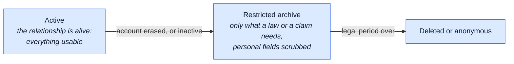
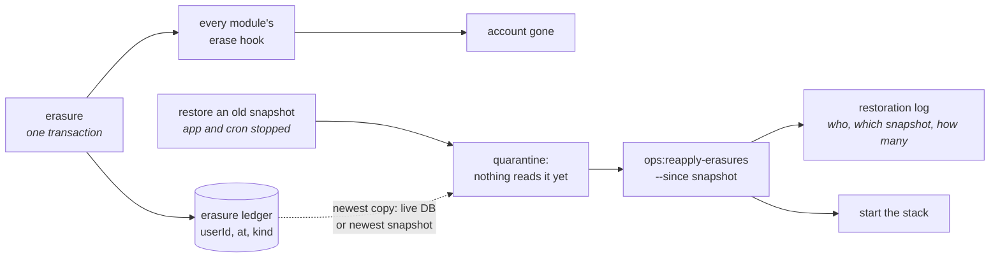

# Data Retention

The [processing register](./data-protection.md#processing-register-art-30) lists every retention
window. This page says **why** each window is as long as it is, and what the industry does.

Not legal advice — the same caveat as [Data Protection](./data-protection.md#what-this-page-is-not).

**This page is the deletion concept** (ISO/IEC 27555, which replaced DIN 66398 in 2025): one rule
per kind of data, each with its period, its trigger and its legal basis. The per-purpose clocks
below are the rules; [Backups and erasure](#backups-and-erasure) is how the concept survives a
restore.

## The rule: one clock per purpose

| GDPR article          | Says                                                               | Here it means                    |
| --------------------- | ------------------------------------------------------------------ | -------------------------------- |
| Art. 5(1)(c)          | collect only what the purpose needs                                | shrink what is stored            |
| Art. 5(1)(e)          | keep it only as long as the purpose needs it                       | every piece of data gets an end  |
| Art. 17(3)(b) and (e) | a legal obligation or a legal claim can outlive an erasure request | invoices, returns, the order row |

- Both duties apply at once. Collecting less never removes the need for an end date.
- Retention is judged **per piece of data**, not per account. An account can live on while one of
  its fields has run out of purpose.

## Three tiers

The model CNIL (the French supervisory authority) describes for customer data, and the one this
repo follows:

| Tier               | Order, as an example                                                                  |
| ------------------ | ------------------------------------------------------------------------------------- |
| Active             | full order: addresses, notes, email — shown in order history                          |
| Restricted archive | `userId` detached, the row kept, addresses still there until the per-order clock ends |
| Deleted/anonymous  | addresses and notes unset, email replaced — the accounting row stays forever          |

## Orders: kept while the account lives

| Situation         | What happens                                                                      | Why                                                                                                                           |
| ----------------- | --------------------------------------------------------------------------------- | ----------------------------------------------------------------------------------------------------------------------------- |
| Account is alive  | the order keeps its personal fields                                               | order history is part of the contract the customer is using (Art. 6(1)(b))                                                    |
| Account is erased | `userId` detached at once; personal fields scrubbed when the per-order clock ends | the order is evidence for a tax audit or a legal claim, never a reason to keep the street forever                             |
| Never paid        | scrubbed at once after erasure, unless money landed after the cancel              | no tax record exists, so no exemption applies; late money is clocked from `moneyReceivedAt`, as a paid order is from `paidAt` |

**What others do with a live customer's orders:** Shopify, WooCommerce and Amazon all keep order
history for as long as the account exists. None of them scrubs a live customer's orders on a timer.

**What the tax record actually needs:** the invoice, which keeps its own encrypted copy of the
billing address. Cross-border EU sales (OSS) also need the place of delivery — a country, not a
street, a phone or a note.

## Orders after the account

Once erasure or inactivity minimisation has started an order's clock, `reap:orders` scrubs the buyer
(email, both addresses with their country, notes) when the order is past its claim window. The due date
is derived on every run from the order's current fields, so an order delivered after the erasure follows
its delivery.

### How long a deployment must keep the records

The invoice buyer clock (`NODE_INVOICE_BUYER_RETENTION_YEARS`) defaults to the longest common EU
period, so the boilerplate is safe anywhere in the EU. A single-country shop may lower it.

Full detail: [Orders after the account](./data-retention-orders.md#orders-after-the-account).

## Invoices: the tax clock

An invoice or credit note is the legal record of a sale, so it outlives the order, the account and
the order's own PII clock. What it does not need forever is the buyer. Once the tax period ends,
`reap:invoices` blanks the buyer block (name, street, city, zip, country) and keeps the numbered
document: seller, lines, every amount, the order link, and a credit note's link to its invoice.

Full detail: [Invoices: the tax clock](./data-retention-orders.md#invoices-the-tax-clock).

## Inactive accounts: minimise, don't delete

Full detail: [Inactive accounts: minimise, don't delete](./data-retention-accounts.md#inactive-accounts-minimise-don-t-delete).

## Self-deletion: a grace under one month

`DELETE /account` does not delete anything at once, and it does not wait for a click either. It
**locks** the account now and **erases** it later, at a date it states in the answer. The big players
do the same (Microsoft Graph keeps a deleted user restorable for 30 days, Google Workspace 20, Discord
about 14); a hijacked session or a mistake is undone before anything is lost.

Full detail: [Self-deletion: a grace under one month](./data-retention-accounts.md#self-deletion-a-grace-under-one-month).

## The previous email after a change

A confirmed email change keeps the old address in `previousEmail`, for one purpose: the 7-day undo
link mailed to that old address. When the link lapses the purpose is over, so the address goes.

- **Who clears it:** the nightly `reap:previous-emails` job, under its own lease.
  It unsets `previousEmail` on every account that holds one and has no live undo token.
- **Why that test:** the link's own expiry is the window, so the clock is the one the user was told.
  A link that was spent or revoked ends the window early, and the same test catches that too.
- **The undo itself** still clears it at once; the sweep only covers the case nobody undid.

The states are in [Proving an address](../modules/account.md#proving-an-address).

## Free text on the order timeline

An order's [timeline](../modules/orders.md#the-timeline) holds one free-text field, `text`: the
reason a staff member gave for an override. Everything else on a row is an id, a code or a number.

Full detail: [Free text on the order timeline](./data-retention-holds.md#free-text-on-the-order-timeline).

## Free text on returns

A return carries a required `reason` (`withdrawal`, `defective`, `wrong_item`, `other`) and two
free-text fields.

Full detail: [Free text on returns](./data-retention-holds.md#free-text-on-returns).

## A shipment's address copy

Each shipment keeps a copy of the address it went to (`destination`, encrypted under the shipment's
own id), so redirecting the rest of an order never rewrites where an earlier parcel went. The copy
is the same personal data as the order's address, on the same clock: when retention scrubs the
order's address (`order.redacted`), `delivery` unsets every shipment's copy in answer. Lines, number,
tracking code and dates stay. The copy is in `POST /account/export`.

## Free text on holds

Staff can put a fulfillment order on hold, with a reason from a closed set and an optional **note**
(`holdNote`, up to 1000 characters). The reason is a vocabulary; the note is a person typing about a
person: "customer rang twice, sounded drunk", "address looks like a reseller". That is the same shape
of risk as a return's `declineMessage`, so it gets the same treatment: an end date of its own.

Full detail: [Free text on holds](./data-retention-holds.md#free-text-on-holds).

## The purchase hold

A hold is a protective pause on one account's checkout after repeated cancellations, or by hand. It
stores a reason, an end date, an optional note staff wrote for the buyer, who set it and when. The
mechanics are in [the purchase hold](../modules/orders.md#the-purchase-hold). An automatic hold lasts
at most 7 days, so a machine's decision stays temporary, and it also flags the account for a person
to look at (`purchaseHoldFlaggedAt`, a timestamp and nothing else).

Full detail: [The purchase hold](./data-retention-holds.md#the-purchase-hold).

## The support mailbox

A contact message is stored twice: as a task in the database, and as a mail in the support mailbox
(`NODE_SUPPORT_EMAIL`). The task follows the rules above. The mailbox is the operator's own mail
provider, outside the app, so the app cannot delete from it.

| Question                           | Answer                                                                                                                                                                                                                                                                                    |
| ---------------------------------- | ----------------------------------------------------------------------------------------------------------------------------------------------------------------------------------------------------------------------------------------------------------------------------------------- |
| How long is a mail kept?           | 24 months from arrival, the same window as a task. The operator deletes older mail every month (a mail rule can do it)                                                                                                                                                                    |
| What happens at an erasure?        | By any door (admin hard delete, the purge, the inactivity erasure, a restore replay), the shop deletes the person's messages, then mails the mailbox ONE notice with their `[#ref]`s only. Staff delete the matching mails: [the guide](../use-the-shop/support.md#mailbox-after-erasure) |
| What do the provider's backups do? | They age out on the provider's own schedule, which the Art. 28 processor contract states                                                                                                                                                                                                  |

## Backups and erasure

A backup is a copy of everything, kept for as long as the keep knobs say (24 hourly, 7 daily, 4 weekly,
6 monthly by default, so up to about six months). It therefore holds accounts that were erased _after_
the snapshot was taken.

| Question                                   | Answer                                                                                                                                                                                                                                                                                                                                |
| ------------------------------------------ | ------------------------------------------------------------------------------------------------------------------------------------------------------------------------------------------------------------------------------------------------------------------------------------------------------------------------------------- |
| Must an erasure reach the backups at once? | No. The ICO accepts that a backup keeps the data until it ages out, **if** it is "beyond use": nobody reads it to serve the subject. The duty to comply with erasure requests on restored systems is the EDPB's: its 2025 coordinated enforcement report (p. 20) asks controllers to keep track of erasure requests and re-apply them |
| What keeps it "beyond use"?                | Backups are encrypted (restic, client side), reachable only through the restore path, and never queried for live work                                                                                                                                                                                                                 |
| What is promised after a restore?          | **Every erasure since the snapshot is re-applied before the app opens.** An erased account does not come back to life, not even for the minutes between a restore and a manual fix                                                                                                                                                    |
| Where does the list come from?             | The **erasure ledger**: one row `{ userId, at, kind }` per erased, scheduled or cancelled account, written in the erasure's own transaction (an owner's schedule and cancel too; a staff cancel is eventual, through the outbox) and kept longer than the oldest backup (`NODE_ERASURE_LEDGER_RETENTION_DAYS`)                        |
| Who re-applies it, and how?                | A person, with `npm run ops:reapply-erasures -- --since <snapshot time>`, on the restored database with the app, workers and cron stopped. Never on its own, never from a schedule. It also deletes the held mail jobs that still name an erased address                                                                              |
| What does the ledger hold?                 | Ids and dates only: no email, ip or user agent. A deletion record carries no content data (SDM Baustein 60)                                                                                                                                                                                                                           |

The ledger is a layer of one design, not a rival of the standards: a deletion concept (this page,
ISO/IEC 27555), a ledger that outlives the backups, a quarantine restore (SDM Baustein 60, M60.S10:
erase again **immediately, before use**) and a restoration log (ISO/IEC 27701). The earlier
`auditlogs` and Loki sources are no longer-lived than the backups (180 days and 7 by default), which is why
they are only the fallback for a lost host together with a lost newest snapshot.

**Deletion locks.** The ledger also records `scheduled` (with the promised `purgeAt`, stored so a
changed grace setting cannot move it) and `canceled`. After a restore the latest event per account wins:
`erased` always erases again; otherwise `scheduled` locks the account at the stored date and `canceled`
clears the lock (even a passed one); cancel, then ask again, stays scheduled. So the purge job never erases
an account its owner kept, and an erasure asked for after the backup is not lost.

**What a repeat erasure keeps.** The original erasure date, in the ledger row's own `at` and expiry. No other clock starts from an erasure: an order's PII scrub is driven by its delivery or payment dates (the `piiClockStartedAt` mark only says the scrub may run).

**What a restore can leave behind.** A never-paid order's payment attempt can outlive its 30 days by up to one backup age: the erasure's cancel bumped its `updatedAt`, and it holds no `userId`.

**Why not erase from the backups themselves.** restic repositories are immutable by design (and the
second machine is append-only on purpose): rewriting history to remove one person would remove the
property that makes the backup worth having. Ageing out is the standard. Crypto-shredding was
rejected too: it needs a separate key store and still leaves plaintext email, logs and uploads.

**What would change this:** the EDPB's promised backup guidance, if it requires purging inside
backups; the shop starting to hold Art. 9 data (SDM then asks for correction runs on the backups);
a deployment with a single backup copy (the newest snapshot is the ledger's off-host copy).

## Read next

- [Data Protection](./data-protection.md): what is processed, and on what basis.
- [Data retention: orders and invoices](./data-retention-orders.md)
- [Data retention: accounts](./data-retention-accounts.md)
