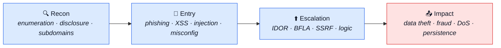

# Web attacks and defences

Every kind of flaw a website can have, and what this codebase does about each one.

One page per attack family. Each page is the same shape: **what the attack is**, in theory and
independent of any codebase — then **how this boilerplate answers it**, with the code and the tools
named. A row that says "no surface" says why, and a row with nothing behind it yet says
🚧 **coming soon** rather than quietly not appearing.

Use it two ways: as a **checklist** when threat-modelling a feature — walk the families and ask
"could this one apply here?" — or as a **lookup**, when you have a name and want to know whether
it is handled. The [alphabetical index](#every-attack-a-to-z) at the bottom is for the second.

## The attack surface in one picture

```mermaid
%%{init: {'flowchart': {'nodeSpacing': 40, 'rankSpacing': 55}}}%%
flowchart LR
    H["🧑 Human<br/><i>phishing · social engineering</i>"]
    B["🌐 Browser<br/><i>XSS · CSRF · clickjacking · XS-Leaks</i>"]
    N["🔌 Transport<br/><i>TLS · smuggling · cache poisoning · DoS</i>"]
    A["⚙️ Application<br/><i>injection · auth · authz · logic · files · SSRF</i>"]
    D["🗄️ Data & infra<br/><i>DB exposure · secrets · misconfig · supply chain</i>"]

    H --> B --> N --> A --> D

    classDef human fill:#fef3c7,stroke:#d97706,color:#111827;
    classDef client fill:#ddd6fe,stroke:#7c3aed,color:#111827;
    classDef net fill:#dbeafe,stroke:#2563eb,color:#111827;
    classDef app fill:#fee2e2,stroke:#dc2626,color:#111827;
    classDef data fill:#dcfce7,stroke:#16a34a,color:#111827;
    class H human;
    class B client;
    class N net;
    class A app;
    class D data;
```

Every family below sits on one of those five boxes. An attacker rarely stays in one: a phishing
mail (human) leads to an open redirect (browser) that lands on an IDOR (application) that dumps a
collection (data). **Chains are the norm**, which is why a "low" finding is rarely low on its own.

Information disclosure feeds entry, entry feeds escalation, escalation feeds impact. Fixing the
"boring" recon-stage items is what turns a chain into a dead end.

## The families

| Family                                                  | What lands there                                                       | Where this repo stands                                                |
| ------------------------------------------------------- | ---------------------------------------------------------------------- | --------------------------------------------------------------------- |
| [Injection](injection.md)                               | untrusted data interpreted as code — SQL, NoSQL, shell, template, CRLF | closed by one type gate at the boundary                               |
| [Client-side](client-side.md)                           | XSS, CSRF, clickjacking, open redirect — attacks in the browser        | mostly the frontend's; the shared rows are here                       |
| [Authentication](authentication.md)                     | credentials, sessions, JWTs, 2FA, OAuth                                | the most-invested family in the repo                                  |
| [Authorization](authorization.md)                       | IDOR, privilege escalation, forced browsing, workflow bypass           | one app-wide assertion, not a local one per module                    |
| [Business logic, money and payments](business-logic.md) | price manipulation, races, refunds, the PSP                            | closed, except what needs a real processor                            |
| [Files, uploads and paths](files-and-uploads.md)        | traversal, unrestricted upload, image bombs, stored XSS                | three gates in a fixed order                                          |
| [Server-side request forgery](ssrf.md)                  | the server made to fetch an attacker's URL                             | two user-URL paths, both through the guard; every other host is fixed |
| [HTTP, proxies and caches](http-and-caches.md)          | smuggling, cache poisoning, trusted-proxy mistakes                     | the cache is owned here; the proxy is the deployment's                |
| [Cryptography and secrets](crypto-and-secrets.md)       | TLS, password hashing, randomness, secrets at rest                     | never implement a primitive                                           |
| [Information disclosure](disclosure.md)                 | verbose errors, excessive data, logs, metrics                          | the recon stage, and why the boring rows matter                       |
| [Denial of service](denial-of-service.md)               | floods, slow HTTP, ReDoS, unbounded queries                            | bounded here; volumetric is the edge's                                |
| [The data layer](data-layer.md)                         | exposed stores, missing owner scope, cache and queue poisoning         | the filter is compiled, not appended                                  |
| [Infrastructure and configuration](infrastructure.md)   | misconfiguration, headers, containers, the platform                    | a dangerous default stops the boot                                    |
| [Supply chain](supply-chain.md)                         | vulnerable and malicious packages, install scripts, base images        | fewer dependencies is the primary defence                             |
| [The API surface](api-surface.md)                       | zombie routes, bulk export, webhooks, GraphQL                          | the contract IS the API                                               |
| [Real-time and messaging](real-time.md)                 | unauthenticated upgrades, broadcast leakage, brokers                   | one-way SSE closes half the family by construction                    |
| [Email and notifications](email.md)                     | template and header injection, spoofing, bombing                       | closed                                                                |
| [Human and social](human-and-social.md)                 | phishing, pretexting, insider threat                                   | almost nothing is closed by code; the rest is blast radius            |
| [Runtime and language level](runtime.md)                | crashes, `eval`, native memory bugs, env trust                         | bound what reaches native code, and exit on the unknown               |
| [Automation and abuse](automation-and-abuse.md)         | scraping, fake accounts, form spam, CAPTCHA                            | a ladder, off by default, because every rung costs someone            |

## How to read a row

| Cell                       | Means                                                                 |
| -------------------------- | --------------------------------------------------------------------- |
| a control plus a file path | closed, and here is the code that does it                             |
| **No surface: …**          | the feature this attacks does not exist here, and the row says which  |
| **Not this layer — …**     | real, and closed by something outside this repo; the owner is named   |
| 🚧 **Coming soon**         | genuinely open. Not overlooked, not dressed up as mitigated           |
| **Same answer as …**       | one home per control; the link goes to where it is actually explained |

That last one is the rule the whole section is built on: a defence is written down **once**, at the
attack it primarily answers, and every other attack it happens to close links to it. A control
described in four places is a control that will be wrong in three of them.

## Every attack, A to Z

Full detail: [Every attack, A to Z](./a-to-z.md).

## Standard references

| Reference                                                                                       | What it gives you                                                |
| ----------------------------------------------------------------------------------------------- | ---------------------------------------------------------------- |
| [OWASP Top 10](https://owasp.org/Top10/)                                                        | the ten most common web risk categories, revised every few years |
| [OWASP API Security Top 10](https://owasp.org/API-Security/)                                    | the same idea, for APIs                                          |
| [OWASP ASVS](https://owasp.org/www-project-application-security-verification-standard/)         | a verifiable checklist of controls, by level                     |
| [OWASP Web Security Testing Guide](https://owasp.org/www-project-web-security-testing-guide/)   | how to test for each item                                        |
| [OWASP Cheat Sheet Series](https://cheatsheetseries.owasp.org/)                                 | one page of concrete defence per topic                           |
| [CWE Top 25](https://cwe.mitre.org/top25/)                                                      | weakness types ranked by real CVE data                           |
| [CAPEC](https://capec.mitre.org/)                                                               | attack pattern catalogue, the "attack" side of CWE               |
| [MITRE ATT&CK](https://attack.mitre.org/)                                                       | adversary tactics and techniques, beyond the web layer           |
| [PortSwigger Web Security Academy](https://portswigger.net/web-security)                        | hands-on labs for most rows in this section                      |
| [STRIDE](https://learn.microsoft.com/en-us/azure/security/develop/threat-modeling-tool-threats) | six-letter threat-modelling mnemonic                             |

## What this section is not

- **Not a severity ranking.** Impact depends on the chain, not the row.
- **Not complete forever.** New classes appear — HTTP/2 desync and XS-Leaks are both recent.
  Revise when a reference above does.
- **Not automatically true.** Nothing enforces the file paths below structurally. A file that moves
  should update its row in the same commit; a control removed without removing its row here is
  worse than never having written the row.
- **Not the frontend's answer.** The paired Vue repo walks the browser rows on its own
  [Web Attack Defences](https://github.com/Guebbit/boilerplate-vue-frontend/blob/main/docs/understand/web-attack-defences.md)
  page. The rows that need both halves are marked **shared** in [Client-side](client-side.md).

## Read next

- [Security](../security.md) — the tools, keys and budgets, from the operator's side
- [Authorization](../authorization.md) — how permission rules, sets and roles are designed
- [Data protection](../data-protection.md) — the same files under a privacy lens
