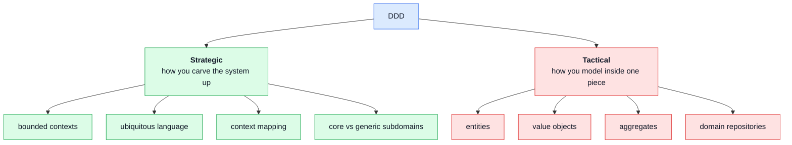
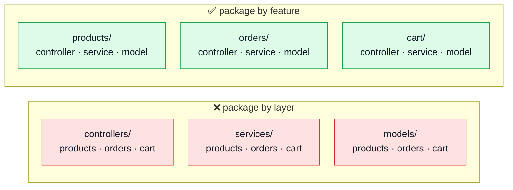
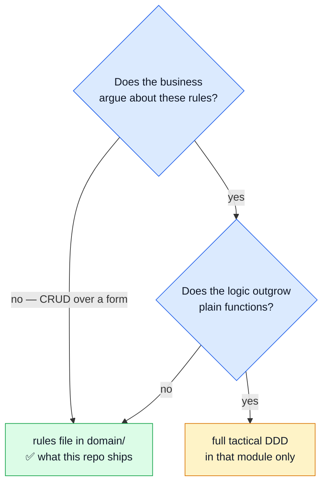

# Domain layer & DDD

Two things, in order:

1. **`domain/`** — the folder, the rule, and where a piece of logic goes.
2. **DDD** — what it actually is, and why it is _not_ the same as this architecture.

---

## 1. The folder

> **A business rule is anything you could test without a database.**
> It goes in `src/modules/<name>/domain/`, as a function that takes data and returns a verdict.

### Where does this go?

### The rule, enforced by lint

### The shape: verdict, not rejection

### Why bother

`src/modules/orders/tests/unit/totals.property.test.ts` runs **each property over `TEST_PROPERTY_RUNS` generated baskets (300 by default), seeded, with no
`setupTestDb`, no `beforeAll` and no mocks** — there is nothing to set up, because the file under
test cannot reach anything. It proves things like _"a total is never `NaN`, for every possible
input"_, which is a claim about all inputs that no table of examples can make. A `NaN` total

### Is this standard?

Yes. A framework-free innermost layer is one of the most agreed-on ideas in software architecture —
four traditions describe the same ring under four names.

### The floor: "testable without a database" is necessary, not sufficient

The question above decides _where_ a rule goes. It does not decide _whether_ there is a rule. A
one-line expression passes "testable without a database" trivially, so the test alone would pull
every ternary in the codebase into `domain/`.

### A 3+-state stored status almost always earns the folder

A 3+-state **stored** status almost always clears the floor, because its allowed moves are a rule: a
transition table catches real bugs a status literal scattered across services cannot.

Full detail: [1. The folder](./domain-layer-folder.md).

## 2. What DDD is

**Domain-Driven Design** (Eric Evans, 2003) is a way of _modelling a business in code_. It has two
halves, and almost everyone means the second when they say "DDD".

**Green = this repo has it. Red = it does not.**

---

## 3. DDD vs feature/domain architecture

These are not the same thing, and conflating them is the usual reason "we do DDD" means "we have
folders named after features".

**Feature architecture is a _packaging_ decision.** Where do files live?

Deleting a feature becomes one folder instead of three edits. **This repo does this, and it is
done.**

**DDD is a _modelling_ decision.** What do the files contain?

|             | Feature architecture           | DDD (tactical)                |
| ----------- | ------------------------------ | ----------------------------- |
| Answers     | _where does this file live?_   | _how is this rule expressed?_ |
| Unit        | a folder                       | an aggregate                  |
| Deliverable | a directory tree               | a model of the business       |
| Alone?      | yes — and this repo largely is | yes, in any tree shape        |

**You can have immaculate feature folders and zero DDD.** That is roughly this repo's position, and
it is a good one — the usual failure is the reverse: elaborate tactical patterns inside a ball of mud.

The overlap is real but partial: a **bounded context** and a **feature folder** often end up being
the same directory, which is why people conflate them. But a bounded context is defined by _where
one model and one language stop being valid_, not by where you put files.

---

## 4. Where this repo stands

**Strategic DDD — adopted, and mostly machine-checked.** Most rows are a declaration in the code with a
check behind it, not a claim about intent. Three have none: the kind label of each context-map edge,
the ubiquitous language and the subdomain table are prose, with no test behind them. See [Strategic DDD](./strategic-ddd.md) for what each one
enforces and what it refuses.

| Concept                | Where                                                                                                                           |
| ---------------------- | ------------------------------------------------------------------------------------------------------------------------------- |
| Bounded context        | one folder per module; `rm -rf` deletes the domain                                                                              |
| Published language     | the module barrel, `index.ts` — lint forbids reaching past it, every module publishes one                                       |
| Context map            | the edges in `module.yaml#dependsOn` (enforced by `npm run check`); each edge's kind and why, in prose on the module pages      |
| Ubiquitous language    | the code's own identifiers, per context — see [Glossary](../reference/glossary.md)                                              |
| Subdomain distillation | the table in [Strategic DDD](./strategic-ddd.md) §4 — a judgement, re-decided per project                                       |
| Domain events          | `kernel/events.ts` — `products` emits, `cart` subscribes                                                                        |
| Domain service         | `orders/domain/totals.ts`, `orders/domain/lifecycle.ts`, `returns/domain/refund-amount.ts`, `invoicing/domain/credit-shares.ts` |

**Tactical DDD — absent, deliberately:**

| Concept                             | Today                                                                   |
| ----------------------------------- | ----------------------------------------------------------------------- |
| Entity                              | none — a Mongoose document is the model                                 |
| Value object                        | `Money` only — `domain-primitives/money.ts`, internal to the arithmetic |
| Aggregate root                      | implicit only                                                           |
| Repository returning domain objects | no — returns `OrderDocument`                                            |
| Invariants at construction          | no — Mongoose schema validators, plus the lifecycle table on the writes |

One tell: the `__v` conditional write in `cart/services/checkout.ts` is **aggregate versioning**,
hand-rolled because there is no aggregate to hang it on. The need is real; only the vocabulary is
missing.

`Money` and the lifecycle table are the two cheap tactical patterns that pay for themselves without an
aggregate — plain data with functions in front of it, placed wherever the rule lives. See
[Tactical DDD](./tactical-ddd.md) for why those two and nothing else.

---

## 5. Should you go further?

DDD's own doctrine: spend the modelling effort on the **core domain**. The effort follows the logic,
and the subdomain label is the first guess at how much logic there will be
([strategic §4](./strategic-ddd.md#_4-subdomain-distillation-—-where-to-spend-effort)). A boilerplate
cannot know where a real project's logic will grow, so it ships the cheap option and leaves the
expensive one one folder away.

The expensive option is an aggregate root, a repository returning domain objects instead of
`OrderDocument`, and invariants enforced at construction rather than by a Mongoose schema
validator — worth the redesign only once a real core domain argues, by hand, about rules the
`domain/` folder's plain functions can no longer keep straight.

## Read next

- [Layers](./layers.md) — the folder map
- [Modules](./modules.md) — the tier rules and their naming
