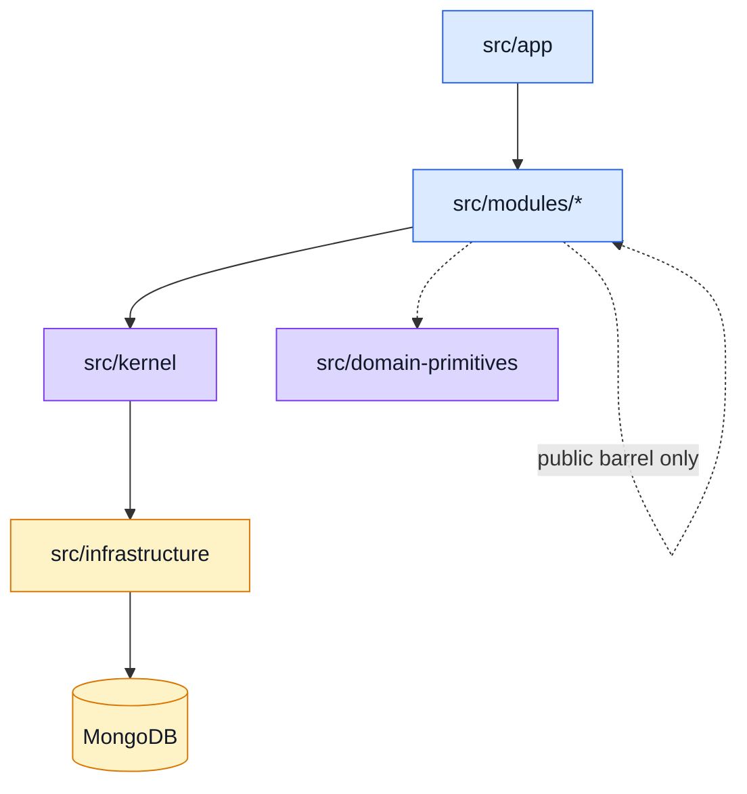
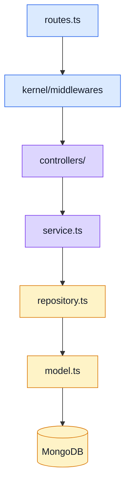
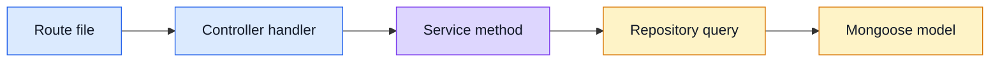

# Layers

This page is the **folder map**.
Use it when you want the exact implementation path without reading every source file.

There are two axes, and confusing them is the usual source of "where does this go?":

- **tiers** decide what a file is allowed to know — `infrastructure` never knows that modules exist,
  `kernel` knows they exist but never which ones, a module knows exactly one domain;
- **layers** decide what a file does within its domain — route, controller, service, repository,
  model. A module contains all five.

## Tier stack

The rule, enforced by `eslint-plugin-boundaries` in `eslint.config.ts`:

- `infrastructure` imports nothing above it;
- `kernel` may import `infrastructure`, never a module and never `app`;
- a module may import `infrastructure`, `kernel`, and **only the public barrel** of another module —
  `@modules/<name>`, never `@modules/<name>/service` — and never `app`;
- `app` may import anything: it is the tier allowed to know which domains exist;
- `domain-primitives` imports npm only (not `@types`, not a module), and every tier — a module's
  `domain/` folder included — may import it;
- nothing outside a module imports its internals.

### The rulebook: one small shared kernel

The rulebook is Domain-Driven Design as Evans (_DDD_, 2003; _DDD Reference_, 2015) and Vernon
(_Implementing DDD_) write it, applied the way the reference modular monoliths do it.

1. Each module owns its rules and its data. Others reach them only through its barrel or service.
2. The only shared code is a **Shared Kernel** (Evans): small, at the bottom, no business words,
   npm only.
3. Test for entry (Milan Jovanović): if removing it breaks only one module, it does not belong there.
4. Core's kernel is `src/domain-primitives/`. There is no second kernel; money stays in it.
5. Same-looking code in two modules stays where it is unless it is the same knowledge (DRY).

| Not here                                                        | Why                                                                                  |
| --------------------------------------------------------------- | ------------------------------------------------------------------------------------ |
| `checkShipLines` (delivery) and `checkRequestedLines` (returns) | Same shape, different knowledge: each module owns its "what remains". A coincidence. |

Three things share the word "kernel", and they are different:

- `src/domain-primitives/` is what modular-monolith guides (Ardalis, Milan Jovanović) call the Shared Kernel.
- `src/kernel/` is the module glue: the module system and the authn/authz every guard shares.
- The account and users "shared kernel" is Evans' original two-context sense
  ([Strategic DDD](./strategic-ddd.md)).

The kernel is **Mongo-only**, on purpose: `kernel/access/query.ts` compiles a caller's rules into a
Mongo filter (`@casl/mongoose`), and `kernel/outbox.ts` is a Mongoose model written inside a
Mongo transaction. A different store means replacing those two files, not configuring them.

Two things hold that beyond what a per-file rule can see:

- **Nothing is permitted by default.** `boundaries/dependencies` runs `default: 'disallow'`, so an
  edge no policy names is refused — the permitted arrows above are stated, not assumed. A tier
  added to the element list without rules can import nothing until its rules are written.
- **`boundaries/no-unknown-files`** refuses a file under `src/` that belongs to no tier at all. A
  new top-level directory therefore cannot sit outside the walls unnoticed; together with the
  default above this is what makes them exhaustive instead of merely present.
- **`npm run check`** ([dependency-cruiser](../build/dependency-graph.md)) asks the
  transitive form of the same questions: not "does this file import mongoose" but "can this tier
  reach it at all", plus cycle detection, which no per-file rule can perform because no file in a
  cycle is doing anything wrong on its own. It is a structural check, not a behavioural one, so it
  runs beside `lint` and the other `check:*` steps in `npm run complete` — never inside `npm run
test`, which is Jest suites only.

Two modules that each need the other are not a dependency pair. Either they are one module, or the
reverse edge becomes a domain event — see `src/kernel/events.ts`, and the catalogue/cart pair for
the worked example.

## Layer stack, inside one module

## Quick map

### `scenarios/` — outside the tiers, one direction only

`scenarios/` is outside `src/` entirely and inverts the usual rule: it imports a module's
repository, model and factories directly — `@modules/<name>/repository`, never the barrel — which
is exactly what `src/` itself may never do to a sibling. That inversion is what lets a production
image omit the whole folder: nothing under `src/` reaches into it, so nothing there notices its

### When `service.ts` becomes `services/`

A module's service starts as one file and stays one file for as long as reading it top to bottom is
practical. Past roughly **300 lines** it stops being practical, and the sanctioned move is a
`services/` folder with an `index.ts` — not a second module, and not a `helpers.ts` on the side. <!-- doc-paths:ignore -->

### And `domain/`, if the module has rules

A module may also carry `domain/` — pure business rules, lint-guaranteed free of Express, Mongoose
and every tier. About half the modules have one; the rest do not, and that is the correct state rather than a gap.

### A port does not have to be infrastructure

`adapters/image-store` is the familiar shape: an interface and an implementation, ready for a
second — nothing selects between them yet, on purpose, since a switch offering one nobody wrote
would only invite a guess at what going live needs. The tier is not part of the pattern. **A module
may own a port of its own, in `providers/`**, when the thing behind it is its business rather than

Full detail: [Quick map](./layers-quick-map.md).

## How to read a feature

### Example from this repo

For a product flow you usually move through:

- `src/modules/products/routes.ts`
- `src/modules/products/controllers/*`
- `src/modules/products/services/*`
- `src/modules/products/repository.ts`
- `src/modules/products/model.ts`

All five sit in one folder, which is the point: the flow is readable without leaving the directory,
and deleting the directory deletes the domain.

That same shape is the real value of the boilerplate.
The entity names are examples.

### Adding a domain

One folder under `src/modules/` with a `module.ts`, plus its registration in `src/modules.ts`, and at most
three hand-kept lists ([the central edits](../build/module-scaffolder.md#the-central-edits)).

Every module gets an `index.ts`, structurally, whether a sibling imports it today or not — a
convenience barrel (`export *` from services, domain rules, events and emails, plus `export type *`
from the model) (not the narrower "only what a sibling needs" rule);
see [Strategic DDD §5](./strategic-ddd.md#_5-published-language-—-the-barrel) for the trade. A
module with nothing to publish yet still gets one, just an empty one — `antibot` is the case — and
an empty barrel forbids import as structurally as no barrel would.

### Removing a domain

`rm -rf src/modules/<name>` and delete its line from `src/modules.ts`. Whatever then fails to
compile is a real dependency another module declared on it, which is exactly what you want to see.

## What each layer should not do

- Routes should not hide business logic.
- Controllers should not become query-heavy.
- A queued mail, an audit record, an analytics event and a domain event are published from the service layer: a controller, `repository.ts` or `model.ts` importing `enqueueEmail`, `recordAudit`, `emitAnalyticsEvent` or `emitDomainEvent` is a lint error (`no-restricted-imports` in `eslint.config.ts`), so a job calling the same service inherits the effect.
- Services should not depend on Express response objects.
- Repositories should not decide HTTP status codes.
- Models should not know route behavior.

## Why this is useful

- easier tests
- easier refactors
- easier stack swaps later
- easier onboarding when ADHD brain wants clear buckets

## Observability in one paragraph

Three signals, only one wired end-to-end by default:

- **Traces** ([Tempo](../operate/tempo.md), via [OpenTelemetry](../operate/opentelemetry.md)) — the timeline of one request, every DB and Redis call, every error.
- **Logs** ([Winston](../operate/winston.md) → stdout) — slim per-request access logs and error logs, each carrying the `trace_id` that links back to a trace.
- **Metrics** (`/observability/metrics`, opt-in) — [Prometheus](../operate/prometheus.md) exposition for HTTP rates/latency and a few business counters.

When something breaks, the log line gives you a `trace_id`, you paste it in [Grafana](../operate/grafana.md) → Tempo, and you get the full picture.

Those are the three that leave the process. The application emits four more — audit, analytics, the SSE metrics feed and queue jobs — and [Events & Logging](events-and-logging.md) is the map of all seven and when to use which.

## Why persistence stays behind the repository {#persistence-behind-the-repository}

`local/no-persistence-imports` enforces it at the import, because that is where it stops being
true. A collection has exactly one door, `repository.ts`, which owns the query shapes and the
mapping from documents to plain data. A second door is why a field rename in `model.ts` turns into
a hunt through callers, why a lean/hydrated mix-up survives review, and why `orderModel.updateOne`
ends up running from a service with none of the repository's guards around it.

The violations arrive by two routes, and neither one sees the other:

1. **By name.** `import { userRepository } from '@modules/users'` comes through a barrel, so the
   path is innocent and only the binding gives it away. The rule reads the IMPORTED name as well
   as the local one, so `import { userModel as Users }` is the same import wearing a hat.
2. **By path.** `import type { UserRecord } from '../model'` names nothing suspicious, but the file
   it comes from is the schema. Only the specifier catches this one.

`import type` counts. A type-only import erases at runtime, which is the argument for letting it
through and the reason it is not: the type IS the schema. A layer naming `UserDocument` has the
storage layout in its signatures and changes when the collection does. The coupling the rule is
about is the one that survives erasure.

The suffixes and the path check are options, because "too close to storage" is a per-layer
verdict: a service holding a repository is the design, a controller holding one is a tier
violation. The config states each layer's answer beside its reason, and the defaults are the
strict reading.

## Related pages

- [Architecture](./architecture.md)
- [Domain Layer](./domain-layer.md) — where a business rule goes, and the `domain/` folder
- [Request Flow](./request-flow.md)
- [Runtime](runtime.md)
- [API overview](../build/api-contracts.md#rest-patterns-used-here)
