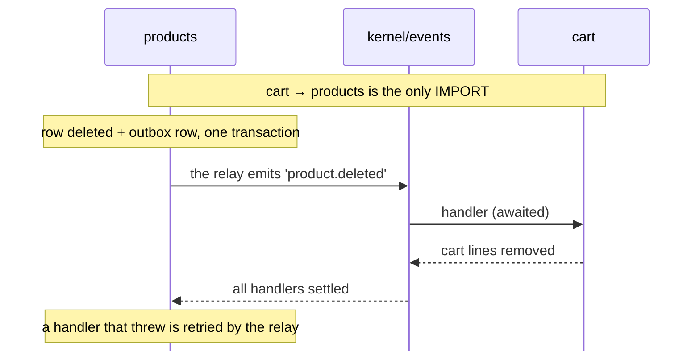
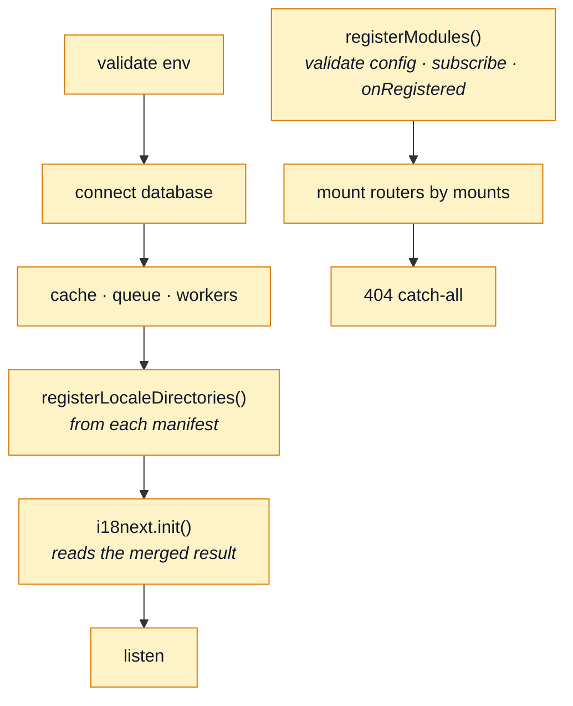

# Modules: the dependency graph and boot order

Who may import whom, and the order modules start in.

## The dependency graph

::: tip The graph itself lives on one page, generated
Every edge, and every node's `reaches`/`reached by` row, is generated from the manifests on
[the Modules overview](../modules/start.md#the-map) — that page is the census; a second, hand-drawn
one here would only go stale. What follows is the **rules** the generated graph obeys, read through
today's shape as an example.
:::

Every arrow is an import across a module boundary, through the target's barrel. `cart` is the
busiest node on the graph — its edges are on [the map](../modules/start.md#the-map) — and that is not
a smell to refactor away: a checkout is the one operation that genuinely needs the catalogue, the
customer, the order it becomes, the method and address it ships to, and the payment that settles it.
`access` and `shop` sit at the opposite end: reached by several modules, `access` reaching none and
`shop` only `account`.

`inventory` is worth reading as a shape rather than a node. It sits one level above `products`, and
`cart`, `orders`, `delivery`, `returns` and `shop-tasks` depend on it, because it owns the only
writes to the three stock counters (`onHand`, `reserved`, `backordered`): `cart` reads what can be
sold, `orders` holds, commits (inside `markPaid`), ships and releases units, `returns` puts received
goods back, and `delivery` and `shop-tasks` listen to its events.

The reverse direction is domain events, and it is a **separate** graph on purpose — an event edge is
exactly the edge that would have made the import graph a cycle:

| Event                           | Emitted by  | Handled by                   |
| ------------------------------- | ----------- | ---------------------------- |
| `inventory.reservation_expired` | `inventory` | `orders` (cancels the order) |

That is one example. Every module page's generated neighbourhood graph (see
[the Modules overview](../modules/start.md)) draws its own event edges as dotted arrows.

A user's hard delete is deliberately not in this table: it is not an event. Each module declares a
`personalData.erase` hook and `users` runs them all inside one transaction, so a failing eraser
aborts the whole erasure instead of being logged and skipped. The inactivity job's
`personalData.minimise` hooks are the same shape without the transaction: each is idempotent, and
the account is stamped minimised only once every hook succeeded, so a failure is retried next night.

Note who emits: every one comes from a module low in the import graph telling a module above it
something, because a module cannot import its own dependants. `inventory.reservation_expired` is the
clearest case — the sweep releases the units itself and needs nobody's help for that, but cancelling
the order behind the hold belongs to `orders`, which already imports `inventory`. An import back
would be the cycle dependency-cruiser's `no-circular` refuses, so it is announced instead.

There is deliberately **no** stock event. A ledger row written as a REACTION to a counter change
would depend on every mover announcing it on every path, rollbacks included, and a counter change
nobody recorded is a corrupt audit trail. The row is written by the same function call that moves
the counter, so it cannot be forgotten.

Every solid arrow is also one of four **kinds** — `conformist`, `customer-supplier`,
`published-language` or `shared-kernel` — though nothing on the map labels which; naming the kind
is what turns "who touches `products`?" into "what does changing `products` cost?" — see
[Strategic DDD](./strategic-ddd.md) for what each one means and how to tell them apart by hand.

That pairing is the answer to mutual need. Deleting a product must empty it from every cart, while
the cart needs the catalogue to price a line. As imports that is a cycle; as one import plus one
event it is a straight edge:

Handlers are **awaited in registration order** within one delivery. `product.deleted` rides the
[transactional outbox](outbox.md), so the event is written with the delete and the relay
delivers it right after the commit; a handler that throws leaves the row pending and the relay
redelivers, so every handler must be idempotent. On the plain bus a throwing handler is logged and
does not fail the emitter — a listener must not roll back an operation that was already authorised.

### The bus is not transactional, and must not be made so

That last sentence has a consequence worth stating outright, because it looks like a bug the first
time you meet it: if cart cleanup throws while a product is being hard-deleted, **the product is
still deleted and the orphaned cart lines stay**.

This is deliberate. The emitting module cannot reason about the failure modes of code it has never
heard of, and a subscriber must not be able to veto an operation it never authorised.

**The thing to not do:** if a future flow needs cross-module cleanup to be all-or-nothing, this is
the wrong primitive and must not be bent into one. Awaiting handlers inside the emitter's
transaction makes every subscriber a participant in a transaction it cannot see — which is how the
dependency arrow this bus exists to remove comes back, pointing the other way. Either that cleanup
belongs in the owning module, or the two modules were one module.

## Boot order

Two orderings are load-bearing: locale directories must be registered **before** `i18next.init()`,
which reads the merged dictionaries; and `registerModules` must run **before** the first route
exists, so every subscription is attached before anything can emit.

## Read next

- [modules](./modules.md): the hub this page belongs to.
