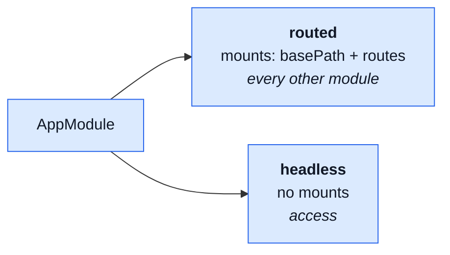

# Modules: the template and the manifest

What a new module copies, what it owns and how it declares itself.

## The module template

`src/modules/example` is this template in code: the module to copy when you start a new domain, and
to delete once you have your own. It is only an example, which is why it has no page under
`docs/modules/`: a page would restate files that are better read. It has its own group
(`module.yaml#group: example`), so `npm run demo:remove` deletes it with the shop, nothing may import it, and it
imports only the foundation (it reads the owner's name through the `users` barrel).

The table above lists what a module MAY have; this is the same shape as one block, with the
question that decides each optional row attached to it directly, and the house rule each row is
downstream of:

```
src/modules/<name>/
  module.ts module.yaml index.ts tests/        ALWAYS
  openapi.yaml routes.ts controllers/          IF it serves HTTP (surfaces/* factory first)
  service.ts                                   DEFAULT for a module with no per-record `actions`
  services/<use-case>.ts                       REPLACES it past ~300 lines, ~12 members, or two audiences;
                                               the scaffolder starts here: crud.ts + actions.ts + index.ts
  model.ts repository.ts                       IF it owns a collection; every conditional write is a named repository method
  domain/                                      IF a rule is worth a unit test; a 3+-state stored status almost always has one
  events.ts                                    IF it emits: past tense or a reached-state word, emitted AFTER the write, with an id (naming: asyncapi-workflow)
  audit/analytics/metrics/probes/rate-limits/config/emails.ts   IF there is something to declare
  providers/                                   IF it owns a port to an outside service (an ACL)
  presenter.ts                                 IF it serves HTTP and owns a model — see below
  factories.ts locales/ asyncapi.yaml          IF needed
```

A handler file in `controllers/` starts with the HTTP method it serves (`get-`, `post-`, `put-`,
`patch-`, `delete-`), or with `update-` for a PUT + PATCH group; the subject comes before the verb
(`post-account-restore.ts`, `post-subscription-enable.ts`). A factory group may share one file
(`get-stats.ts` holds eight handlers), and a helper that is not a handler (`respond.ts`,
`send-pdf.ts`) keeps its own name. A read of the whole collection is `get-<xs>.ts` and a read of
one record is `get-<x>.ts` (`get-orders.ts` / `get-order.ts`): the pair the scaffolder writes.
Never `get-<x>-item.ts` or `get-<x>-by-id.ts`; the exported handler keeps the operationId's name.

`routes.ts` and `controllers/` say "IF it serves HTTP", not "write them by hand": a controller is a
short spec against one of the five shared factories in `infrastructure/surfaces/` (list, item,
search, update, delete/restore) before it is anything else — see
[Request Flow](./request-flow.md) for what each factory owns, so that a new endpoint states its
differences from the shape instead of re-deriving it. `service.ts` REPLACES itself with `services/`
past a size the module itself measures, not a line this page enforces twice —
[Layers](./layers.md#when-service-ts-becomes-services) has the actual thresholds and the split this
repo has used every time.

### Standards the template carries

Each standard is written once, in the page that owns it, and carried by `example` and by what
`npm run scaffold:module` writes. A new module that copies either one gets all of them; a change to
a standard lands in the owning page, the template and the scaffolder in the same commit.

| Standard                                       | Written in                                                                                | Carried as                                                    |
| ---------------------------------------------- | ----------------------------------------------------------------------------------------- | ------------------------------------------------------------- |
| `actions` on every read and write              | [Capabilities](./tactical-ddd.md#_2-capabilities-the-server-answers-what-a-client-may-do) | `domain/` rule, `services/actions.ts`, required in the schema |
| A status change is a door, one per event       | [Write methods](write-methods.md#action-→-200)                                            | `POST /x/{id}/<event>`, never a field of PUT/PATCH            |
| A refused lifecycle move is 409 + a code       | [Write methods](write-methods.md)                                                         | `x-error-codes` entry, `details {status}`                     |
| A resource with an item write has an item read | [Write methods](write-methods.md#an-item-write-has-an-item-read)                          | `GET /x/{id}` through the item factory                        |
| Every file opens with its role                 | `CLAUDE.md`, Comments                                                                     | the scaffolder's twin-header test against `example`           |

### Optional capabilities, and the files that carry them

The core is what every module has. Each capability below is one manifest entry plus its own files,
so it can be added or dropped alone. `example` shows each one; delete the files in the middle
column, and the manifest entry, to drop it.

| Capability                 | Files (all in `src/modules/example/` unless said)                                   | Manifest entry                         | What `example` does with it                                                                                                                                         |
| -------------------------- | ----------------------------------------------------------------------------------- | -------------------------------------- | ------------------------------------------------------------------------------------------------------------------------------------------------------------------- |
| Events and a subscriber    | `events.ts`, `services/notify.ts`                                                   | `subscribe`                            | publishes `example.published` on the outbox; its own mail listens                                                                                                   |
| Mail                       | `emails.ts`, `templates/`                                                           | the manifest's `templates`             | mails the owner when an example is published                                                                                                                        |
| Rate limits                | `rate-limits.ts`                                                                    | `rateLimits`                           | a budget on creating examples                                                                                                                                       |
| A public webhook           | `events.ts`, the module's own `asyncapi.webhooks.yaml`                              | `publicEvents`                         | an `example.published` webhook                                                                                                                                      |
| Translatable fields        | the `locales` port's methods on `repository.ts`                                     | `translatables`                        | the title, per language; `fieldRules` is the title as its own PATCH contract bounds it                                                                              |
| An uploaded image          | `services/cover.ts`, `controllers/put-example-cover.ts`, the route and path         | `imageTargets`                         | a cover image                                                                                                                                                       |
| A typed setting            | `config.ts`                                                                         | `config`                               | the longest body an example may have                                                                                                                                |
| Demo records               | `scenarios/example.ts`, found by `npm run regenerate`                               | (the scenario table)                   | a few seeded examples for the demo profile                                                                                                                          |
| Metrics, probes, analytics | `metrics.ts`, `probes.ts`, `analytics.ts`                                           | (found by name, not declared)          | one counter, one probe, one event                                                                                                                                   |
| Personal data              | `services/personal-data.ts`                                                         | `personalData` (`collect` and `erase`) | exports and erases the person's examples                                                                                                                            |
| An action endpoint         | `services/transition.ts`, `controllers/post-example-event.ts`, the routes and paths | (the route)                            | `POST /examples/{id}/publish\|archive\|unarchive`, one door per event; the write is conditional, so of two racers one lands (409 for the other)                     |
| Capabilities (`actions`)   | `services/actions.ts`, `domain/lifecycle.ts`, `presenter.ts`                        | (on the wire)                          | each row carries what this caller may do: its moves (an event table built with `defineLifecycle`), edit, delete - computed per row by `permitsOnRows` in the kernel |
| An idempotent create       | `idempotencyKey` in `routes.ts`                                                     | (the route)                            | a retried `POST /examples` with the same `Idempotency-Key` replays the first answer                                                                                 |

Left out on purpose, with the module that really needs each: `rawBodyPaths` (`payments`: a signed
body), `consumers` (`webhooks`: a queue), a config slice's own `check` (`account`'s session and OAuth
settings, `payments`) and `onRegistered` (`locales`, `account`).

Four rules the table above cannot show, because each is about how a file BEHAVES rather than
whether it exists:

1. **Effects live in the service.** A controller reads input and calls one service method; a
   repository issues one query. Neither may decide to send an email, emit an event or record audit
   (bar the few handlers that argue an exception in place, listed in [Request Flow](request-flow.md)) — a rule enforced at both ends would drift the moment one side changed alone, and a controller
   or repository is exactly the layer a future edit reaches for first because it is where the
   request or the query already is. The service is the one place that has BOTH the business
   decision and the authority to act on it, so it is the only place a side effect is written down
   once.
2. **Every multi-document write sequence names how it survives failure.** A write that touches two
   collections (or a collection and a queue) can be interrupted between them by nothing more exotic
   than a process restart — and "it usually finishes" is not a survival strategy, it is an untested
   one. Name which of the three this sequence uses: one atomic write (a single `updateOne`, or a
   Mongo transaction across the two), OR a durable marker plus a **scheduled** sweep that finishes
   what the request started (`inventory`'s reservation-expiry sweep is this shape). A retry loop
   inside the request is not a fourth option — it still leaves the marker-less gap if the process
   dies mid-loop.
3. **A version guard moves on every write.** `updateOne({ _id, version }, { $set: ..., $inc: {
version: 1 } })`, never a plain `findByIdAndUpdate` — a version that does not move on every write
   is a version field that only decorates the document, since two concurrent writers reading the
   same version and racing to save would otherwise both "succeed", the second silently discarding
   the first's write with no error either side can see. Moving it inside the SAME filtered write
   (not a separate check-then-write) is what makes the race impossible rather than merely unlikely.
4. **One presenter per module.** Without it, a controller reaching for its own
   `document.toJSON() as SomeResponse` cast, ad hoc, once per call site, would still have the
   compiler enforce the OUTPUT type — but nothing would enforce that two call sites for the same
   resource agree on how they got there, and a sibling wanting the same shape would find it cheaper
   to copy the cast than to ask. `presenter.ts` is the fix: one pure function per resource
   (`presentProduct(document): Product`), the single place a Mongoose document becomes the wire
   shape, replacing every ad hoc cast in that module's own controllers. The cast is a narrowing,
   not a claim: `toJSON` (`persistence/serialize.ts`) turns every date and ObjectId into text after
   the model's own step, so a presenter's output already holds the text the API type says. The
   lean/list path keeps its date objects. A sibling reaches the
   transform through the owning module's SERVICE, the same door it already uses for a repository
   read — never the presenter file directly, never the wire-shape cast, and never the repository,
   which the [barrel rule](./strategic-ddd.md#_5-published-language-—-the-barrel) already refuses.
   A type import from a sibling's barrel (`export type * from './model'`) is not a leak: it is
   compile-time only, carries no runtime value and writes nothing. What a sibling may not do with
   that type is write through it — no `.save()`, no mutation of another module's document; the
   service is the door for a write. That half is held by this rule, not by the compiler. Only the
   presenter's OUTPUT TYPE may leave the barrel, as
   `export type *`, the same treatment `model.ts` already gets — `barrel-allowed-sources` checks
   both. A module presenting more than one resource shape (webhooks: subscriptions AND deliveries;
   locales: a language AND its entries) uses `presenters.ts`, plural, one function per resource
   inside it; a module whose only shaping is a handful of identical call sites still gets the file
   — the point is one canonical transform, not a line-count minimum.

## Libraries a module owns

A `package.json` dependency is a bounded context's business the same way a collection is, once
exactly one module imports it:

- **The owner is whoever imports it.** One module → that module. Several → `infrastructure`,
  behind an adapter, or the kernel — [the same line](./modules.md#the-infrastructure-kernel-line) this page
  already draws for a substrate concern.
- **Another module needing it asks the owner's public `index.ts`**, not the library. If two
  modules genuinely need the library itself, it moves down to `infrastructure` behind a port.
- **Deleting a module removes the libraries it owned** from `package.json` — see
  [Adding & Removing a Module](../build/module-lifecycle.md#removing-a-module).
- **Adding one** runs the vetting rules in [Dependency Vetting](../build/dependency-vetting.md)
  first, same as any other dependency.

None of this is hand-kept. [Package Dependencies](../reference/package-dependencies.md) derives who
imports what straight from the source tree, and a module that owns one gets a `## Libraries`
section on its own page — why this library, what was rejected — the same shape
[`antibot`](../modules/antibot.md#choosing-a-provider) already uses to justify its provider choice.

## The manifest

```ts
export default {
    name: 'orders',
    mounts: [{ basePath: '/orders', routes: router }],
    locales: path.join(__dirname, 'locales')
} satisfies AppModule;
```

Every field is read by something: each router in `mounts` is mounted at its `basePath`, `locales` is handed to
i18next, `subscribe` attaches the module's event handlers, `onRegistered` runs once every module is
known — installing a kernel port, or resolving a cross-module lookup like `locales`'
`translatables`. That is the bar for a field being here at all. The subdomain and the `dependsOn` graph live next to
the manifest, in the module's own `module.yaml` — one plain file, read by `.dependency-cruiser.cjs`
as the enforced allow-list behind `npm run check`, not by the app at runtime — see
[Strategic DDD](./strategic-ddd.md) §2 and §4. Demo data is not on the manifest either:
`scenarios/<module>.ts` reads a module's repository and factories directly.

`mounts` is optional, so a domain that owns data but no URL is an ordinary
entry rather than a special case — `access` declares none and `app/routes.ts` mounts only
what a module lists. A mount is a pair, `{ basePath, routes }`, and a module may list several:
`delivery` serves `/delivery` and also `POST /orders/{id}/process` at `/orders`; `payments` serves
`/payments` and also `POST /orders/{id}/payments`:



`AppModule` is a plain interface with `mounts` optional. A mount carries its `basePath` and its
router together, so a router with no mount point cannot be written; a module with no mounts is
skipped by `app/routes.ts` rather than reported.

**Keep it small.** A field only one module fills does not belong here — that module should do the
thing itself. `subscribe` passes the bar: several modules fill it.

## Read next

- [modules](./modules.md): the hub this page belongs to.
