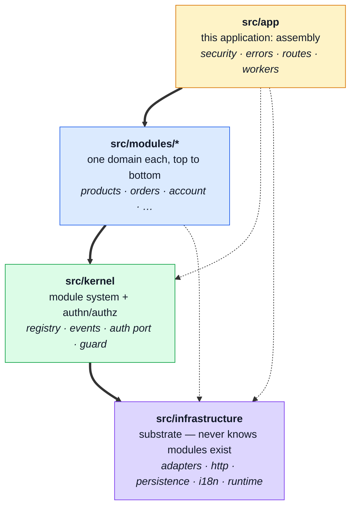
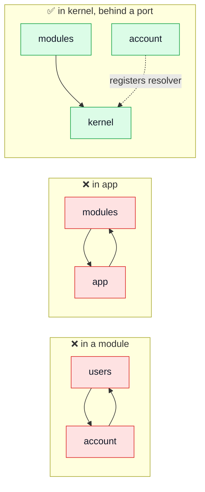
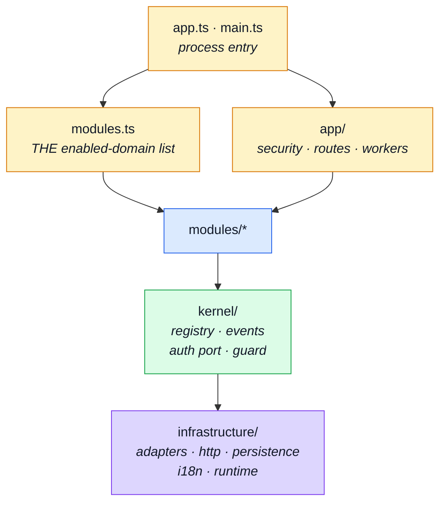

# Modules: the four tiers

Which tier a module sits in, and what each tier may reach.

## The four tiers

**Every arrow points down, and none points back.** That is the whole architecture. A tier may import
anything below it and nothing above it, and lint enforces each edge in both directions.

| Tier               | Folder               | Knows about                                | May import             |
| ------------------ | -------------------- | ------------------------------------------ | ---------------------- |
| **App**            | `src/app`            | this application: how it is assembled      | modules, kernel, infra |
| **Modules**        | `src/modules/<name>` | its own domain, plus siblings' **barrels** | kernel, infra          |
| **Kernel**         | `src/kernel`         | that modules exist — never _which_ ones    | infra                  |
| **Infrastructure** | `src/infrastructure` | Express, Mongoose, the outside world       | —                      |

### The `infrastructure` / `kernel` line

This is the boundary people trip on, so it gets one question and no adjectives:

> **If this project had no modules at all — if it were one undivided app — would this file still
> make sense?**

- **Yes, it still works** → `infrastructure`.
- **No, it becomes meaningless** → `kernel`.

`infrastructure` is not "framework-free" — it is the opposite. Dozens of files there import Express
or Mongoose, which is exactly right: `infrastructure/http/response.ts` is Express-coupled
substrate and belongs where it is. The one thing it may never contain is the knowledge that a
module system exists.

It also may not hold a **business rule**, even one that two modules share. That is the trap this
tier invites, because "two modules need it" feels like a reason to push something down. It is not:
the substrate is what the application runs ON, and none of it knows what an order or a price is. A
shared rule belongs to whichever domain OWNS it, exported through that module's barrel — see
`src/modules/orders/domain/totals.ts`.

So `kernel` holds only what would lose its reason to exist if modules did — which today is NOT
just the module system machinery (`registry.ts`, `events.ts`): most of its code is the authn/authz surface every module's guard shares. That is a real weight,
not an oversight — the table below is what earns each file its place, module system or not:

| File                            | Why it cannot be infrastructure                                                                                     |
| ------------------------------- | ------------------------------------------------------------------------------------------------------------------- |
| `registry.ts`                   | it _is_ the module system — `AppModule`, `registerModules`                                                          |
| `events.ts`                     | it exists so two modules can talk without importing each other                                                      |
| `authentication.ts`             | the socket `account` plugs into, so guards need no module import                                                    |
| `middlewares/authorizations.ts` | the guard that consumes that socket                                                                                 |
| `permissions.ts`                | the declared keys and preset roles, read off the shared YAML the PHP twin reads                                     |
| `ability.ts`                    | a resolved caller's rules, built once per request from what `permissions.ts` declares                               |
| `access/query.ts`               | a caller's rules turned into the Mongo filter that enforces them, so no module writes its own                       |
| `access/tenant.ts`              | the one shop's pinned `_id`, needed by `permissions.ts` before `@modules/access` can be imported                    |
| `module-config.ts`              | the boot-time gate collecting every module's — and no module's — configuration slices                               |
| `config.ts`                     | the kernel's own variables: step-up windows and the outbox retry policy                                             |
| `cookies.ts`                    | the session cookie's name and reader, which the auth port and the SSE-only path both consume                        |
| `outbox.ts`                     | the transactional outbox: an event written with the state change it announces, published after by a relay           |
| `staff-read.ts`                 | the audit entry for staff reading someone else's record, shared by every module's detail reads                      |
| `translation.ts`                | the hook `modules/locales` answers, so a decorator can resolve content without importing `src/modules/*`            |
| `middlewares/locale-preview.ts` | the staff preview of a draft language's product text, needing the caller the auth socket resolved                   |
| `*.generated.ts`                | `outbox.generated.ts` and `step-up.generated.ts`, written from the shared rules ([shared rules](./shared-rules.md)) |

The seed accounts' ids and credentials — the two demo identities `users`, `orders`, `cart` and
`wishlist` each point at — are NOT here: they are pure scenario data, owned by none of the modules
that need them, so `scenarios/accounts.ts` holds them outside `src/` entirely rather than in the
kernel. A sibling gets what it needs to name a person without taking on the shape of a user, the
same inversion as the auth port; the file's own header carries the full argument.

Delete `src/modules/` and every file in the table above loses its reason to exist. Everything else
that is domain-free is `infrastructure`, no matter where it sits in the request lifecycle:

| Feature                     | Home                                                | Why it is not kernel                                                                         |
| --------------------------- | --------------------------------------------------- | -------------------------------------------------------------------------------------------- |
| response cache, `noStore`   | `infrastructure/http/middlewares/cache.ts`          | Express caching; no module needed                                                            |
| locale negotiation          | `infrastructure/http/middlewares/locale.ts`         | wraps `infrastructure/i18n`; no module needed                                                |
| observability context       | `infrastructure/http/request.ts`                    | built per request, not seeded by a middleware                                                |
| access logging              | `infrastructure/http/middlewares/request-logger.ts` | reads tracer + metrics labels                                                                |
| rate limiting               | `infrastructure/http/middlewares/rate-limit.ts`     | generic HTTP hardening                                                                       |
| Prometheus scrape guard     | `src/modules/observability/metrics-scraper.ts`      | guards one module's own route, not shared — see [observability](../modules/observability.md) |
| conditional handler toggle  | `infrastructure/http/middlewares/route-flag.ts`     | imports nothing but Express                                                                  |
| email queue consumer        | `infrastructure/adapters/email.worker.ts`           | the consumer half of `adapters/mailer.ts`                                                    |
| worker registration at boot | `app/workers.ts`                                    | names which queues _this_ build drains                                                       |

The test that keeps this honest: a `kernel` file may be imported by a module, but its **purpose**
must dissolve if modules do. Being domain-free is not enough — most of `infrastructure` is
domain-free too.

### Why these names, and what everyone else calls them

Separating a module system from its substrate is a well-established pattern. The **vocabulary is
not**, and that is the whole reason this section exists:

| Project       | The module / DI system | The substrate     |
| ------------- | ---------------------- | ----------------- |
| **VS Code**   | `vs/platform`          | `vs/base`         |
| **NestJS**    | `@nestjs/core`         | `@nestjs/common`  |
| **Angular**   | `@angular/core`        | `@angular/common` |
| **Spring**    | `spring-context`       | `spring-core`     |
| **Backstage** | `core-plugin-api`      | `core-components` |
| **this repo** | `kernel`               | `infrastructure`  |

Read the table for what it actually shows: **`core` names both halves, depending on who you ask.**
Nest and Angular use it for the DI container, Spring and Backstage for the substrate, so this repo
avoids it.

A name needing a disclaimer does negative work: a NOVEL name
makes a reader look it up, an OVERLOADED one makes them think they already know. The second failure
is silent, and it is the expensive one.

`infrastructure` needs no disclaimer. Adapters, HTTP plumbing, persistence substrate and runtime
are what the word means in hexagonal architecture — the tradition this dependency rule already
comes from. `common` and `base` were the other candidates and were rejected for the opposite
reason: they describe nothing, and a folder that describes nothing accepts anything, which is
exactly how a `utils/` becomes a dumping ground.

**`kernel` over `platform`.** VS Code's `vs/platform` is its _service and DI layer_, and to platform
engineering "the platform" is the base layer everything runs on, which is this repo's
`infrastructure`. Read cold, `platform` and `infrastructure` would point at each other's contents.

`kernel` carries none of that. These files are a **microkernel**: a small fixed host that
loads, validates and connects plugins it has never heard of — the pattern under its textbook name.

### Why "app" is a tier and not a leftovers drawer

It holds the things that are allowed to know every domain: how the application is assembled
(security, error handling, routes, workers) and the system route that belongs to no domain. `src/modules.ts` and `app.ts` sit beside it for the
same reason — the registry names every enabled domain, which nothing below it may do.

The test for whether something belongs here: **does it need to know which domains exist?** If yes,
it is `app`. If it needs a domain's _capability_ but not its identity, it is `kernel` with a port.

### The rule that forced the shape

`authorizations.ts` guards every module's routes and needs a user to do it. That is a genuine
tension, and the naive placements both fail:

In `account` it closes a `users → account → users` cycle, because `users`' own admin routes need
`requirePermission`. In `app` it makes modules import upward. So `kernel` declares what it needs —
"turn this token into a user" — and `account` registers an implementation at boot. Same inversion as
`AuditSink` and `ImageStore`. See `src/kernel/authentication.ts`.

### Where everything else sits

**One alias per tier**, so an import line states which tier it crosses: `@app/*`, `@modules/*`,
`@kernel/*`, `@infrastructure/*`. Two leaf folders no tier forbids — `src/domain-primitives` (`@domain-primitives/*`) and `src/types` (`@types`) — import none of them.
`src/domain-primitives` is the Shared Kernel (generic, npm only); `src/kernel` is module glue, a different thing — see [the rulebook](./layers.md#the-rulebook-one-small-shared-kernel).

Two naming details worth knowing:

- **`infrastructure/runtime`** starts the _process's_ resources — database connection, env validation, the
  OTel SDK, signal handlers. No Express anywhere, and not a twin of the app tier's assembly steps.
- **a substrate queue consumer is `infrastructure`, not `kernel`.** Sending an email is a verb, not
  a domain, and does not stop making sense in an app with no modules — so its consumer sits beside
  the adapter it is the other half of. Only `registerWorkers()` is app-tier, because naming which
  queues this build drains is an assembly fact. A domain-owned worker belongs to its module
  instead: `webhooks`' delivery worker does, declared on its own module's manifest rather than
  `app/workers.ts`.

## Read next

- [modules](./modules.md): the hub this page belongs to.
