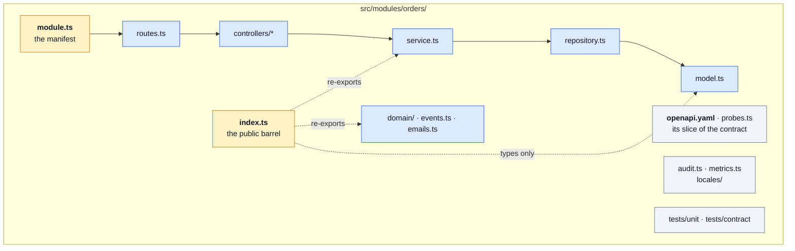

# Modules

A domain lives in exactly one folder. Adding one is a folder plus its registration in `src/modules.ts`, and at most three hand-kept lists
([the central edits](../build/module-scaffolder.md#the-central-edits)); removing one is `rm -rf` plus deleting that registration. Everything on this page exists to make those
two sentences true; [Adding & removing a module](../build/module-lifecycle.md) walks the steps.

> New to the words **domain** and **barrel**? They are defined with a picture each in
> [The words these pages use](./start.md#the-words-these-pages-use).

## The four tiers

### The `infrastructure` / `kernel` line

This is the boundary people trip on, so it gets one question and no adjectives.

### Why these names, and what everyone else calls them

Separating a module system from its substrate is a well-established pattern. The **vocabulary is
not**, and that is the whole reason this section exists.

### Why "app" is a tier and not a leftovers drawer

It holds the things that are allowed to know every domain: how the application is assembled
(security, error handling, routes, workers) and the system route that belongs to no domain. `src/modules.ts` and `app.ts` sit beside it for the
same reason — the registry names every enabled domain, which nothing below it may do.

### The rule that forced the shape

`authorizations.ts` guards every module's routes and needs a user to do it. That is a genuine
tension, and the naive placements both fail.

### Where everything else sits

Full detail: [The four tiers](./modules-tiers.md).

## What a module contains

| File                                                 | Required?                                                                          | What it is                                                                                                                                                                                                                                                                             |
| ---------------------------------------------------- | ---------------------------------------------------------------------------------- | -------------------------------------------------------------------------------------------------------------------------------------------------------------------------------------------------------------------------------------------------------------------------------------- |
| `module.ts`                                          | **yes**                                                                            | the manifest — the only file `src/modules.ts` imports                                                                                                                                                                                                                                  |
| `index.ts`                                           | **yes**                                                                            | the public barrel                                                                                                                                                                                                                                                                      |
| `routes.ts` + `controllers/`                         | only if the domain serves HTTP                                                     | only `access` has neither                                                                                                                                                                                                                                                              |
| `service.ts` · `repository.ts` · `model.ts`          | only if it owns data                                                               | `observability` owns none — it serves URLs over other domains' data                                                                                                                                                                                                                    |
| `services/`                                          | when `service.ts` outgrows one file                                                | see [Layers](./layers.md#when-service-ts-becomes-services)                                                                                                                                                                                                                             |
| `presenter.ts` (`presenters.ts` for >1 resource)     | if it serves HTTP and owns a model                                                 | the one place a document becomes wire shape — see [below](#the-module-template)                                                                                                                                                                                                        |
| `domain/`                                            | only if the module has rules to prove; a 3+-state stored status almost always does | see [Domain Layer](./domain-layer.md#a-3-state-stored-status-almost-always-earns-the-folder)                                                                                                                                                                                           |
| `openapi.yaml`                                       | if it serves HTTP                                                                  | its standalone slice of the REST contract                                                                                                                                                                                                                                              |
| `asyncapi.yaml`                                      | if it owns a channel                                                               | the same, for the async contract — `observability`, `webhooks`, `notifications`; `asyncapi.internal.yaml` (`account`, `webhooks`) and `asyncapi.webhooks.yaml` (`delivery`, `example`, `orders`, `payments`, `returns`) are the same idea for the internal and public-webhook channels |
| `probes.ts`                                          | as needed                                                                          | the requests a spec cannot describe — see below                                                                                                                                                                                                                                        |
| `providers/`                                         | if the domain has an outbound port                                                 | e.g. `payments`, `invoicing` — see below                                                                                                                                                                                                                                               |
| `audit.ts` · `metrics.ts` · `locales/` · `events.ts` | as needed                                                                          | the domain's own slice of each cross-cutting declaration                                                                                                                                                                                                                               |
| `analytics.ts` · `factories.ts`                      | as needed                                                                          | the event names it emits; how its test/demo records are built                                                                                                                                                                                                                          |
| `emails.ts`                                          | only if the domain sends email                                                     | the finished copy of its emails — see below                                                                                                                                                                                                                                            |
| `tests/unit/` · `tests/contract/`                    | yes, in practice                                                                   | deleted with the module                                                                                                                                                                                                                                                                |

The table lists what a module MAY have. What decides **where** in the module a file goes is one
rule, and `account` is the module that forced it to be written down:

> A module root holds the manifest, the barrel, the contract files, the single-file layers and the
> self-registering slots. Everything else goes in a folder named for what it holds.

Under it, `account`'s token surface sits in `session/`, its behaviour in `services/`, and its
collection files are plainly `model.ts` and `repository.ts`. A file at the root is a layer, and a
folder is a subject.

Nothing central enumerates these. `audit.ts`, `metrics.ts` and `events.ts` register or augment
themselves on import; `locales` is declared in the manifest so the i18n boot can walk the registry
without naming a domain.

`probes.ts` is the one row that is not obvious from the name. A generated API collection can only
contain the calls the contract describes, and a contract describes valid calls and their declared
answers — so the requests that prove the API _rejects_ things have nowhere to come from. A module
declares those as data (method, path, headers, body, and a `why` that becomes the description) and
the collection generator emits them after its contract-derived requests. A handful of modules carry one. The generator
finds `probes.ts` files by scanning `src/modules/` (`scripts/contracts/client-collections-bundle.ts`), so there is no list to edit: a
module that writes one is in the collections, and a deleted module simply has none. See
[Contract Ownership & Fragmentation](../build/contract-fragmentation.md#the-client-collections-generated).

`providers/` is a **module-tier port**: the same inversion as `AuditSink` and `ImageStore`, owned
by a domain instead of by the substrate. `payments/providers/` declares what a payment provider must
do, ships no implementation (the `fake` is a test double outside `src/`), and selects one on `NODE_PAYMENT_PROVIDER` — so going live
means writing `stripe.ts` beside it and changing an env var, while the contract, the service and the <!-- doc-paths:ignore -->
frontend hear nothing. It belongs to `payments` and not to `infrastructure` for the reason the
`infrastructure` / `kernel` line already gives: charging a card is this domain's business, and a
substrate that knew what a charge was would be holding a business rule. The shape is shared, not
copied — `infrastructure/observability/analytics/index.ts` builds its own `NODE_ANALYTICS_PROVIDER`
seam from `createProviderRegistry` (`infrastructure/runtime/provider-registry.ts`).

`emails.ts` exists for a boundary reason. An email is rendered by
`infrastructure/adapters/email.worker.ts`, which drains a queue possibly in another process, long after
the request that asked for the email ended — so there is no locale store there and nothing to
resolve a translation key against. Rather than rebuild that context in the worker, each module
resolves its own copy while the request is alive: `emails.ts` returns an `EmailContent` (template
name, subject, and every string the template interpolates), the controller hands it to
`enqueueEmail`, and the job that reaches the worker is finished text. The workers import no i18n
at all, and the templates interpolate rather than translate.

## The module template

`src/modules/example` is this template in code: the module to copy when you start a new domain, and
to delete once you have your own. It is only an example, which is why it has no page under
`docs/modules/`: a page would restate files that are better read. It has its own group
(`module.yaml#group: example`), so `npm run demo:remove` deletes it with the shop, nothing may import it, and it

### Standards the template carries

Each standard is written once, in the page that owns it, and carried by `example` and by what
`npm run scaffold:module` writes. A new module that copies either one gets all of them; a change to
a standard lands in the owning page, the template and the scaffolder in the same commit.

### Optional capabilities, and the files that carry them

The core is what every module has. Each capability below is one manifest entry plus its own files,
so it can be added or dropped alone. `example` shows each one; delete the files in the middle
column, and the manifest entry, to drop it.

Full detail: [The module template](./modules-template.md).

## Libraries a module owns

A `package.json` dependency is a bounded context's business the same way a collection is, once
exactly one module imports it.

Full detail: [Libraries a module owns](./modules-template.md).

## The manifest

Full detail: [The manifest](./modules-template.md).

## The dependency graph

::: tip The graph itself lives on one page, generated
Every edge, and every node's `reaches`/`reached by` row, is generated from the manifests on
[the Modules overview](../modules/start.md#the-map) — that page is the census; a second, hand-drawn
one here would only go stale. What follows is the **rules** the generated graph obeys, read through

### The bus is not transactional, and must not be made so

That last sentence has a consequence worth stating outright, because it looks like a bug the first
time you meet it: if cart cleanup throws while a product is being hard-deleted, **the product is
still deleted and the orphaned cart lines stay**.

Full detail: [The dependency graph](./modules-graph.md).

## Boot order

Full detail: [Boot order](./modules-graph.md).

## Adding and removing a domain

Adding one is a folder plus its registration in `src/modules.ts`, and at most three hand-kept
lists ([the central edits](../build/module-scaffolder.md#the-central-edits)); removing one is `rm -rf` plus
deleting that registration. The full procedure — the conditional registries, the bundling, the two-repo step — is
[Adding & removing a module](../build/module-lifecycle.md). What belongs on this page is why it works and
what it measured.

**It works because nothing central enumerates domains.** Route mounting, the seeder, the i18n boot,
the audit vocabulary and the metrics registry all walk the registry rather than naming its entries,
so none of them is on either checklist. `src/modules.ts` is the registry that names a domain, and
`scripts/scaffold/central-edits.ts` lists the files a new module still edits by hand. The three contract order lists name domains too, but only as a preferred position — membership is read
off disk (`scripts/contracts/section-order.ts`), so they are not a census and never need an edit.

**And it is measured, in both directions.** `wishlist` was added under it with its folder and its registration, and no edit to another module.

Deleting a few depended-upon modules together gives these breaks:

| Tier                  | Files that break | What they are                                                       |
| --------------------- | ---------------- | ------------------------------------------------------------------- |
| `scripts/db/**`       | **0**            | —                                                                   |
| `src/**` (production) | the dependants   | modules that genuinely import it — a real coupling, failing loudly  |
| co-located specs      | the dependants'  | those modules' own tests, reaching for a deleted domain's factories |
| `tests/**`            | a few            | central specs using a domain as sample data, or asserting one       |
| `scripts/**`          | a few            | the section lists, announcing the entry you have not deleted yet    |

**The `scripts/db/**` zero is the verdict.\*\* Dependants break because they genuinely import what
was deleted — a compile error naming the file and the line, which is the failure a real coupling
should produce. What must stay at zero is the tier that names domains it has no business naming.

The rest is residue in test and script code, and some of the test breaks are **correct** and must
not be "fixed". Which is which, and how to re-run it, is
[Re-running the deletability check](../build/module-lifecycle.md#re-running-the-deletability-check).

If a module you delete is imported by another, `tsc` fails on the importing file rather than the app
500-ing on the first request that crosses the gap — which is why the barrel is the only surface a
sibling may reach.

::: tip Run a deletability test after any significant change
Delete two or three domains on a throwaway copy and see what breaks. Nothing in the suite checks
this, and every finding it has ever produced was invisible to `tsc`, to lint and to a fully green
run. The procedure is
[Re-running the deletability check](../build/module-lifecycle.md#re-running-the-deletability-check).
::.

## What is guarded, and by what

Some of these rules are relational — what a file may import depends on which module owns it — and
`no-restricted-imports` only matches file globs. Those live as tests instead, in
`tests/cross-cutting/`.

| Rule                                                                                  | Guard                                                                                                                                           |
| ------------------------------------------------------------------------------------- | ----------------------------------------------------------------------------------------------------------------------------------------------- |
| No module imports a sibling's internals                                               | `eslint-plugin-boundaries`, and dependency-cruiser's `module-internals-are-private` ([how](./strategic-ddd.md#how-the-tier-walls-are-enforced)) |
| `infrastructure` and `kernel` never import a module                                   | ESLint, per-tier blocks                                                                                                                         |
| A spec may reach its own module, a sibling's barrel, manifest or tests — nothing else | `eslint-plugin-boundaries`                                                                                                                      |
| Two modules never claim the same audit action, and every action is dotted             | `audit-actions.test.ts`, ESLint                                                                                                                 |
| No module shadows a shared locale key, or writes outside its own namespace            | `locale-namespaces.test.ts`                                                                                                                     |
| Every language declares the same keys across every module                             | `locale-parity.test.ts`                                                                                                                         |
| `infrastructure`'s shared scalars still match every operation in `openapi.yaml`       | `contract-scalars.test.ts`                                                                                                                      |
| Every controller handles its own rejections                                           | ESLint `controller-chain-must-catch`                                                                                                            |
| A module's `subscribe` hook registering nothing, or one event twice                   | `module-subscriptions.test.ts`                                                                                                                  |
| A controller reading the caller on a route that does not guarantee one                | `authenticated-controllers.test.ts`                                                                                                             |
| Every committed bundle is structurally correct — no dangling path, channel or gap     | `contract-bundles.test.ts`                                                                                                                      |
| Every mounted route is in the spec, and every spec operation is mounted               | `route-spec-parity.test.ts`                                                                                                                     |
| No `shopModules` entry names a module `enabledModules` does not mount                 | `ShopModulesAreMounted`, a compile-time check in `scenarios/check.ts` (against `ModuleName`)                                                    |

Each of these was verified by deliberately breaking it and watching it fail. A guard nobody has seen
fire is a comment. Several rows are ESLint rules, dependency-cruiser rules or a `tsc` check, not
tests; the tests live in `tests/cross-cutting/`, except `route-spec-parity.test.ts`, which sits in
`tests/contract/` because it needs the loaded spec the contract harness already registers.

**`module-subscriptions.test.ts` is the least obvious of these**, because the thing it catches never
fails on its own. `subscribe` is the one part of a manifest that is pure behaviour: `routes` and
`locales` are values a test can read, but a subscription only exists as the side effect
of calling a function at boot. Nothing else in the suite calls these hooks — `app.ts` does, once —
so an emptied `subscribe` body is invisible. The module still registers, still serves its routes,
still passes every other check, and simply stops reacting to the rest of the system: deleting a
product would stop emptying it out of carts and wishlists, a reservation timing out would stop
cancelling its order.

## Read next

- [Adding & removing a module](../build/module-lifecycle.md) — the procedure, with the commands
- [Layers](./layers.md) — the layer stack inside one module
- [Architecture](./architecture.md) — the runtime shape of the service
- [Request Flow](./request-flow.md) — what happens to one request
