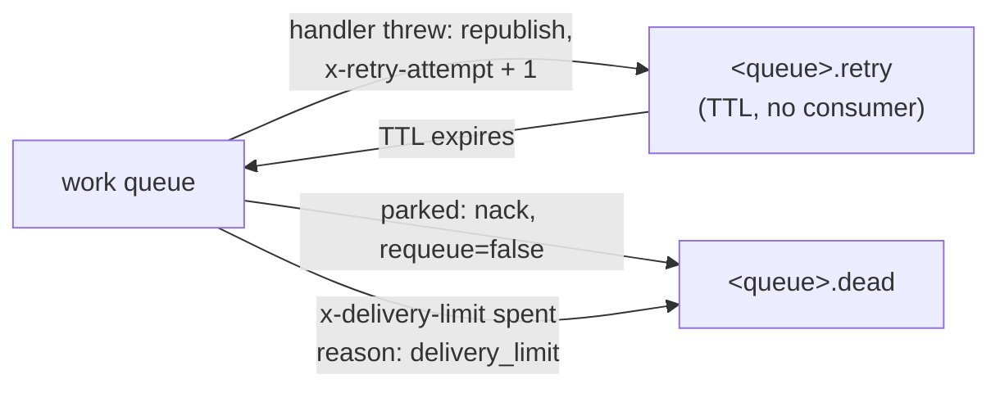
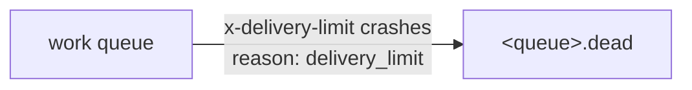

# RabbitMQ: usage

How code publishes and consumes jobs.

## Usage

### Publishing a message

```ts
import { publishToQueue, EMAIL_QUEUE } from '@infrastructure/adapters/queue';

// Inside a controller or service:
await publishToQueue({
    queue: EMAIL_QUEUE,
    payload: { to: 'user@example.com', template: 'welcome', data: { name: 'Alice' } }
});
```

Never a string literal. `EMAIL_QUEUE` and `IMAGE_QUEUE` are aliases of `WORKER_CHANNELS.EMAIL_SEND`
and `WORKER_CHANNELS.IMAGE_DIGEST`; a module-owned queue reads its own entry off `WORKER_CHANNELS`
directly (`webhooks`' `WORKER_CHANNELS.WEBHOOK_DELIVER`) — all generated out of `asyncapi.yaml`, so
the name a producer publishes to, the name the consumer drains and the name the contract declares
are one string. A typo in a literal is not an error anywhere; it is a message on a queue nobody
reads.

`publishToQueue`'s `true`/`false` answers the BROKER's own confirmation, not `sendToQueue`'s return
value — the channel it publishes on is a confirm channel
(`model.createConfirmChannel()`), and only the confirm callback resolves the promise (a 5s timeout
falls back to `false` if it never arrives). `sendToQueue` returning `false` on its own means "the
local write buffer is full, wait for `drain`" — never "failed" — so a caller reading THAT boolean
directly would run its inline fallback alongside a publish that was going to succeed anyway.

**A late confirm sends the mail twice.** An unconfirmed publish (the 5s timeout) falls back to the
inline send, and a confirm that arrives after it means the broker has the message as well. This is
chosen on purpose: delivery is at-least-once, and a duplicate beats a lost mail.

### Consuming messages

```ts
import { consumeFromQueue, EMAIL_QUEUE } from '@infrastructure/adapters/queue';

consumeFromQueue({
    queue: EMAIL_QUEUE,
    prefetch: 5,
    handler: async (message) => {
        // Return true to ack. Return false ONLY for a job that will never be processable —
        // it is dead-lettered permanently. Let anything transient throw: the consumer republishes it
        // to `<queue>.retry` (TTL, no consumer), which expires back onto this queue — never an
        // immediate broker requeue.
        await sendEmail(message);
        return true;
    }
});
```

### Retries and parking

A failing job waits in a TTL queue and comes back on its own — the broker owns the delay, not an
app-side timer:



Every work queue is declared with two companions, all through the same `dead-letter` exchange (a
`direct` exchange — a routing key names exactly one queue):

| Name            | What it is                                                                                                                                                                                                        |
| --------------- | ----------------------------------------------------------------------------------------------------------------------------------------------------------------------------------------------------------------- |
| `<queue>.retry` | No consumer. `x-message-ttl` set to `NODE_QUEUE_RETRY_DELAY_SECONDS`; dead-letters BACK to `<queue>` once a message sits out its wait.                                                                            |
| `<queue>.dead`  | The parking lot. No consumer, no `x-dead-letter-*` of its own; `x-message-ttl` of 7 days, after which a parked message is dropped. The work queue dead-letters into it, bound to the exchange under its own name. |

The work queue's OWN dead-letter target is `<queue>.dead`: a `nack(msg, false, false)` and a spent
`x-delivery-limit` both park the message, so nothing is ever dropped. A retry is never a
dead-letter; the consumer republishes it itself. That is what makes the handler's outcomes mean what
they say:

| Handler does                 | What happens                                                                                       |
| ---------------------------- | -------------------------------------------------------------------------------------------------- |
| resolve `true`               | `ack` — deleted, the job is done                                                                   |
| resolve `false`              | parked: `nack(msg, false, false)`, the broker moves it to `<queue>.dead` — never retried           |
| malformed / contract-invalid | parked the same way — the bytes will never become valid on a retry                                 |
| throws, attempts remain      | republished to `<queue>.retry` (confirmed), then acked; comes back once its TTL expires            |
| throws, attempts exhausted   | parked in `<queue>.dead`, logged once at `error` (the job's identifying fields, never the payload) |

**The attempt count is our own header.** Every retry republish stamps `x-retry-attempt` (one higher
than it arrived with, `0` when absent). It is not `x-death`: RabbitMQ 4 ignores an `x-death` that a
client republishes ([4.0.1 release notes](https://github.com/rabbitmq/rabbitmq-server/releases/tag/v4.0.1)),
so a republished message would never count there.

**A retry is a confirmed republish.** The original is acked only once the broker has confirmed the
copy in `<queue>.retry` — the same confirm-channel guarantee [Publishing a message](./rabbitmq.md#publishing-a-message)
describes — and nacked with requeue when the confirm fails, so a failed hop never drops a job.
Parking needs no publish at all: the nack and the dead-lettering are one broker-side move.

**The two knobs**, one number each for every consumer — not a per-consumer option:

| Env var                          | Default | Meaning                                         |
| -------------------------------- | ------- | ----------------------------------------------- |
| `NODE_QUEUE_MAX_ATTEMPTS`        | `5`     | Deliveries before a job is parked.              |
| `NODE_QUEUE_RETRY_DELAY_SECONDS` | `30`    | How long a failed job waits in `<queue>.retry`. |

One fixed delay per queue (not per message) is deliberate: RabbitMQ only expires a queue from the
head, so a 5s message queued behind a 10-hour one would otherwise wait 10 hours. One retry queue
per work queue sidesteps that entirely.

**Replaying a parked job** is a management-UI action today (move the message from `<queue>.dead`
back onto `<queue>`), not an app endpoint — a parked job is a morning's work to triage, not
something to automate blindly.

**Upgrading an existing broker.** `assertQueue` throws `PRECONDITION_FAILED` when a queue already
exists with different arguments — which is what this retry topology, the priority argument, and
[the move to quorum queues](./rabbitmq.md#queue-type-quorum) each do in turn to a broker holding queues
declared without them. The channel dies, is replaced, and fails the same way — and a queue's TYPE
is the one property that cannot be changed by re-declaring it at all, `PRECONDITION_FAILED`
included: it can only be dropped and recreated. Delete the old queues once
(`rabbitmqctl delete_queue worker.email.send`, and the same for `worker.image.digest`,
`worker.email.send.retry`/`.dead` and any module-owned queue's own pair) with the consumers
stopped, then restart the app — the declarations, `.retry` included, are recreated on the first
publish. Nothing is deployed against a broker outside this compose stack as of this writing, so
this stays a runbook line rather than a procedure anyone has had to run.

### Queue type: quorum

Every queue `queue.ts` declares — work, retry and dead-letter alike — carries
`x-queue-type: quorum`. Quorum queues are RabbitMQ 4's recommended durable type; classic MIRRORED
queues, their predecessor, are gone in 4.x. The reason it matters here specifically: a quorum
queue tracks its own `delivery-count`, incremented on EVERY redelivery — a consumer that crashes
mid-handler included, not only a `nack` the app chose to send. That is what bounds a message that
kills its consumer before the handler ever gets to answer it, which the app's own
`x-retry-attempt` count (`NODE_QUEUE_MAX_ATTEMPTS`) alone cannot, since the handler's failure path
never runs:



| Queue argument           | Value            | Where                    | Why                                                                                                                                                                                           |
| ------------------------ | ---------------- | ------------------------ | --------------------------------------------------------------------------------------------------------------------------------------------------------------------------------------------- |
| `x-queue-type`           | `quorum`         | work, retry, dead-letter | RabbitMQ 4's recommended durable type — see above.                                                                                                                                            |
| `x-delivery-limit`       | `3`              | work queue only          | Caps the broker's OWN redelivery count, explicit rather than trusting 4.x's default of 20 — a message that kills the process on contact should not get 20 chances before it is dead-lettered. |
| `x-dead-letter-strategy` | `at-least-once`  | work, retry              | The default, `at-most-once`, can silently drop a message in transit to its dead-letter target.                                                                                                |
| `x-overflow`             | `reject-publish` | work, retry              | `at-least-once` requires it — the alternative default, `drop-head`, would silently discard the oldest queued message instead.                                                                 |

When `x-delivery-limit` is reached, the work queue dead-letters the message straight to
`<queue>.dead`, where it is parked like any other spent job.

See [RabbitMQ: Quorum Queues](https://www.rabbitmq.com/docs/quorum-queues) and
[Upgrading an existing broker](./rabbitmq.md#retries-and-parking) above — a queue TYPE cannot change in place
any more than its other arguments can.

### Priority

Quorum queues have no `x-max-priority` opt-in: every queue always offers the full 0-31 range, and
a message published with no `priority` at all lands at **4**, not 0
(https://www.rabbitmq.com/docs/quorum-queues#priority). `JobPriority`'s two levels sit above that
default rather than at the classic-queue `0`/`1`, or `'normal'` would rank BELOW an unmarked
message:

| `JobPriority` | Number | Meaning                                                                                                        |
| ------------- | ------ | -------------------------------------------------------------------------------------------------------------- |
| `'normal'`    | `4`    | Default — level with what an unmarked message gets, never below it.                                            |
| `'high'`      | `8`    | A person is actively blocked on this — jumps ahead of `'normal'` messages currently waiting on the same queue. |

`enqueueEmail()` defaults to `'normal'` and takes an optional fourth argument; the account
module's token-bearing links (password reset, account deletion, account setup, email
verification — all short-TTL, all a person is staring at an inbox for) pass `'high'`. Order
confirmations, delivery notices and the rest stay `'normal'`.

Two levels, deliberately: this is "give the few urgent things a preference" — one gap between
most things and what a person is actively blocked on — not a real-time scheduler. See
[RabbitMQ: Quorum Queues — Priorities](https://www.rabbitmq.com/docs/quorum-queues#priority).

### Options

| Publish option | Default    | Description                                                                                                     |
| -------------- | ---------- | --------------------------------------------------------------------------------------------------------------- |
| `durable`      | `true`     | Queue survives broker restarts.                                                                                 |
| `persistent`   | `true`     | Message is written to disk.                                                                                     |
| `priority`     | `'normal'` | `'high'` jumps ahead of `'normal'` messages waiting on the same queue — see [Priority](./rabbitmq.md#priority). |

| Consume option      | Default                          | Description                                                |
| ------------------- | -------------------------------- | ---------------------------------------------------------- |
| `durable`           | `true`                           | Queue survives broker restarts.                            |
| `prefetch`          | `1`                              | Unacknowledged messages allowed at once.                   |
| `maxAttempts`       | `NODE_QUEUE_MAX_ATTEMPTS`        | Overrides the deployment-wide default for this queue only. |
| `retryDelaySeconds` | `NODE_QUEUE_RETRY_DELAY_SECONDS` | Overrides the deployment-wide default for this queue only. |

## Read next

- [rabbitmq](./rabbitmq.md): the hub this page belongs to.
