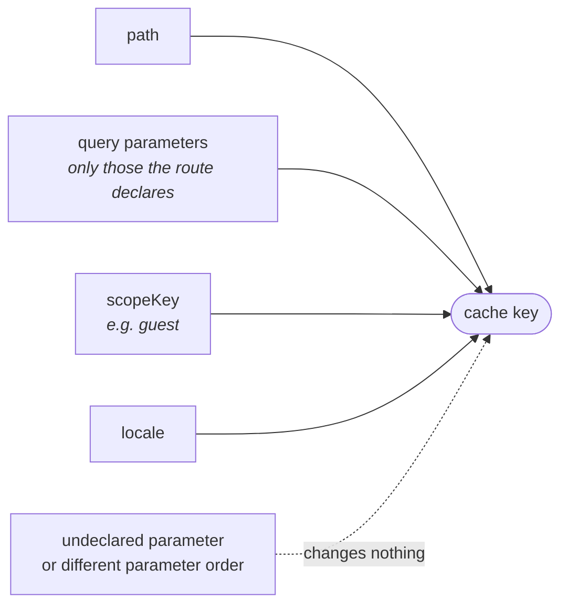

# Redis cache: keys, size and headers

What makes a cache key, how big an entry may be, and what headers say.

## The key is what the request asked for, not how it was written



Every route declares which query parameters change its answer, and the key is built from those
plus the resolved `scopeKey` and the locale:

```ts
const cacheProductsSearch = searchCache(
    'products',
    searchProductsKeyParameters,
    cacheScopeKey,
    undefined,
    {
        keyValues: searchProductsKeyValues,
        orderedKeyParameters: searchProductsOrderedParameters
    }
);

router.post('/search', previewDraftLanguage, cacheProductsSearch, getProducts);
router.get('/', previewDraftLanguage, cacheProductsSearch, getProducts);
```

`cacheScopeKey` is the [`hasAnonymousReadScope` check](./redis-cache.md#no-caching-depends-on-who-is-asking): `guest`, or undefined to bypass.

`keyParameters` is required rather than optional, because it decides which requests share a cached
response — a parameter the controller reads but the key omits would serve one search's results
for another, and that is a correctness bug rather than a missed optimisation. Most routes declare
`[]`: a path-only route has no query parameter that changes anything. The one cached search
controller, `products`', exports its own as `Object.keys(schema.shape)`, derived from the very
schema it validates against, so the list cannot drift from what the controller actually reads.

Two URLs asking for the same thing therefore land on one entry, and an undeclared parameter
cannot mint a new one:

| Request                              | Key      |
| ------------------------------------ | -------- |
| `?page=1&pageSize=10`                | one key  |
| `?pageSize=10&page=1` (same request) | same key |
| `?page=1&anything=else`              | same key |

The first two rows are what costs something in ordinary traffic: query-string order is not stable
across HTTP clients, so a URL-derived key stores the same request twice and pays for a second
Mongo query behind the second copy. The third row is why an arbitrary parameter cannot mint an
entry, and the same body is never stored twice under two spellings.

Note what the key still separates, and must: the path, the `guest` scope segment (see above), the
locale, and any declared parameter that genuinely differs — including a repeated one
(`?tag=a&tag=b` arrives as an array) and a blank one, which is not assumed to mean the same as
absent.

### What reaches the key, and how

The key is built BEFORE the controller validates anything, so what feeds it is bounded on purpose:

- **Parsed, where the route can.** A route may hand `setCache` a `keyValues` function: the search
  routes run the controller's own merge and schema, so `priceMin: "0e0"`, `"0x0"` and `0` are one
  key, and a request the controller would refuse never gets one. Without it, the raw body or
  query value feeds the key.
- **Scalars only.** A string, number, boolean or null, or an array of those. Anything else (a
  nested array, an object) skips the cache for that request, uncached and unharmed. A recursive
  walk would throw a `RangeError` on a 100 kB `[[[…]]]` body.
- **Hashed.** The values become one `sha256`, so a 90 kB `title` costs a 64-character key, not a
  90 kB one stored twice.
- **Arrays are sets, unless declared ordered.** `?id=a&id=b` and `?id=b&id=a` share a key;
  `sort` is declared in `orderedKeyParameters`, because its tokens apply in sequence.

Every entry is also indexed under its tags in a **sorted set scored by the entry's expiry**. Each
write first drops the members already past their score, so the index follows the live entries and
cannot grow without bound between invalidations.

## Entry size is bounded

Caching turns a cheap request into long-lived server state, and that is a different risk from
simply answering it: `GET /products` is public and `setCache(3600, …)` keeps its answers for an
hour. The declared-parameter key above bounds how many entries a caller can mint; this bounds how
large any one of them may be, at whatever size the endpoint happens to return.

The `setCache` middleware therefore refuses to store a body above `NODE_REDIS_CACHE_MAX_BYTES`
(default `262144`, 256 KB) and logs a warning naming the key and the size. It lives with the
middleware rather than in the adapter because the limit is measured on a serialized RESPONSE — the
adapter below it stores opaque bytes and has no opinion about how many of them a response is
allowed to be. The response is still returned
normally — skipping is a lost optimisation, not a failure — so the endpoint stays correct and only
loses its cache.

This is deliberately independent of the request layer's own bounds. `PageSize.maximum` is `100`
in `openapi.yaml` and a full page of products serializes to roughly 50 KB, so the guard never
fires in normal traffic; it exists so the property holds regardless of which endpoint is writing,
and regardless of whether that endpoint's page size is ever raised.

## Response headers

`applyCacheHeaders` (`infrastructure/http/middlewares/cache.ts`) sets every `Cache-Control` header
this middleware owns, and decides whether the request is even a candidate for the Redis lookup
`serveOrArm` does next.

**`Cache-Control` itself:** every response starts as `no-store` (`installRoutes`, after the static
files, so an image keeps its year-long cache), and the rules below overwrite it on the routes that
opt in. A response is uncacheable unless a route says it is, so a secret in one (`POST /api-keys`,
a webhook secret, an audit page) cannot be kept by a shared cache or a browser's disk because an
opt-in was forgotten. An error answer is `no-store` too, whatever the route set before it failed
(`rejectResponse`).

- A cached POST (`POST /x/search`, keyed the same as its GET twin) is a SERVER-side arrangement
  only — the wire always says `no-store`, since a shared cache holding a POST response could
  answer a later POST from it, including a real write on some other route.
- A GET whose module owns the answer and stores it itself (the availability reads, see
  [inventory](../modules/inventory.md#the-availability-reads)) mounts `publicNoCache`: `public,
no-cache` and `Vary: Authorization`, and no Redis entry from this middleware. Its `x-cache` is
  `revalidate`.
- A cacheable GET gets `max-age`/`stale-*` (a shared cache in front of this server is what absorbs
  a guest-scope stampede), or `no-cache` when the route asked for `browserRevalidate` instead. The
  product reads (`GET /products/:id`, `GET /products`) do: staff edits clear Redis but cannot reach a
  copy in someone's browser, so the browser re-checks and gets a 304 while nothing changed.
- `browserRevalidate` is read on a GET only. A POST answers `no-store` whatever it says, so a route
  with a cached POST twin (`searchCache`) declares it once for both spellings.
- `cacheScope === undefined` — this caller sees more than the shared answer, per
  [the scope-key rule above](./redis-cache.md#no-caching-depends-on-who-is-asking) — answers `private, no-cache`
  regardless of `browserRevalidate`: `serveOrArm` is about to bypass Redis for this same request,
  and a shared/browser cache must not store this ONE caller's wider answer as if it were generic.
- A response that already carries a `Set-Cookie` (the dead-session clear `getAuth` writes in cookie
  mode) is answered `private, no-cache` and skips Redis too: RFC 9111 §7.3 lets a shared cache store
  and replay a cookie, which would log everyone out. Only a cookie set before `setCache` is seen.

**The `Vary` headers:** `Authorization`, because `getAuth` derives `authContext` from it, or from
the session cookie in cookie mode — without this, a shared cache could serve one anonymous response
back to an admin, the same class of bug `GET /account` once had. `Accept-Language`, because
`attachLocale` already sets it and a route reaching this by another path should still declare it.
`Cookie`, set by `getAuth` itself and only in cookie mode, since there the cookie is the credential;
`cache.ts` may not import the kernel, so it cannot say it.

**One throw guards a mounting mistake, not a runtime condition:** `noStore` already forbade
caching. Left unchecked, the `Cache-Control` set here would REPLACE that header rather than merge —
exactly how `GET /account` once cached a caller's profile for an hour behind a router-wide no-store
mount.

## Keys this middleware does not own

`availability:<id>` is a plain value in the same Redis, with no tag and a 60 second life, written
and deleted by `inventory` through `getCacheValues`, `setCacheValue` and `deleteCacheValues` in the
adapter, not by `setCache`. It is not cleared by `invalidateCache(['products'])`: a stock move or a
`product.terms_changed` clears it ([why](../modules/inventory.md#the-availability-reads)).

## Read next

- [redis-cache](./redis-cache.md): the hub this page belongs to.
