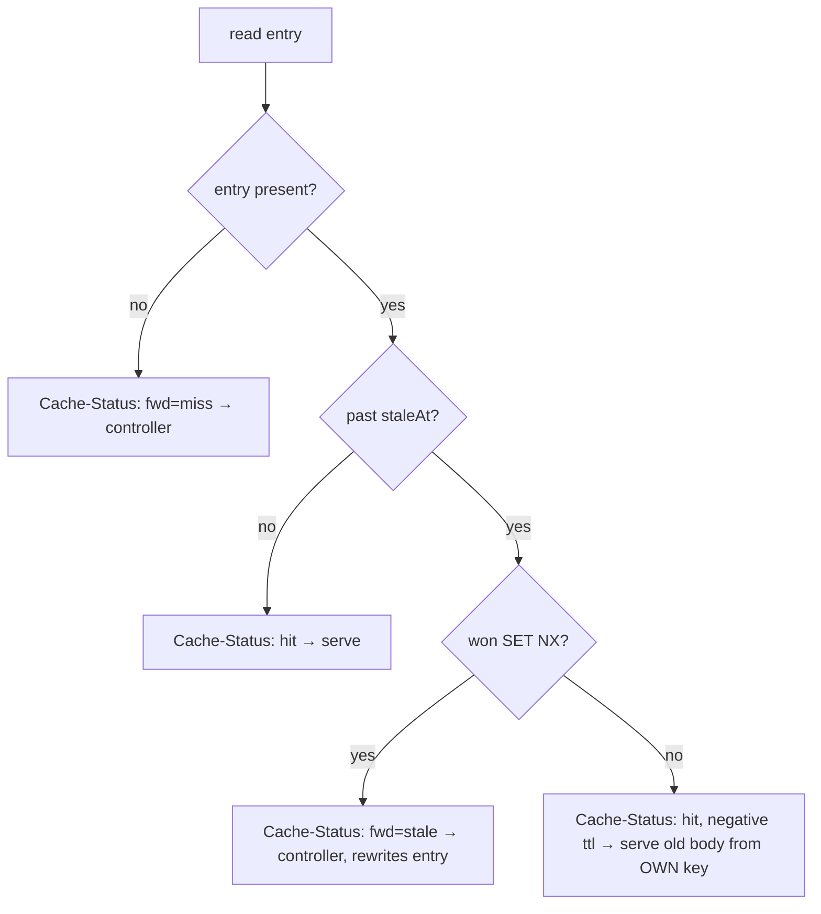

# Redis cache: refresh-ahead

How a hot key refreshes without a stampede.

## Refresh-ahead: no stampede when a hot key goes stale

A popular key expiring is a cache **stampede**: every request being served from it misses at the
same instant, and all of them run the same expensive query. `scopeKey` answers `true` for
every cacheable caller (see [No caching depends on who is asking](./redis-cache.md#no-caching-depends-on-who-is-asking)),
so the crowd behind one entry is exactly that — every visitor to `GET /products` who reads the
published catalogue, guest or logged-in alike, shares one entry; a caller who sees more bypasses
Redis and has no crowd to be part of.

The fix is the pattern behind Rails' `race_condition_ttl`, Caffeine's `refreshAfterWrite`,
memcached leases and HTTP's `stale-while-revalidate` (RFC 5861): **serve the old value, let
exactly one caller rebuild it.** Two layers apply it:

| Layer                                             | Mechanism                         | Covers                                               |
| ------------------------------------------------- | --------------------------------- | ---------------------------------------------------- |
| The edge (a shared cache in front of this server) | `Cache-Control` directives, below | `GET`, guest scope, wherever a proxy/CDN is deployed |
| The origin (`cache.ts`)                           | Redis `SET … NX EX` claim, below  | Everything else, across every worker and replica     |

### The two advertised windows

`setCache`'s `max-age` branch (not `no-cache`, not `no-store`) adds two RFC 5861 directives,
as fixed constants — not the resolved/clamped `ttl` — so a shared cache in front of this server
can absorb a stampede before it ever reaches Node:

```
Cache-Control: <private|public>, max-age=<ttl>, stale-while-revalidate=60, stale-if-error=300
```

- `stale-while-revalidate=60` — a shared cache may serve the expired copy for up to 60s while it
  refetches once in the background.
- `stale-if-error=300` — during a 5xx or an unreachable origin, serve the last good copy for 5
  minutes instead of an error page. Advertised only; nothing server-side enforces it, since an
  origin that is down cannot also be the one enforcing its own header.

### The origin's own claim

Each cache entry carries a soft expiry (`staleAt`) ahead of its hard Redis expiry (`ttl + grace`,
where `grace` is `stale-while-revalidate`'s 60s clamped to at most `ttl` — see
[Writes that bypass the API](./redis-cache.md#writes-that-bypass-the-api) for why a fixed 60s grace would
otherwise undo the dev TTL ceiling). A read past `staleAt` tries `claimCacheRefresh`: Redis'
`SET <prefix>:refresh:<key> 1 NX EX <grace>` grants the claim to exactly one caller across every worker and
replica — everyone else gets `null` back for the same window.



The outcome is sent as an [RFC 9211](https://www.rfc-editor.org/rfc/rfc9211) `Cache-Status`
header named `api-redis`. It is a debug aid: not in the contract, not CORS-exposed (devtools and
curl see it anyway).

| Outcome | Header                                                                                     |
| ------- | ------------------------------------------------------------------------------------------ |
| MISS    | `Cache-Status: api-redis; fwd=miss`                                                        |
| HIT     | `Cache-Status: api-redis; hit; ttl=N` (seconds to `staleAt`)                               |
| STALE   | `Cache-Status: api-redis; hit; ttl=-N` (seconds past `staleAt`, RFC 9211's stale-hit form) |
| REFRESH | `Cache-Status: api-redis; fwd=stale`                                                       |

A HIT or STALE answer also carries `Age: N`, the whole seconds since the entry was saved (RFC 9111
§5.1), beside the route's own `Cache-Control`. The browser then keeps it for `max-age` minus `Age`,
not for a fresh `max-age` on top of the time Redis held it. A miss sends none.

`fwd=miss` rather than `uri-miss`: the key also folds in locale and the cacheable gate, so a URI
miss cannot be told from a vary miss.

Nobody waits, and nobody but the claimer ever runs the controller — everyone else reads back
their own key's stale body. That is also the trap to keep in mind if this is ever changed: the key
stays scoped by `scopeKey` and locale, because a rebuild collapsed across a caller who sees more
than the shared answer would turn an availability fix into a data leak.

Every failure degrades to what already happens without this feature — there is no state that a
crash or an evicted claim leaves stuck:

| Failure                      | Result                                                        |
| ---------------------------- | ------------------------------------------------------------- |
| Claimer crashes mid-rebuild  | the claim expires; the next reader past `staleAt` claims it   |
| Refresh key evicted by LRU   | an extra claimer picks it up — one extra rebuild              |
| Entry hard-expired, not soft | no stale body to serve — falls straight through to MISS       |
| Tag invalidated              | key gone entirely — falls straight through to MISS, by design |

Invalidation (`invalidateCache`, a `DEL` on every key in the tag) deliberately gets no
refresh-ahead treatment: after a `DEL` there is no stale body left to serve, and marking entries
stale instead of deleting them would serve data the API already knows is wrong — the one thing
invalidation exists to prevent.

### `cache_requests_total`

The one hit/miss signal this cache has: a Prometheus counter labelled `result`, one of `hit`,
`miss`, `stale`, `refresh` — see `infrastructure/observability/metrics-cache.ts`.

## Read next

- [redis-cache](./redis-cache.md): the hub this page belongs to.
