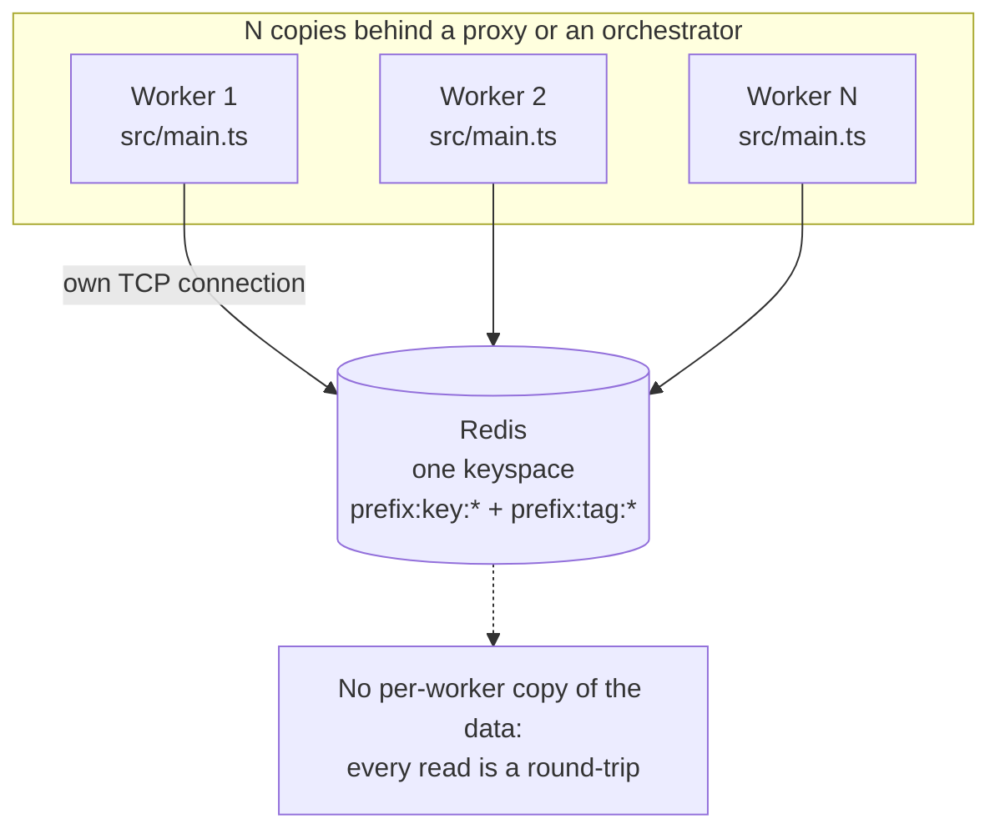
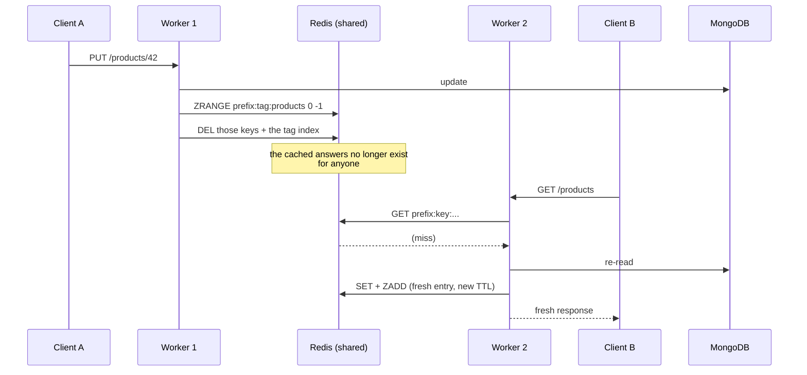
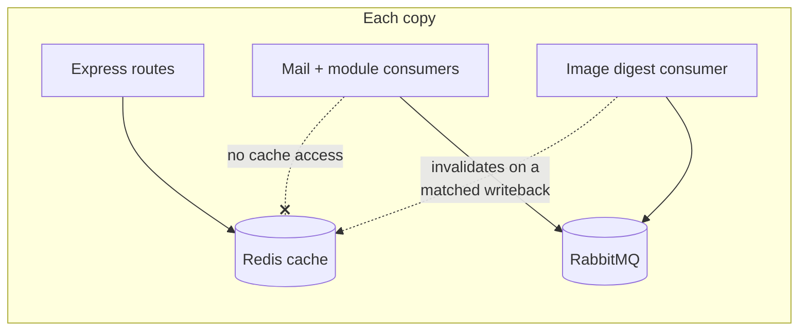

# Redis cache: the workers

Redis as the workers see it.

## Redis and the workers

With more than one copy of the app (orchestrator replicas, or N processes behind a proxy), each copy runs
the whole Express app — see [Scaling](scaling.md#how-to-run-more-than-one). Copies ("workers" below) are separate OS
processes: they share no memory, no variables, no in-process cache. What they do share is Redis.

Each worker opens **its own connection** (`src/infrastructure/adapters/cache.ts` over
`adapters/managed-connection.ts`, one lazy client per process), but every connection addresses the **same keyspace** — same
`NODE_REDIS_URL`, same `NODE_REDIS_CACHE_PREFIX`. A worker never keeps a local copy of a cached
response, so there is no such thing as "worker 2's cache" to fall out of date. There is one cache,
and four processes reading it.

The same holds beyond one host: replicas in separate containers, pods or machines behave
identically as long as they point at the same Redis with the same prefix.

### Why there is no cross-instance broadcast

That shared keyspace is what makes invalidation a solved problem rather than a coordination one.
A write handled by worker 1 deletes the keys; worker 2 finds them gone on its very next read,
without being told anything:

Worker 2 is correct **before any message could have been sent**. A pub/sub broadcast on top of
this would tell worker 2 to delete keys worker 1 already deleted — three extra round-trips per
write per worker, a second Redis connection per process, and a shutdown ordering constraint, all
to change no state. One was implemented here and has been removed; the AsyncAPI channel
`cache.tags.invalidated` went with it.

The one design that would need the broadcast is a **process-local L1 cache** — an in-memory map
in each worker, in front of Redis, saving the network hop on every hit. Then worker 2 really
would hold a stale copy only it can see, and only a message could reach it. That tier does not
exist in `cache.ts`; if it is ever added, the pub/sub comes back in the same commit, tested
against the in-memory eviction it actually serves.

The one pub/sub that exists today carries something else: live notification frames
([Live messages between copies](./redis-cache.md#live-messages-between-copies)). There the state
really is process-local, a socket held by one worker, so only a message can reach it.

Two consequences worth keeping in mind:

- **A missed invalidation is bounded by the TTL, and nothing else.** That was already true — the
  broadcast never contributed to correctness — which is why the TTL cap above is load-bearing.
- **Whatever a worker keeps in its own memory is invisible to the other workers.** Rate-limit
  counters, session state, dedup sets: if it must be shared, it goes in Redis or Mongo.

### Queue workers

`src/infrastructure/adapters/` (email, image digest) plus the module-owned consumers (webhook delivery, account export) are a different meaning of the word:
those are RabbitMQ consumers, and `registerWorkers()` runs them **inside every copy**,
so N processes consume from the same queues.

That is fine for every shipped worker but one — sending mail, delivering a webhook and building
an export change no cached resource. The image digest worker is the exception, and it is one of the
[writes that bypass the API](./redis-cache.md#writes-that-bypass-the-api) described above: the write that enqueues
its job already cleared the target's cache tag, before the digest ran, so the response that write
re-warmed still carries the pre-digest placeholder. The worker clears the same tag a second time
once its writeback actually matches a document — never passing through the `invalidateCache`
middleware, so it calls `invalidateCacheTagsLogged` itself, same as that middleware does. See
`settleWriteback` in `infrastructure/adapters/image.worker.ts`.

### When invalidation cannot reach Redis

`invalidateCacheTagsLogged` wraps `invalidateCacheTags`, which never rejects — the write (or
digest) it follows has already succeeded in Mongo, and rejecting would turn a completed write into
an error response the client would retry. `invalidateCacheTags` reports instead, with the same
`{ deleted, reachable }` `clearCache` returns.

`reachable: false` means the pre-write response is still cached and will be served until its TTL
expires: a customer edits a product, gets a 200, and the catalogue shows the old one for up to an
hour. The response has already been sent by then, so observability is the only move left —
`invalidateCacheTagsLogged` logs at `error` and increments `cache_invalidation_failures_total{tag}`.
A non-zero rate on that counter means some endpoint is serving a stale answer to somebody.

## Read next

- [redis-cache](./redis-cache.md): the hub this page belongs to.
