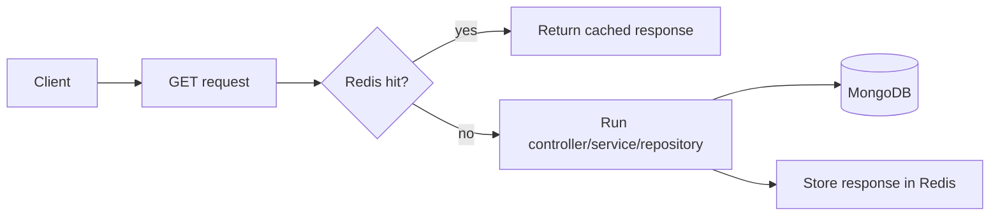
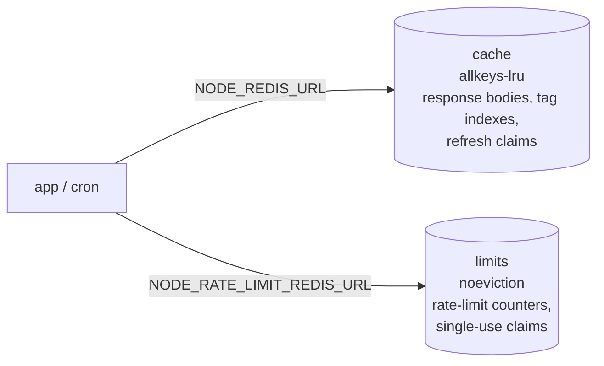

# Redis Cache

Redis as an optional cache for repeated GET responses: the key, the entry, and how the API behaves without it.

## Why Redis is here

[Redis](https://redis.io/docs/latest/) is used as an **optional server-side cache** for repeated GET responses.
It makes repeated reads cheaper without becoming required for the API to work.

The repo uses the official [`redis`](https://github.com/redis/node-redis) Node client. The work is
split in two: `src/infrastructure/adapters/cache.ts` is a **byte store with tags** — get, set,
invalidate by tag, clear — and `src/infrastructure/http/middlewares/cache.ts` is what makes those
bytes an HTTP response, owning the key, the stored entry, the TTL policy and the size limit. A
project that wants to cache something that is not a response uses the adapter directly and inherits
none of the response rules.

## Cache flow

## Important behavior

- cache is mainly for repeated reads,
- writes invalidate related tags,
- no route caches a response that depends on WHO is asking (see below),
- the key is built from declared parameters, not the raw URL (see below),
- a versioned read's `ETag` (`"<editRevision>.<digest>"`) is stored with the entry and replayed on a hit or a stale serve, so a miss and a hit send the same tag and a revisit is a `304` either way ([the tag](write-methods.md#what-the-tag-is)); an unversioned read stores none and Express mints its own,
- oversized responses are served but not stored (see below),
- a stale hot key is rebuilt by exactly one caller, not stampeded by all of them (see below),
- if Redis is unavailable, the app keeps going.

## No caching depends on who is asking

RFC 9111 §3.5: a shared cache must not store a response to an authenticated request unless the
response says it may be shared. `orders`, and `users`' own directory search and item read, and
`tasks` never belong here at all — each answer is specific to the caller (their own orders, an
admin's filtered queue), so a shared Redis entry is not an optimisation for them, only a store that
keeps growing for no caller but the one who filled it. Those routes mount `privateNoCache`
instead: `Cache-Control: private, no-cache` — the BROWSER may keep its own copy, but must always
revalidate before reusing it (cheap, since `app.set('etag', 'strong')` gives every GET a
conditional-request target for free), and there is no server-side entry to invalidate at all.

`products` and `locales`, by contrast, answer the SAME thing to every caller with the same READ
SCOPE — the published catalogue, the active locale manifest — so those stay cached, but never
keyed per caller. Every route that still mounts `setCache`/`searchCache` supplies a `scopeKey`
(`CacheOptions.scopeKey`, `infrastructure/http/middlewares/cache.ts`) — a `(request) => boolean`
predicate, checked per request:

- `true` — this caller reads the SAME guest-visible scope every other cacheable caller shares, so
  the key segment is always the literal `guest` and this request shares that one entry;
- `false` — this caller sees MORE than the shared answer (an admin, inactive rows included) —
  Redis is bypassed for the request entirely, neither read nor written, no key built at all, and
  the response answers `private, no-cache` instead of the shared entry's `public, max-age=…`.

`kernel/access/query.ts#hasAnonymousReadScope` is what a `scopeKey` is built on: it compares the
caller's compiled CASL read filter to an anonymous caller's, byte for byte, rather than branching
on a role name — safe BY CONSTRUCTION, since a role change that widens visibility makes the two
filters unequal on its own, with nobody needing to remember to touch the cache key too.

## Draft previews

A third case beside `scopeKey`'s `true` and `false`: the draft-preview flag. A staff caller whose
first `Accept-Language` choice is a switched-off language is answered in it ([previewing a draft](../modules/locales.md#previewing-a-draft)), and that answer must never meet a
visitor.

|          | Behaviour                                                                                   |
| -------- | ------------------------------------------------------------------------------------------- |
| Flag     | `markDraftPreview` sets `response.locals.draftPreview`; `isDraftPreview` reads it           |
| Decision | `cacheable = !draftPreview && scopeKey(request)`. The flag wins over `scopeKey`             |
| Redis    | No key is built, nothing is read, nothing is written. `armCacheWrite` refuses a second time |
| Headers  | `private, no-store` on GET and POST. `privateNoCache` keeps it. `Vary` is unchanged         |
| 304      | Evaluated as on every read (RFC 9110 §13.1.2); only the same preview answer can match       |
| Order    | Mount before `setCache`: its key is built from `request.locale`                             |

Why not trust `scopeKey`: a custom role or an API key can hold `display:Locale` without
`display:Product`, which reads the anonymous catalogue scope and so shares the visitors' entry.

## Response headers

`applyCacheHeaders` (`infrastructure/http/middlewares/cache.ts`) sets every `Cache-Control` header
this middleware owns, and decides whether the request is even a candidate for the Redis lookup
`serveOrArm` does next.

Full detail: [Response headers](./redis-cache-keys.md).

## The key is what the request asked for, not how it was written

Every route declares which query parameters change its answer, and the key is built from those
plus the resolved `scopeKey` and the locale.

### What reaches the key, and how

The key is built BEFORE the controller validates anything, so what feeds it is bounded on purpose.

Full detail: [The key is what the request asked for, not how it was written](./redis-cache-keys.md).

## Entry size is bounded

Caching turns a cheap request into long-lived server state, and that is a different risk from
simply answering it: `GET /products` is public and `setCache(3600, …)` keeps its answers for an
hour. The declared-parameter key above bounds how many entries a caller can mint; this bounds how
large any one of them may be, at whatever size the endpoint happens to return.

Full detail: [Entry size is bounded](./redis-cache-keys.md).

## Refresh-ahead: no stampede when a hot key goes stale

A popular key expiring is a cache **stampede**: every request being served from it misses at the
same instant, and all of them run the same expensive query. `scopeKey` answers `true` for
every cacheable caller (see [No caching depends on who is asking](#no-caching-depends-on-who-is-asking)),
so the crowd behind one entry is exactly that — every visitor to `GET /products` who reads the

### The two advertised windows

`setCache`'s `max-age` branch (not `no-cache`, not `no-store`) adds two RFC 5861 directives,
as fixed constants — not the resolved/clamped `ttl` — so a shared cache in front of this server
can absorb a stampede before it ever reaches Node.

### The origin's own claim

Each cache entry carries a soft expiry (`staleAt`) ahead of its hard Redis expiry (`ttl + grace`,
where `grace` is `stale-while-revalidate`'s 60s clamped to at most `ttl` — see
[Writes that bypass the API](#writes-that-bypass-the-api) for why a fixed 60s grace would
otherwise undo the dev TTL ceiling). A read past `staleAt` tries `claimCacheRefresh`: Redis'

### `cache_requests_total`

The one hit/miss signal this cache has: a Prometheus counter labelled `result`, one of `hit`,
`miss`, `stale`, `refresh` — see `infrastructure/observability/metrics-cache.ts`.

Full detail: [Refresh-ahead: no stampede when a hot key goes stale](./redis-cache-refresh.md).

## Memory is capped, and the cap evicts

Both composes start the cache Redis with `--maxmemory` and `--maxmemory-policy`, both overridable
from `.env`:

The variables are in [the configuration table](#configuration).

Redis' own default is `maxmemory 0` — unlimited — which is the wrong default for a cache: entry
count here follows traffic rather than data size, since `GET /products` is public and its answers
live for an hour. Left uncapped, Redis grows until the host or the container limit stops it.

Keep the policy on an `allkeys-` variant. That is what makes the ceiling a cache policy rather
than an error: Redis evicts the least recently used key and accepts the write. Redis' default,
`noeviction`, would instead start **refusing** writes at the ceiling — the app fails open so it
would keep serving correctly, but it would log a warning per request and cache nothing more until
something expired. `allkeys-` rather than `volatile-` because every key written here carries a
TTL anyway, so the two would behave alike until they didn't.

## Two Redis instances

Eviction is a property of a Redis INSTANCE, not of a key, so whatever must never be evicted cannot
share an instance with a cache that evicts on purpose.
([Redis eviction](https://redis.io/docs/latest/develop/reference/eviction/))

| Instance | URL                         | Policy                | What a lost key costs                                                               |
| -------- | --------------------------- | --------------------- | ----------------------------------------------------------------------------------- |
| `cache`  | `NODE_REDIS_URL`            | `allkeys-lru`, capped | a miss                                                                              |
| `limits` | `NODE_RATE_LIMIT_REDIS_URL` | `noeviction`, small   | a budget that resets, or a solved ALTCHA challenge that can be replayed on a worker |

- **No inheritance.** `NODE_RATE_LIMIT_REDIS_URL` never falls back to `NODE_REDIS_URL`: one unset
  variable must not turn two instances into one. Unset means the in-process stores, and each
  instance is named explicitly, with its own password.
- **`noeviction` fails by refusing.** At its ceiling `limits` rejects a write rather than dropping a
  counter; the app then counts in its own memory for that request. `NODE_LIMITS_MAXMEMORY` (default
  `64mb`) is far above need: a counter is about a hundred bytes.
- **Why the flood no longer matters.** Search keys are hashed and bounded
  ([What reaches the key](#what-reaches-the-key-and-how)), the tag index is pruned as entries
  expire, and even a flood that fills the cache evicts cache entries, never a counter.

## Writes that bypass the API

This is **cache-aside**: reads fill the cache, and whoever writes the data is responsible for
invalidating it. `invalidateCache` (in `src/infrastructure/http/middlewares/cache.ts`) does that for every write the
API handles.

Nothing does it for writes that never reach Express — `npm run scenario:apply`, a one-off `scripts/ops/` script, a
`mongosh` session, a GUI. Those change Mongo while Redis keeps serving the answer it computed
beforehand, which is how a freshly-seeded database can still render as an empty product list.

Two mitigations, because neither is sufficient alone:

|                                | What it does                                                                                                                                                                       | Limit                                                             |
| ------------------------------ | ---------------------------------------------------------------------------------------------------------------------------------------------------------------------------------- | ----------------------------------------------------------------- |
| `npm run db:cache:clear`       | Deletes every key under `NODE_REDIS_CACHE_PREFIX` (`SCAN` + `DEL`, never `FLUSHALL`, so a shared Redis is safe). `scenario:apply` calls it automatically when it created something | Opt-in — only covers writers that remember                        |
| `NODE_REDIS_CACHE_DEV_TTL_MAX` | Clamps every route's TTL in development/test only, default `30`s                                                                                                                   | Dev only, and it shortens the stale window rather than closing it |

The TTL cap is the one that matters for writers nobody anticipated: it bounds _every_ out-of-band
write to seconds instead of the route's declared hour. Set it to `0` to opt out and use the
declared TTLs everywhere. Production is never clamped, because there the API is the only writer.

`clearCache()` never throws, but it does report whether it got through: it resolves
`{ deleted, reachable }`, where `reachable: false` means caching is switched on and Redis could
not be reached, so stale entries survived. Its two callers then differ on purpose — `scenario:apply`
ignores the flag and keeps seeding (an unreachable Redis must not block a seed), while
`db:cache:clear` exits `1`, since a recovery tool that announces `0 keys removed` and exits `0`
having done nothing is indistinguishable from a genuinely empty cache.

The complete answer is to have the database announce its own changes — MongoDB change streams,
or CDC via Debezium — so any write invalidates regardless of origin. Change streams require a
replica set, which this compose file does not run.

## Redis and the workers

With more than one copy of the app (orchestrator replicas, or N processes behind a proxy), each copy runs
the whole Express app — see [Scaling](scaling.md#how-to-run-more-than-one). Copies ("workers" below) are separate OS
processes: they share no memory, no variables, no in-process cache. What they do share is Redis.

### Why there is no cross-instance broadcast

That shared keyspace is what makes invalidation a solved problem rather than a coordination one.

### Queue workers

`src/infrastructure/adapters/` (email, image digest) plus the module-owned consumers (webhook delivery, account export) are a different meaning of the word.

### When invalidation cannot reach Redis

`invalidateCacheTagsLogged` wraps `invalidateCacheTags`, which never rejects — the write (or
digest) it follows has already succeeded in Mongo, and rejecting would turn a completed write into
an error response the client would retry. `invalidateCacheTags` reports instead, with the same
`{ deleted, reachable }` `clearCache` returns.

Full detail: [Redis and the workers](./redis-cache-workers.md).

## Live messages between copies

One use of Redis here is not a cache: pub/sub, in `src/infrastructure/adapters/pubsub.ts`. Its only
user today is the notifications stream, because a held SSE connection belongs to one process and
the write it must report can happen in another
([how it works](../modules/notifications.md#more-than-one-process)).

- **The cache instance, not the limits one.** Pub/sub stores no keys, so `allkeys-lru` never evicts a
  message; the limits instance exists to hold counters nothing else may share its memory with.
- **Same prefix.** Channels are named `<NODE_REDIS_CACHE_PREFIX>:<name>`, so staging and production on one
  Redis do not hear each other.
- **Two connections per process.** A client in subscriber mode can run no other command, so publishing has
  its own. The subscriber opens with the first stream, not at boot.
- **Fails open.** No Redis, or an unreachable one, drops the message and keeps the caller working. The
  subscriber is not reconnected on a timer: the next stream that opens reopens it, and a lost one tells its
  owner once.
- **`NODE_REDIS_CACHE_ENABLED=0` does not switch it off.** That flag exists to debug a stale cache.

## Configuration

| Variable                           | Default                    | Meaning                                                                                                                                |
| ---------------------------------- | -------------------------- | -------------------------------------------------------------------------------------------------------------------------------------- |
| `NODE_REDIS_CACHE_ENABLED`         | `1`                        | `0` serves every request uncached — the switch to reach for when a stale answer is worse than a slow one, and what the test suites set |
| `NODE_REDIS_URL`                   | —                          | Wins outright; blanking it is how `npm run host` falls through to the host/port pair below                                             |
| `NODE_REDIS_HOST` / `_PORT`        | `127.0.0.1` / —            | Used only when the URI is unset or empty                                                                                               |
| `NODE_REDIS_PASSWORD`              | —                          | Password for the host/port pair; a URI carries its own                                                                                 |
| `NODE_RATE_LIMIT_REDIS_URL`        | —                          | The `limits` instance — see [Two Redis instances](#two-redis-instances)                                                                |
| `NODE_REDIS_CACHE_PREFIX`          | `boilerplate-node-backend` | Namespaces every key, so two deployments may share one Redis                                                                           |
| `NODE_REDIS_CACHE_DEV_TTL_MAX`     | `30`                       | Outside production, clamps every route's declared TTL — see [Writes that bypass the API](#writes-that-bypass-the-api)                  |
| `NODE_REDIS_CACHE_MAX_BYTES`       | `262144` (256 KB)          | See [Entry size is bounded](#entry-size-is-bounded)                                                                                    |
| `NODE_REDIS_MAXMEMORY` / `_POLICY` | `256mb` / `allkeys-lru`    | Read by the compose files, not by the app — see [Memory is capped](#memory-is-capped-and-the-cap-evicts)                               |

Disabling the cache is not the same as Redis being unreachable. `NODE_REDIS_CACHE_ENABLED=0`
never builds a client at all; an unreachable Redis builds one, fails, and falls through — the
difference shows up as a `warn` on boot in the second case and silence in the first.

## Works with

- **[OpenTelemetry](../operate/opentelemetry.md)** — every Redis command (`GET` for cache reads, `SET` for writes, `DEL` for tag invalidations) is automatically wrapped as a child span. In Grafana → Tempo a cache hit looks like a short Redis span with no following Mongoose span — the span tree makes the cache benefit immediately visible. A cache miss shows Redis then Mongoose back to back. → [What is instrumented out of the box](../operate/opentelemetry.md#what-is-instrumented-out-of-the-box)

## External references

- [Redis pub/sub](https://redis.io/docs/latest/develop/interact/pubsub/) — the mechanism this page deliberately does _not_ use, and the one to reach for if an L1 tier is ever added

## Read next

- [Scaling & Graceful Shutdown](scaling.md) — where the workers sharing this cache come from
- [Request Flow](request-flow.md)
- [MongoDB & Mongoose](./mongodb-mongoose.md)
- [Prometheus](../operate/prometheus.md)
- [OpenTelemetry](../operate/opentelemetry.md) — Redis spans show every command
