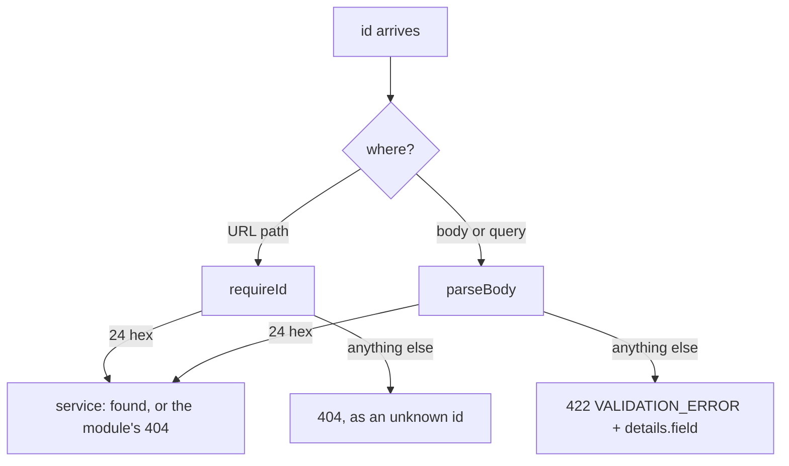

# Request flow: errors

How a malformed id, a database error and an unhandled error reach the client.

## A malformed id has one answer per position

Where an id sits decides the answer. "Malformed" means not this backend's own id: 24 hex
characters. The contract's shared `Id` is deliberately looser (see below), so a value can satisfy
the contract and still be refused here.

| The id is in…      | Malformed (`abc`)                                                     | Well-formed but unknown |
| ------------------ | --------------------------------------------------------------------- | ----------------------- |
| the **URL path**   | **404**, the same code and copy the module answers an unknown id with | 404                     |
| a **body field**   | **422** `VALIDATION_ERROR`, `details.field` names the field           | 404 from the service    |
| a **query filter** | **422** `VALIDATION_ERROR`, `details.field` names the field           | an empty list           |

`tests/integration/malformed-ids.test.ts` owns the test of this table: it sends every position its
malformed spellings, so a module test repeats one only when it checks more than the status.

- **Path → 404.** The URL _is_ the resource asked for, so a broken one points at nothing, and the
  answer cannot tell a caller which ids this API issues. `requireId`
  (`src/infrastructure/http/ids.ts`) is the one check, called by every shared controller factory and
  by every hand-written controller with an id in its path, before the database is asked. It takes
  the module's own not-found copy, which is what makes the two answers byte-identical.
- **Field → 422 naming the field.** A body or query value is an argument, and a bad argument is a
  validation error that says which one. `parseBody` walks the request schema for the contract's `Id`
  fields (found by the shared pattern) and refuses each that is not an ObjectId, in the same list
  as every other bad field — so a body with a bad `quantity` and a bad `items.1.productId` reports
  both.
- **The contract's `Id`** is `minLength: 1`, `maxLength: 64`, `pattern: '^[0-9A-Za-z_-]+$'`: a
  storage-neutral bound (OWASP API4:2023, bound every string input) that fits an ObjectId, a ULID
  and a UUID, so the paired twin and the frontend's response validation keep working. The ObjectId
  rule is this backend's alone and never reaches the contract.
- **Why not 404 everywhere.** A 404 on `POST /cart/items` reads like a mistyped path, it cannot name the
  field (one body can carry several ids), and `quantity: -1` is already a 422 naming its field.

`tests/integration/malformed-ids.test.ts` walks every id site `openapi.yaml` declares and holds it
to the table, so a route added later is covered on its first run.

## The database error interpreter

`databaseErrorInterpreter` in `src/infrastructure/http/errors.ts` is the single place that decides
which driver failures describe the **request** rather than the server. One function, so the answer
is the same on every model — a call-site `try`/`catch` is invisible to every endpoint that
did not think to write one.

| Raised by                                                                                           | Status | Why it is the caller's problem                                                                                                                                                                           |
| --------------------------------------------------------------------------------------------------- | ------ | -------------------------------------------------------------------------------------------------------------------------------------------------------------------------------------------------------- |
| `CastError` (Mongoose)                                                                              | 422    | A value failed a schema path's cast (recognised by its `kind`). A safety net: a malformed id is answered before the database, see [below](./request-flow.md#a-malformed-id-has-one-answer-per-position). |
| `BSONError` (driver)                                                                                | 422    | `new ObjectId(...)` itself refused: `''`, `'%00'`, `'undefined'`, anything not 24 hex characters. The same safety net.                                                                                   |
| `E11000` duplicate key                                                                              | 409    | A unique index refused the write: something with that value already exists.                                                                                                                              |
| `ValidationError` (Mongoose)                                                                        | 422    | A schema validator refused — a `required` path left empty, a value outside `min`/`max`, a failed `match`.                                                                                                |
| any module's `ConflictError`                                                                        | 409    | The write was refused for what it would make true — `access`'s `AccessInvariantError` today.                                                                                                             |
| `PreconditionFailedError`                                                                           | 412    | The caller's `If-Match` no longer describes the row — see [Conditional writes](write-methods.md#conditional-writes-etag-and-if-match).                                                                   |
| a dependency outage (Mongo or Redis unreachable, a full queue, or a query killed at its time limit) | 503    | The server is temporarily broken, not the request: `isInfrastructureError`, answered with `SERVICE_UNAVAILABLE` (`QUERY_TIMEOUT` for a killed query) and a `Retry-After` hint.                           |
| anything else                                                                                       | 500    | Genuinely unrecognised.                                                                                                                                                                                  |

Every branch above exists so that something describing the CALLER is not reported as a server
fault. `POST /products/search` is public and takes an `id` filter, so `{"id": ""}` must not become
an **unauthenticated** request producing a server error — an availability signal as much as a
correctness one.

### Three rules the branches share

- **The driver/Mongoose branches are detected by shape, not `instanceof`:** `BSONError` and `ValidationError` by `name`, `CastError` by its own `kind` property, E11000 by `isDuplicateKey`. Both `bson` and
  `mongoose` reach this process as transitive dependencies of more than one package, and an
  `instanceof` against the wrong copy silently returns false. `ConflictError` is the one exception:
  it is our own class, defined once, here — a module subclasses it and `instanceof` is exactly the
  right tool, since there is no second copy of it anywhere to disagree with.
- **The message is never the driver's.** E11000's text carries the index name and the duplicated
  value — user-supplied data, which has no business being echoed back. Mongoose's enumerates the
  failing paths, which describes the schema. Both are literals here instead.
- **Neither half of the tuple comes from the error.** `message` is prose, so parsing a status out
  of it yields `NaN`, and `res.status(NaN)` throws inside Express — a client error arriving as a 500.

### Why `ValidationError` is not already impossible

Request bodies are validated by Zod schemas generated from `openapi.yaml`, inside the controller (`parseBody`), before any service runs,
so a Mongoose validator firing means the model is enforcing something the contract does not.
For example, a display name of one space satisfies `minLength: 1`, then the schema's `trim`
reduces it to `''` and `required` refuses it — a 500 for a stray space, which
`tests/fuzz/endpoints.fuzz.test.ts` finds.

Closing it **at the contract** is still the better fix where the constraint can be expressed there.
This branch is the floor under that, across every model at once.

### Where a fifth branch goes

In this function, carrying a comment naming which driver raises it and why its status is what it
is — not in a controller, and not as a `try`/`catch` at the call site.
`tests/fuzz/endpoints.fuzz.test.ts` is what surfaces these: a 500 out of it is this class of error
until something proves otherwise.

## What an unhandled error tells the client

The global handler answers in four branches, and the order is the point: a `MulterError` becomes
413 for a size limit (`LIMIT_FILE_SIZE`, `LIMIT_FIELD_VALUE`) and 400 for any other limit; a library that follows the `http-errors` contract (`expose: true`, a 4xx `.status`/
`.statusCode`) — body-parser's oversized-body and malformed-body rejections among them — answers
that declared status (400/413/415), never the library's own message; a driver failure that
`databaseErrorInterpreter` recognises as a _client_ mistake becomes that 4xx; and everything else
is 500. A middleware that already has the `Response` in hand — file upload validation, for one —
answers `rejectResponse` directly instead of throwing something for this handler to translate.

A malformed multipart body (no boundary, cut short) is the same contract: the upload middleware
wraps busboy's plain `Error` as a 400 client error (`status` + `expose`), so it never reaches the
500 branch. An OS failure (a full disk) is left alone and stays 500.

The JSON parser is non-strict: any JSON value parses (RFC 8259 §2), and a body that is not a JSON
object (`5`, `"x"`, `true`, `null`, `[]`) answers 422 `VALIDATION_ERROR` from `requireJsonObjectBody`
before any route (RFC 5789 §2.2). Unparseable JSON stays the parser's 400.

### A status-only failure is still translated

A refusal that carries no text of its own (a bare 404 from the catch-all, a 409, a 412) answers
`errors[0].message` from one `generic.*` locale key per status, in the caller's `Accept-Language`.
The problem's `title` stays the English status phrase on purpose: it is the developer-facing
label, `detail` and `errors[]` are what a person reads ([the shape](../reference/errors.md#problem-details)). The locale is
negotiated before request parsing, so the global limiter's 429 and a parser's 400 / 413 / 415
speak the caller's language and carry `Content-Language` too. A `MulterError` keeps its `code`,
and its English text is replaced by `generic.error-upload-refused`. When multer names the
form field that broke the rule, the item also carries `details.field`.

### The database branch is a safety net, not a substitute

Every controller ends its chain with a `.catch()` that calls `rejectDatabaseError`, so nothing
routinely relies on this branch. But a controller added later may forget one, and forgetting is
silent. `tests/fuzz/endpoints.fuzz.test.ts` walks every spec operation and is what catches the next
one. A malformed id is not that case: it is answered before the database by `requireId` and
`parseBody`, and a `CastError` reaching this branch means a route skipped them.

### The 500 branch says nothing

`errors[]` carries a constant, never `error.message`. An unexpected error is precisely the case
where nobody chose the wording: a Mongoose validation error naming internal field paths, a driver
error naming hosts and ports, an `ENOENT` naming a filesystem layout, a third-party client quoting
a URL with a key in it. Any of those is free reconnaissance for an unauthenticated caller, and none
of it means anything to the person reading it.

The detail is not lost — it is logged with the request id and trace id, where an operator can act on
it and a stranger cannot.

## Read next

- [request-flow](./request-flow.md): the hub this page belongs to.
