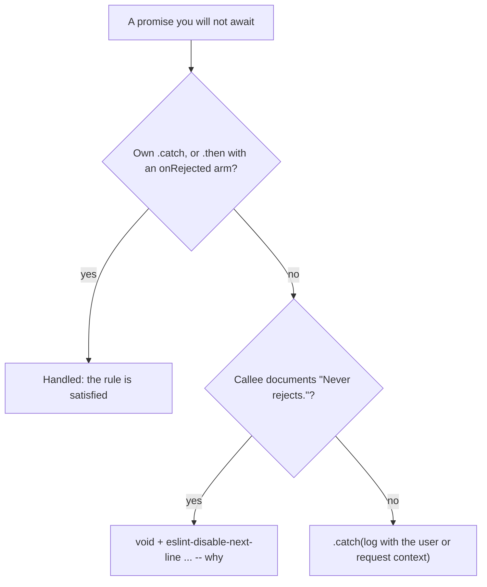
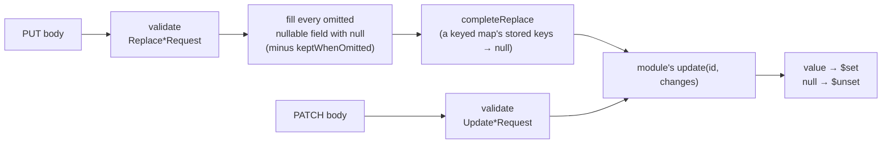
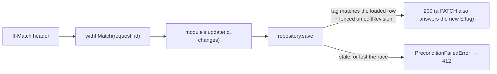

# Request flow: cross-cutting strategies

The strategies that run for every request, and how PUT and PATCH differ.

## Cross-cutting strategies

### Security first

Things like [Helmet](security.md), CORS, cookies, auth, and rate limits happen near the edge.
That keeps the inside layers focused.

### Validation at the edge, rules inside

Shape validation happens in the **controller**, against the [Zod](runtime.md) schemas
generated from `openapi.yaml` — so a service is only ever called with data the contract already
accepted, and never has to ask whether a field is a string. Which sources a controller reads
(params, query, body, and in what precedence) is a property of the surface rather than of the
handler; [Request Input](./request-input.md) is the page for that.

The four steps every controller repeats — parse the body, answer 422, send a service refusal,
catch — live in `@infrastructure/http/controller` as `parseBody`, `refused`
and `catchAs`. Helpers rather than a wrapper, deliberately: a wrapper that owned the chain would
move the stack trace off the handler, degrade the inference `parseBody`'s return type carries, and
hide the literal `.catch(` that `scripts/eslint/controller-chain-must-catch.ts` looks for.

**A refusal about one field names it**, whatever its code: `details.field` carries the dotted path
(`shippingAddress.zip`), so a client shows the message under that input instead of in a banner.
A schema failure is `VALIDATION_ERROR`; a business rule about one field keeps its domain code
(`RETURN_DEDUCTION_INVALID` on `handlingDeduction`). Both build their item with `fieldError` from
`@infrastructure/http/response`. This is Stripe's `param`, and RFC 9457's `errors[].pointer`.

**Two endpoints deliberately do not parse a generated schema, and say so in place.**
`post-signup` is validated by its service against `SignupBody` plus the two rules the contract
cannot say (the repeat matches, terms accepted), so a direct caller of the service gets the same 422. `post-login` answers one
way for every wrong credential: parsing first makes a too-short password a 422 while a wrong
password of the right length is a 401, and it answers before `recordLoginFailure`, so the attempt
most worth recording never reaches the audit trail.

Business rules live in the
service, and the ones worth proving without a database live in `domain/`.

### Optional acceleration

[Redis cache hooks](redis-cache.md) speed up repeated reads, but the API still works when Redis is off.

### Async offloading

Heavy tasks (email, PDF generation) are pushed to [RabbitMQ](rabbitmq.md) so the HTTP response returns immediately.

### Fire-and-forget work

A promise nobody awaits (the verification mail after a signup, a cache write) has no caller left to
catch its rejection. `void p` does not change that: it only discards the value. The lint rule
`@typescript-eslint/no-floating-promises` runs with `ignoreVoid: false`, so `void p` is checked
like `p`.

What a lost rejection costs depends on where it happens:

| Where                   | What an unhandled rejection does                                                                                                                 |
| ----------------------- | ------------------------------------------------------------------------------------------------------------------------------------------------ |
| Production request path | `handleUnhandledRejection` (`src/app/error-handling.ts`) counts it, audit-logs it and keeps running. The line carries no request id and no user. |
| Tests                   | No handler is registered, so Jest pins the rejection on the test and fails it.                                                                   |
| Scripts and early boot  | Node's default: the process crashes.                                                                                                             |

- Handle it at the site: `.catch((error: unknown) => logger.error({ message, userId, error }))`.
- Opt out only when the callee cannot reject, and say so on the line:
  `// eslint-disable-next-line @typescript-eslint/no-floating-promises -- enqueueEmail never rejects`.
  The callee's JSDoc says "Never rejects." so the reason can be checked.
- A script's top-level promise ends in `.catch(failScript)` (`scripts/fail-script.ts`).

### Signals everywhere

[Winston](../operate/winston.md), [Prometheus](../operate/prometheus.md), [OpenTelemetry](../operate/opentelemetry.md), and [Grafana](../operate/grafana.md) make it easier to debug the same request from multiple angles. Each log line carries a `trace_id` that links back to the full trace in Grafana → Tempo.

## PUT replaces, PATCH merges

The rules themselves — what each verb means, the status it answers, `null` versus `''`, the
415 guard — are on [Write Methods](write-methods.md). This section is the mechanism.

Most resources with an update answer both verbs through one shared controller —
`createUpdateController` in `@infrastructure/surfaces/create-update-controller`. The verb only
changes the front of the pipeline; the module's own `update(id, changes)` never learns which one
produced the change-set.

**Not factory-backed:**

- **Entity translations** (`PUT`/`PATCH /locales/translations/{entityType}/{id}`) and the locale
  entries bulk import (`PUT`/`PATCH /locales/{locale}/apps/{app}/entries`) are hand-written.
  Their bodies differ by verb where it matters: a PATCH locale entry merges field by field (a
  `null` clears one), a PUT states each locale whole.
- **PUT-only resources** — `PUT /locales/{locale}/apps/{app}/entries/{entryId}`,
  `PUT /cart/shipping-method`, `PUT /account/addresses/{id}/default` —
  have no PATCH.

- **The factory reads the clearable fields off the schema itself** (`clearableFields`: every field
  that accepts `null`), so nobody keeps the list by hand. A field that cannot be `null` is
  required by the PUT schema instead.
- **`keptWhenOmitted`** names fields outside the PUT representation that are nullable yet must
  survive an omission — `imageUrl`, whose only writer is an upload. An explicit `null` still
  clears it: the field is unset and the old file and thumbnail are deleted after the save.
- **`completeReplace`** is the PUT-only hook for a keyed map the schema alone cannot name: a
  product's `translations` sets every stored locale the body left out to `null`, the signal a
  PATCH uses to delete one.
- **A cleared field is unset on disk, never a stored `null`.** `clearedOrValue`
  (`@infrastructure/persistence/changes`) turns the change-set's `null` into `undefined`, which
  `.save()` writes as `$unset`.
- **The module's `update()` audits itself.** The factory never records an audit entry, so no
  update is logged twice.

`tests/cross-cutting/replace-patch-parity.test.ts` checks that each resource's PUT and PATCH
schemas declare the same fields.

**Conditional writes ride the same pipeline.** The update and delete factories run the module's
write inside `withIfMatch(request, id, …)`, which opens a precondition for that row. The
repository's `save`/`deleteOne` are where it is met, so no module writes precondition code — see
[Write Methods](write-methods.md#conditional-writes-etag-and-if-match).

The update factory takes a required `versioned: boolean`. `true` is a resource whose contract
declares `If-Match` and `412`; `false` ignores the header entirely, so a route never answers a
`412` its contract does not declare. The list is in
[Which resources are versioned](write-methods.md#which-resources-are-versioned).

## Read next

- [request-flow](./request-flow.md): the hub this page belongs to.
