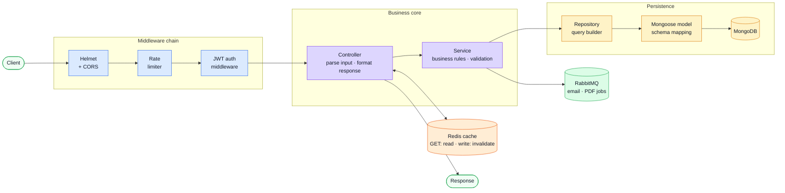
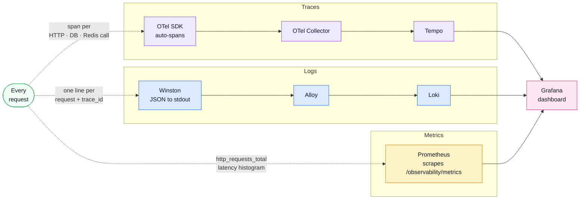

# Request Flow

The controller, service, repository and model below are **one module's** files, sitting side by side
in `src/modules/<name>/` — the flow crosses layers without leaving the directory. The middleware
chain and the datastores are the shared substrate every module travels through.

## End-to-end path

## Observability signals

Every request produces three independent signal streams in parallel with the flow above.

## What each layer does

| Layer                                 | Responsibility                                                                                                                                                                                                     |
| ------------------------------------- | ------------------------------------------------------------------------------------------------------------------------------------------------------------------------------------------------------------------ |
| Middleware chain                      | Helmet sets security headers · CORS checks the origin · rate limiter blocks abuse · JWT auth verifies the token (or skips for public routes)                                                                       |
| Redis cache                           | GET requests probe Redis first. A hit returns the stored response immediately — no controller, no database reached. On a write the controller invalidates related tags so stale entries are evicted.               |
| Controller                            | Reads HTTP input, **validates it against the contract's Zod schema**, calls the service, answers with the resource, a list object or 204.                                                                          |
| Service                               | Applies business rules over data that is already the right shape, and **emits the module's audit action** — the write and the record of it are decided in one place. Publishes async jobs to RabbitMQ when needed. |
| Repository → Mongoose model → MongoDB | Runs the actual database query. Repositories own query shape; models own schema. Controllers never touch either directly.                                                                                          |
| RabbitMQ                              | Receives heavy async jobs (email, PDF). The HTTP handler responds immediately; a separate worker processes the job at its own pace.                                                                                |

A module records its audit action from `service.ts` or `services/*.ts`, beside the write itself.
The exceptions are handlers that each argue in place why they have to emit themselves: the two
`account` ones below, `get-oauth-callback` (only a genuine login owes the row, known once the
callback has finished), `orders`' `get-order` (a staff read of someone else's order,
`ADMIN_ORDER_VIEWED`) and `payments`' `post-payment-webhook` (an invalid signature, which never
reaches a service).
`post-login` keeps the failure and success emits together at the handler because the success one may
only fire once the refresh token, the cookies and the access token all exist, which is a step later
than `login()` proving the credentials matched. `post-reset-request` emits **unconditionally**,
whether or not the address belongs to an account, because an emit reachable only after a user is
found would make the audit trail leak the existence the identical response deliberately hides — the
same user-enumeration guarantee, one layer down.

The exceptions are all about a fact the service cannot see: when the emit must fire, and whether it
fires at all. Anything decided by the write itself belongs with the write.

## Cross-cutting strategies

### Security first

Things like [Helmet](security.md), CORS, cookies, auth, and rate limits happen near the edge.

### Validation at the edge, rules inside

Shape validation happens in the **controller**, against the [Zod](runtime.md) schemas
generated from `openapi.yaml` — so a service is only ever called with data the contract already
accepted, and never has to ask whether a field is a string. Which sources a controller reads
(params, query, body, and in what precedence) is a property of the surface rather than of the

### Optional acceleration

[Redis cache hooks](redis-cache.md) speed up repeated reads, but the API still works when Redis is off.

### Async offloading

Heavy tasks (email, PDF generation) are pushed to [RabbitMQ](rabbitmq.md) so the HTTP response returns immediately.

### Fire-and-forget work

A promise nobody awaits (the verification mail after a signup, a cache write) has no caller left to
catch its rejection. `void p` does not change that: it only discards the value. The lint rule
`@typescript-eslint/no-floating-promises` runs with `ignoreVoid: false`, so `void p` is checked
like `p`.

### Signals everywhere

[Winston](../operate/winston.md), [Prometheus](../operate/prometheus.md), [OpenTelemetry](../operate/opentelemetry.md), and [Grafana](../operate/grafana.md) make it easier to debug the same request from multiple angles. Each log line carries a `trace_id` that links back to the full trace in Grafana → Tempo.

Full detail: [Cross-cutting strategies](./request-flow-strategies.md).

## PUT replaces, PATCH merges

The rules themselves — what each verb means, the status it answers, `null` versus `''`, the
415 guard — are on [Write Methods](write-methods.md). This section is the mechanism.

Full detail: [PUT replaces, PATCH merges](./request-flow-strategies.md).

## A malformed id has one answer per position

Where an id sits decides the answer. "Malformed" means not this backend's own id: 24 hex
characters. The contract's shared `Id` is deliberately looser (see below), so a value can satisfy
the contract and still be refused here.

Full detail: [A malformed id has one answer per position](./request-flow-errors.md).

## The database error interpreter

`databaseErrorInterpreter` in `src/infrastructure/http/errors.ts` is the single place that decides
which driver failures describe the **request** rather than the server. One function, so the answer
is the same on every model — a call-site `try`/`catch` is invisible to every endpoint that
did not think to write one.

### Three rules the branches share

- **The driver/Mongoose branches are detected by shape, not `instanceof`:** `BSONError` and `ValidationError` by `name`, `CastError` by its own `kind` property, E11000 by `isDuplicateKey`. Both `bson` and
  `mongoose` reach this process as transitive dependencies of more than one package, and an
  `instanceof` against the wrong copy silently returns false. `ConflictError` is the one exception.

### Why `ValidationError` is not already impossible

Request bodies are validated by Zod schemas generated from `openapi.yaml`, inside the controller (`parseBody`), before any service runs,
so a Mongoose validator firing means the model is enforcing something the contract does not.

### Where a fifth branch goes

In this function, carrying a comment naming which driver raises it and why its status is what it
is — not in a controller, and not as a `try`/`catch` at the call site.

Full detail: [The database error interpreter](./request-flow-errors.md).

## What an unhandled error tells the client

The global handler answers in four branches, and the order is the point: a `MulterError` becomes
413 for a size limit (`LIMIT_FILE_SIZE`, `LIMIT_FIELD_VALUE`) and 400 for any other limit; a library that follows the `http-errors` contract (`expose: true`, a 4xx `.status`/
`.statusCode`) — body-parser's oversized-body and malformed-body rejections among them — answers
that declared status (400/413/415), never the library's own message; a driver failure that

### A status-only failure is still translated

A refusal that carries no text of its own (a bare 404 from the catch-all, a 409, a 412) answers
`errors[0].message` from one `generic.*` locale key per status, in the caller's `Accept-Language`.

### The database branch is a safety net, not a substitute

Every controller ends its chain with a `.catch()` that calls `rejectDatabaseError`, so nothing
routinely relies on this branch. But a controller added later may forget one, and forgetting is
silent. `tests/fuzz/endpoints.fuzz.test.ts` walks every spec operation and is what catches the next
one. A malformed id is not that case: it is answered before the database by `requireId` and

### The 500 branch says nothing

`errors[]` carries a constant, never `error.message`. An unexpected error is precisely the case
where nobody chose the wording: a Mongoose validation error naming internal field paths, a driver
error naming hosts and ports, an `ENOENT` naming a filesystem layout, a third-party client quoting
a URL with a key in it. Any of those is free reconnaissance for an unauthenticated caller, and none

Full detail: [What an unhandled error tells the client](./request-flow-errors.md).

## Why the flow matters

When you change behavior, ask:

- Is this an **API contract** change? Go to [API](../build/api-contracts.md).
- Is this a **dependency or infrastructure** concern? Go to [Tools](tool-map.md).
- Is this a **layer ownership** issue? Go back to [Layers](./layers.md).
- Is this about **process lifecycle**, scaling, or shutdown? Go to [Scaling & Shutdown](./scaling.md).

## Read next

- [Request flow: errors](./request-flow-errors.md)
- [Request Input](./request-input.md)
- [Layers](./layers.md)
