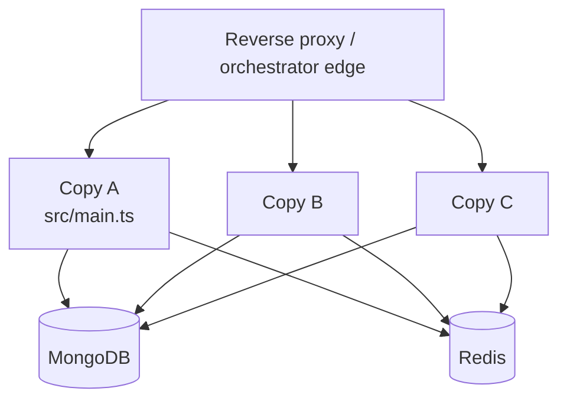
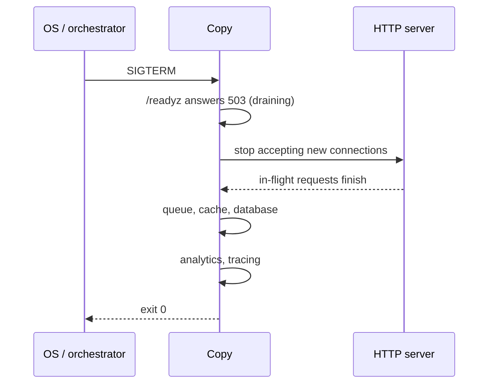

# Scaling with replicas & Graceful Shutdown

This page explains how the app boots, how to run more than one copy of it, and how a copy shuts down cleanly.
The relevant files are `src/main.ts` (the process entry: one process), `src/app.ts` (`createApp()`: the
HTTP app + its `boot`/`start`/`stop` lifecycle) and `src/serve.ts` (calls `start()`, wires
`stop()` to the process signals — the file `main.ts` actually runs).

## How to run more than one

The app is one process by design: no process forks inside it, and nothing supervises it from within.
To use more than one CPU core, or to run more than one copy for availability, run **more copies** and put
something in front of them.

| Where                             | How                                                                                                                 | Who restarts a copy                 |
| --------------------------------- | ------------------------------------------------------------------------------------------------------------------- | ----------------------------------- |
| Containers, production, dev       | `npm start` (`src/main.ts`, one process per container); scale with orchestrator replicas, each with its own address | the platform                        |
| A single host, more than one core | N plain processes (`npm start`, one `NODE_PORT` each) behind the reverse proxy you already run                      | your process manager (systemd, say) |

`main.ts` loads `.env`, starts OTel, then imports `serve.ts`. The default is one process because the
platform already restarts and scales; a second supervisor inside the container is two layers of
process management.

For the single-host row, the proxy has to behave like a real balancer. The shape is the one `tests/replicas`
builds ([Replicas testing](../build/replicas-testing.md#the-multi-copy-suite)):

- every copy has its own `NODE_PORT`, and the same `NODE_URL`: the public address, since a token's issuer is that address;
- the proxy balances per request over the copies whose `GET /readyz` answers 200, and drops the others;
- `NODE_TRUST_PROXY_HOPS` is set to the number of proxies in front;
- a copy that is told to stop answers 503 on `/readyz` first, so give the shutdown a delay longer than the proxy's polling ([below](#graceful-shutdown)).

PM2 is a footnote, not a recommendation: it can fork N processes that share one port
(`pm2 start "npm start" -i max`). Its runtime is open source; its monitoring is a paid add-on. Every limit in the next section applies to it unchanged.

### What changes with more than one copy

- `/metrics` is per copy: a scrape through a balancer hits a different copy each time, so scrape every copy as its own target.
- The `ApiRestarting` alert is unreliable behind a balancer: `process_start_time_seconds` jumps between copies.
- SSE caps (per-user and global stream limits) are counted per copy, so the real ceiling is cap × copies.
- Rate-limit budgets are per process without a `limits` Redis, so a budget of 100 a minute becomes `100 × copies`. Nothing refuses to boot without it, because a copy cannot see its siblings: set `NODE_RATE_LIMIT_REDIS_URL` yourself.
- Copies are stateless: anything kept in memory is invisible to the others and dies on the next deploy or crash. State lives in Mongo or Redis.

Every copy opens its own connection to each store, but they all address the **same** database and the
**same** Redis keyspace — which is why a cache invalidation done by one copy needs no
broadcast to the others. → [Redis and the workers](redis-cache.md#redis-and-the-workers)

## Configuration

| Env var                             | Effect                                                                                                                                                                  |
| ----------------------------------- | ----------------------------------------------------------------------------------------------------------------------------------------------------------------------- |
| `NODE_PORT`                         | The port a copy listens on. One per copy when several share a host.                                                                                                     |
| `NODE_GRACEFUL_SHUTDOWN_TIMEOUT_MS` | Teardown budget (default 15 000 ms), read by `registerSignalHandlers`; the drain steps below take shares of it.                                                         |
| `NODE_SHUTDOWN_DELAY_MS`            | Lame-duck delay before the teardown (default 0): `/readyz` answers 503 but the server keeps serving, so a balancer's readiness poll notices before the listener closes. |

## Graceful shutdown

A copy's shutdown sequence lives in `createApp()`'s `stop` (`src/app.ts`, wired to the
process signals by `src/serve.ts`):

1. `GET /readyz` is marked draining (503) the moment the signal arrives, by `registerSignalHandlers` (`src/infrastructure/runtime/server-lifecycle.ts`) before `stop` runs. Every response now says `Connection: close`, queue consumers are cancelled, and the copy waits `NODE_SHUTDOWN_DELAY_MS` (see [Health checks](../operate/health-checks.md#shutting-down-behind-a-load-balancer)). A second signal is ignored.
2. End the SSE streams (each told when to reconnect), then close the HTTP server: no new connections, idle keep-alive sockets dropped, in-flight requests drain. Anything still open at its share of the budget is cut.
3. Stop the locale-override refresh timer, then let started PDF renders and event deliveries
   finish (`settleRenders`, `settleInFlight`).
4. `stopQueue()` before `stopCache()`: a running job would otherwise reopen the cache connection. It waits for running handlers, up to their share of the budget.
5. `stopLimitsRedis()`, then `stopDatabase()` — disconnect the stores.
6. `shutdownAnalytics()` — flush PostHog if configured.
7. `shutdownTracing()` — flush remaining OTel spans to Tempo.

The `stop*` steps swallow their own failure, so a broken Redis cannot stop the database from closing. `shutdownAnalytics` and `shutdownTracing` do not swallow theirs, which is part of why they run last.
The order lives in `shutdownInfra` (`src/infrastructure/runtime/server-lifecycle.ts`).

If shutdown takes longer than the timeout, the copy force-exits. Keep the orchestrator's grace period above
`NODE_SHUTDOWN_DELAY_MS` + `NODE_GRACEFUL_SHUTDOWN_TIMEOUT_MS`.

## Why this matters

- Copies are stateless: anything you store in memory dies on the next deploy or crash.
- Background timers must be cleared in `stop` (or the `stop*` helper it calls), otherwise the process never exits.
- OTel must be initialised **before** any other import; that is why `src/main.ts` calls `startTracing()` before importing `serve.ts`.

## Useful links

- [Node.js `process` events (`SIGTERM`, `SIGINT`)](https://nodejs.org/api/process.html#signal-events)
- [The Twelve-Factor App — Disposability](https://12factor.net/disposability)
- [The Twelve-Factor App — Concurrency](https://12factor.net/concurrency)

## Read next

- [Architecture](./architecture.md)
- [Request Flow](./request-flow.md)
- [Runtime](runtime.md)
- [OpenTelemetry](../operate/opentelemetry.md)
