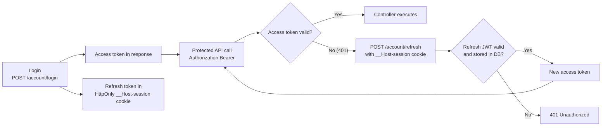

# Security: authentication

How a request is authenticated and where a token is verified.

_The diagram shows the `jwt` session mode only; the `cookie` mode is in [Two ways to stay signed in](sessions.md)._

## Auth architecture (current backend pattern)

A deployment runs one of two session modes, picked by `NODE_SESSION_MODE` and explained in
[Two ways to stay signed in](sessions.md). The default, `jwt`, is a **split-token model**:

- **Access token**: short-lived JWT returned by `POST /account/login` and sent on API calls in the `Authorization` header with the Bearer scheme.
- **Refresh token**: longer-lived JWT stored in the HTTP-only `__Host-session` cookie and used only to mint a new access token (`POST /account/refresh`).

This keeps normal authenticated requests explicit (client-attached Bearer token), while keeping the refresh token out of JavaScript access (HTTP-only cookie).

In `cookie` mode there is one credential, a random session id kept hashed in the database: an HttpOnly `__Host-session` cookie for a browser, or a `ses_…` Bearer for a client without a cookie jar. Because a cookie rides along on requests the user never meant to make, every state-changing request it authenticates is refused 403 unless its `Origin` is allowed (`getAuth`). A request that names no `Origin` at all passes: curl and a health check are not a browser's cross-origin call.

## Where token verification happens

- **Access token verification**: `getAuth` middleware reads the Bearer token from `Authorization` and verifies JWT signature/expiry with `verifyAccessToken`.
- **Refresh token verification**: `createAccessToken` calls `verifyRefreshWithRow`, which checks both:
    1. JWT signature/expiry with the refresh secret.
    2. a live row in the `sessions` collection, to reject revoked/unknown refresh tokens.

If access-token verification fails, the route returns `401` — a protected one and a public one alike (see [A bad bearer on a public page](./security.md#a-bad-bearer-on-a-public-page)). The client can then call refresh and retry with the new access token.

### A bad bearer on a public page

A bearer is a credential the client chose to present, so a bad one is told so, never quietly
served as a guest (RFC 6750 §3.1; the same rule `sk_` keys already had). `getAuth` answers a
bearer that names no live session — bad signature, expired, revoked, a user who no longer exists —
with `401` and `WWW-Authenticate: Bearer error="invalid_token"`, and an idle staff session with
`401 SESSION_IDLE`. On `invalid_token` the client refreshes and retries as the same person; if the refresh fails
it falls back to a guest by itself. On `SESSION_IDLE` it tells the user and carries on as a guest.

| Request                                                         | Answer                                         |
| --------------------------------------------------------------- | ---------------------------------------------- |
| No credential at all                                            | a guest, as ever                               |
| A cookie that names no session (`cookie` mode)                  | a guest: a browser sends the cookie unasked    |
| A bad bearer on an operation that accepts a sign-in             | `401 invalid_token` (`SESSION_IDLE` when idle) |
| A bad bearer on an operation whose contract says `security: []` | answered as if it were absent                  |

The exemption is read from the contract, not listed by hand: the generated `OPERATION_ROUTES`
carries `securityOpenMethods` per path, and `getAuth` matches method and path against it. A new
open operation is exempt the moment its contract says `security: []`. A request that matches no
contract operation is not exempt. A 401 is never cached: `getAuth` runs before any cache layer, and so its dead-cookie clear
never reaches a shared cache (`setCache` answers a response that sets a cookie `private, no-cache`).
Tested in `tests/cross-cutting/stale-bearer-on-open-operations.test.ts`.

**A failure while resolving a token is not "invalid credentials".** `getAuth` tells a _miss_ from a
_fault_ (`kernel/middlewares/authorizations.ts`, `infrastructure/http/errors.ts#isInfrastructureError`).
Only a miss is a `401`: a bad signature, an expired token, a user who no longer exists. A
resolver that **rejects** — a Mongo/Redis connection failure, or anything nobody anticipated — is
forwarded to the global error handler, which logs it and answers `503` with `Retry-After` for an
outage and `500` for the rest. The same holds for an `sk_` key. A build with no `account` module has no
sessions, so every bearer there is a miss. RFC 9110 §15.5.2 vs §15.6.4 — telling a client its
credentials are wrong when the server is the one that is broken is a lie the client acts on, logging
out a session that was never invalid.

## Login → auth → refresh request flow

The `jwt` mode flow. `cookie` mode has no refresh step: the cookie authenticates every request, and the diagram is on [its own page](sessions.md#cookie-mode-one-random-id).

1. User logs in (`POST /account/login`).
2. Server returns a short-lived access token and sets the `__Host-session` refresh cookie.
3. Client calls protected APIs with the Bearer token in `Authorization`.
4. If access token is expired/invalid, API responds `401 Unauthorized`.
5. Client calls `POST /account/refresh`; browser sends the `__Host-session` cookie automatically.
6. Server validates refresh token signature **and** DB presence, then returns a new access token.
7. Client retries protected request with the new access token.

## Read next

- [security](./security.md): the hub this page belongs to.
