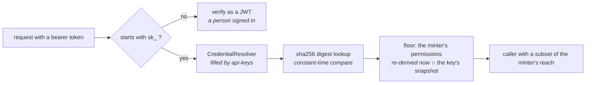

# Security: machine-to-machine credentials

API keys and other non-human credentials.

## Machine-to-machine credentials

A JWT proves a PERSON signed in; a partner integration or a webhook consumer calling back into the
API has no person behind it, and handing it a person's password would put every request in the
audit trail under that person's name while carrying their whole reach. `api-keys` is the answer: a
revocable, opaque credential a person MINTS, scoped to a subset of their own permissions.

**Format and dispatch.** `sk_<8-char prefix>_<32 bytes>`, both halves `base64url`. `getAuth`
(`kernel/middlewares/authorizations.ts`) branches on the `sk_` prefix before attempting any JWT
verification — a JWT is always base64url of `{"alg"` and so always begins `eyJ`, so the two
prefixes can never collide. `kernel/authentication.ts`'s `CredentialResolver` port is what
`api-keys` fills, the same "module fills a kernel port" shape `AuthResolver` already establishes;
unlike `AuthResolver`, an unregistered `CredentialResolver` is not an error — a build with no
`api-keys` module simply resolves nothing for an `sk_...` token, the same as a token nobody can
verify.

**Storage is a sha256 digest, not encryption.** A credential is verified, never re-signed with, so
there is no plaintext to recover later — `hashToken` (`src/infrastructure/security/hash-token.ts`), the same one-way primitive
session and one-time tokens use: `randomBytes(32)` has no search space for bcrypt/argon2 to make expensive,
so the ~100ms they would cost on every authenticated request buys nothing. Comparison is
constant-time (`constantTimeEqual`, `infrastructure/security/constant-time.ts` — the same helper
`isMetricsScraper` uses, see below), never `===`.

**A key holds a subset of the minter's permissions, floored TWICE.** Once at MINT time
(`api-keys/services/api-keys.ts`), against what the requesting caller holds right then; again on
EVERY SUBSEQUENT USE (`api-keys/module.ts`'s `CredentialResolver`), by re-deriving the minter's
CURRENT permissions and intersecting them against the key's stored snapshot. The second floor is
the one that matters after the fact: demoting or deleting the person who minted a key shrinks or
kills every key they ever minted, without the credential document itself ever being touched — the
same defensive shape as `kernel/permissions.ts`'s own caller flooring (never trust a cached
permission list; re-derive from the authoritative source on every check).

**A key can never hold a step-up permission.** `isMintable` refuses any permission that carries a
`stepUp` tier (`delete:User`, for one) with a 422 at mint time. A credential has no
`authTime`, so `requirePermission` would answer "re-authenticate" forever: the key would hold a
permission that is dead on arrival. GitHub's sudo mode likewise keeps sensitive actions to a fresh
human login.

**A do-not-retry write needs the header.** An API key holding `create:StockMovement` (or `update:Shipment`, which is mintable too) must send an `Idempotency-Key` on stock receipts, stock adjustments and shipments: without it the route answers 400. See [Do-not-retry operations](./idempotency.md#do-not-retry-operations).

**Tenant-scoped only.** A credential can never satisfy a `platform.` key — `requirePermission`
refuses one outright, distinctly from a missing permission, since this repo's deployment model is a
silo (one organisation per stack) and every real use case is shop-level.

**Which routes a credential may reach, and how that is kept honest.** Two identity guards, and a
route mounts exactly one:

| Guard                | Admits                              | For                                                                                                                                                                   |
| -------------------- | ----------------------------------- | --------------------------------------------------------------------------------------------------------------------------------------------------------------------- |
| `isAuth`             | a human session only                | routes whose subject is the CALLER — cart, wishlist, addresses, `account/*`, and `orders`, whose customer views narrow their reads through `callerScope(authContext)` |
| `isAuthOrCredential` | a session OR an `sk_...` credential | routes whose subject is the TENANT'S DATA — `users`, `inventory`, `audit-logs`, `webhooks`, `tasks`'s operator half, and the write halves of `products` and `locales` |

This is a split rather than one widened guard because a credential resolves to `request.caller`
with NO `authContext`, and roughly a hundred reads across the modules assume one is present — many
written `request.authContext!.id`, an assertion sound only while `isAuth` admits nothing else.
Widening `isAuth` would turn each of those into a `TypeError` and a 500 on exactly the routes where
a machine credential makes least sense. With the split, a route whose author forgets to think about
credentials gets `isAuth` and answers 401 — the direction an auth mistake should fail in.

Mount `isAuthOrCredential` only where both hold, and both are checkable rather than a matter of
taste: every guard on the route asks for a tenant-scoped rule with no owner condition, and no controller
it reaches reads `request.authContext`.
Both halves are asserted, both by `tests/cross-cutting/authenticated-controllers.test.ts`: it
reads Express's own resolved chain per route, refusing an `authContext!` read behind anything but
`isAuth` and a `requirePermission` rule with an owner condition behind `isAuthOrCredential` (a
rule pinned to the caller's own rows, such as `read:Order`, rather than a staff one like
`display:Order`). A controller that starts reading `authContext`, or a write that starts checking an
own-rows rule, behind the credential guard fails the suite rather than production.
`tests/cross-cutting/api-key-authentication.test.ts` covers the other mount rule instead — that no
module mounts BOTH identity guards — driving a real credential over the real chain.

**A key's read permissions count.** `products` reads narrow through `callerScope(request.caller)`,
which a session and a key both set, so a key holding `display:Product` sees drafts and soft-deleted
rows exactly as a session with it does, and the response cache bypass follows from the same filter
(`hasAnonymousReadScope`). A resolved credential never holds fewer keys than a stranger: the public
baseline is unioned in (`api-keys/services/resolver.ts`), so a key minted for something else still
reads the published catalogue instead of an empty one.

Two exclusions are decisions, not consequences, and each says so at its mount:

- **`api-keys` itself.** It reads no `authContext` and would qualify mechanically. A credential
  that can mint credentials is one that never has to be rotated, so minting stays a human act.
- **`orders`.** Its staff routes (`display:Order`, `update:Order`) would qualify, but the same router carries the
  customer's own `/:id`, `/:id/cancel` and `/:id/invoice`. Opening it up means splitting the
  router first.

Never pair `isAuthOrCredential` with `requireFreshAuth`: step-up reads `authContext`, and a
credential can never answer a re-authentication challenge, so the pairing hands a partner
integration a 401 it can never clear. No route mounts both, and that is the rule rather than a
coincidence.

**Lifecycle.** The plaintext is shown exactly once, in `POST /api-keys`'s response. Revoke
(`DELETE /api-keys/{id}`) is a soft state change — `revokedAt`, not a delete — so a revoked key's
audit history stays readable; revoking twice is a no-op, not a 404. An optional `expiresAt` refuses
the credential past that instant with no revoke needed. `lastUsedAt` is stamped on every successful
resolve, fire-and-forget, so a partner integration that stopped calling can be found and cleaned up.

## Read next

- [security](./security.md): the hub this page belongs to.
