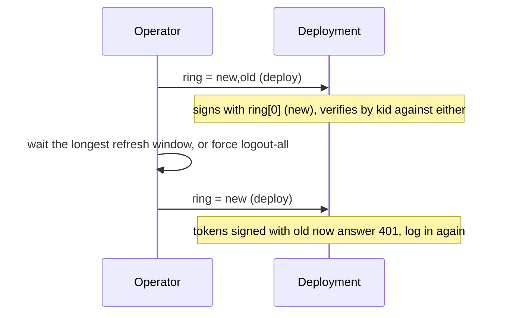

# Security: key and credential rotation

Rotating signing keys, database credentials and keys.

## Signing-key rotation



`NODE_TOKEN_ACCESS` and `NODE_TOKEN_REFRESH` are each an ordered, comma-separated **ring** of
secrets, newest first — `account/session/config.ts`'s `getAccessTokenRing`/`getRefreshTokenRing`.
`account/session/jwt.ts` signs every new token with `ring[0]` and stamps a `kid` header
(`account/session/key-ring.ts#keyId`, a truncated SHA-256 of the secret itself, never its index —
reordering the ring on rotation must not silently repoint an old `kid` at a different key).
Verifying looks the claimed `kid` up in the ring and checks the signature against that one member;
a `kid` naming no current member rejects as an ordinary bad token (401), not a 500 — it is a
session signed by a key this deployment has since retired, which is exactly "log in again". A ring
of one — no comma — behaves precisely as an unrotated deployment always has.

**`jwt` mode only** — a `cookie` deployment signs nothing and has no ring to rotate.

**To rotate:** prepend the new secret (`new-secret,old-secret`), deploy, wait out the longest
refresh window in play (`NODE_SESSION_TIME_LONG` — 30 days by default — or force
`logout-all` for every account instead of waiting), then drop the old secret and deploy again.
Skipping the wait window logs out every session still signed with the entry you remove.

## Database credential and key rotation

Three separate secrets, three separate rotation procedures — none of them automated, all of them
either a `mongosh` command or an env-var edit plus a deploy.

**`mongo_app_password` / `mongo_root_password`** (files under `clients/<name>/secrets/`).
`docker/mongo-init.js` only ever runs against an empty data directory, so editing the file alone
does nothing to an existing volume — change the password inside Mongo itself, then update the file
to match:

```bash
docker compose --env-file "clients/<name>/.env" -f compose.yaml -f compose.production.yaml \
  exec database mongosh -u "$MONGO_ROOT_USER" -p --authenticationDatabase admin --eval '
    db.getSiblingDB("<MONGO_DB>").updateUser("<MONGO_APP_USER>", { pwd: "<new password>" })
  '
```

Then write the new value into the secret file and recreate the services that mount it — the running
`app`/`worker`/`cron` containers hold the old password in memory until they restart. Rotate
`mongo_root_password` the same way against the `admin` database, with
`db.getSiblingDB("admin").updateUser("<MONGO_ROOT_USER>", ...)`.

**`mongo_backup_password`** (the `backup` role's login, used only by the `backup` container). Rotate it
like the app password, against the `admin` database, then rewrite the file and recreate `backup`:
`db.getSiblingDB("admin").updateUser("backup", { pwd: "<new password>" })`.
**`restic_password`** is different: it encrypts every existing snapshot, so changing the file alone
locks the repository. Add a new key with `restic key add`, switch the file, then `restic key remove` the old one
([Backups](../operate/backups.md)).

**`NODE_TOTP_ENCRYPTION_KEY` / `NODE_WEBHOOK_SECRET_ENCRYPTION_KEY` / `NODE_PII_ENCRYPTION_KEY`.**
Each is a **ring**, the same shape as the JWT secrets above but with an explicit version rather
than a derived `kid`:
`v2:<new-secret>,v1:<old-secret>` — newest first, `parseVersionedKeyRing` in
`@infrastructure/security/versioned-secret`. A bare value with no `v1:` prefix is still accepted
(a single-key deployment needs no format change), and `versioned-secret.ts` stamps every ciphertext
it writes with the ring entry that wrote it, so a decrypt looks up the STORED version rather than
assuming `ring[0]`.

**To rotate:**

1. Prepend the new secret, keep the old one: `NODE_TOTP_ENCRYPTION_KEY=v2:<new>,v1:<old>`. Deploy —
   every new TOTP enrollment and every delivered-code HMAC now uses `v2`; every row still stamped
   `v1` keeps decrypting against the entry that wrote it.
2. Re-encrypt existing rows onto the new key: `npm run reencrypt`. In a deployed container, which
   has no npm, run it from `/app` as `node --import tsx scripts/ops/reencrypt.ts` (same flags). Nothing re-encrypts a row lazily:
   only a fresh write of that same field or this script moves it, so skipping it leaves `v1` rows
   that the next step would strand. `npm run reencrypt -- --dry-run` writes nothing and prints, per
   field, how many values sit on each key version. Batched, and safe to repeat: a value already on
   `v2` is not touched, so a second run writes nothing. Each owning module declares its own walk
   on its manifest (`reencrypt` in `module.ts`: address books, user phones, order and invoice
   addresses and notes, order staff notes, TOTP secrets, webhook secrets); `scripts/ops/reencrypt.ts` runs every
   enabled module's, so it names none. Not scheduled: a rotation is an event, not a cadence.
   Until it finishes, both entries must stay in the ring.
3. Once `npm run reencrypt -- --dry-run` reports nothing on `v1`, drop it from the ring and deploy
   again. A row still stamped with a dropped version fails loudly (`Unknown TOTP key version: v1`)
   rather than reading as garbage.

A delivered code (`account/two-factor/delivered-codes.ts`) is the one exception: it is never
persisted across a rotation (`DELIVERED_CODE_TTL_MS` is ten minutes), so it always signs and
verifies against `ring[0]` — a rotation mid-flight invalidates a code in transit, the same trade the
JWT rotation above makes for a session mid-refresh.

## Read next

- [security](./security.md): the hub this page belongs to.
