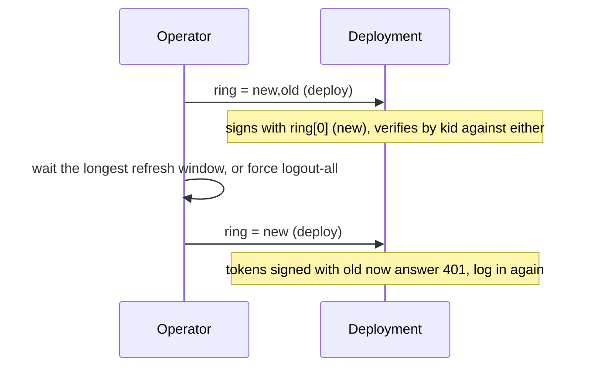

# Security: key and credential rotation

How the signing-key and encryption-key rings work. The steps to rotate are in [Rotate keys and credentials](../operate/key-rotation.md).

## Signing-key rotation

`NODE_TOKEN_ACCESS` and `NODE_TOKEN_REFRESH` are each an ordered, comma-separated **ring** of
secrets, newest first — `account/session/config.ts`'s `getAccessTokenRing`/`getRefreshTokenRing`.
`account/session/jwt.ts` signs every new token with `ring[0]` and stamps a `kid` header
(`account/session/key-ring.ts#keyId`, a truncated SHA-256 of the secret itself, never its index —
reordering the ring on rotation must not silently repoint an old `kid` at a different key).
Verifying looks the claimed `kid` up in the ring and checks the signature against that one member;
a `kid` naming no current member rejects as an ordinary bad token (401), not a 500 — it is a
session signed by a key this deployment has since retired, which is exactly "log in again". A ring
of one — no comma — behaves precisely as an unrotated deployment always has.

**`jwt` mode only** — a `cookie` deployment signs nothing and has no ring to rotate.

How to run a rotation: [Rotate keys and credentials](../operate/key-rotation.md#signing-keys).

## Encryption-key rings

`NODE_TOTP_ENCRYPTION_KEY`, `NODE_WEBHOOK_SECRET_ENCRYPTION_KEY` and `NODE_PII_ENCRYPTION_KEY` are each a **ring**, the same shape
as the JWT secrets above but with an explicit version rather than a derived `kid`:
`v2:<new-secret>,v1:<old-secret>`, newest first, `parseVersionedKeyRing` in
`@infrastructure/security/versioned-secret`. A bare value with no `v1:` prefix is still accepted
(a single-key deployment needs no format change), and `versioned-secret.ts` stamps every ciphertext
it writes with the ring entry that wrote it, so a decrypt looks up the STORED version rather than
assuming `ring[0]`.

A delivered code (`account/two-factor/delivered-codes.ts`) is the one exception: it is never
persisted across a rotation (`DELIVERED_CODE_TTL_MS` is ten minutes), so it always signs and
verifies against `ring[0]`. A rotation mid-flight invalidates a code in transit, the same trade the
JWT rotation makes for a session mid-refresh.

The database passwords and the restic password are not rings: how to change them is in
[Rotate keys and credentials](../operate/key-rotation.md#database-and-backup-credentials).

## Read next

- [security](./security.md): the hub this page belongs to.
