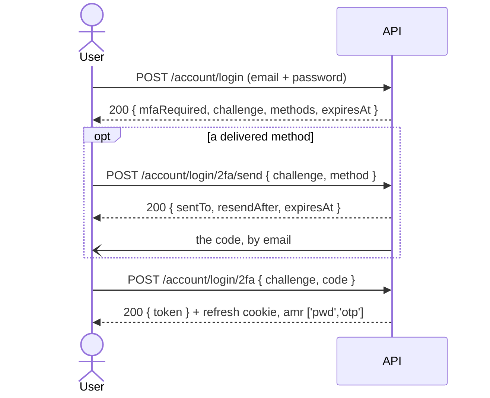

# Security: two-factor authentication

How the second factor works and what it protects.

## Two-factor authentication

The attacker's side of the second factor. The registry's shape, the enrollment state machine and
what a user document carries are on
[Two-factor authentication](../modules/account-two-factor.md).

A second factor on top of the login flow above, optional for a shopper and required for any staff
role (the role grants nothing without an authenticator app — see
[Staff need an authenticator app](../modules/account-two-factor.md#staff-need-an-authenticator-app)).
An account may arm **several**, and the
set of them is a registry rather than a branch: `src/modules/account/two-factor/methods/` holds one
handler per channel, and everything above it — services, controllers, contract — deals in a
`method` string.

Two methods ship: `totp`, an authenticator app, and `email`, a six-digit code mailed to the
account's verified address. A future `sms` is a third handler and no other change.

### The challenge is a claim check, not a code

The single most misread part of the flow. `POST /account/login` cannot mint a session yet but must
not hold the half-finished login in memory, so it hands the browser a signed note naming the
attempt. The **code** is the separate secret, and where it comes from is what a method decides.

The challenge is a single-use, revocable, hashed-at-rest token — the same `verificationtokens` mechanism
`password-reset` and account-deletion confirmation use (`account/services/tokens.ts#issueToken`), not a JWT — so
there is no shared secret to keep straight from an access token: it simply fails ordinary token
verification. `POST /account/login/2fa` spends it the moment a right code arrives
(`spendThen`), so a second presentation of an already-answered challenge is refused outright,
not merely re-checked. It lives 5 minutes for a device-only account and **10** for one with a
delivered method armed, because a mailed code has an SMTP queue and an app switch to survive.

### Storage is asymmetric, per method

| what             | form                                                               | why                                                                                                                            |
| ---------------- | ------------------------------------------------------------------ | ------------------------------------------------------------------------------------------------------------------------------ |
| a device secret  | AES-256-GCM, key from `NODE_TOTP_ENCRYPTION_KEY`, version-prefixed | must be recoverable to recompute a code against; the prefix lets a future key rotation decrypt old rows with their own key     |
| a delivered code | HMAC-SHA256 under an HKDF subkey of the same key                   | six digits is a space of one million — a bare digest falls to anyone holding a database dump, an HMAC does not without the key |
| backup codes     | scrypt, one salt per account                                       | 40 bits per code needs stretching — NIST 800-63B's "look-up secret" rule below 112 bits                                        |

### The controls, and which attack each one answers

- **Enrollment is two steps, per method.** `POST /account/2fa/methods/{method}/setup` arms nothing;
  only `.../confirm`, given a code the caller demonstrably received, sets `enrolledAt`.
- **Backup codes are minted once**, by whichever method an account arms first — they recover the
  account, not the method. Losing the last factor discards them. A code is spent by one
  conditional pull, so the same code sent twice in parallel works once.
- **Email requires a verified address.** 2FA by mail is only ever as strong as the mailbox behind
  it, and an address nobody has proved control of is not a second factor at all.
- **Replay** — a device code's RFC 6238 time step is stored, so the identical code cannot verify
  twice; a delivered code is deleted the moment it is spent.
- **Guessing** — `NODE_MFA_CHALLENGE_MAX` bounds attempts against ONE live challenge. On top of
  that, a delivered code carries its own attempt ceiling, because the code outlives any single
  challenge: a caller who simply logs in again would otherwise get a fresh budget to keep guessing
  the same six digits with.
- **Mail-bombing** — `NODE_MFA_SEND_MAX` bounds deliveries per challenge, and a per-code cooldown
  paces the resend button. Both, because they bound different things: the limiter caps the total,
  the cooldown paces one account's own retries.
- **Disabling requires proving a factor** — fresh critical auth plus a valid code or backup code —
  so a stolen-but-fresh session cannot strip 2FA off an account on its own. Removing one method
  and removing all of them are held to the same bar.
- **There is no app path to recover a lost factor.** No self-service reset (a mailbox-based one
  would make 2FA only as strong as the inbox it defends against), and no staff reset either: a
  credential is its owner's alone, so no `/users` route can clear a second factor. A lost device
  and lost backup codes are fixed by a technician, by hand, in the database.

### OAuth and the second factor

`GET /account/oauth/{provider}/callback` checks `twoFactorEnabledAt` the way `postLogin` does: an
account with an armed factor gets the login challenge instead of a session, so 2FA guards every
way in, not the password path alone. See [OAuth](../modules/account-oauth.md) for that path's own
defences.

## Read next

- [security](./security.md): the hub this page belongs to.
