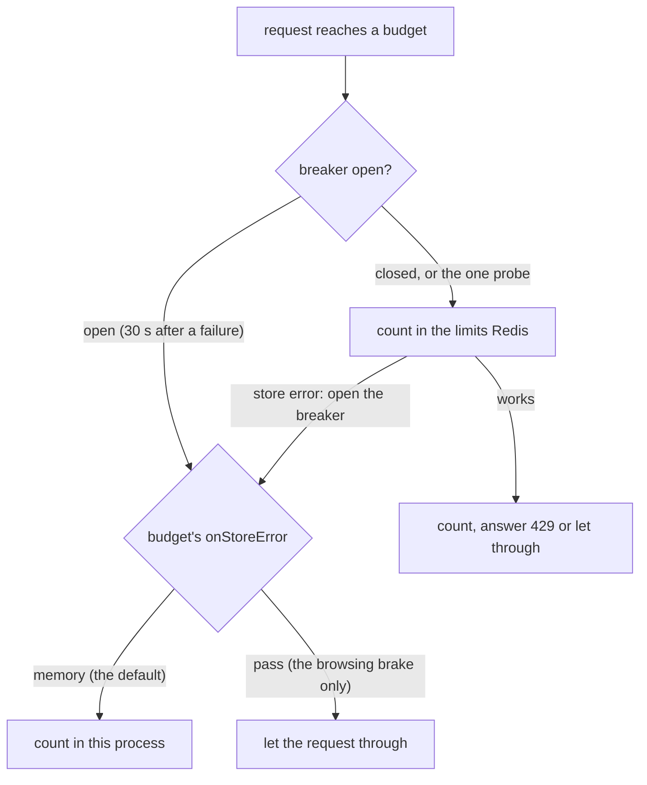
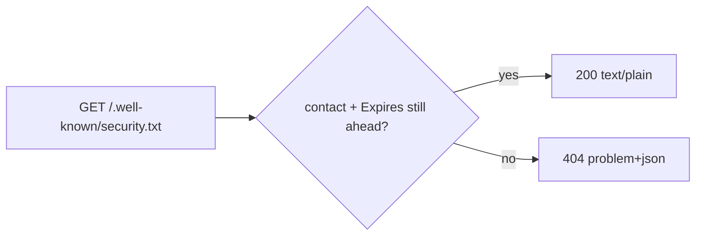

# Security

The security tools in use and the decisions behind them; the narrower topics live in the sub-pages.

## Main security tools

| Tool                                                                                                 | Why it is here                               |
| ---------------------------------------------------------------------------------------------------- | -------------------------------------------- |
| [Helmet](https://helmetjs.github.io/)                                                                | safe default HTTP headers                    |
| [cors](https://github.com/expressjs/cors#readme)                                                     | origin allowlist and browser access control  |
| [express-rate-limit](https://express-rate-limit.mintlify.app/)                                       | basic abuse protection at the edge           |
| [jose](https://github.com/panva/jose#readme)                                                         | access and refresh token flows               |
| [cookie-parser](https://github.com/expressjs/cookie-parser#readme)                                   | cookie access in Express                     |
| [node:crypto argon2id](https://nodejs.org/api/crypto.html#cryptoargon2algorithm-parameters-callback) | password hashing (Node 24.7+, no dependency) |

## Auth architecture (current backend pattern)

A deployment runs one of two session modes, picked by `NODE_SESSION_MODE` and explained in
[Two ways to stay signed in](sessions.md). The default, `jwt`, is a **split-token model**.

Full detail: [Auth architecture (current backend pattern)](./security-auth.md).

## Where token verification happens

- **Access token verification**: `getAuth` middleware reads the Bearer token from `Authorization` and verifies JWT signature/expiry with `verifyAccessToken`.

### A bad bearer on a public page

A bearer is a credential the client chose to present, so a bad one is told so, never quietly
served as a guest (RFC 6750 §3.1; the same rule `sk_` keys already had). `getAuth` answers a
bearer that names no live session — bad signature, expired, revoked, a user who no longer exists —
with `401` and `WWW-Authenticate: Bearer error="invalid_token"`, and an idle staff session with
`401 SESSION_IDLE`. On `invalid_token` the client refreshes and retries as the same person; if the refresh fails
it falls back to a guest by itself. On `SESSION_IDLE` it tells the user and carries on as a guest.

### What a refused credential leaves behind

A bad credential is recorded one of two ways, by whether somebody could have sent it by accident.

- **An attack** — a forged signature, a malformed value, a revoked `sk_` key — is a stored audit row, a log line and a `security_events_total` count.
- **Everything else** — an expired, revoked or idle session, an expired key, or no credential at all on a protected route — is a structured log line (`security.unauthorized`, with the reason, route, method and address, never the token) and, for a stale one, an `auth_stale_credentials_total` count. No row.

So the operator's incident feed does not list 401s: a customer's expired tab and an anonymous
`GET` are routine, and a row each would be a write any caller chooses to make. Find them in the
audit log stream (`log_type: audit`, `event.name: security.unauthorized`).
See [Audit events](../operate/winston.md#audit-events).

Full detail: [Where token verification happens](./security-auth.md).

## Signing-key rotation

`NODE_TOKEN_ACCESS` and `NODE_TOKEN_REFRESH` are each an ordered, comma-separated **ring** of
secrets, newest first — `account/session/config.ts`'s `getAccessTokenRing`/`getRefreshTokenRing`.

Full detail: [Signing-key rotation](../operate/key-rotation.md#signing-keys).

## Database credential and key rotation

Three separate secrets, three separate rotation procedures — none of them automated, all of them
either a `mongosh` command or an env-var edit plus a deploy.

Full detail: [Database credential and key rotation](../operate/key-rotation.md#database-and-backup-credentials).

## Pseudonymised identifiers

One primitive, `pseudonymise(purpose, value)` (`src/infrastructure/security/pseudonymise.ts`), keys every hash of an identifier or a secret that must be comparable but not readable.

| Purpose       | Used for                                | Why not a bare hash                                                                                           |
| ------------- | --------------------------------------- | ------------------------------------------------------------------------------------------------------------- |
| `idempotency` | the request fingerprint stored for 24 h | `POST /signup` bodies carry the plaintext password; a bare SHA-256 lets a Mongo dump be guessed at hash speed |
| `rate-limit`  | the submitted-email budget key in Redis | a Redis snapshot must not hand over the user list                                                             |
| `log`         | personal fields in log lines            | see [Winston](../operate/winston.md#personal-data)                                                            |

- **Scheme:** HMAC-SHA256 under a subkey HKDF-derived (RFC 5869) from `NODE_PSEUDONYM_KEY`, one subkey per purpose, so a digest made for one purpose cannot be replayed as another's.
- **One HKDF entry point:** `deriveSubkey(root, info)` in `infrastructure/security/subkey.ts` derives and caches every subkey (this one, the at-rest AES keys in `versioned-secret.ts`, and the delivered-code MAC key) and returns an immutable `KeyObject`. Nothing else calls `hkdfSync`.
- **Standard:** EDPB Guidelines 01/2025 ¶88-89 and ¶117-118, ENISA pseudonymisation techniques (2019) §7.3, NIST SP 800-57 §5.2.
- **Rotation:** a single value, no ring. Changing it costs, once: identity rate-limit budgets reset (at most one window), log digests stop correlating across the change, and a retry with the same `Idempotency-Key` across the change answers `422` for at most 24 h.

## Machine-to-machine credentials

A JWT proves a PERSON signed in; a partner integration or a webhook consumer calling back into the
API has no person behind it, and handing it a person's password would put every request in the
audit trail under that person's name while carrying their whole reach. `api-keys` is the answer: a
revocable, opaque credential a person MINTS, scoped to a subset of their own permissions.

Full detail: [Machine-to-machine credentials](./security-m2m.md).

## Security properties provided

- **JWT signing (HS256 + secret, key ring)**: prevents token tampering and enforces expiry
  validation; the ring above is what makes rotating the secret not a mass logout.
- **Bearer transport**: token is not auto-attached by browsers; requests must include it explicitly.
- **Refresh cookie flags** (`httpOnly`, `sameSite=lax`, `secure` in production):
    - `httpOnly` blocks JavaScript reads of the refresh token.
    - `sameSite=lax` reduces cross-site cookie sending in common CSRF scenarios.
    - `secure` (production) limits cookie transport to HTTPS.
- **Server-side refresh-token check**: refresh is accepted only if the signed token still has a live `sessions` row, enabling revocation/logout-all behavior.
- **Single-use token entropy**: every value stored in `sessions` or `verificationtokens` — refresh sessions, password reset, email verification, account restore — carries at least 128 bits, from `randomBytes(16)` or a signed JWT. Storage is a plain sha256 digest, never the raw value, so a database dump yields nothing usable. Deliberately **not** bcrypt: there is no low-entropy secret to stretch, and a KDF would tax the refresh path every authenticated client hits on a timer.
- **Single-use tokens are spent atomically**: a token is consumed by one `deleteOne`, never by load-then-`save()`. The operation is idempotent — deleting an already-spent token matches nothing and reports `deletedCount: 0` — and that count is the _only_ thing that distinguishes the winner when the same reset link is followed twice at once. Both callers pass the earlier "does this token exist" read; exactly one sees a non-zero count and proceeds.

## Login → auth → refresh request flow

The `jwt` mode flow. `cookie` mode has no refresh step: the cookie authenticates every request, and the diagram is on [its own page](sessions.md#cookie-mode-one-random-id).

Full detail: [Login → auth → refresh request flow](./security-auth.md).

## Two-factor authentication

The attacker's side of the second factor. The registry's shape, the enrollment state machine and
what a user document carries are on
[Two-factor authentication](../modules/account-two-factor.md).

### The challenge is a claim check, not a code

The single most misread part of the flow. `POST /account/login` cannot mint a session yet but must
not hold the half-finished login in memory, so it hands the browser a signed note naming the
attempt. The **code** is the separate secret, and where it comes from is what a method decides.

### Storage is asymmetric, per method

### The controls, and which attack each one answers

- **Enrollment is two steps, per method.** `POST /account/2fa/methods/{method}/setup` arms nothing;
  only `.../confirm`, given a code the caller demonstrably received, sets `enrolledAt`.

### OAuth and the second factor

`GET /account/oauth/{provider}/callback` checks `twoFactorEnabledAt` the way `postLogin` does: an
account with an armed factor gets the login challenge instead of a session, so 2FA guards every
way in, not the password path alone. See [OAuth](../modules/account-oauth.md) for that path's own
defences.

Full detail: [Two-factor authentication](./security-two-factor.md).

## The rate-limit budgets

**The global limiter is sized for browsing.** A single-page app spends 5–15 requests rendering one
page, and a full pass of the frontend's live e2e suite issues ~150, peaking at 52 in a minute
(measured, not estimated). The default is therefore 100 requests per **minute** — the conventional
shape for a public API.

Per minute rather than per quarter-hour, for two reasons. Spread over a long window the same number
becomes a session quota an ordinary browsing session trips, and a limit a legitimate user reaches is
worse than none: the 429 lands on them and reads as the app being broken, while an attacker simply
rotates IPs. A short window also recovers — exhausting a 15-minute budget in the first two minutes
locks the user out for the remaining thirteen.

**Credential endpoints get their own, much smaller budget.** Applied to `POST /account/login`, the
global generosity is a hundred password guesses a minute from one address. Worse, a shared bucket
means an attacker's guesses and a real user's page views spend the same allowance, so raising the
global limit for legitimate traffic silently raises the guessing rate too. The separate limiter is
mounted per route, so browsing never consumes it and a locked-out guesser can still read the
catalogue.

`skipSuccessfulRequests` is on: a user who signs in correctly has spent nothing, so a shared address
(an office, a school, CGNAT) does not lock its own users out for succeeding. Only failures count,
which is exactly the signal worth limiting.

The test suites raise the budgets — the global one to 100000 and each auth budget to 10000 — see `tests/support/setup-environment.ts`.

**Every budget's store carries its own prefix.** `express-rate-limit` refuses to count one request
twice in the same store (`ERR_ERL_DOUBLE_COUNT`) and tells stores apart by `store.prefix`. The
Redis and failover wrappers are plain objects, so `rateLimitStore` stamps `<namespace>:` on each.
Without it, two budgets keyed alike on one request — the account-keyed attempt and decline budgets
on `POST /payments/:id/confirm` — were reported as one hit counted twice, though each counted once
in its own namespace.

**A third budget, the same shape as neither.** The contact budgets (`contactLimiters`: `submissionLimiter` per address, plus a per-email and a per-address-block budget) guard `tasks`'s
`POST /tasks` — a public write that causes an outbound email (signup and reset also do, under their own budgets; this one reaches the operator) — and it inverts the rule
above: `skipSuccessfulRequests` is deliberately **off**. A credential attempt is abusive when it
FAILS (a wrong guess); a contact-form submission is abusive when it SUCCEEDS (a bot posts a
well-formed body, gets a `202`, and an operator gets an email). Mounting `credentialLimiters` on
`POST /tasks` would therefore change nothing at all — it would count zero of the requests that matter.
`submissionLimiter` spends its budget on every request, success or failure, keyed on the caller's
address like the global limiter, at a much smaller default (`NODE_SUBMISSION_RATE_LIMIT_MAX=5`) —
a person files a contact request once. The other two are `NODE_SUBMISSION_RATE_LIMIT_EMAIL_MAX` (5) and
`NODE_SUBMISSION_RATE_LIMIT_BLOCK_MAX` (20).

**A fourth budget, same shape as the third.** `uploadLimiter` guards every route that accepts an
image (`upload.single('imageUpload')`, across `products`, `users` and `account`). The cost here
isn't a spam email, it's CPU: each upload feeds the `worker.image.digest` pipeline —
decode/strip-metadata/resize/re-encode via `sharp` — which runs inline when no broker is
configured, and one at a time per worker (`prefetch: 1`) when one is. Like `submissionLimiter`,
`skipSuccessfulRequests` is off: a well-formed upload is the expensive case, not a rejected one.
Default `NODE_UPLOAD_RATE_LIMIT_MAX=20` — generous enough for someone editing several product
images in a row, well under the global brake. Keyed on the UPLOADER, not the address: the api-key
credential, else the signed-in account (`getAuth` has resolved one by the time an upload route runs),
else the address block. A session behind a proxy pool does not get 20 per address, and staff behind
one office NAT do not share 20.

**A fifth, on the one unauthenticated WRITE.** `webhookLimiter` guards `POST /payments/webhook/{provider}`.
The signature check is the actual defence, so only an unverified delivery needs a bound:
`skipSuccessfulRequests` refunds a verified one, and the budget counts refusals (a `400` or a
`404`) per address BLOCK, the key every other anonymous budget uses. A forgery costs one HMAC per
secret, two log lines and a security event; it is bounded per block, not in total, since a proxy
pool spans many blocks. The budget is `audited: false`: a forged flood would bury the audit trail
in `security.rate_limit_hit` rows, and the refusal metric (`RateLimitRefusals`) and the
signature-failure alert (`PaymentWebhookSignatureFailures`) still fire.
Default `NODE_PAYMENT_WEBHOOK_RATE_LIMIT_MAX=60` per window.

**The last two are keyed on a credential, not an address.** `mfaChallengeLimiter`
(`POST /account/login/2fa`) and `mfaSendLimiter` (`POST /account/login/2fa/send`) both bucket on a
keyed HMAC of the challenge token (`pseudonymise`) rather than the caller's IP. That is the only key that bounds guesses
against one login: an IP or account key lets a distributed attacker rotate addresses, while the
challenge is the thing being attacked. Both windows are 600s, the longer of the two challenge
tiers, so a window can never end before the challenge it bounds.

A request naming no `challenge` at all — a forged or malformed body — has nothing to hash, so it
falls back to the caller's address BLOCK instead of one shared bucket: a shared bucket would let
any two such callers exhaust the same budget, which bounds neither of them against a live
challenge.

They are two budgets and not one because they bound different costs — `NODE_MFA_CHALLENGE_MAX`
caps GUESSES, `NODE_MFA_SEND_MAX` caps outbound mail — and sharing them would let a caller who
typed three wrong codes lose the ability to be sent a right one.

Neither is the whole story, because a delivered code lives on the user document and outlives the
challenge it was sent for. Its own attempt ceiling is what closes that, and a ceiling only counts
if a miss is WRITTEN: every path that checks a code — the login challenge, the enrollment confirm,
and both removal routes — persists the spent attempt before answering, or the ceiling silently
becomes no ceiling at all.

**A sixth, also keyed on a credential.** `apiKeyLimiter` bounds a request authenticated via
[an api-key](#machine-to-machine-credentials), keyed on the credential itself rather than the
caller's address — a partner behind one NAT is one caller, and ten partners behind one CDN are ten,
which an address-keyed budget can't tell apart. Run from inside `getAuth`'s credential branch
rather than mounted on any one route, so every route reached through `getAuth` gets it for free; it
layers on top of the address-keyed global brake, and the global brake refunds a request once it
ends if a key resolved for it: a valid key is bound by its own 120 and nothing else, partners
sharing one exit address (a corporate NAT, an automation service) get 120 each, and a fake
`Bearer sk_` header earns no refund, so anonymous and fake-key traffic stays at 100 per address.
"Resolved" is the test, not the status code. The cost: a partner with more than 100 requests in
flight at once can see brief `429`s, because a refund lands only when the response finishes.
Default `NODE_API_KEY_RATE_LIMIT_MAX=120`.

Every budget above, as declared data (`RateLimitBudget` on the owning module's manifest, or
`INFRASTRUCTURE_RATE_LIMITS` for the ones with no module) — generated by
`npm run regenerate`, checked by `tests/cross-cutting/rate-limit-budgets.test.ts`.

The numbers and wording of a budget (name, namespace, env var, default, window, bounds, audited,
`onStoreError`) are YAML: the module's `module.yaml` under `rateLimits:`, or
`shared/rules/rate-limits.yaml` for the kernel's three. `regenerate` writes a committed
`rate-limits.generated.ts` from each, so a twin backend copies the YAML. How a caller is bucketed
(`keyGenerator`), what counts as a success and what is skipped stay code, in each module's `rate-limits.ts` (the kernel's in `rate-limit.ts`).
See [shared rules](shared-rules.md#rule-data-the-twin-will-need-yaml-generated-ts):

<!-- rate-limit-budgets:start -->

| Budget                                       | Namespace                         | Owner            | Env var                                     | Default | Window                      | Keyed by                                                                                                                  | Audited | Redis down |
| -------------------------------------------- | --------------------------------- | ---------------- | ------------------------------------------- | ------- | --------------------------- | ------------------------------------------------------------------------------------------------------------------------- | ------- | ---------- |
| Mail to one mailbox                          | `mail-recipient`                  | `account`        | `NODE_MAIL_RECIPIENT_RATE_LIMIT_MAX`        | 10      | 86400000ms                  | the recipient mailbox: lowercased, `+tag` dropped, dots dropped for Gmail, pseudonymised                                  | yes     | memory     |
| Credential guesses — per account             | `credentials-identity`            | `account`        | `NODE_AUTH_RATE_LIMIT_MAX`                  | 10      | 900000ms                    | the submitted email or username (normalised and pseudonymised); not counted when the body names none                      | yes     | memory     |
| Credential guesses — failing device cookie   | `credentials-device`              | `account`        | `NODE_AUTH_RATE_LIMIT_DEVICE_MAX`           | 10      | 900000ms                    | address (IPv6 /56)                                                                                                        | yes     | memory     |
| Credential guesses — per address             | `credentials-address`             | `account`        | `NODE_AUTH_RATE_LIMIT_ADDRESS_MAX`          | 30      | 900000ms                    | address (IPv6 /56)                                                                                                        | yes     | memory     |
| Credential guesses — per address block       | `credentials-block`               | `account`        | `NODE_AUTH_RATE_LIMIT_BLOCK_MAX`            | 100     | 900000ms                    | address block (IPv4 /24, IPv6 /48)                                                                                        | yes     | memory     |
| Credential guesses — per signed-in account   | `credentials-signed-in`           | `account`        | `NODE_AUTH_RATE_LIMIT_SIGNED_IN_MAX`        | 10      | 900000ms                    | the authenticated account                                                                                                 | yes     | memory     |
| Password-strength checks                     | `password-check`                  | `account`        | `NODE_PASSWORD_CHECK_RATE_LIMIT_MAX`        | 20      | `NODE_RATE_LIMIT_WINDOW_MS` | address (IPv6 /56)                                                                                                        | yes     | memory     |
| Password-strength checks — per address block | `password-check-block`            | `account`        | `NODE_PASSWORD_CHECK_RATE_LIMIT_BLOCK_MAX`  | 60      | `NODE_RATE_LIMIT_WINDOW_MS` | address block (IPv4 /24, IPv6 /48)                                                                                        | yes     | memory     |
| Signups — per email                          | `signup-identity`                 | `account`        | `NODE_SIGNUP_RATE_LIMIT_MAX`                | 5       | `NODE_RATE_LIMIT_WINDOW_MS` | the submitted email or username, normalised and pseudonymised (falls back to address block when absent)                   | yes     | memory     |
| Signups — per address                        | `signup-address`                  | `account`        | `NODE_SIGNUP_RATE_LIMIT_ADDRESS_MAX`        | 15      | `NODE_RATE_LIMIT_WINDOW_MS` | address (IPv6 /56)                                                                                                        | yes     | memory     |
| Signups — per address block                  | `signup-block`                    | `account`        | `NODE_SIGNUP_RATE_LIMIT_BLOCK_MAX`          | 40      | `NODE_RATE_LIMIT_WINDOW_MS` | address block (IPv4 /24, IPv6 /48)                                                                                        | yes     | memory     |
| Password resets — per email                  | `reset-identity`                  | `account`        | `NODE_RESET_RATE_LIMIT_MAX`                 | 5       | `NODE_RATE_LIMIT_WINDOW_MS` | the submitted email or username, normalised and pseudonymised (falls back to address block when absent)                   | yes     | memory     |
| Password resets — per address                | `reset-address`                   | `account`        | `NODE_RESET_RATE_LIMIT_ADDRESS_MAX`         | 15      | `NODE_RATE_LIMIT_WINDOW_MS` | address (IPv6 /56)                                                                                                        | yes     | memory     |
| Password resets — per address block          | `reset-block`                     | `account`        | `NODE_RESET_RATE_LIMIT_BLOCK_MAX`           | 40      | `NODE_RATE_LIMIT_WINDOW_MS` | address block (IPv4 /24, IPv6 /48)                                                                                        | yes     | memory     |
| MFA challenge guesses                        | `mfa-challenge`                   | `account`        | `NODE_MFA_CHALLENGE_MAX`                    | 5       | 600000ms                    | the challenge string, hashed: from the body, else the OAuth continuation cookie (falls back to address block when absent) | yes     | memory     |
| MFA code deliveries                          | `mfa-send`                        | `account`        | `NODE_MFA_SEND_MAX`                         | 3       | 600000ms                    | the challenge string, hashed: from the body, else the OAuth continuation cookie (falls back to address block when absent) | yes     | memory     |
| MFA code deliveries — per account            | `mfa-account-send`                | `account`        | `NODE_MFA_ACCOUNT_SEND_MAX`                 | 5       | 3600000ms                   | the authenticated account                                                                                                 | yes     | memory     |
| Checkouts attempted                          | `checkout`                        | `cart`           | `NODE_CHECKOUT_RATE_LIMIT_MAX`              | 10      | `NODE_RATE_LIMIT_WINDOW_MS` | the authenticated account                                                                                                 | yes     | memory     |
| Cart merges                                  | `cart-merge`                      | `cart`           | `NODE_CART_MERGE_RATE_LIMIT_MAX`            | 10      | `NODE_RATE_LIMIT_WINDOW_MS` | the authenticated account                                                                                                 | yes     | memory     |
| Example creation                             | `example-create`                  | `example`        | `NODE_EXAMPLE_RATE_LIMIT_MAX`               | 30      | `NODE_RATE_LIMIT_WINDOW_MS` | the authenticated account                                                                                                 | yes     | memory     |
| Invoice / credit-note renders                | `invoicing-render`                | `invoicing`      | `NODE_INVOICING_RATE_LIMIT_MAX`             | 20      | `NODE_RATE_LIMIT_WINDOW_MS` | the authenticated account                                                                                                 | yes     | memory     |
| Order CSV exports                            | `orders-export`                   | `orders`         | `NODE_ORDER_EXPORT_RATE_LIMIT_MAX`          | 10      | `NODE_RATE_LIMIT_WINDOW_MS` | the authenticated account                                                                                                 | yes     | memory     |
| Order staff notes                            | `orders-note`                     | `orders`         | `NODE_ORDER_NOTE_RATE_LIMIT_MAX`            | 30      | `NODE_RATE_LIMIT_WINDOW_MS` | the authenticated account                                                                                                 | yes     | memory     |
| Payment webhook deliveries                   | `payment-webhook`                 | `payments`       | `NODE_PAYMENT_WEBHOOK_RATE_LIMIT_MAX`       | 60      | `NODE_RATE_LIMIT_WINDOW_MS` | address block (IPv4 /24, IPv6 /48)                                                                                        | no      | memory     |
| Payment confirm attempts                     | `payments-confirm-attempts`       | `payments`       | `NODE_PAYMENT_CONFIRM_RATE_LIMIT_MAX`       | 5       | 3600000ms                   | the authenticated account                                                                                                 | yes     | memory     |
| Payment confirm declines                     | `payments-confirm-declines`       | `payments`       | `NODE_PAYMENT_DECLINE_RATE_LIMIT_MAX`       | 3       | 3600000ms                   | the authenticated account                                                                                                 | yes     | memory     |
| Payment confirm declines per address block   | `payments-confirm-declines-block` | `payments`       | `NODE_PAYMENT_DECLINE_BLOCK_RATE_LIMIT_MAX` | 10      | 3600000ms                   | address block (IPv4 /24, IPv6 /48)                                                                                        | yes     | memory     |
| Payment intents and syncs                    | `payments-intent-sync`            | `payments`       | `NODE_PAYMENT_INTENT_RATE_LIMIT_MAX`        | 30      | 3600000ms                   | the authenticated account                                                                                                 | yes     | memory     |
| Returns and withdrawals opened               | `returns-write`                   | `returns`        | `NODE_RETURNS_RATE_LIMIT_MAX`               | 20      | `NODE_RATE_LIMIT_WINDOW_MS` | the authenticated account                                                                                                 | yes     | memory     |
| Contact submissions — per address            | `submissions`                     | `tasks`          | `NODE_SUBMISSION_RATE_LIMIT_MAX`            | 5       | `NODE_RATE_LIMIT_WINDOW_MS` | address (IPv6 /56)                                                                                                        | yes     | memory     |
| Contact submissions — per email              | `submission-identity`             | `tasks`          | `NODE_SUBMISSION_RATE_LIMIT_EMAIL_MAX`      | 5       | `NODE_RATE_LIMIT_WINDOW_MS` | the submitted email or username, normalised and pseudonymised (falls back to address block when absent)                   | yes     | memory     |
| Contact submissions — per address block      | `submission-block`                | `tasks`          | `NODE_SUBMISSION_RATE_LIMIT_BLOCK_MAX`      | 20      | `NODE_RATE_LIMIT_WINDOW_MS` | address block (IPv4 /24, IPv6 /48)                                                                                        | yes     | memory     |
| Browsing (global)                            | `global`                          | `infrastructure` | `NODE_RATE_LIMIT_MAX`                       | 100     | `NODE_RATE_LIMIT_WINDOW_MS` | address (IPv6 /56)                                                                                                        | no      | pass       |
| Api-key requests                             | `api-key`                         | `infrastructure` | `NODE_API_KEY_RATE_LIMIT_MAX`               | 120     | `NODE_RATE_LIMIT_WINDOW_MS` | the api-key credential                                                                                                    | yes     | memory     |
| Image uploads                                | `uploads`                         | `infrastructure` | `NODE_UPLOAD_RATE_LIMIT_MAX`                | 20      | `NODE_RATE_LIMIT_WINDOW_MS` | the uploader: the api-key credential, else the authenticated account (falls back to address block when neither resolved)  | yes     | memory     |

<!-- rate-limit-budgets:end -->

### Response headers

Every response that passed a budget carries it in the current IETF draft's syntax
([`draft-ietf-httpapi-ratelimit-headers`](https://datatracker.ietf.org/doc/draft-ietf-httpapi-ratelimit-headers/)).
One named item per budget the request went through, so a login shows the global brake plus up to
four credential budgets (the per-account one is skipped on a familiar device; the device one counts
only a forged or stale device cookie):

```
RateLimit-Policy: "global";q=100;w=60, "credentials-identity";q=10;w=900, "credentials-address";q=30;w=900, "credentials-block";q=100;w=900
RateLimit: "global";r=97;t=41, "credentials-identity";r=9;t=880, "credentials-address";r=29;t=880, "credentials-block";r=99;t=880
```

- The name is the budget's `namespace`, the Namespace column of the table above; `q` is the limit, `w` the window in
  seconds, `r` what is left, `t` seconds to the reset.
- A refusal (`429`) carries the same two headers plus `Retry-After`, the same number as
  `details.retryAfter` (at least one second). The refusing budget is always listed in `RateLimit`
  with `r=0` and `t` equal to `Retry-After`, and named in `details.policy`, even a mailbox budget
  charged by hand that has no `RateLimit-Policy` item. Cooldowns and the 2FA lock send
  `Retry-After` only.
- After a lockout, this account's later windows double (up to 7200 s), so `t` and `Retry-After`
  can exceed `w`. `t` / `Retry-After` is the real wait; `w` is the base window. The doubling is in
  [authentication](defences/authentication.md).
- We write them ourselves instead of using express-rate-limit's `draft-8` writer: that one always
  adds `pk`, a truncated unsalted hash of the caller's key (an IPv4 address for the global brake).
  `pk` identifies the caller, so no identifier of the caller is sent.
- A public cached read (catalogue, locales, `/config`, sitemaps) may carry another visitor's
  `"global"` numbers if a shared cache stores it. They name no one, but a client must ignore
  `RateLimit` on a response served from a cache (`Age` > 0, draft §7.3).
- The `RateLimit` / `RateLimit-Policy` fields are declared in the contract under
  `components/headers` and exposed to browsers through CORS.

### When the limits Redis is down

Counters live on the `limits` Redis ([two instances](redis-cache.md#two-redis-instances)). A security
control fails **secure** (OWASP A10:2025), so a store error must not switch a budget off, and it must
not lock every customer out either:



- **`memory` is the default**, so a new budget fails secure without anyone asking. The limit holds
  per worker rather than per deployment for the length of the outage. Login's challenge gate and
  the payment decline gate read the same fallback, so they keep working.
- **`pass` is a decision**, listed in `tests/cross-cutting/rate-limit-budgets.test.ts`: only the
  global browsing brake, which guards no credential.
- **The breaker** (`store-breaker.ts`) is one per process. Without it an outage adds the 1 s connect
  timeout to every request on every budget. After 30 s one request probes Redis; the rest keep
  using the fallback until it answers.
- **Signal:** one `error` log line per outage, and `rate_limit_store_fallback_total{namespace}`
  counts every operation served without Redis. An alert on it belongs to the monitoring stack.

### Identity- and block-keyed budgets — signup, password reset, the contact form

A residential-proxy pool costs about $20 for millions of addresses, and a single IPv6 customer is
allocated 18 quintillion of them. A budget keyed on one address bounds almost nothing against
either — which mattered nowhere more than the three routes above whose abuse is a well-formed
request repeated, not a failed one.

**`signupLimiters` and `resetRequestLimiters` replace `credentialLimiters` on their routes**, not
add to it. `credentialLimiters`' `skipSuccessfulRequests` spends nothing on a successful signup
(a Sybil account) or a successful reset request (`postResetRequest` always answers 200, to avoid
revealing whether an account exists) — exactly the requests these routes exist to bound. Both are
shaped like `submissionLimiter` instead: every request spends the budget, success or failure.

**Every one of these budgets is three, not one**: identity (the submitted email, normalised
and hashed like `identityOf`), single address, and address BLOCK — an IPv4 /24, an IPv6 /48 (the single-address key masks IPv6 to the library's /56, so the block is the wider bucket on both families).
`contactLimiters` adds the same two dimensions (email and block) on top of `submissionLimiter`, which is the address one. The
block dimension also extends `credentialLimiters` itself, so login gets the same third bucket.
A dual-stack listener reports an IPv4 caller as `::ffff:a.b.c.d`, so the key is built by unmapping
FIRST (`ipKeyGenerator`) and masking the IPv4 result to its /24 after; masking before would leave
every mapped caller in a bucket of one.

Three independent buckets, not one key built from all three fields: varying any single one of
identity, address or block gets a caller a fresh budget on the other two dimensions, but never on
all three at once — which is the property that makes a proxy pool, or a pool of freshly-registered
mailboxes, cost something rather than nothing.

### Mail to one mailbox — the victim's budget

Every budget above bounds a CALLER. A mail bomb is bounded by its VICTIM: signup, password reset,
email change, both resends, and a data export can each be pointed at a stranger's address, and `victim+1@x`,
`victim+2@x`, … each look like a new address to a budget keyed on the submitted string.

**One budget on the canonical mailbox, used by every flow that mails** (`account/mail-budget.ts`):

- **Canonical:** lowercase, the `+tag` dropped, dots dropped for Gmail (and `googlemail.com` read as
  `gmail.com`) — `canonicalMailbox`. For budgets only: storage and uniqueness are untouched, since
  `a@x` and `a+shop@x` are legitimately two accounts.
- **A day, not a minute:** `NODE_MAIL_RECIPIENT_RATE_LIMIT_MAX` (10) per 24 hours, so a slow drip is
  caught too.
- **Two doors:** a middleware where the body names the address (signup, reset), and a charge inside
  the service where the server picks the recipient (verification resend, pending-email resend, an
  email change to a new address). Both count in one store, so one budget has one tally.
- **A refused charge sends nothing and saves nothing:** `429`, with `Retry-After`; an email change
  leaves `pendingEmail` as it was.
  Either door counts the refusal in `rate_limit_refusals_total` and audits it
  (`security.rate_limit_hit`), whoever asked.
- **Not canonicalised, accepted:** a catch-all domain and a sub-address separator other than `+`
  (`victim-1@x`) still read as a new mailbox, so each gets a fresh `mail-recipient` bucket. The
  address and block budgets above still bound it.

## Why the metrics endpoint has its own credential

`/observability/metrics` cannot use the bearer token the other observability routes check
`read:ObservabilitySnapshot` on: it is scraped by Prometheus, which has no way to log in, refresh
a token or hold a session. What Prometheus does
support is a static bearer credential in its `scrape_configs`, so that is the credential here.

Full detail: [Why the metrics endpoint has its own credential](./security-decisions.md).

## Why search text is escaped before it reaches `$regex`

`$regex` with unescaped input is a remote denial of service, not a correctness nit. MongoDB
evaluates the pattern **server-side against every candidate document**, and a catastrophic
backtracking pattern costs seconds of CPU per document from a handful of characters — `(a+)+$`
against a 31-character subject takes ~45s in one engine. `POST /products/search` and

Full detail: [Why search text is escaped before it reaches `$regex`](./security-decisions.md).

## Redis and RabbitMQ stay plaintext

Redis and RabbitMQ are reached over plaintext on the compose network of the single host, and
publish no port outside it. Nothing refuses a plaintext URL: a deployment that crosses a network
sets `rediss://` and `amqps://` itself. Sentry's and GitLab's self-hosted setups make the same
choice for their own bundled stores.

Full detail: [Redis and RabbitMQ stay plaintext](./security-decisions.md).

## One environment switch

`NODE_ENV` has two settings that matter: **development or test** (a developer's machine, CI) and
**everything else**. Everything else is strict, an unset value and `staging` included. One helper
says which, `isRelaxedEnvironment()` in `infrastructure/runtime/config.ts`, and every switch
below reads it. The failure it closes: a safety switch that turned on only for the exact word

Full detail: [One environment switch](./security-decisions.md).

## `trust proxy`, and the two ways to get it wrong

Everything that identifies a caller by address — the rate limiter's bucket key, the audit log's
`ip` — reads `request.ip`. Behind a proxy that is the **proxy's** address unless Express is told
otherwise, and both failure modes are silent.

Full detail: [`trust proxy`, and the two ways to get it wrong](./security-decisions.md).

## 401 or 403, and why the guards agree

The distinction is the client's next move, not a shade of politeness.

Full detail: [401 or 403, and why the guards agree](./security-decisions.md).

## Why the SSE endpoints authenticate by cookie

`EventSource` — the only way a browser consumes SSE — **cannot set request headers**. That is a
limitation of the browser API, not an oversight, so `isAuth`, which reads `Authorization: Bearer`,
can never be satisfied by an SSE connection.

Full detail: [Why the SSE endpoints authenticate by cookie](./security-decisions.md).

## Reporting a vulnerability

Three layers, each reaching a different finder:

| Layer                                  | Reaches                              | Where                                                       |
| -------------------------------------- | ------------------------------------ | ----------------------------------------------------------- |
| GitHub private vulnerability reporting | someone browsing the repo            | repo Settings → Security (a maintainer toggle, outside git) |
| A security policy file                 | the repo's Security tab              | repo root                                                   |
| `/.well-known/security.txt` (RFC 9116) | someone probing a running deployment | `src/app/system-routes.ts`                                  |

Layer 3 is an Express route, not a static file: `express.static` runs with `dotfiles: 'ignore'`,
which 404s every `.well-known` path, and that option is a defence worth keeping.

It is **off by default**, so a fork never publishes the author's contact:

| Variable                   | Meaning                                                 |
| -------------------------- | ------------------------------------------------------- |
| `NODE_SECURITY_CONTACT`    | required to publish; a GitHub advisory URL or `mailto:` |
| `NODE_SECURITY_EXPIRES`    | required to publish; ISO 8601 date                      |
| `NODE_SECURITY_POLICY_URL` | optional `Policy:` link                                 |

`Expires` is a renewal duty. It is a fixed date on purpose: a rolling one always looks fresh and
so says nothing. Once it passes the route answers 404 (RFC 9116 §2.5.5: an expired file must not be
trusted), judged on every request rather than at boot. Not published: PGP `Encryption:` and
signatures.



## Strategy

Security concerns should happen **before** business logic reaches deep layers.
That is why auth, headers, origin checks, and rate limiting stay near routes and middlewares.

## External references

- [OWASP REST Security Cheat Sheet](https://cheatsheetseries.owasp.org/cheatsheets/REST_Security_Cheat_Sheet.html)
- [OWASP JWT Cheat Sheet](https://cheatsheetseries.owasp.org/cheatsheets/JSON_Web_Token_for_Java_Cheat_Sheet.html)

## Read next

- [Request Flow](request-flow.md)
- [api-keys](../modules/api-keys.md) — machine-to-machine credentials, in full
- [Sessions](../modules/account-sessions.md) — the token mechanics, and the freshness claims
- [Two-factor authentication](../modules/account-two-factor.md) — the registry and its state machine
- [OAuth](../modules/account-oauth.md) — the provider port and the CSRF handshake
- [Winston & Audit Logs](../operate/winston.md)
- [API overview](../build/api-contracts.md#rest-patterns-used-here)
- [Data Protection](data-protection.md) — what personal data this stores, under what
  lawful basis, and the subject-request and breach runbooks
