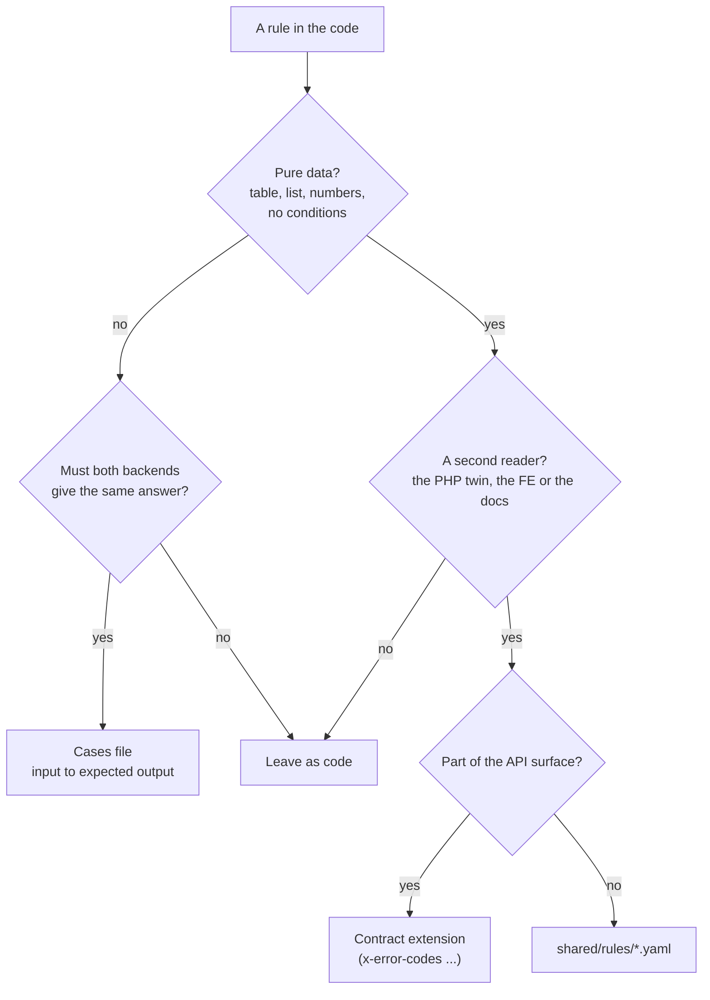
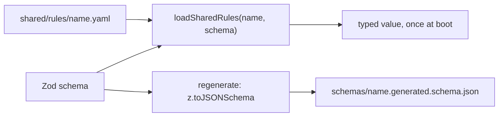
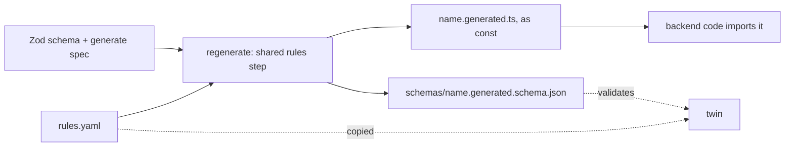

# Shared rules

A rule that is really **data** (a list, a table, a few numbers) is written once, in a file both
backends read. Logic that must stay code gets a **cases file** instead: input to expected output,
run by both backends' tests. This page is what goes where, and how to add one.

The first instance is older than this page: `shared/authorization-keys.generated.yaml`, `shared/rules/authorization-roles.yaml` and `shared/cases/authorization.cases.yaml`.
CASL reads them here, Laravel reads them in the twin. Shared rules extend that pattern.

## 1 · What goes where

Hard limits, enforced by each file's schema rather than by review:

- A rules file never holds an expression, a condition or a formula. Strings, numbers, booleans,
  lists and maps only. A field that wants an `if` is code plus a cases file; otherwise YAML grows
  into a bad programming language.
- Env var names stay per twin. A rules file holds the default; the env still overrides it.
- Key generators, `run` functions and library calls stay code. Only their data fields move.
- Prefer a cases file. It adds tests and changes no code.

Two things deliberately do **not** go to YAML:

- **Module lifecycles stay code.** A status machine is a typed TypeScript event table read by
  `defineLifecycle` (`src/domain-primitives/lifecycle.ts`); the contract carries only the status enum
  and the `actions` flags, and clients read `actions`. No mature API publishes its transition graph.
- **Shop-only tables stay code until a second reader exists.** Order events, status traits, VAT and
  shipping tables belong to the commerce modules; moving them early would build a reader for nobody.

## 2 · Is this standard?

| Name                                     | Examples                                                                                                 |
| ---------------------------------------- | -------------------------------------------------------------------------------------------------------- |
| Rules as data / table-driven design      | Symfony Workflow (YAML), xstate configs, SCXML, CASL / OPA / Cedar policy files, OMG DMN decision tables |
| Shared test vectors / conformance suites | JSON Schema Test Suite, CommonMark spec tests, Wycheproof, RFC 6238 TOTP vectors, CloudEvents SDKs       |

## 3 · Layout

| What            | Where                                                                               |
| --------------- | ----------------------------------------------------------------------------------- |
| Rule data       | `shared/rules/<name>.yaml`                                                          |
| Its schema      | Zod, in `src/infrastructure/config/shared-rules/<name>.ts`, listed in `registry.ts` |
| Its JSON Schema | `shared/rules/schemas/<name>.generated.schema.json`, generated, committed           |
| Its TS (opt-in) | `<out>.generated.ts`, an `as const` file built from the YAML, gitignored            |
| Cases           | `shared/cases/<name>.cases.yaml`                                                    |
| Cases test      | `tests/cross-cutting/<name>-conformance.test.ts`, through `tests/support/cases.ts`  |
| Moved verbatim  | `shared/rules/breached-passwords.txt`, `shared/locales/*.json`                      |

`shared/**` is byte-identical in both repos. The twin picks the files up from there; nothing here
writes to the twin.

`*.generated.*` is written by `npm run regenerate`; edit its sources, never the file.

## 4 · How it loads

`loadSharedRules` parses with `yaml`, validates with the schema and returns `z.infer` of it. It runs
once at import, so a broken file fails the boot, never a request. The JSON Schema export lets the
twin validate the same file without Zod; `npm run check` refuses a stale one.

### Rule data the twin will need: YAML + generated TS

Data that types a literal union (audit action names) or holds plain numbers (retry delays, 2FA
limits) is not read at boot. `regenerate` turns the YAML into a committed `as const` file, so the
type is a real union and the code imports a constant. The twin copies the YAML and never sees the TS.

- A shared file opts in with `generate: { out, exportName, shape }` in `registry.ts`.
- A module-owned file is `src/modules/<m>/rules.yaml` + `rules.schema.ts` (exports `rulesSchema`,
  `rulesGenerate`) and is found by the generator, not listed.
- A block in a module's `module.yaml` (`rateLimits:`, `jobs:`) is found the same way. The generator
  keeps one table of such blocks, `{ key, schema, file, exportName }`: a new block is one row.
- Data that sits in another shared document (the `stepUp:` windows in
  `authorization-keys.generated.yaml`) is listed in the generator beside the registry's entries.
- `shape` is `verbatim` (dump the parsed data) or `keyed-list` (`{ value, description }` rows become
  `{ KEY: 'value' }` with a JSDoc per key).
- The generated TypeScript is gitignored and rebuilt by `postinstall`; Stryker excludes it. The
  committed JSON Schemas are checked by the pre-commit hook, which refuses a stale one.

## 5 · Adding a rule

1. Write `shared/rules/<name>.yaml`, with a comment on every list saying why it is shaped that way.
2. Write the Zod schema (`z.strictObject`, so an unknown field fails) and add it to `registry.ts`.
3. Read it with `loadSharedRules` where the constant used to be. Values do not change in a move.
4. `npm run regenerate` writes the JSON Schema.

## 6 · Adding a case

1. Write `shared/cases/<name>.cases.yaml`. Each case has a `name` (one sentence) and an `expect`.
   Put every `allow` next to the `deny` that bounds it.
2. Write the test with `describeCases(file, caseSchema, run)`. A file with no cases fails on its
   own (`it.each` throws on an empty table), and a malformed case fails the strict parse.
3. A case that fails on this backend is a bug here. Fix it in the same change.

## 7 · Today

Not listed here: a list of every shared file and its readers would be a second copy of what the files
already say about themselves.

- **A rule file** (`shared/rules/*.yaml`, a module's `module.yaml` blocks) names its generated reader in
  its own header; the reader's `*.generated.ts` header names the source.
- **A cases file** (`shared/cases/*.cases.yaml`) is run by the `tests/cross-cutting/<name>-conformance.test.ts`
  of the same name.
- **`shared/authorization-keys.generated.yaml`** is not on the rules generator: the frontend cannot run
  it, so `api/permission-vocabulary.ts` and the frontend's copy are built from it instead.

## Money is a case file, not a rule table

`cases/money.cases.yaml` pins how an amount is read and spelled: its `decimal` kind yields the
padded string (`"19.90"` EUR, `"1000"` JPY, `"1.500"` KWD), with exponent cases for MGA and MRU
(2 places). The ISO 4217 exponent table itself stays in `src/domain-primitives/money.ts`; it is not
a shared YAML, and the frontend keeps no table at all, because an amount at its currency's scale
carries its own decimals.
