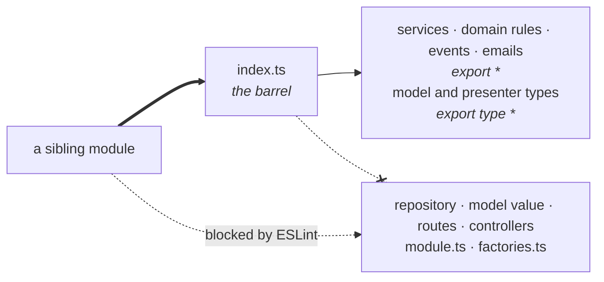

# Strategic DDD: the barrel

Published language: what a module lets its siblings reach.

## 5. Published language — the barrel

`index.ts` is the one surface a sibling may import, and ESLint stops anyone reaching past it — every
module has one, structurally, so there is no "no barrel, therefore unreachable" escape hatch left.

The convention is a **convenience barrel with a short, structural deny-list**, not the narrower
"publish only what a sibling imports today". That narrower form has exactly one failure in practice: the list is short, a sibling's need is real, and copying the logic,
redeclaring the type, or casting around the gap is cheaper than adding the export. A convenience
barrel removes the incentive to route around it, at the cost of three things
this repo already pays for elsewhere: a write handle leaking through a published repository (closed
by the deny-list below), an import cycle inside a module (closed by ESLint refusing a module's own
barrel-of-itself), and the loading cost of pulling in a whole module (already paid — `modules.ts`
loads every module regardless).

What a barrel publishes: `export *` from its services, domain rules, events and emails files, and
`export type *` from its model and its presenter(s) — a shape describing itself grants no power the
way a handle does. What it never publishes, no matter how convenient:

- **A repository.** `productRepository` leaving the barrel is a handle on a collection: whoever
  holds it can create, update and delete rows of a module it does not own, with that module's
  service — and every rule, event, counter and audit line the service carries — bypassed. A sibling
  read moves to a service function instead. `modules/inventory/index.ts` states the case by
  refusing outright:

    > The repositories, both models and every counter primitive are deliberately absent:
    > publishing one would hand back the ability this module exists to take away. A sibling asks
    > for a transition by name and gets a boolean — what it costs in counters is not their
    > business.

- **A step beneath a guarded door.** The work a service does once another function has checked
  scope, ownership or state (`payments`' `settlePayment`, `inventory`'s `applyTransition`).
  Publishing it is a repository export one level up: the write goes through, the checks don't. A
  judgement call, not a file name, so a person marks the step `@internal` (TSDoc's own tag, with
  the one-line reason). `tests/cross-cutting/guarded-steps-stay-unpublished.test.ts` then refuses
  any tagged step a barrel reaches (also when a service object bundles it as `{ x: ns.fn }`, as a
  forwarding wrapper `{ x: (a) => step(a) }`, or with `...ns`), and the
  `scripts/audit/reachability/SKILL.md` audit (see [AI Auditing](../build/ai-auditing.md))
  hunts the ones nobody has tagged.

    The same rule holds for the raw write a `…ById` door delegates to (`update(doc)`, `remove(doc)`):
    the barrel publishes the door, not the write. When a sibling has a legitimate reason to hold the
    loaded document, the module names a narrower door for it: `users` serves `account` through
    `updateOwnProfile`, `scheduleOwnDeletion`, `restoreOwnAccount`, `eraseScheduledDeletion`, `softDeleteInactive` and `eraseInactive`, see
    [users](../modules/users.md#the-doors-a-sibling-module-may-use).

    **A step exactly one other module must call** is not published in the barrel either. The owner
    gives that module a **friend file**, `src/modules/<owner>/friends/<friend>.ts`, and the
    boundaries policy lets only the module named in the file's name import it (the template
    `friends/<the importer's module>.ts` in `eslint.config.ts`). Three exist:
    `users/friends/account.ts` (`accountUserService`, everything `account` calls),
    `users/friends/orders.ts` (`takeAutomaticPurchaseHold`) and `orders/friends/payments.ts`
    (`markPaid`). A friend file opens with why that module is the friend, and the step it carries is
    tagged `@internal` so the barrel can never re-export it. A friend uses only its friend object:
    a second policy refuses `account` the public `userService`, so a new `account`-only function can
    only be added to `accountUserService`, and making something public is a deliberate step for
    another module. Tests may reach any friend file. Not caught, on purpose: `import * as users`,
    `export *` and a dynamic `import()`.

- **The model's runtime** — the mongoose schema, its `toJSON` transform, the model object itself.
  `export type * from './model'` still publishes every type the model declares; only the values
  that touch storage stay inside.
- **The presenter FUNCTION.** `presenter.ts` (or `presenters.ts`, for a module presenting more than
  one resource shape) is the one place a Mongoose document becomes a wire shape — see
  [Modules](./modules.md#the-module-template). Its RETURN TYPE leaves the barrel the same way
  the model's does, `export type * from './presenter'`; the function itself never does, in any
  form. A sibling that needs the transform asks the service for it, the same door it already goes
  through for a repository read — `orderService.withActions` is `orders/presenter.ts`'s
  `presentOrder` plus the caller's `actions` (`orders/services/actions.ts`), reached this way by `cart`, `delivery` and `payments` alike.
- **Wiring** — `routes.ts`, `controllers/`, `module.ts`, `probes.ts`, `metrics.ts`, `analytics.ts`,
  `audit.ts`. The app registers these; a sibling never calls them.
- **`factories.ts`.** A builder writes past the domain rules a service enforces — the same
  shortcut a repository export would be, offered from the test side instead. It stays reachable at
  `@modules/<name>/factories`, directly, for tests, `scenarios/`, and a module's own
  `tests/factories.ts`; the barrel is a production door, and a production import has no legitimate
  reason to reach for a test builder.

Unused exports in a published file are allowed on purpose and unenforced — the point of this
section is that copying is the expensive failure mode, not an idle export. Published means
reachable from the module barrel; a sub-barrel or an infrastructure facade is a convenience, and
its unused re-exports go. What IS enforced: a
barrel may only `export *` from the files above, and a module may not import its own barrel — the
same cycle risk `export *` always carries, now closed at the one place it would bite.

A repository export deserves more thought than a type export even so, and the asymmetry above is
worth restating in code, not just here: `OrderDocument` leaving the barrel promises a shape will not
move; a repository leaving it is a bypass of everything the owning service enforces.

The narrowest surface in the repo is `observability`'s — it owns no collection and no data a
sibling could want, so its barrel publishes services nothing has needed to import yet (see that
module's own page). The widest is `users`, and it is wide
because it is the `users` end of the one shared-kernel relationship in the repo — `account`
authenticates the record `users` administers. The credentials stay on that record deliberately;
the reasoning is in [account-two-factor](../modules/account-two-factor.md#what-the-user-document-carries).

---

## Read next

- [strategic-ddd](./strategic-ddd.md): the hub this page belongs to.
