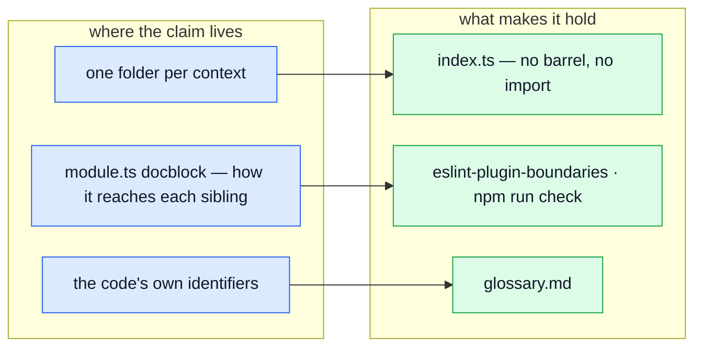

# Strategic DDD

**The part of Domain-Driven Design that pays for itself in a starter kit** — bounded contexts,
context mapping, ubiquitous language and subdomain distillation. All four are in the code — as
folders, imports, identifiers and barrels, which is where they can be seen rather than asserted.

The other half — entities, aggregates, domain repositories — is **not** here, on purpose: it is
worth adopting only once a real core domain argues, by hand, about rules a plain function can no
longer keep straight, and nothing in this repo has reached that yet. The two cheapest patterns did
land, because they fixed live bugs rather than imposing a shape — see
[Tactical DDD](./tactical-ddd.md). This page is about what _is_ adopted at the strategic level. What a client may do with a record is
answered by the server, not left to the client: see
[Tactical DDD §2](./tactical-ddd.md#_2-capabilities-the-server-answers-what-a-client-may-do).

::: tip The distinction that matters
A folder per feature is a **packaging** decision. DDD is a **modelling** one. You can have immaculate
feature folders and zero DDD — that is the common case, and it is a good state.
[Domain layer](./domain-layer.md) §2–3 has the long version.
:::

---

## The problem this solves

Every architecture document says things like "orders owns the order lifecycle" and "authentication
is generic, do not over-model it". Those sentences are true when written and unverifiable forever
after. Six months later the document says one thing, the imports say another, and the document is
the one that loses — quietly, because nothing fails.

The answer this repo settled on is to keep each claim **where the thing it describes is written**,
so a reader meets both at once, and to let the boundary itself be structural rather than described:

---

## 1. Bounded context — the folder

One module is one context. `rm -rf src/modules/wishlist` plus its import, its `enabledModules` entry
and its `ModuleName` member in `src/modules.ts` deletes the domain, and anything that breaks is real
coupling worth seeing ([Removing a module](../build/module-lifecycle.md#removing-a-module) walks it).

This is the oldest rule in the repo and the one everything else hangs off. It is covered in
[Modules](./modules.md); the rest of this page assumes it.

## 2. Context map — how a module reaches its siblings

A module's imports are its dependency list. What they do not say is what KIND of reach each one is,
and the kinds differ enormously in what they cost when the upstream moves:

| Kind                 | What it means                                                       | Cost when the upstream changes                   | Example           |
| -------------------- | ------------------------------------------------------------------- | ------------------------------------------------ | ----------------- |
| `conformist`         | reads the upstream's records as they are, no translation, no say    | **high** — the shape is your shape too           | `cart → products` |
| `customer-supplier`  | asks the upstream to _do_ something; its surface answers the demand | medium — the call survives, the payload may not  | `cart → orders`   |
| `published-language` | receives vocabulary, not records: pure functions over plain data    | **low** — neither side knows the other's storage | `cart → delivery` |
| `shared-kernel`      | both read and write the same model                                  | **highest** — every change agreed twice          | `account → users` |

Anticorruption layer is deliberately absent from the list. It is the right pattern for a model you
do not control, and every module here is a sibling in this repo. `payments` does wrap an outside
provider that way — behind `./providers`.

A domain event is not a fifth kind — it is not an import, so it carries none of the four coupling
costs above. A context's own event is published by that context alone: `orders` emits
`order.status_changed`, never a sibling reporting the move on its behalf, the same way `orders` is
the only writer of the status itself (see [Tactical DDD](./tactical-ddd.md#who-writes-the-status)).
The dotted arrows in each module's own graph (`<!-- module-graph:… -->`) are this fact, drawn — the
return path an import graph alone cannot show.

### Where the map lives

Two places, on purpose, for two different questions. **Which** siblings a module may reach lives in
its own `module.yaml#dependsOn` — a plain array of names, one per module folder, read by
`.dependency-cruiser.cjs` and enforced as the allow-list behind `npm run check`. **What kind**
of reach each edge is, and why it exists, stays in prose: a `# why` comment beside each edge in
`module.yaml`, the `module.ts` docblock for what crosses and what is deliberately not in the import
graph, and the kind label itself on the module pages
([`cart-checkout.md`](../modules/cart-checkout.md#what-crosses-each-edge), `account.md`, `users.md`,
`wishlist.md`).

A typed `dependsOn: { module, as, because }[]` manifest field is deliberately not used: nothing
would read it at runtime and nothing would enforce it, and it would duplicate the relationship KIND
this table already classifies.

`module.yaml#dependsOn` carries the edge, and `.dependency-cruiser.cjs` reads it directly as the rule
it enforces — an import outside a module's own `dependsOn` fails `npm run check`, the same gate
CI runs. There is no second copy to drift: the file the config reads IS the map. Which of the four
kinds (`conformist`, `customer-supplier`, `published-language`, `shared-kernel`) an edge is lives
in prose, not in a label a script reads: `module.yaml` answers "may it", the comment and the module
page answer "why, and how".

The twin makes the opposite call, and correctly: `boilerplate-php-laravel-backend` keeps its
`dependsOn` edges because `ModuleRegistry::inDependencyOrder()` sorts the seeders with them —
an `orders` row has foreign keys to a product and a user, so the graph decides who is written
first. Mongo has no foreign keys. This repo's seeding order is a small `after` graph of its own
(`scenarios/waves.ts`, run from `scenarios/shop.scenario.ts`; today only `products` waits, for
`locales`), separate from `dependsOn` — which is why the same field is documentation here and
load-bearing there.

### Reading the map

`cart` reaches the most modules ([the map](../modules/start.md#the-map) draws them), and that is not a
smell to refactor away — a checkout is the one place where price, stock, address, shipping and the
resulting order all have to agree at once. [`cart-checkout.md`](../modules/cart-checkout.md#what-crosses-each-edge)
says _how_ it depends on each — a `conformist` read of `products`, a `customer-supplier` call into
`orders`, and so on. The `cart → delivery` edge is the cheapest relationship to name and the one to
copy: `cart` calls pure functions over plain data (`findShippingMethod`, `priceShipping`) and never
learns that a shipment record exists.

## 3. Ubiquitous language — per context, not per app

**The language lives in the identifiers.** `Reserved`, `Available`, `softDelete`, `OrderStatus` —
those are the ubiquitous language, and they are what a change to the model has to move. That is
Evans' actual requirement: the model and the language co-evolve, and the code is the primary
expression of both.

What an identifier cannot carry is the meaning behind it, and that lives in
**[Glossary](../reference/glossary.md)** — one section per module, because the same word legitimately means
different things in two of them. `Soft delete` is a withdrawal from sale in `products` and a
destroyed account in `users`. Two different things, correctly. A single flat glossary would have to
collapse them into one entry that is wrong in both places, and **that divergence is the
bounded-context pattern**.

::: tip Not a manifest field
A `language: {}` map on `module.ts` would be read by nothing and checked by nothing, and would sit
furthest from the symbol each entry constrains. The prose lives in the glossary page; the
constraints belong on the symbols.
::.

## 4. Subdomain distillation — where to spend effort

DDD's own advice is the part most often skipped: spend the modelling effort where the business
differs, and use the simplest thing that works everywhere else.

Full detail: [4. Subdomain distillation — where to spend effort](./strategic-ddd-subdomains.md).

## 4a. Foundation and shop — an enforced fact, not a naming convention {#4a-foundation-and-shop}

The API docs' "Core" family is the platform (every `group: foundation` module), NOT the DDD core
subdomain: products, orders and cart are the core subdomain here and sit under "Catalogue" and "Buying".

Full detail: [4a. Foundation and shop — an enforced fact, not a naming convention](./strategic-ddd-subdomains.md).

## 5. Published language — the barrel

`index.ts` is the one surface a sibling may import, and ESLint stops anyone reaching past it — every
module has one, structurally, so there is no "no barrel, therefore unreachable" escape hatch left.

Full detail: [5. Published language — the barrel](./strategic-ddd-barrel.md).

## How the tier walls are enforced

`eslint.config.ts` states which tier may depend on which as one graph, through
`eslint-plugin-boundaries`, instead of as file globs repeated per tier. The built-in
`no-restricted-imports` cannot express two things, and a test is the wrong place for either:

1. **Coverage, at both levels.** `no-restricted-imports` is scoped by file glob, so a NEW
   top-level directory under `src/` matches no block, is bound by no wall, and is reported by
   nothing. Two settings close that, and they are the guarantee `deptrac --fail-on-uncovered`
   gives the PHP twin:
    - `boundaries/no-unknown-files` refuses a FILE no descriptor claims.
    - `default: 'disallow'` refuses an EDGE no policy claims, so classifying a new tier is not
      enough: its arrows have to be argued for before it can import anything.
2. **Relation.** What a module's spec may import depends on WHICH module owns it, and a glob
   cannot say "its own". `capture` reads the module name out of the path, and
   the template `from.element.captured.module` compares the two sides, so one policy covers
   every domain, including one added later.

### The one door

A module publishes `index.ts`, its runtime API, and nothing else, plus the friend file it keeps for
each module it has named a friend (`friends/<that module>.ts`, see §5). `fileInternalPath` names that
file inside the target element, so the rule is about the door rather than about the path
spelling that reaches it. A scenario's fixtures are `scenarios/`'s own tier, not a second door
on the module.

---

## What this does not give you

Everything above is about **boundaries and vocabulary**. None of it makes an invalid `Order`
unconstructable, and none of it gives a repository a domain object to return. Those are tactical
patterns and they are genuinely absent.

Two exceptions, both taken because the rule was written down in several places and would
otherwise stop agreeing with itself: `Money` and the order lifecycle table. Neither needs an aggregate, and
neither is a step toward one — [Tactical DDD](./tactical-ddd.md) has both.

See [Domain layer](./domain-layer.md) for the `domain/` folder as it stands, and what going
further would cost.

## Read next

- [Tactical DDD](./tactical-ddd.md)
- [Domain layer & DDD](./domain-layer.md)
- [Modules](./modules.md)
