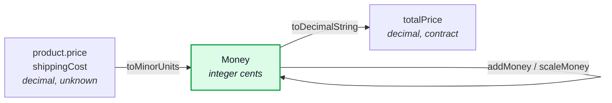
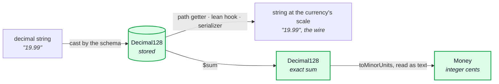
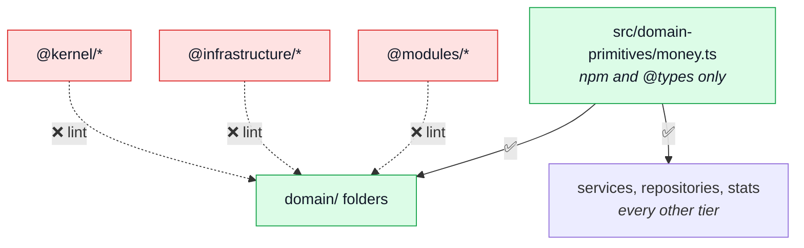
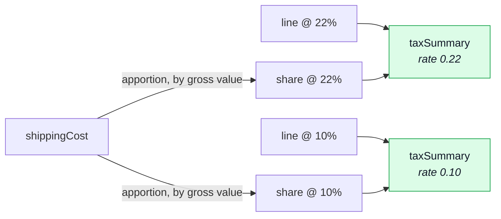

# Tactical DDD: money

Money as a value object, from cents to the invoice.

## 3. Money

`src/domain-primitives/money.ts` — a branded integer count of minor units.

### The boundary, which is the whole design

`openapi.yaml` types every monetary field `number`/`double`, and nothing about that moved. What
changed is the arithmetic _between_ the boundaries.

One function in (`toMinorUnits`) and one out (`toDecimalString`), both taking the currency they
convert for. Every intermediate is an integer, so the sum is exact and
order-independent — no accumulator can round differently depending on the sequence it saw the lines
in. The rounding rule exists once, in this file.

`money.ts` owns ROUNDING; `totals.ts` owns COMPOSITION. `orderTotal({ items, shippingCost })` is
what the customer owes, and every place that needs that figure reads it rather than adding the two
numbers itself, so the payment intent cannot charge the lines and forget the shipping.

### At rest: Decimal128

A stored amount is a BSON `Decimal128`, MongoDB's own recommendation for money (a `double` is
"unsuitable for monetary arithmetic"). It is exact on disk and in the database, so a `$sum` over it
needs no conversion. Nothing above the persistence layer sees one.

- **One definition.** `moneyPath()` in `src/infrastructure/persistence/money-field.ts` is how a
  model declares a money field, and `moneyPlugin` is what a lean read needs. Decimal128 has no `min`,
  so `nonNegative` is a validator.
- **Reading a sum.** `toMinorUnits` takes the `Decimal128` of a `$sum` as text and moves the digits;
  it never multiplies a float. A `number` is still multiplied and rounded, for the callers that hold one.
- **On the wire.** Every amount is a decimal string padded to its currency's ISO 4217 places (`"19.90"` EUR, `"1000"` JPY, `"1.500"` KWD), so two equal amounts are equal strings. `Decimal128` drops trailing zeros and `$inc`/`$sum` lose the scale, so `applySerialization` pads every money path last, from the schema's `moneyPath` list, with the document's own currency (products use the live shop currency). `toDecimalString` moves digits, never divides. A JSON number is refused with 422; more places than the currency has is refused with 422; rates (`taxRate`) stay numbers.
- **Not every aggregation is revived.** A lean read and `toJSON` hand back decimal text. An aggregation's
  output is whatever its pipeline shaped, so a pipeline that returns stored money row by row
  (`payments/repository.ts#aggregateRefundRows`) revives it with `stringifyDecimals`; the serializer pads it on the way out.

### Which decimals a currency has

`minorUnitExponent` reads a table pinned in `money.ts` from ISO 4217, never `Intl`. CLDR's display
digits say 0 for HUF, IDR, COP, PKR, LBP and IQD, where ISO says 2, 2, 2, 2, 2 and 3: a HUF shop
would lose the fillér. A code the table does not list gets 2. The six are pinned by a unit test.

`fitsCurrency(amount, currency)` is the write-side rule: a price, a delivery rate or a refund with
more places than the minor unit is refused, so the stored value is always the charged value
(19.999 EUR is a 422, not a stored 19.999 charged as 20.00). It cannot be a contract `multipleOf`,
because that cannot vary by currency, so it is a refinement beside each schema.

### Why a brand rather than a class

A class would give the domain layer an object identity to maintain, a `toJSON` every serialization
path must know about, and a shape Mongoose would try to store. A branded number is **the same
integer at runtime** and a distinct type at compile time — which is the whole benefit:
`toDecimalString` is the only way back to a plain `number`, so an amount cannot be summed with a raw
price by accident or written to a document without passing the boundary that rounds it.

### Totality is checked at every step, not at the end

`Number.MAX_VALUE` is a finite price whose product with a quantity is not. Once one term is
`Infinity`, a later negative term makes the running total `NaN` — which reaches the customer as a
blank price. So every construction point funnels through one private `asMoney`, which answers
"nothing owed" for anything non-finite, and normalises `-0` away as a second spelling of an amount
with one meaning.

That is a property over every possible input, which is why
`tests/unit/domain-primitives/money.property.test.ts` is property-based rather than a table of
examples. It found the `-0` case.

### Why it lives in `src/domain-primitives/`

Money arithmetic is not one module's business: `orders`, `payments`, `returns`, `invoicing`,
`cart` and `stats`, among others, all add, scale or convert amounts. A type that many modules need
has no single owner, so it sits in its own tier, `src/domain-primitives/`.

There is also a hard constraint. The domain layer may not import `@kernel/*`, `@infrastructure/*`,
`@modules/*` or even `../*` — see the folder rule in `eslint.config.ts`. A jointly-owned value type
therefore has to sit somewhere a `domain/` folder CAN reach, without loosening that rule. The
`domain-primitives` tier does it: it is the Shared Kernel (generic, npm only), and every tier may
import it. See [the rulebook](./layers.md#the-rulebook-one-small-shared-kernel).

### Per-rate VAT, and where shipping's own split goes

`orders/domain/tax.ts`'s `orderTaxBreakdown` answers three questions from the same pass over an
order's frozen lines, not three separate ones:

- **Per line** (`lines[]`) — goods only, what `netTotal` sums. `taxTotal` does not stay goods-only:
  it folds in shipping's own apportioned tax on top of the lines' — see `shippingNetAmount`/
  `shippingTaxAmount` below for the goods/shipping split `netTotal` keeps but `taxTotal` doesn't.
- **Shipping's own split** (`shippingNetAmount`/`shippingTaxAmount`) — delivery carries no VAT
  rate of its own; it is taxed as ancillary to what it delivers, apportioned pro-rata across the
  lines by their own gross value (`apportion`, the same "remainder to the largest weight" rule
  `domain-primitives/money.ts` has), then taxed at _each line's own rate_. Two lines at different rates
  split shipping's cost between them and pay two different amounts of tax on their own halves.
- **Per rate** (`taxSummary[]`) — one row per DISTINCT rate charged on the order, goods and
  shipping folded into the same row, since shipping was never a rate of its own to begin with.
  This is what an invoice actually has to print: a customer does not care which line shipping's
  22%-taxed share came from, only that the 22% column reconciles.

VAT is rounded ONCE per rate, on that rate's whole gross total (EN 16931 BR-CO-17), and only then
split down to shipping and lines by the same `apportion` rule. Summing per-line rounded amounts
would drift: three 0.10 lines at 22% carry 0.05 of VAT, not 0.06. The order response and the
invoice call the same function, so they cannot disagree.

Reconciliation is exact, in integer minor units, never approximated: summed `taxSummary.netAmount`
is `netTotal + shippingNetAmount`, summed `taxAmount` is `taxTotal`, and summed `grossAmount` is
the order's own `totalPrice` — `orders/tests/unit/tax.test.ts` asserts both reconciliations with a
fixed multi-rate, multi-line example each, not a single hand-picked total.

The invoice needs a fourth shape `orderTaxBreakdown` also returns but the wire contract never
sees: `shippingByRate`, shipping's slice of `taxSummary` broken back OUT per rate — "shipping,
taxed at 22%: €4.10 net, €0.90 tax" as its own printed row. `model.ts` does not copy it onto a
serialized order. `invoicing`'s `issue-invoice.ts` and `services/credit-breakdown.ts` call
`orderTaxBreakdown` and freeze `shippingByRate` onto the invoicing document; `emails.ts`, `render.ts`
and `domain/credit-shares.ts` read it from there.

### Currency is an argument, not part of the type

A currency's minor unit is not always a hundredth (JPY has none, KWD has three), so
`toMinorUnits(value, currency)` and `toDecimalString(amount, currency)` take the code they convert
for, and `orderTotal` takes the order's own `currency`. The `Money` brand itself carries no
currency, so `addMoney` cannot refuse a mismatch: the shop is single-currency per deployment
(`NODE_DEFAULT_CURRENCY`), and a tag on the type would have one possible value.

The day two currencies mix in one sum, the currency belongs **on this type** rather than beside
the amount — an `addMoney` that refuses a mismatch is precisely the reason to put it there.

---

## Read next

- [tactical-ddd](./tactical-ddd.md): the hub this page belongs to.
