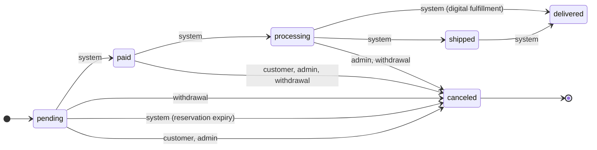
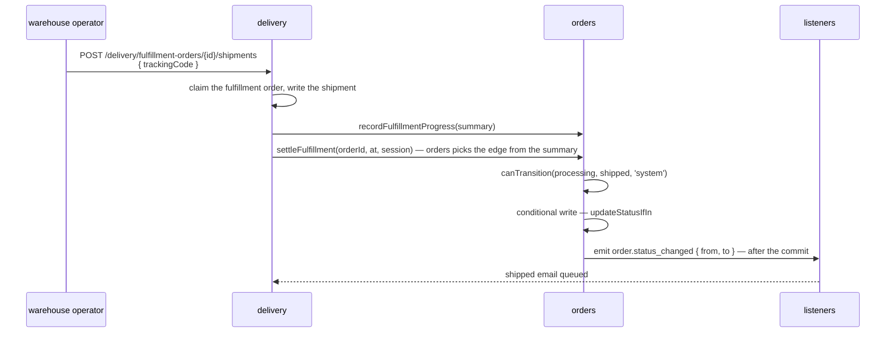
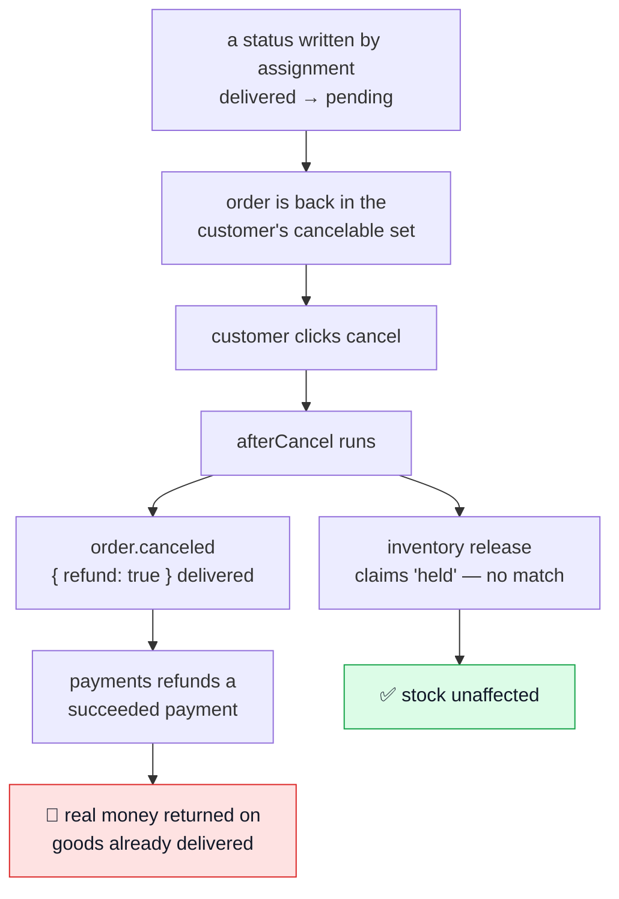
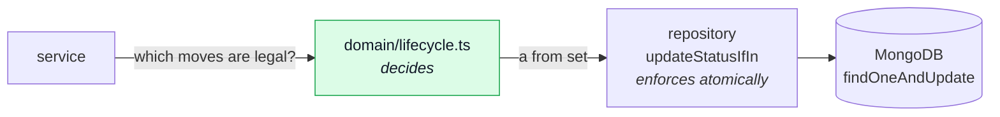
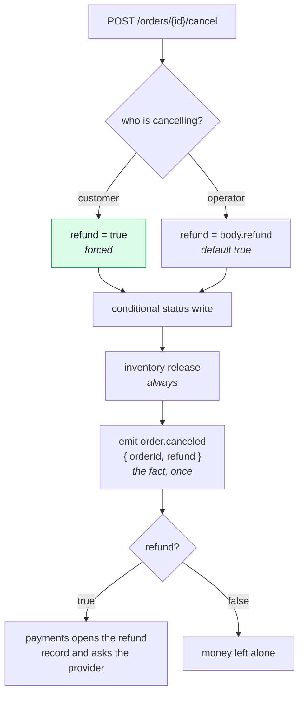

# Tactical DDD: the order lifecycle

The order state machine as a worked example.

## 1. The order lifecycle

`src/modules/orders/domain/lifecycle.ts` — which status may follow which, and who may make the move.

### What it does and does not own

The **set** of statuses is not its business. `OrderStatus` is generated from `openapi.yaml` into
`@api/models`, so the six values are contract-first and single-sourced. What the enum cannot carry
is the **edges** between them, and the **actor** each edge belongs to.

The table is keyed by **event**, not by status: `pay`, `process`, `ship`, `reopen` (a lost
shipment steps the order back), `reship` (a replacement does the same from `delivered`), `deliver`,
`fulfillmentComplete` (the digital `processing -> delivered` edge, also a remainder cancel that
completes the order), `expire`, `cancel` and `cancelInFulfillment`. Each entry carries its `from`
set, its `to` and its actors, so a service names the event and the conditional write is handed the
event's own `from` — nothing is derived from a neighbouring column.

What a status **is**, apart from its edges, is a second table: `ORDER_STATUS_TRAITS` in
`domain/status-traits.ts` (stock committed, before dispatch, withdrawable, fulfilment value). It is
total over `OrderStatus`, so a new contract status is a compile error there, not a silent default.
See [the status traits](../modules/orders.md#status-traits).

Three absences are load-bearing:

- **Nothing reaches `paid` but `system`.** An operator cannot mark an order paid by hand — money
  landing is a fact from outside the application. the table is where it holds.
- **A customer's cancel stops at `paid`.** The refund listener is what makes `paid` cancellable;
  past that the order is in the fulfilment queue and cancelling becomes an operator's decision (the
  EU withdrawal right is its own actor, `withdrawal`, which can also cancel from `processing`).
- **`shipped` has no cancel edge at all.** Goods in transit come back as a return, which is a flow
  of its own. The only way back is a lost parcel or a replacement, which step the order back to
  `processing`.

An admin override (below) can still force any of these moves forward with a reason — the diagram
above is the forward path, the one no override is involved in. Two system-only backward moves
(`reopen` for a lost parcel, `reship` for a replacement) and the lost-parcel cancel are in
[orders](../modules/orders.md#who-writes-the-status).

### Who writes the status

Two rules, and they are different rules. **Only `orders` writes a `status` field** — every other
module that causes a move (`payments` on settlement, `delivery` on a parcel event) asks `orders` to
make it, through `markPaid` (payments) or `settleFulfillment`/`reopenForFulfillment` (delivery), and never touches the document itself.
That is a placement rule: it says WHERE the write happens. **The table above is a permission rule:**
it says WHO may ask for which move, `admin`/`customer`/`system` on each edge.

`system` is not "no human involved" — every `system` move follows from a recorded fact a human (or
an external service) already caused: money landing at the payment processor, a warehouse operator
recording a parcel's handover. `system` means "this application did not decide it, it is reporting
it" — the recording is what makes the move happen, not a person editing a field.

The full move/actor/door table lives on
[Who writes the status](../modules/orders.md#who-writes-the-status) — one home for it, since a
second copy here is exactly the kind of duplicate that drifted before. What that table does not
say: WHAT records the fact before `orders` ever hears about it — the payment processor confirming
a charge, a warehouse operator scanning a parcel, an operator's own typed reason for an override.
`orders` only ever reports a fact something else already caused.

One reported move, end to end — the warehouse records a handover, `delivery` owns the shipment, and
`orders` is the only thing that ever writes the status. Everything below commits in ONE transaction
(the shipment, the units leaving the shelf, the order's summary, the status move, the outbox events):

`delivery` never assigns `order.status` itself, and never picks the edge either: it states the fact (the
summary is written) and `settleFulfillment` (`services/status.ts`) decides from the order's own status and
that summary whether it ships, delivers, completes in one act or cancels as lost. `reopenForFulfillment`
puts a `shipped` or `delivered` order back to `processing`. Both take the act's own session, so the move
commits with the shipment; the six `mark*` steps beneath them are not on the barrel. A second door, `overrideStatus`, moves the status alone and
announces it, so `delivery` keeps its records in step — see
[Who writes the status](../modules/orders.md#who-writes-the-status) for both.

### The actor is part of the table, not beside it

"Which status may follow `paid`" has no single answer — it depends on who is asking. Splitting the
actor into a second table would let the two disagree, so it rides on the edge itself.

`system` is not a privilege level above `admin`. It is **narrower**: the moves an operator may never
make by hand, because something outside the application has to have happened first. Money landing
is one; fulfilment starting (`paid → processing`) is the other, recorded through `delivery`'s own
start action (`POST /orders/{id}/process`), or by the first shipment or fulfil — see "Action endpoints execute" below.

### What the table prevents

Lifecycle knowledge in several places that can disagree is how an unguarded status write becomes a
refund on delivered goods:

Every individual write site is defensively coded, which is why only one half of that sequence would
cause damage: `inventory` claims the reservation conditionally, so a stale release finds nothing,
while `payments` guards the refund on the payment's own status — and that payment really was
`succeeded`, so the guard passes. The table closes it at the source: no write site asserts a
lifecycle edge of its own, they all ask.

### How it is enforced

| Call site                                                                     | Question asked                                                                                                                                  |
| ----------------------------------------------------------------------------- | ----------------------------------------------------------------------------------------------------------------------------------------------- |
| `orders/services/cancel.ts` — the cancel doors                                | `statusesLeadingTo(canceled, cause.by)`                                                                                                         |
| `orders/services/status.ts` — `markPaid`/`markProcessing`/`settleFulfillment` | the named event's own `from` and `to` (`ORDER_EVENTS.ship`, ...), read off the table rather than restated as a literal                          |
| `payments/services/intent.ts`/`offline.ts`/`settlement.ts`/`view.ts`          | `isPayable(status)` — asks `orders` the one question every payment door needs, never the table directly (see "One function, three doors" below) |
| `delivery/services/*`, `returns/services/{cancel-right,withdraw}.ts`          | `canProcessOrder`, `canShip`, `canRecordArrival`, `isAwaitingGoods`, `hasShopStarted`                                                           |
| `orders/services/override.ts`                                                 | `canOverrideTo(from, to)` — its OWN rule, deliberately not `canTransition`: an override exists to skip the gate the ordinary table enforces     |

Every cancel door asks as its cause's actor, because the table answers differently for each: a customer
may cancel from `pending` and `paid`, an operator also from `processing`.

A stored status with named action endpoints uses the table where it fits: each move is one event,
and the write, the `actions` flag and the test all read it.

### Action endpoints execute; `update` does not decide

Whether a flip is an action or a field is one test, written once in
[`write-methods.md`](write-methods.md#action-or-field): does the move have an effect, guard
or permission of its own? The order's status does; a product's `active` does not.

`orders/services/crud.ts`'s `update` carries no status logic at all: `UpdateOrderByIdRequest`
declares `email` only, so there is no move left for it to refuse or apply, and no partial-write
window between an email save and a status move to guard against — impossible by construction
rather than guarded.

`POST /orders/{id}/cancel` is the one path that runs a cancellation, for a customer and an operator
alike: the hold is released and `ORDER_CANCELED` is announced, in the cancel's own transaction,
carrying `refund` — and when one is due `payments` opens the refund from that same event. A plain field write could
never do that — a paid order set to `canceled` by assignment would end with the customer's money
kept and the stock held until the sweep.

`shipped`/`delivered` are never a field an admin assigns either — they follow a parcel event
`delivery` records, through `settleFulfillment` (see "Who writes the status" above).
`paid → processing` follows a fulfillment-start fact the same way, through `markProcessing`.
The admin override (`POST /orders/{id}/override-status`) is the door for a mis-scanned parcel or a
manual correction. `items`/`userId` are not in
`UpdateOrderByIdRequest` at all either — they stay `POST /orders` (create)-only. Rewriting a
document that already carries a sequential invoice number has no safe meaning: EU VAT practice
corrects an issued invoice with a credit note, not a rewrite, and a real order-edit flow (stock
delta, refund/charge, tax) is a feature of its own.

### Deciding and enforcing stay separate

The table decides. `updateStatusIfIn` (`src/infrastructure/persistence/conditional-status.ts`) enforces:
it is the conditional write that makes exactly one racing writer win. A plain "move only from {A,B}"
write uses it, so none can forget `status` in its filter. A write that needs more (`$unset`,
`$min`/`$max`, a lease, an upsert, a revision, lean rows) writes its own guarded filter, and its
docblock says why. The table only decides which `from` set that write is handed.

The table itself is TypeScript, an event table (`{ initial, events: { name: { from[], to, actors? } } }`)
built with `defineLifecycle` (`src/domain-primitives/lifecycle.ts`), which refuses at load a status that
does not exist and an event that lands inside its own `from` — the self-move is illegal by
construction.

A refusal to a move the table does not have answers **409**: `ORDER_NOT_CANCELABLE` from
a cancel door with no further detail, `ORDER_OVERRIDE_NOT_ALLOWED` from `overrideStatus` carrying
`details: { from, to }`. Neither lists which moves ARE still open — a client wanting that reads
`Order.actions` on the order instead: the flags (`cancel`, `overrideStatus`, …) name the doors open to the caller. Every guard runs before any field
is assigned, so a refused request is never a partial write.

### Compensation is policy, and it travels with the fact

A cancellation has consequences — the stock comes back, and usually the money does too. Who decides
which, and where that decision lives, is a separate question from which moves are legal.

`order.canceled` carries a `refund` flag rather than the listener inferring one, and that flag is
the whole promise: it is written to the outbox in the cancel's own transaction, `payments` opens a
refund record from it, and the relay delivers the event again until that has happened. Once the
record exists it is the durable intent (the refund sweep finishes it, forever, with the same
idempotency key), so a provider refusal after that point is logged and the event is answered. A
second event for the refund was tried and dropped: it needed its own marker on the order and its
own sweep, a second mechanism for what the outbox already does. A redelivery cannot duplicate
anything: the refund finds nothing left to return, and `webhooks` dedupes on the event id.

Three things this shape buys. A customer cannot waive their own refund, because `paid` is
cancellable precisely on the promise that the money comes back — the flag is overwritten, not
trusted. An operator can cancel without refunding, which is the replacement-going-out case. And
`order.canceled` fires either way, so the record of what happened does not depend on what was
compensated; suppressing it for the no-refund case would make `order.canceled` mean "cancelled and
refunded", which is not what it says.

Returning money on its own is a separate route, `POST /payments/{id}/refunds`, because it
is a separate act: a goodwill refund leaves the order where it is. It lives in `payments` rather
than `orders` for a structural reason — `payments` already depends on `orders`, so an order module
reaching back for a refund would close a cycle `npm run check` refuses.

### What is still NOT modelled

The three effects have one owner: the cancel doors move the status, releases the hold and announces the
refund policy, and no caller can reach the state while skipping the consequences — `update` refuses a
plain move to `canceled` for exactly that reason. What the conditional write buys is that **at most
one caller runs the sequence**; a double-click and the reservation sweep cannot both proceed.

The status move, the stock coming back and the `order.canceled` outbox row are one transaction
(`moveToCanceled`), so a crash cannot leave a cancelled order holding stock or a cancel nobody
heard of. What runs after the commit is the catalogue's stock cache, which is a mirror and cannot
roll back; the next stock write refreshes it.

---

## Read next

- [tactical-ddd](./tactical-ddd.md): the hub this page belongs to.
