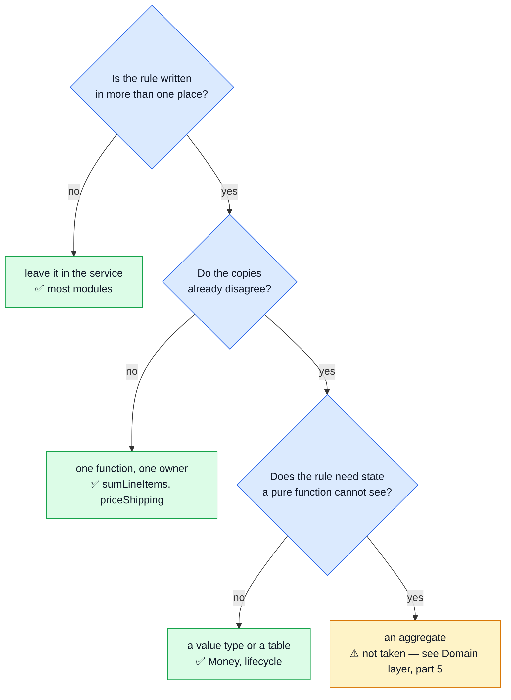
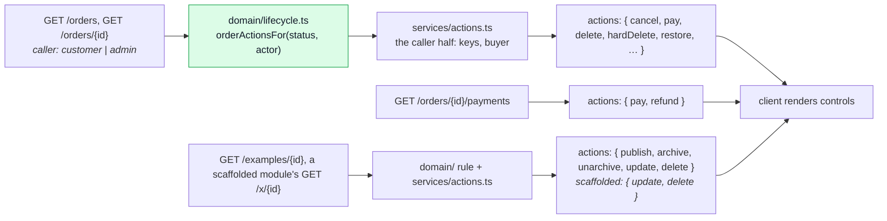
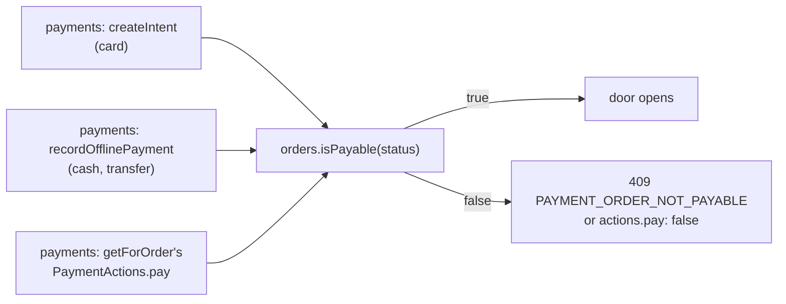

# Tactical DDD

**The half of Domain-Driven Design this repo takes selectively** — value objects, invariants,
aggregates. [Strategic DDD](./strategic-ddd.md) covers the other half, which is adopted wholesale.

Two tactical patterns are in the code. `Money` lives in `src/domain-primitives/money.ts` and the
order lifecycle in `src/modules/orders/domain/lifecycle.ts`; both are plain
data with functions in front of them, and both exist for the same reason: a rule needed in more than
one place gets one owner, so the copies cannot disagree.

Everything else — aggregates, domain repositories, mappers, a read model — is deliberately absent,
worth the cost only once a real core domain argues, by hand, about rules a plain function can no
longer keep straight.

## Why these two and not the rest

The usual failure mode is adopting the shape without the pressure that justifies it. The test used
here is narrow: **is the rule already duplicated, and do the copies disagree?**

Both patterns below cleared the middle branch. Nothing in the codebase has cleared the right one.

---

## 1. The order lifecycle

`src/modules/orders/domain/lifecycle.ts` — which status may follow which, and who may make the move.

### What it does and does not own

The **set** of statuses is not its business. `OrderStatus` is generated from `openapi.yaml` into
`@api/models`, so the six values are contract-first and single-sourced. What the enum cannot carry
is the **edges** between them, and the **actor** each edge belongs to.

### Who writes the status

Two rules, and they are different rules. **Only `orders` writes a `status` field** — every other
module that causes a move (`payments` on settlement, `delivery` on a parcel event) asks `orders` to
make it, through `markPaid` (payments) or `settleFulfillment`/`reopenForFulfillment` (delivery), and never touches the document itself.

### The actor is part of the table, not beside it

"Which status may follow `paid`" has no single answer — it depends on who is asking. Splitting the
actor into a second table would let the two disagree, so it rides on the edge itself.

### What the table prevents

Lifecycle knowledge in several places that can disagree is how an unguarded status write becomes a
refund on delivered goods.

### How it is enforced

### Action endpoints execute; `update` does not decide

Whether a flip is an action or a field is one test, written once in
[`write-methods.md`](write-methods.md#action-or-field): does the move have an effect, guard
or permission of its own? The order's status does; a product's `active` does not.

### Deciding and enforcing stay separate

The table decides. `updateStatusIfIn` (`src/infrastructure/persistence/conditional-status.ts`) enforces.

### Compensation is policy, and it travels with the fact

A cancellation has consequences — the stock comes back, and usually the money does too. Who decides
which, and where that decision lives, is a separate question from which moves are legal.

### What is still NOT modelled

The three effects have one owner: the cancel doors move the status, releases the hold and announces the
refund policy, and no caller can reach the state while skipping the consequences — `update` refuses a
plain move to `canceled` for exactly that reason. What the conditional write buys is that **at most
one caller runs the sequence**; a double-click and the reservation sweep cannot both proceed.

Full detail: [1. The order lifecycle](./tactical-ddd-order-lifecycle.md).

## 2. Capabilities: the server answers what a client may do

A client has to decide what controls to show. Doing that from the record alone means
re-implementing the rules — a status dropdown listing every enum value, a cancel button testing for
`pending` or `paid`, a pay form testing for `pending`. Three copies of server rules, in a separately
deployed codebase, with nothing able to notice when they drift.

A record with a lifecycle `status`, or with doors a client offers as controls (`Product`: update,
delete, restore, hard delete), therefore lists `actions` in `required`, on every read and write,
list rows included; a read-only projection or a line of its parent is the exception, and
`tests/cross-cutting/api-standards.test.ts` names each one with its reason. A presenter maps what
a service decided and imports no ability, caller or service; review holds that line.

The transition graph itself is not published in the contract, on purpose: no mature API does (Google
AIP-216 names one verb per move; Shopify and Stripe describe the graph in prose and a diagram). A
client reads `actions`, and each verb endpoint's description names the statuses it may start from
in one line, which the endpoint's 409 test pins.

So the server sends the answer. `Order.actions` and `PaymentActions` are computed per REQUEST, not
stored. `example` is the minimal worked case: `Example.actions` is flags `{ publish, archive, unarchive, update, delete }` (one door per lifecycle event, like `User.actions`),
the events from the domain's table and the two keys asked of the kernel per row (`permitsOnRows`), so
the own-rows condition in `authorization.yaml` stays its only encoding. `User.actions` is the
account-side case: one flag per endpoint (`activate`, `restore`, `placePurchaseHold`…), assembled in
`users/services/actions.ts` from the caller's keys, `access`'s pure `mayChangeAccount` and the row's
own state, and only mapped by the presenter ([users](../modules/users.md#actions)):

**Why per caller.** The answer depends on the role: a customer may cancel a paid order, an operator
may also advance it, and nobody may mark it paid by hand. A stored field could not say that. The
response cache keys on the user, so an operator's answer is never served to a customer.

**Why the split across two modules.** Each answers for what it owns. `orders` says which status
moves are open and whether the order still awaits payment; `payments` says whether money can come
back. Neither guesses at the other's half, and no new dependency edge is created — which matters,
because `payments` already depends on `orders` and the reverse would be a cycle
`dependency-cruiser` rejects at lint time, in `npm run check`.

**Why `pay` appears on both.** They answer different questions. `Order.actions.pay` is "this order
still awaits payment", which is what decides whether to offer a card form on an order with no
payment record yet. `PaymentActions.pay` is "this specific intent can be confirmed", which already
folds the order's status in — so once a payment exists, its own answer is the one that counts, and
the panel flips the instant a charge lands rather than waiting for the order to be re-read.

**Why there is no `paid` move.** No request may make it; it follows a confirmed charge. `pay` says
"the card form may be offered", and no flag says "you may write the status `paid`".

**Two halves.** The state half ("can this order do X in its status") is a pure predicate in
`domain/` that the write path's guard asks too, so the flag and the refusal cannot disagree
(`softDeletable`, `hardDeletable`, `canWithdraw`). The caller half (keys, ownership) is combined in
`services/actions.ts`, one pure function per order, so a list can ask it once per row after ONE
`$in` read for the page.

**One function, three doors.** `domain/lifecycle.ts`'s `isPayable(status)` is the single answer to
"can this order still be paid" — `pending` only, the one status with a `system` edge into `paid`.
Every door that moves money asks it instead of comparing a status literal:

A settlement arriving twice (a webhook retry) finds the order no longer `pending`, so the
conditional write matches nothing: no table says "staying put is allowed", and no door treats it
as a second offer to pay.

The client's side of the bargain is to decide nothing. A control is enabled when the server says so
and disabled otherwise, which is what makes a rule change on the API move the interface without the
interface being edited.

Every door a client offers as a control has its flag, including the destructive ones (delete, hard
delete, a replay). A refusal described only in the operation's prose leaves the client to copy the
rule.

A refusal about the caller's account, not the resource (a purchase hold, the open-order limit),
needs no flag: the control stays enabled, the door refuses, and the client renders the refusal's
`details`. The account's own record may show the state as a banner; it never disables the control.

---

## 3. Money

`src/domain-primitives/money.ts` — a branded integer count of minor units.

### The boundary, which is the whole design

`openapi.yaml` types every monetary field `number`/`double`, and nothing about that moved. What
changed is the arithmetic _between_ the boundaries.

### At rest: Decimal128

A stored amount is a BSON `Decimal128`, MongoDB's own recommendation for money (a `double` is
"unsuitable for monetary arithmetic"). It is exact on disk and in the database, so a `$sum` over it
needs no conversion. Nothing above the persistence layer sees one.

### Which decimals a currency has

`minorUnitExponent` reads a table pinned in `money.ts` from ISO 4217, never `Intl`. CLDR's display
digits say 0 for HUF, IDR, COP, PKR, LBP and IQD, where ISO says 2, 2, 2, 2, 2 and 3: a HUF shop
would lose the fillér. A code the table does not list gets 2. The six are pinned by a unit test.

### Why a brand rather than a class

A class would give the domain layer an object identity to maintain, a `toJSON` every serialization
path must know about, and a shape Mongoose would try to store. A branded number is **the same
integer at runtime** and a distinct type at compile time — which is the whole benefit.

### Totality is checked at every step, not at the end

`Number.MAX_VALUE` is a finite price whose product with a quantity is not. Once one term is
`Infinity`, a later negative term makes the running total `NaN` — which reaches the customer as a
blank price. So every construction point funnels through one private `asMoney`, which answers
"nothing owed" for anything non-finite, and normalises `-0` away as a second spelling of an amount

### Why it lives in `src/domain-primitives/`

Money arithmetic is not one module's business: `orders`, `payments`, `returns`, `invoicing`,
`cart` and `stats`, among others, all add, scale or convert amounts. A type that many modules need
has no single owner, so it sits in its own tier, `src/domain-primitives/`.

### Per-rate VAT, and where shipping's own split goes

`orders/domain/tax.ts`'s `orderTaxBreakdown` answers three questions from the same pass over an
order's frozen lines, not three separate ones.

### Currency is an argument, not part of the type

A currency's minor unit is not always a hundredth (JPY has none, KWD has three), so
`toMinorUnits(value, currency)` and `toDecimalString(amount, currency)` take the code they convert
for, and `orderTotal` takes the order's own `currency`. The `Money` brand itself carries no
currency, so `addMoney` cannot refuse a mismatch: the shop is single-currency per deployment

Full detail: [3. Money](./tactical-ddd-money.md).

## 4. What is still absent

| Concept                              | Today                                                          |
| ------------------------------------ | -------------------------------------------------------------- |
| Entity                               | none — a Mongoose document is the model                        |
| Value object                         | `Money` only, internal to the arithmetic                       |
| Aggregate root                       | implicit only                                                  |
| Repository returning domain objects  | no — returns `OrderDocument`                                   |
| Invariants at construction           | no — schema validators, plus the lifecycle table on the writes |
| Read model separate from write model | no — one model, one search spec                                |

One tell that the pressure is real: `clearLinesIfUnchanged` in `cart/repository.ts` writes
conditionally on the `__v` it read the cart at. That is **aggregate versioning** with no aggregate to
hang it on — the need exists, only the vocabulary is missing.

It is not the only versioned write: delivery's fulfillment-order `revision` claim
(`delivery/repository.ts`) is the other, and the cart's `__v` is the only one on a document with no
aggregate to hang it on. `updateStatusIfIn` here and `claimStatus` in `inventory/repository.ts` look
similar and are a different pattern: they key on `status`, naming the state a move comes _from_ so
that exactly one of N concurrent callers wins. That is an exactly-once primitive, correct as it
stands, and an aggregate would not simplify it. Worth keeping straight, since it is the thing that
would decide whether a future aggregate slice is real pressure or a shape imposed for its own
sake: count `__v`, not `status`.

The line this repo draws: a value type or a rules table where the rule is real and already
duplicated, and no aggregate until something needs state a pure function cannot see.

## Related pages

- [Domain layer](./domain-layer.md) — what earns a place in `domain/`, and the lint rule; §5 covers
  what an aggregate slice would cost, and the conditions that would make it the right call
- [Strategic DDD](./strategic-ddd.md) — the half adopted wholesale
