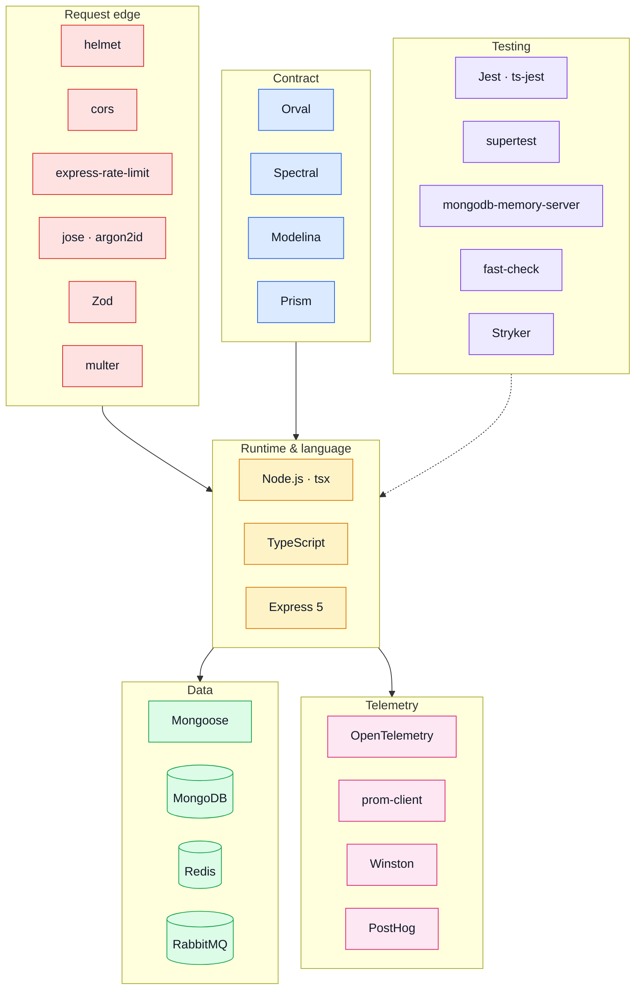

# Tools Explained

This page answers three questions for every tool in the stack: **what it is**, **what problem it solves**, and **what it does in this repo**.
Each section links to the dedicated page for configuration details and code pointers.

## The whole stack on one page

Colour is the job a tool does, not the layer it sits in.

**Contract points into the runtime, never the other way round.** `openapi.yaml` is assembled from
per-module fragments and generates everything under `api/`, which both this repository and the
paired frontend import. Editing generated output is the one mistake this diagram exists to
prevent.

---

## Core stack

### Node.js + TypeScript

**What it is.** Node.js is a JavaScript runtime built on Chrome's V8 engine that lets you run JavaScript outside the browser. TypeScript adds a static type system on top of JavaScript — errors are caught at compile time, not at runtime.

### Express

**What it is.** Express is the most widely used HTTP framework for Node.js. It provides routing, a middleware pipeline, and a thin request/response abstraction on top of Node's built-in `http` module.

### Zod

**What it is.** Zod is a TypeScript-first schema validation library. You define a schema once and Zod both validates the data and infers the TypeScript type from it — no duplicate type declarations.

### Helmet

**What it is.** Helmet is a collection of small Express middleware functions that set HTTP response headers that browsers use to enable security policies (Content-Security-Policy, X-Frame-Options, HSTS, etc.).

### JWT (jose) and password hashing (argon2id)

**What it is.** JSON Web Tokens (JWT) are signed, compact tokens that carry claims (user ID, role, expiry) without a server-side session store. argon2id (from `node:crypto`) is a password hashing algorithm designed to be slow and memory-hungry — which makes brute-force attacks expensive.

### express-rate-limit

**What it is.** A middleware that counts requests per IP address over a fixed window and returns `429 Too Many Requests` when the limit is exceeded.

Full detail: [Core stack](./tools-explained-core.md).

## Data layer

### MongoDB

**What it is.** MongoDB is a document database. Instead of rows and columns, it stores JSON-like documents (BSON) grouped into collections. Documents in the same collection do not need to share a schema.

### Mongoose

**What it is.** Mongoose is an ODM (Object-Document Mapper) for MongoDB. It lets you define schemas and models in TypeScript, add lifecycle hooks (`pre('save')`), define instance methods, and write queries with a fluent API instead of raw MongoDB driver calls.

### Redis

**What it is.** Redis is an in-memory key-value store. Because data lives in RAM, reads and writes are orders of magnitude faster than a disk-backed database.

### RabbitMQ

**What it is.** RabbitMQ is a message broker. Producers publish messages to named queues; consumers receive and process them independently. Messages are persisted to disk, so they survive restarts, and failed messages can be requeued for retry.

### restic (backups)

**What it is.** restic is a backup program: one static binary that writes encrypted, deduplicated snapshots to a repository (a local disk, SFTP, S3-compatible storage, or a REST server).

### rclone (the append-only second machine)

**What it is.** rclone is a command-line tool for storage; its `serve restic` command speaks restic's REST protocol over a folder.

Full detail: [Data layer](./tools-explained-core.md).

## Outbound

### Nodemailer + EJS (email)

**What it is.** Nodemailer is the standard SMTP client for Node.js. EJS (Embedded JavaScript) is a template engine that renders HTML strings from data.

**Problem it solves.** Sending a formatted HTML email requires connecting to an SMTP relay, rendering a template, handling attachments, and dealing with SMTP errors. Nodemailer abstracts the transport; EJS handles the HTML so email markup stays in template files, not in code strings.

**In this repo.** Used for password-reset emails, order confirmations, and contact-form notifications. Templates live in `src/modules/*/templates/*.ejs`, one directory per owning module — only the shared layout partials stay under `shared/templates/`. Calls go through `enqueueEmail()` which either publishes to RabbitMQ (if configured) or calls Nodemailer directly.

→ [Email & PDF Rendering](./email-and-rendering.md)

---

### Puppeteer / puppeteer-core (PDF)

**What it is.** Puppeteer is a Node.js library that controls a Chromium browser programmatically. `puppeteer-core` is the same thing without a bundled Chromium binary — you must provide the browser yourself.

**Problem it solves.** Generating pixel-perfect, styled PDFs from HTML is hard with pure-JS libraries. Driving a real browser to render the HTML and export it as PDF produces output that matches what users would see in a browser tab — fonts, CSS grid, images and all.

**In this repo.** Used for invoice and credit-note PDFs (`GET /orders/:id/invoice`), rendered on first download. The Dockerfile pre-installs Chromium so the container has a browser available. Without `PUPPETEER_EXECUTABLE_PATH` pointing at a browser binary the invoice endpoint will error at request time; the rest of the API keeps running.

→ [Email & PDF Rendering](./email-and-rendering.md)

---

### Server-Sent Events (SSE)

**What it is.** SSE is a plain-HTTP streaming format: the server holds a `text/event-stream` response open and keeps writing `event:`/`data:` frames to it. The browser consumes it with the built-in `EventSource` API, which reconnects on its own if the stream drops.

**Problem it solves.** HTTP is request-response: the client asks, the server answers. For live dashboards the server needs to push without waiting for a poll, which is wasteful and adds latency proportional to the poll interval. SSE gets that push for the common server → client case with no new protocol, no upgrade handshake, and no extra dependency.

**In this repo.** `GET /observability/events` streams live process metrics — an initial snapshot, then updates every 5 s and a heartbeat every 15 s. It is an ordinary Express route (`src/modules/observability/services/stream.ts`), so all the usual middleware applies. Event names and payload shapes come from `asyncapi.yaml`.

**Why not WebSockets.** This boilerplate has no bidirectional realtime layer on purpose. WebSockets bypass Express entirely (they are handled on the HTTP server's `'upgrade'` event), so auth, rate limiting and request logging all have to be re-implemented for them; and because a connection is pinned to one cluster worker, anything shared between connections needs a Redis/NATS backplane. That is a real architectural commitment, not scaffolding — so it is left to you rather than half-shipped as a demo. If you need it, add `ws` and an `'upgrade'` listener in `src/app.ts`. The backplane is yours to write: `src/infrastructure/adapters/cache.ts` opens one Redis client for commands and nothing else — a subscriber has to be a second connection, because a client in subscribe mode accepts no other commands.

→ [Observability Endpoints](../reference/observability.md)

---

### PostHog (product analytics)

**What it is.** PostHog is an open-source product analytics platform. It captures user and business events (signups, page views, purchases) and lets you analyse funnels, retention, and feature adoption through a web UI. It can be self-hosted or used as a cloud service.

**Problem it solves.** Infrastructure metrics (Prometheus) tell you the API is healthy but not whether users are actually completing signups or dropping off at checkout. Product analytics answer the "are users doing what we expect?" question from a product/business perspective rather than an infrastructure one.

**In this repo.** Example events (login, product view, checkout) are emitted from controllers through one helper, and `NODE_ANALYTICS_PROVIDER` decides which backend receives them: Umami (the default, self-hosted next to the app), PostHog, or none.

→ [Product Analytics](./analytics.md)

---

## Observability stack

Observability is the ability to understand what a running system is doing from its outputs. Three complementary signals cover the full picture.

### Winston (logs)

**What it is.** Winston is the most widely used structured logging library for Node.js. It supports multiple transports (stdout, files, HTTP) and formats (JSON, pretty-print) and lets you define custom log levels.

### Prometheus (metrics)

**What it is.** Prometheus is a time-series database and monitoring system. It works by scraping an HTTP endpoint exposed by the application — at regular intervals Prometheus pulls the current metric values and stores them as time-stamped data points.

### Alertmanager

**What it is.** Alertmanager is Prometheus's companion for alert routing. Prometheus evaluates rules and marks alerts as firing; Alertmanager groups, deduplicates, silences, and routes those alerts to configured receivers (Slack, PagerDuty, email, webhooks).

### OpenTelemetry (traces)

**What it is.** OpenTelemetry (OTel) is a vendor-neutral open standard for distributed tracing, metrics, and logs. It provides SDKs for every major language and a common wire format (OTLP). An "instrumentation" library wraps a framework (Express, Mongoose, Redis) and automatically creates "spans" for each operation.

### OTel Collector

**What it is.** The OpenTelemetry Collector is a standalone service that receives telemetry data from applications and routes it to one or more backends. It acts as a fan-out proxy: receive once, export to many.

### Tempo (trace storage)

**What it is.** Grafana Tempo is an open-source, horizontally scalable distributed trace storage system. It receives spans from the OTel Collector, stores them, and makes them queryable via TraceQL or by `trace_id` lookup.

### Loki (log storage)

**What it is.** Grafana Loki is a log aggregation system inspired by Prometheus. Instead of full-text indexing every word in every log line (like Elasticsearch does), Loki indexes only a small set of labels (`service`, `level`, `job`) and stores the raw log lines compressed. Queries filter by label first, then scan the matching compressed chunks.

### Alloy (log shipping)

**What it is.** Alloy is Grafana's telemetry collector — an agent that tails log files on the host, applies pipeline transformations (parse JSON, add labels, drop noise), and pushes log entries to Loki. It replaces Promtail, which has been end of life since March 2026.

### Grafana (UI)

**What it is.** Grafana is an open-source observability UI. It connects to data sources (Prometheus, Tempo, Loki, and many others), renders dashboards and charts from queries, and lets you explore metrics, traces, and logs side by side.

Full detail: [Observability stack](./tools-explained-observability.md).

## Project workflow tools

### `db:sync` (schema reconciliation)

**What it is.** Not a tool but a script — `scripts/db/sync-indexes.ts`, over Mongoose's own
`Model.diffIndexes()`. It compares the indexes a database holds against the ones the schemas
declare and adds the missing. It never drops by surprise: an undeclared index is kept and reported.

**Problem it solves.** Index changes have to be reproducible across environments (dev, staging,
production). A migration runner does that by recording applied files by name — right for a one-off
backfill, wrong for an index, which is derivable from the model and must simply be true after every
deploy. Reconciling removes the second author, and with it the whole class of "the schema says one
thing and the migration says another" boot failures.

**In this repo.** `npm run db:sync` applies; `npm run db:sync -- --check` prints the plan and
changes nothing; `-- --prune` also drops every undeclared index. `db:bootstrap` runs it (pruning) before
the server starts; a deploy never prunes. Data changes that cannot be
derived from a schema — a rename, a backfill — are one-off scripts under `scripts/ops/` instead.

→ [MongoDB & Mongoose](./mongodb-mongoose.md) · [Data](../reference/data.md)

---

### Orval + OpenAPI Generator (client codegen)

**What it is.** Orval is a code generator that reads an OpenAPI specification and outputs typed API client code (TypeScript, React Query hooks, Zod schemas, etc.). The source of truth is `openapi.yaml`; the generated `api/` folder is a derived artifact.

**Problem it solves.** Maintaining a typed API client by hand alongside the spec means they inevitably drift. Every time a route changes, the client must be manually updated — which is error-prone and slow. Code generation makes the client an output of the spec, not a separate thing to maintain.

**In this repo.** `npm run gen:api` regenerates `api/` from `openapi.yaml`. `api/` is gitignored and rebuilt by `postinstall`; the paired frontend regenerates its own from the `openapi.yaml` that `sync:frontend` hands over.

→ [OpenAPI Workflow](../build/openapi-workflow.md)

---

### Spectral (OpenAPI linting)

**What it is.** Spectral is a linter for API specification documents (OpenAPI, AsyncAPI, JSON Schema). It applies a ruleset to the YAML/JSON file and reports violations — missing descriptions, inconsistent response shapes, undefined error codes, etc.

**Problem it solves.** A syntactically valid OpenAPI document can still be incomplete or inconsistent — no 401 response defined, optional fields with no description, enums without documentation. Spectral catches these issues in CI before they cause runtime surprises or confuse API consumers.

**In this repo.** `npm run lint:openapi` runs Spectral against the bundled `openapi.yaml` with `shared/contracts/spectral.yaml`; `lint:openapi:modules` lints each module's own fragment. Runs in CI after TypeScript type-check.

→ [OpenAPI Workflow](../build/openapi-workflow.md)

---

### Jest (testing)

**What it is.** Jest is a JavaScript/TypeScript testing framework that provides test runner, assertion library, mocking, code coverage, and snapshot testing in one package.

**Problem it solves.** Without automated tests, every change requires manual verification of every feature. Tests encode expectations about behaviour so regressions are caught automatically — and so future developers can refactor with confidence.

**In this repo.** Five suites — unit, cross-cutting, integration, contract and fuzz (`npm test` runs them all). Config lives in `jest.config.js` and `tsconfig.jest.json`; see [Testing & Docs](../build/testing-and-docs.md).

→ [Testing & Docs](../build/testing-and-docs.md)
