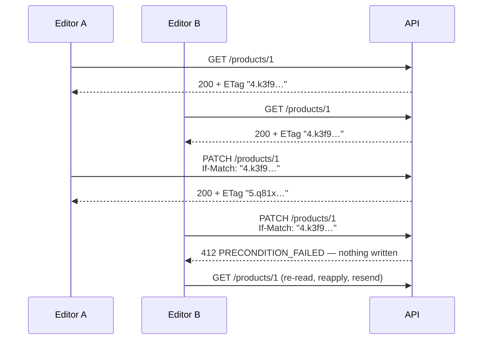
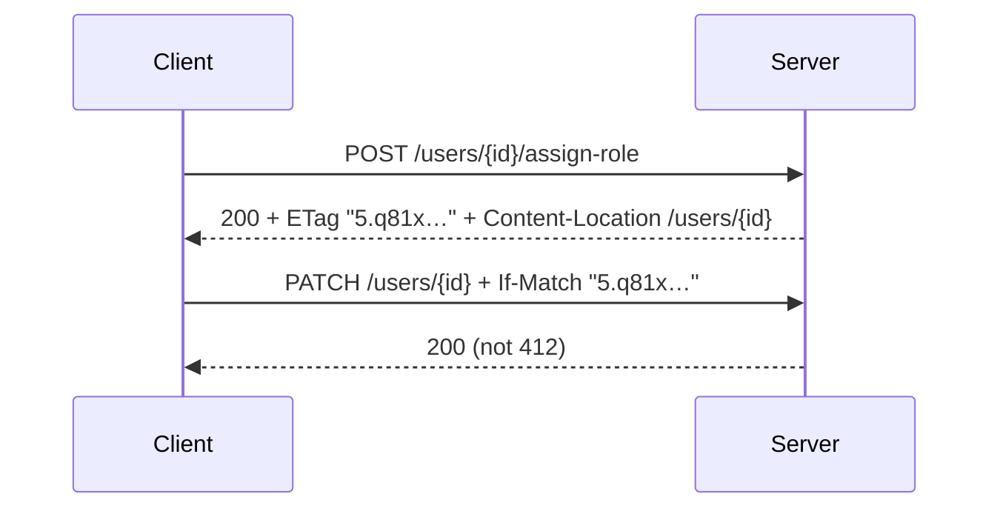

# Write Methods: conditional writes

ETag and If-Match: optimistic locking on versioned resources.

## Conditional writes: ETag and If-Match

Two admins open the same product. Both save. Without a check, the second save silently overwrites
the first — the _lost update_. A versioned resource lets the client say "only if it is still the
version I read" (RFC 9110 §13.1.1); the server refuses with **412** when it is not.

|                         | Standard                                                                          |
| ----------------------- | --------------------------------------------------------------------------------- |
| `ETag`, `If-Match`, 412 | [RFC 9110](https://www.rfc-editor.org/rfc/rfc9110) §8.8.3, §13.1.1, §15.5.13      |
| Same idea elsewhere     | Kubernetes `resourceVersion`, Google [AIP-154](https://google.aip.dev/154) `etag` |

**Optional.** No `If-Match`, no check: the write runs as it always did, last writer wins. Requiring
it (428, RFC 6585) can come later without changing anything below.

### Which resources are versioned

A resource is versioned when its item read hands out an `ETag` **and** its write honours `If-Match`.
A PUT answer never carries a validator: every PUT here transforms what it stores, and RFC 9110 §9.3.4
forbids a validator on the answer then. `dropUnownedValidators` (`http/preconditions.ts`) strips it
whatever the controller or Express set.
The contract says so with one marker on the path item — `x-versioned: [get, put, patch, delete]` —
and the bundler adds the header parameter, the 412 and the response header from it.

#### A create, a restore or an action answers the real tag

A write that answers a versioned resource hands back **that resource's tag**, plus
`Content-Location` naming it (RFC 9110 §8.8.3, §15.3.2, §6.4.2 rule 7: without `Content-Location` a
POST answer's body is "unidentified", and its tag ambiguous). The next edit then needs no read:

- **Who:** creates (products, users, examples, orders, cart checkout, webhook subscriptions,
  languages), restores (products, users, orders) and actions (user activation, role, purchase hold;
  order cancel, override, process; example publish, archive, unarchive; subscription enable,
  disable and secret rotation; language activate, deactivate; the caller's own email-change
  request, which answers what `GET /account` does).
- **How:** the controller calls `answerAsResource(response, row, uri)`: `setEtag` plus
  `Content-Location`, in the path convention `Location` uses. The body must be what a `GET` on that
  URI returns right after (§8.7); users share `toUserContract`, products `presentForCaller`.
- **The hook marks, it does not guess.** `setEtag` marks the response; on any write that is not a
  PUT, `dropUnownedValidators` removes an `ETag` that nothing marked. That is Express's byte-hash,
  which no `If-Match` accepts. On a PUT it removes every validator, whoever set it.
- **Replays:** an idempotent retry replays `ETag` and `Content-Location` and keeps the tag.
- **Not tagged:** signup and login (nothing to edit yet), a search, a delete. A POST that answers a
  row nobody can edit later answers no tag.
- **Contract:** `x-versioned: [post]` on the create's or the action's own path item. The bundler adds
  `ETag` and `Content-Location` (both required) to its 2xx, and no `If-Match` or 412. The optional
  app-level `ETag` is left off every write answer.

| Resource                        | Read that sends `ETag`                                                      | Writes that take `If-Match`                                                                              |
| ------------------------------- | --------------------------------------------------------------------------- | -------------------------------------------------------------------------------------------------------- |
| product                         | `GET /products/{id}`                                                        | `PUT`, `PATCH`, `DELETE /products/{id}`, `DELETE /products/{id}/hard`                                    |
| user                            | `GET /users/{id}`                                                           | `PUT`, `PATCH`, `DELETE /users/{id}`, `DELETE /users/{id}/hard`                                          |
| order                           | `GET /orders/{id}`                                                          | `PUT`, `PATCH`, `DELETE /orders/{id}`, `DELETE /orders/{id}/hard`                                        |
| the caller's account            | `GET /account`                                                              | `PUT`, `PATCH /account`                                                                                  |
| example                         | `GET /examples/{id}`                                                        | `PUT`, `PATCH`, `DELETE /examples/{id}`                                                                  |
| webhook subscription            | `GET /webhooks/subscriptions/{id}`                                          | `PUT`, `PATCH`, `DELETE /webhooks/subscriptions/{id}`                                                    |
| language                        | `GET /locales/{locale}`; `POST /locales` answers its tag                    | `PUT`, `PATCH /locales/{locale}` (not the `DELETE`: removing a language is unconditional)                |
| a language's dictionary entries | `GET /locales/{locale}/entries`, `GET /locales/{locale}/apps/{app}/entries` | the two imports, `PUT`, `PATCH /locales/{locale}/apps/{app}/entries` (the single-entry writes take none) |
| translations of an entity       | `GET /locales/translations/{entityType}/{id}`                               | `PUT`, `PATCH /locales/translations/{entityType}/{id}`                                                   |

The role door (`POST /users/{id}/assign-role`, `/revoke-role`) is not in that column: a POST is a
state change with its own 409, not an overwrite, so two callers naming different roles both succeed
and the last write wins. It still moves the row's `editRevision`, so an edit holding an older tag is
refused.

Not versioned: a resource with one owner or one field (an address in its book), no item read to take a
tag from (the cart), or its own concurrency rule (cart lines, stock, a task's status doors). A `PUT` or
`DELETE` with `If-Match` on one of those is simply not declared; the reasons are in
[`unversioned-writes`](api-standards.md#where-we-differ-and-why).

A language is addressed by its tag, so its `If-Match` is keyed by the tag (case-insensitive: `pt-br`
is `pt-BR`), while the counter lives on its row. Switching it on or off moves the edit counter and
`updatedAt`, so an open name form is refused after a toggle; writing a dictionary entry moves
neither.

A language's entries are fenced on a second counter of the same row, its `revision` (what clients
re-fetch on). One counter per language, not per app: both lists, the one app's and the all-apps one
the export reads, answer it as the version of their `ETag`, so the tag of the export is the tag of
the import. The cost is one retry: a write to app X refuses an open import into app Y once, and
that is safe, where a per-app counter could not describe the all-apps list at all.

- **The imports take it.** `PUT` and `PATCH /locales/{locale}/apps/{app}/entries` send the tag of a
  list read as `If-Match`; a language whose `revision` moved since is a 412 and nothing is written.
  An import that would change nothing is checked too (RFC 9110 §13.1.1 evaluates the condition
  before the method). The `PATCH` answers the new tag.
- **The single-entry writes do not take it**, as the edit of one string is not an overwrite of a
  list. They move the same counter, and the row and the bump are one transaction, so an import
  cannot land between the two and pass a fence that has not moved yet.
- **An import's check and its bump are inside its own transaction** too: the fence is a read of
  the language row, so a bump that lands afterwards conflicts with the import's own and re-runs
  the whole attempt against the new counter.
- **Using a page's tag on the import URL is a house convention** (`if-match-edit-version`): the
  tag came from a GET with a query, the import has none. The client strips the query when it files
  a tag, and sends the all-apps list's tag explicitly on an import.

The translations of an entity are fenced on the OWNER's counter (the product's or the example's
`editRevision`), not on one of their own: a translation save already moves it, and a product read
shows the translations. So a translation save and a product edit refuse each other's stale tag, on
purpose; a stock move refuses neither. The read answers 404 for an entity that does not exist.

A webhook subscription's delivery bookkeeping (the failure streak, the auto-disable) writes with
`timestamps: false`, so a delivery outcome never moves the edit counter and never refuses an open
edit form.

### The pattern: optimistic locking

The edit counter is a **version number**, the pattern called _optimistic locking_
([Fowler: Optimistic Offline Lock](https://martinfowler.com/eaaCatalog/optimisticOfflineLock.html)).
Rails `lock_version`, JPA `@Version` and Kubernetes `resourceVersion` are the same idea.
`If-Match` is how HTTP carries it.

It is not a nonce, though both are "a value the server checks":

|         | Version counter (this)                                            | Nonce                                                                         |
| ------- | ----------------------------------------------------------------- | ----------------------------------------------------------------------------- |
| Value   | an integer that goes up by one per edit                           | random                                                                        |
| Order   | yes: 5 is newer than 4                                            | none                                                                          |
| Shared? | everyone who reads the row gets the same one, until the next edit | each one is issued once                                                       |
| Answers | "has this changed since I read it?"                               | "have I seen this message before?"                                            |
| Here    | `editRevision`, the edit part of the `ETag`                       | the `Idempotency-Key` ledger, the OAuth `state`, the ALTCHA antibot challenge |

Three rules keep it honest. Break any one and a lost update gets through:

1. **Check and write in one atomic step.** "Update where the counter is 7, and make it 8"; nothing
   matched → 412. A check in one step and a write in the next lets a second editor in between.
   See [What the server does with `If-Match`](./write-methods.md#what-the-server-does-with-if-match).
2. **Every edit moves the counter in the same atomic step as the edit.** A row and its own counter:
   one update (`$inc`). Many rows under one counter: one transaction. A bump made afterwards leaves
   a window where the data has changed and the counter still says it has not.
3. **The tag describes exactly what the client read.** A read that covers a whole set of rows
   hands out the set's counter, so a write based on that read is checked against the set.

### What the tag is

- **`ETag: "<editRevision>.<digest>"`** — strong, quoted, opaque to the client: compare it, never
  parse it. Two parts, one for each job:
    - **The edit part** (`editRevision`): an integer stored on the row (never in the representation)
      that every edit moves by one, in the same atomic update as the edit itself (`$inc`). A write's
      `If-Match` compares only this.
    - **The digest**: a short sha256 of the exact body sent, so the whole tag changes whenever the
      bytes do (stock, price, language, a stock move) and a read can safely answer `304` on a match.
      A write never compares it, so a sale never refuses an editor's open form. This is the one
      registered difference from RFC 9110 §13.1.1, `if-match-edit-version`
      (`docs/understand/api-standards.md`); FHIR's version-only `If-Match` is the same kind of choice.
    - A Redis copy stores the tag and replays it, so a hit and a miss send the same one.
- **Why a counter, and not `updatedAt` or Mongoose's `__v`.** A strong validator must change
  whenever the representation does (RFC 9110 §8.8.1). Two edits in one millisecond share an
  `updatedAt` (and the PHP twin's timestamps have whole seconds); `__v` moves only when an _array_
  changes. A counter incremented by the database cannot repeat: two writers who both read 4 do not
  both write 5, even with no `If-Match` at all.
- **One rule says what moves it: the counter moves wherever `updatedAt` moves.** Mongoose's
  `timestamps` stamps `updatedAt` on every `save()` and query update that is an edit, and the
  plugin (`persistence/revision-plugin.ts`) adds the `$inc` beside that stamp — through `save()`,
  `updateOne`, `updateMany` and `findOneAndUpdate`, pipeline updates included. A write that is NOT
  an editor's edit passes `timestamps: false` and so never touches either: the stock mirror, the
  image digest, a session token, a password change, the reaper's warning, and another module's
  report on an order (a refund or return word, the stamp that money landed, a shipment's
  fulfillment summary, a guarantee extension). A status move stays an edit, a full shipment
  included. An admin's form is never invalidated by a customer logging in.
- **Where the counter lives.** It is the schema's Mongoose version key (`editRevision`, replacing
  `__v` on every versioned schema). It is not called `revision` because `locales` owns a wire
  field of that name with another meaning. It is stripped from every response and carried beside
  the shaped object (`carryVersion`) so a presenter can reshape a row without losing its tag.
- **An edit that changes nothing on the row still moves it, by stamping `updatedAt` by hand.**
    - A product edited only through its `translations` writes rows outside the product document
      (`TranslatableTarget.markEdited`, also for `PUT`/`PATCH /locales/translations/product/{id}`,
      whichever locale it names).
    - A user edited only through its `role` changes the membership, not the user document
      (`markModified('updatedAt')`): two admins on one tag cannot both change the role.
- **The orders anonymisation sweep is an edit.** It stamps `updatedAt`, so the counter moves and
  an edit form opened before it cannot put the scrubbed email back.
- **One private Mongoose touch.** `save()` has no public door for "increment, but add no version
  filter" (`Document#increment()` does both, which would turn every unconditional save into a
  failure when the row moved), so the plugin sets Mongoose's own `VERSION_INC` bit. A Mongoose
  upgrade that moves it fails `tests/integration/persistence/revision.test.ts` loudly.

### What the server does with `If-Match`

| Header                                               | Result                                                                              |
| ---------------------------------------------------- | ----------------------------------------------------------------------------------- |
| absent                                               | the write runs unconditionally                                                      |
| `"<tag>"` whose edit part matches the stored version | the write runs; a PATCH's response carries the **new** `ETag`, a PUT's carries none |
| `"<tag>"` whose edit part is old, or the row is gone | **412** `PRECONDITION_FAILED`, nothing written                                      |
| several tags, `"a", "b"`                             | matches if any edit part does                                                       |
| `*`                                                  | matches any row that exists                                                         |
| weak (`W/"…"`), or anything that is not a quoted tag | never matches → 412 (`If-Match` compares strongly)                                  |

- **The check and the write are one atomic step for `PUT`/`PATCH`/`DELETE`, hard or soft.** The version the
  service loaded is compared with the header, and the same version becomes part of the update's
  filter (Mongoose `$where`, on `editRevision`) — two editors holding the same tag cannot both win. A hard `DELETE`
  is fenced the same way: Mongoose 9 applies `$where` to a document delete, and a delete that
  removed nothing is a 412.
- **It lives in the repository, not in each module.** `createUpdateController` and
  `createDeleteController` open the precondition for the request; `repository.save` and
  `repository.deleteOne` meet it. A module's service never sees a header.
- **The body is validated first.** A 422 for a body the schema refuses wins over a 412.
- **The whole tag validates reads; the edit part validates writes.** A versioned item read
  (`products`, `users`, `orders`, `examples`) answers `If-None-Match` with `304` when the whole tag
  matches, on a Redis miss and a hit alike. The digest moves with prices, language and stock, so a
  `304` is never stale; the edit part is the only thing a write checks.
- **The cached reads are a separate case.** Two families answer `If-None-Match` with `304` on no
  change, through Express's own ETag check: the `privateNoCache` reads (`orders`, `users`,
  `tasks`, `payments`, `returns`, `stats`, `example`: a private copy the browser revalidates) and every
  `setCache` read (`locales`, `products` `/facets` and `/:id`: the shared copy, revalidated once
  `max-age` runs out or at once under `browserRevalidate`). Each such `GET` carries
  `x-cache` in its fragment, and the bundler declares the answer (the shared `NotModified`: no
  body, an `ETag` header) on every operation that does, so no fragment repeats it.
  `tests/cross-cutting/cache-policy-declared.test.ts` walks the mounted routers and holds them
  equal to the `x-cache` operations, both ways.
  The sitemap streams its XML and carries no `ETag`, so it is not one of them.
- **`no-store` reads get no declared `304`**: a compliant cache never revalidates them. A client that
  sends `If-None-Match` anyway is still answered per RFC 9110 §13.1.2, undeclared.
- **Browsers** may send `If-Match` and read `ETag` cross-origin: both are in the CORS allow and
  expose lists.

### For a client

1. Keep the `ETag` of the record the form loaded.
2. Send it back as `If-Match` on the save; take the new `ETag` from a PATCH's 200, or from a create's
   or an action's answer (its `Content-Location` says which resource it is for). After a PUT, re-read
   with GET: a PUT answer carries no `ETag` or `Last-Modified` (RFC 9110 §9.3.4).
3. On 412 the record changed under you: re-read it, show the user what is different, resend.

## Read next

- [write-methods](./write-methods.md): the hub this page belongs to.
