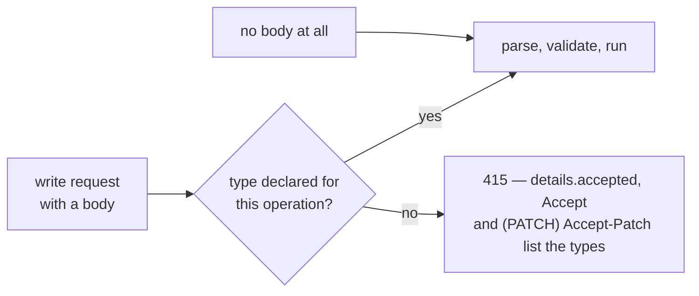

# Write Methods: refusals

What a write answers when the request is wrong: 415, wrong method, OPTIONS, status codes.

## Content-Type: 415

The JSON body parser handles only the types it is told to, so a body in any other type would arrive as
`{}` — and an all-optional PATCH schema accepts `{}`: a 200 that changed nothing. The guard refuses it instead.

The guard is `requireDeclaredContentType`, built from `api/request-content-types.ts`, which
`npm run gen:api` derives from the contract's own `requestBody` media types. A request with no
bytes is not judged: a missing required body is the schema's own 422.

The 415 also sends `Accept` with the declared types, and `Accept-Patch` (the same list) on a
`PATCH` (RFC 9110 §12.5.1, RFC 5789 §2.2). An operation with no declared body sends neither. The
`OPTIONS` answer reads the same row (`declaredOperation`), so the two lists never differ.

Any write (`POST`, `PUT`, `PATCH`, `DELETE`) that declares no body is listed with no types at all
(`types: []`), and the guard refuses ANY body on it, `{}` included, `details.accepted` empty. An
action button (`POST /users/{id}/deactivate`) therefore never drops a `{"reason": …}` with a 200:
the sender is told the field was not read. The contract declares the 415 on every such operation.
For a `DELETE` that is also why `DELETE /products/{id}` takes no `{hardDelete}`
body: a client or gateway that drops it would turn a hard delete into a soft one, so the flag lives
in the query or the `/hard` path and a body is refused instead of ignored.

## A known path with the wrong method

A path the contract declares, asked with a method it does not give it, answers **405** with an
`Allow` header (RFC 9110 §15.5.6) — never the catch-all's 404. `DELETE /tasks/{id}` is fine,
`PATCH /tasks/{id}` is a 405 naming `DELETE, GET, HEAD, OPTIONS`: a task's `status` is read-only and moves only through its doors.

- **`Allow` is sorted**, with HEAD beside GET and `OPTIONS` on every path: every served path
  answers it, and a 405 must list what the resource supports (RFC 9110 §15.5.6). The 405 and the
  `OPTIONS` answer (below) take it from one function, so they never disagree. The guard never
  judges `OPTIONS` itself: that answer runs before any router.
- **A trailing slash is the same path.** `/things/` reads as `/things`.
- **A literal path wins over a templated one.** `DELETE /products/facets` would otherwise
  read `categories` as the `{id}` of `/products/{id}` and answer 404, so the guard runs a second
  time before the routers, for paths with no `{param}` only.
- **A module this build does not serve stays a 404**: its paths are in the table, but nothing is
  mounted to ask.
- **Not declared per operation.** The 405 belongs to a request that matched no operation, so no
  operation's `responses` could carry it; its code, `METHOD_NOT_ALLOWED`, is in the contract's
  `x-error-codes`.
- **Swept over the whole spec.** `tests/integration/method-not-allowed.test.ts` asks every path of
  `openapi.yaml` with every verb it does not declare and expects 405 plus the exact `Allow`. It
  asks as an admin: a router-level auth guard answers an anonymous caller 401 first, on purpose,
  so an anonymous caller learns nothing about which routes and methods exist.

## `OPTIONS` says what a path accepts

`OPTIONS` asks a path what it can do (RFC 9110 §9.3.7; RFC 5789 §3.1 for `Accept-Patch`). `cors`
runs with `preflightContinue: true`, so ONE handler (`answerOptions`, mounted right after it in
`src/app/security.ts`) answers every `OPTIONS`, whatever the Origin.

| Request                                                                   | Answer                                                      |
| ------------------------------------------------------------------------- | ----------------------------------------------------------- |
| a path of a served module                                                 | 204 + `Allow`; `Accept-Patch` only when `Allow` has `PATCH` |
| `OPTIONS *`, or a preflight (`Access-Control-Request-Method`) on any path | 204                                                         |
| a plain `OPTIONS` on a path no served module owns                         | the 404 problem                                             |

- **No `Content-Length` on the 204** (RFC 9110 §8.6).
- **Same `Allow` for an allowed, a refused and an absent Origin.** A refused Origin gets no
  `Access-Control-*` headers, so the browser still fails the call.
- **`Allow` lists `OPTIONS`**, the same as the 405.
- **A literal path wins**: `/products/facets` answers `GET, HEAD, OPTIONS`, not the `/products/{id}` set.
- **`Accept-Patch`** is the media types the contract declares for that path's `PATCH` body.
- **A module this build does not serve** is a 404 for a plain `OPTIONS`, like any other method.

The guard is `methodNotAllowed`, built from `api/operation-routes.ts`, which `npm run gen:api`
derives from the contract's paths and mounted twice in `src/app/routes.ts`: before the routers
(literal paths) and right before the 404 (every other path).

## Status codes a write answers

| Code | When                                                                                                                                                                                                                                       |
| ---- | ------------------------------------------------------------------------------------------------------------------------------------------------------------------------------------------------------------------------------------------ |
| 200  | an update, an action, a search, an idempotent refresh                                                                                                                                                                                      |
| 201  | a create — something new exists, and `Location` says where                                                                                                                                                                                 |
| 204  | a delete, a logout, a confirm step: done, nothing to say, no body — see [No content](../reference/responses.md#no-content)                                                                                                                 |
| 404  | the target does not exist (or the caller may not know it does)                                                                                                                                                                             |
| 409  | the write conflicts with the current state — a duplicate, a lifecycle refusal, an action whose target state is already reached, a cap reached (`WEBHOOK_SUBSCRIPTION_LIMIT_REACHED`: deleting a record would let the same request through) |
| 412  | an `If-Match` that no longer matches — see [Conditional writes](./write-methods.md#conditional-writes-etag-and-if-match)                                                                                                                   |
| 415  | a body in a type the operation does not declare                                                                                                                                                                                            |
| 422  | the body breaks the contract or a domain rule                                                                                                                                                                                              |

An action endpoint (`POST …/activate`) whose target state is already reached is refused, not
answered with a silent 200: **409** with `<RESOURCE>_ALREADY_<STATE>` and a plain message, as
Google AIP-216 asks for a state that cannot be moved to, kept at 409 because RFC 9110 §15.5.10
defines it as a conflict with the current state. `DELETE` stays idempotent: [DELETE — remove](./write-methods.md#delete-—-remove).

The app-wide ones (400, 413, 415, 429, 500, 503) come from `x-app-level-responses` — see
[Regenerating](../build/regenerating.md).

## Read next

- [write-methods](./write-methods.md): the hub this page belongs to.
