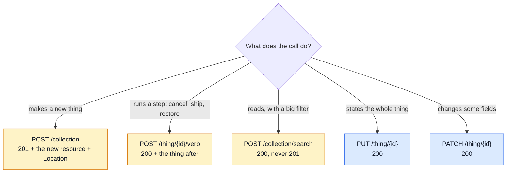

# Write Methods: POST, PUT, PATCH

Every write route follows the web's own rules for its verb. This page is those rules, in the
form this API applies them, and the few places it deliberately does something else.

|                         | Standard                                                                                                      |
| ----------------------- | ------------------------------------------------------------------------------------------------------------- |
| POST, PUT, status codes | [RFC 9110](https://www.rfc-editor.org/rfc/rfc9110) — HTTP Semantics                                           |
| PATCH                   | [RFC 5789](https://www.rfc-editor.org/rfc/rfc5789) — the method                                               |
| What a PATCH body means | [RFC 7396](https://www.rfc-editor.org/rfc/rfc7396) — JSON Merge Patch                                         |
| Retrying a POST safely  | [`Idempotency-Key`](https://datatracker.ietf.org/doc/draft-ietf-httpapi-idempotency-key-header/) — IETF draft |

## The three verbs in one table

|                  | POST                                                                | PUT                                     | PATCH                  |
| ---------------- | ------------------------------------------------------------------- | --------------------------------------- | ---------------------- |
| Means            | create in a collection, or run an action                            | replace the whole resource              | change part of it      |
| Target           | `/products` · `/orders/{id}/cancel`                                 | `/products/{id}`                        | `/products/{id}`       |
| Body             | the new resource, or the action's input                             | the **full** new representation         | only what changes      |
| An omitted field | the server's default                                                | **cleared** (see [PUT](#put-—-replace)) | left alone             |
| `null`           | 422 — nothing to clear yet                                          | clears                                  | clears                 |
| `''`             | 422 wherever the field has `minLength: 1`                           | same                                    | same                   |
| Safe to repeat   | no — send `Idempotency-Key`                                         | yes (idempotent)                        | yes, in practice       |
| Success          | **201** + the created resource + `Location` · **200** for an action | **200** + the resource                  | **200** + the resource |
| Target missing   | —                                                                   | 404                                     | 404                    |

## POST

### Create → 201

- The body answered is the created resource itself ([Success Responses](../reference/responses.md)) — a checkout answers the order
  itself, an address write answers the address.

### Action → 200

- `POST /orders/{id}/cancel`, `/restore`, `/override-status`: a state change on a
  thing that already exists. 200, with the thing as it now stands.

#### A toggle is a pair of actions

A toggle on a resource is a state of a record that stays, flipped both ways (assigned or not, held
or not). When either direction has its own effect, guard, permission, audit row or notification, it
is a pair of POST actions, `POST /x/{id}/<verb>` and `POST /x/{id}/<opposite>`, never a PUT/DELETE
pair (Google [AIP-136](https://google.aip.dev/136): POST for a method with side effects).

#### Action or field

A status or flag moves through an action when the move has its OWN effect, guard or permission.

### A line is written through its parent

A **line** is a part of a parent with no life of its own: a cart line, a saved product, a
back-in-stock request, an OAuth link, a task's note, a webhook subscription's secret. It is written through the
parent. It has no read of its own: where a line has a URL, that URL only adds, changes or removes
the line.

### A child created under its parent

A **child** with a life of its own (an id, a status, actions of its own) may be created at
`POST /parent/{id}/children` with no `GET` on that path (it answers 405 with `Allow: OPTIONS, POST`), when.

### Repeating an action (409)

An action whose target state is already reached is **refused**, not answered with a second success.

#### An action whose target state is already reached

`POST …/enable` on an enabled subscription, `POST …/disable` on a disabled one: **409**, with
`<RESOURCE>_ALREADY_<STATE>` (`WEBHOOK_SUBSCRIPTION_ALREADY_ENABLED`) and a plain message. Not
200, because an action may carry an effect a repeat must not re-run (enabling resets the failure
streak). Not 400, which Google's [AIP-216](https://google.aip.dev/216) uses: the lifecycle rule is

### An item write has an item read

A resource that can be changed by id can be read by id. Without `GET /x/{id}` a detail or edit page
has to find its record in a list: past the page size it never finds it, and it cannot tell "gone"
from "not loaded". The read is scoped like the list's rows (a row the caller may not see is a 404,
never a 403 that confirms it exists), and answers the same shape the list rows carry. Webhook

### Search → 200

`POST /x/search` is a read that needs a body — see
[Request Input](request-input.md). It creates nothing, so it is never a 201.

### Retrying a POST

A POST is not idempotent: sent twice, it may create twice. Every POST or PATCH whose repeat would
write again accepts an optional `Idempotency-Key`. Where a repeat would move money or stock twice (the do-not-retry class) the key is
required (400 without it), and a key whose first attempt never reported an outcome answers a stored
409 `IDEMPOTENCY_OUTCOME_UNKNOWN` instead of running again. See

Full detail: [POST](./write-methods-post.md).

## PUT — replace

The body **is** the new resource (RFC 9110 §9.3.4).

| A field in the representation is…    | Omitted from a PUT                     |
| ------------------------------------ | -------------------------------------- |
| clearable (`type` lists `'null'`)    | cleared — as if it were sent as `null` |
| not clearable (no legal empty state) | **required**: omitting it is a 422     |
| outside the representation (below)   | unchanged, always                      |

**Outside the representation** — a PUT neither sets nor clears these:

| Kind                                | Examples                                                   | Changed only by                               |
| ----------------------------------- | ---------------------------------------------------------- | --------------------------------------------- |
| server-managed                      | `id`, timestamps, lifecycle `status`, totals, `verifiedAt` | the server                                    |
| a secret with its own door          | `password`                                                 | `POST /account/password`, the reset flow      |
| a sign-in channel with its own door | `email`                                                    | `POST /account/email-change`                  |
| an uploaded file                    | `imageUrl`                                                 | a multipart upload; an explicit `null` clears |
| a pointer owned by the parent       | an address's `default`                                     | `PUT /account/addresses/{id}/default`         |

An image is the case that shapes the rule: a client can no longer send the current path back
(`imageUrl` accepts `null` only), so a PUT that never mentions it must keep it, or every
GET → edit → PUT round trip would delete the picture.

**Idempotent.** The same PUT twice leaves the same state as once (RFC 9110 §9.2.2). A value equal
to the stored one is no change — no second email, no role re-grant, no version or revision bump.
Logging each request is allowed.

**A PUT with no body points at something.** When the URI is the whole statement, the body is
empty: `PUT /account/addresses/{id}/default` (this address is the default). Sent twice, nothing
changes — Shopify's `PUT …/addresses/{id}/default.json` is the same shape. A line of a parent
(a saved product, a cart line) is not this: it is written through the parent, see
[A line is written through its parent](#a-line-is-written-through-its-parent).

**A PUT never creates.** A PUT on an id that does not exist is a 404 (a PUT that creates MUST
answer 201, RFC 9110 §9.3.4, and nothing here has a URL the client may name).

**Offer a PUT only when the body can be the whole resource.** A route that changes part of a
bigger record is a PATCH alone (`PATCH /delivery/shipments/{id}` changes only the tracking code),
never a PUT that clears the rest.

**A server may transform.** RFC 9110 lets the stored state differ from the body. No route does
today: the one that did, an email held as `pendingEmail` until proven, is its own door now
(`POST /account/email-change`), so `PUT /account` stores exactly what it is sent.

**A keyed map is part of the representation.** A product's `translations` on a PUT is the whole
set of the OTHER languages: a stored locale it leaves out is deleted (`{}` deletes them all), the
default language is never a key (it is the top-level `title`/`description`), and a locale it states
is stated whole (its omitted `description` is cleared).

## PATCH — JSON Merge Patch

The body is a merge patch (RFC 7396):

| The body says     | The server does                                                                                                            |
| ----------------- | -------------------------------------------------------------------------------------------------------------------------- |
| `"field"` absent  | leaves it alone                                                                                                            |
| `"field": value`  | replaces it                                                                                                                |
| `"field": null`   | clears it                                                                                                                  |
| `"list": [ … ]`   | replaces the whole array                                                                                                   |
| `"object": { … }` | merges into it by the same rules, one level down — `"translations": {"it": {"title": "x"}}` changes only the Italian title |

Sent as `application/merge-patch+json` (RFC 7396's own media type) or plain `application/json`
(what GitHub accepts). Both are declared in the contract on every PATCH; the frontend calls the
JSON one.

## DELETE — remove

A `DELETE` has no body; one is refused with 415 (see [Content-Type: 415](#content-type-415)).
Success is 204; 200 when the answer is the parent (a cart or wishlist line) or the list left; 202
when the removal is scheduled (`DELETE /account`). A webhook secret's removal is a 204 too: the
subscription is one read away. A `DELETE` answer is never tagged.

Sent again, it writes nothing and sends no second domain event, mail or audit row (RFC 9110
§9.2.2). An analytics hit or a stream refresh may repeat. What it answers with nothing left to
remove follows what the URI names now:

| The URI names...                                                                                   | Sent again, it answers            | Example                                                         |
| -------------------------------------------------------------------------------------------------- | --------------------------------- | --------------------------------------------------------------- |
| one thing that no longer answers a GET                                                             | 404                               | a row, a line, a session, a link, a withdrawn order note        |
| one thing that still answers a GET, marked deleted or revoked, for the caller allowed to delete it | the same success                  | a soft-deleted product, user or order; a revoked API key        |
| a collection or a pending request                                                                  | the same success, even when empty | `DELETE /cart/items`, `/notifications`, `/account/email-change` |

A row kept with its content withdrawn but with no GET of its own (an order note) is gone: 404.

A `DELETE` is never the "already done" 409 of an action (see
[Repeating an action](#repeating-an-action-409)). A 409 on a `DELETE` is a guard
(`ORDER_NOT_CANCELED`, `LOCALE_LANGUAGE_IS_FALLBACK`).

Why: RFC 9110 §15.5.5 says 404 means the target has no current representation. §13.1.1 allows a
2xx when the change was already applied to a representation that still exists, as after a lost
response, and the RFC ranks above Google's AIP-164, which answers NOT_FOUND for a repeated soft
delete (as does Solidus). The no-op success was chosen deliberately: a double-click is not an
error. GitHub answers 204 for remove-all-labels and 404 for one label that is missing; Shopify's
Ajax cart clear returns the empty cart. See
[`collection-delete`](api-standards.md#where-we-differ-and-why) for the collection form
against Google's AIP.

## Content-Type: 415

The JSON body parser handles only the types it is told to, so a body in any other type would arrive as
`{}` — and an all-optional PATCH schema accepts `{}`: a 200 that changed nothing. The guard refuses it instead.

Full detail: [Content-Type: 415](./write-methods-errors.md).

## A known path with the wrong method

A path the contract declares, asked with a method it does not give it, answers **405** with an
`Allow` header (RFC 9110 §15.5.6) — never the catch-all's 404. `DELETE /tasks/{id}` is fine,
`PATCH /tasks/{id}` is a 405 naming `DELETE, GET, HEAD, OPTIONS`: a task's `status` is read-only and moves only through its doors.

Full detail: [A known path with the wrong method](./write-methods-errors.md).

## `OPTIONS` says what a path accepts

`OPTIONS` asks a path what it can do (RFC 9110 §9.3.7; RFC 5789 §3.1 for `Accept-Patch`). `cors`
runs with `preflightContinue: true`, so ONE handler (`answerOptions`, mounted right after it in
`src/app/security.ts`) answers every `OPTIONS`, whatever the Origin.

Full detail: [`OPTIONS` says what a path accepts](./write-methods-errors.md).

## Empty, `null`, omitted

`null` is a **write verb**. It travels in a request, never in a response.

|            | request (write)                                                                         | response (read)                                             |
| ---------- | --------------------------------------------------------------------------------------- | ----------------------------------------------------------- |
| key absent | nothing to say (POST: default · PATCH: untouched · PUT: cleared if clearable, else 422) | no value                                                    |
| `null`     | clear it; PUT/PATCH only, only where `type` lists `'null'`; 422 on a create             | **never sent**                                              |
| `''`       | an empty value, never "clear"; only where no `minLength`                                | only a real empty value (a blank translation), never "none" |

The read half is guarded twice: `tests/cross-cutting/contract-responses-never-null.test.ts` refuses
a `'null'` type in any response schema, and `tests/support/response-contract.ts` fails any real
response body that holds a `null` anywhere, free-form objects included (an audit row's `changes`, a
timeline row's `data`). An unset side of an audit `{ from, to }` is the absent key.

One exception: permission rule conditions on the session answers (a sign-in, `GET /account`, a
refresh). A permission rule's conditions are a query, not a value; `null` there is the operand "has no
value", and the only form allowed is `{ deletedAt: null }`. The client never evaluates a condition
(`can()` takes a type name only); the rule travels as the server holds it. Any other `null`, and any
other response carrying the same shape, is still refused.

The same spelling is the house query rule for a soft delete: `deletedAt: null`, never
`deletedAt: { $exists: false }`, so a permission rule and a repository filter read alike
(`products`' `PUBLIC_SCOPE` follows it). The rule is limited to `deletedAt` and permission
conditions: other fields legitimately ask `$exists` (`lockedUntil`, `supersededAt`, `trackingCode`).

A stored `null` that means something (a product's `backorderLimit`: no cap) is mapped in the
presenter, so the wire still says "absent". RFC 7396 §1 is why: a `GET` that served `"x": null`,
written back by a `PATCH`, would delete `x`.

Every optional free-text field in a write body carries `minLength: 1`, so a blank string is a
422 rather than a stored `''`. Search bodies are reads: an empty filter there is ignored.

A create body declares no `'null'` type — there is nothing to clear yet, so `null` is a 422 and
"no value" is spelt by leaving the field out.

## Multipart

`multipart/form-data` has no `null`: every part is a string or a file.

- The server validates a multipart body with the **JSON** schema of the same verb, after decoding
  booleans, numbers, arrays and JSON parts.
- So a clear cannot travel with an upload. Clear with a JSON PATCH; send the file alone, or with
  the fields that have values.
- The `*Multipart` schemas are documentation and client codegen only. They declare no
  `'null'` type.

## Status codes a write answers

Full detail: [Status codes a write answers](./write-methods-errors.md).

## Conditional writes: ETag and If-Match

Two admins open the same product. Both save. Without a check, the second save silently overwrites
the first — the _lost update_. A versioned resource lets the client say "only if it is still the
version I read" (RFC 9110 §13.1.1); the server refuses with **412** when it is not.

### Which resources are versioned

A resource is versioned when its item read hands out an `ETag` **and** its write honours `If-Match`.

#### A create, a restore or an action answers the real tag

A write that answers a versioned resource hands back **that resource's tag**, plus
`Content-Location` naming it (RFC 9110 §8.8.3, §15.3.2, §6.4.2 rule 7: without `Content-Location` a
POST answer's body is "unidentified", and its tag ambiguous). The next edit then needs no read.

### The pattern: optimistic locking

The edit counter is a **version number**, the pattern called _optimistic locking_
([Fowler: Optimistic Offline Lock](https://martinfowler.com/eaaCatalog/optimisticOfflineLock.html)).

### What the tag is

- **`ETag: "<editRevision>.<digest>"`** — strong, quoted, opaque to the client: compare it, never
  parse it. Two parts, one for each job.

### What the server does with `If-Match`

### For a client

1. Keep the `ETag` of the record the form loaded.

Full detail: [Conditional writes: ETag and If-Match](./write-methods-conditional.md).

## Date filters

A date filter on a read has one of three spellings. Each means one thing.

| Spelling                    | Meaning                                            | Where                                                                                     |
| --------------------------- | -------------------------------------------------- | ----------------------------------------------------------------------------------------- |
| `<field>From` / `<field>To` | Inclusive, date-time, optional; filters that field | orders `createdFrom`/`createdTo`, `paidFrom`/`paidTo`; payments `createdFrom`/`createdTo` |
| `from` / `to`               | A report period in calendar days, required         | `stats`                                                                                   |
| `since`                     | A log's "strictly after", exclusive, date-time     | `audit-logs`, `observability`                                                             |

A new date filter picks one of the three; a fourth spelling needs a card.

## Deliberate exceptions

| Route                                                                                                                    | Differs how                                                                                                     | Why                                                                                                 |
| ------------------------------------------------------------------------------------------------------------------------ | --------------------------------------------------------------------------------------------------------------- | --------------------------------------------------------------------------------------------------- |
| `POST /account/signup`                                                                                                   | a refused address still gets a 201 and the same `Location: /account`, and nothing is created                    | antibot: the refusal must look like a success                                                       |
| `PUT /cart/shipping-method`, `PUT /locales/{locale}/apps/{app}/entries/{entryId}`, `PUT /account/addresses/{id}/default` | no PATCH                                                                                                        | one field, or none; a PATCH would say exactly what the PUT says                                     |
| `POST /payments`, `POST /orders/{id}/payments`                                                                           | 200 when they refresh or convert the order's one payment row                                                    | one payment per order is a database fact                                                            |
| `PUT`/`PATCH /locales/{locale}/apps/{app}/entries`                                                                       | the app is a path segment; the body is `{ entries: { <key>: text } }`, and under PATCH a `null` deletes its key | a PUT replaces exactly what the GET on the same URI lists; the map is a real merge patch (RFC 7396) |
| `PATCH /locales/translations/{entityType}/{id}`                                                                          | an empty `fields` for a locale is a 422                                                                         | a locale with no fields is not a translation; deleting one is the locale's own `null`               |

## How it is kept true

| Guard                                                                                | Catches                                                                                                                                                                 |
| ------------------------------------------------------------------------------------ | ----------------------------------------------------------------------------------------------------------------------------------------------------------------------- |
| `createUpdateController` — [Request Flow](request-flow.md#put-replaces-patch-merges) | one PUT/PATCH pipeline for every factory-backed resource                                                                                                                |
| `tests/cross-cutting/replace-patch-parity.test.ts`                                   | a PUT and a PATCH schema declaring different fields                                                                                                                     |
| `tests/support/response-contract.ts`                                                 | a 201 without its `Location`, a status the operation does not document, a write answering an `ETag` that is not the API's own or that its operation never declares      |
| `tests/contract/etag-on-every-answer.test.ts`                                        | a create, a restore or an action whose tag its own `If-Match` refuses, a tag on a write with no resource, a replay that lost the tag                                    |
| `tests/contract/write-methods.test.ts`                                               | an empty string stored, an undeclared type accepted, a `Location` missing or wrong, a 412 the contract does not declare, an `ETag` a versioned 200 forgot               |
| `tests/integration/conditional-writes.test.ts`                                       | a stale `If-Match` that still wrote, two editors on one tag both winning, a translations-only or role-only edit that left the tag alone, a non-edit write that moved it |
| `tests/integration/persistence/revision.test.ts`                                     | a counter that repeats under two writers, moves for a non-edit, or misses a form of write (`save`, `updateOne`, `updateMany`, `findOneAndUpdate`, a pipeline)           |
| `tests/unit/scripts/contracts/openapi-bundle.test.ts`                                | an `x-versioned` marker (read, write or `post`) that did not reach the bundled operation                                                                                |
| `tests/contract/request-contract.test.ts`                                            | a body the contract refuses being accepted                                                                                                                              |
| `tests/fuzz/endpoints.fuzz.test.ts`                                                  | a hostile body answered with a 5xx                                                                                                                                      |

## Read next

- [Write Methods: POST](./write-methods-post.md)
- [Write Methods: conditional writes](./write-methods-conditional.md)
- [Request Input](./request-input.md)
