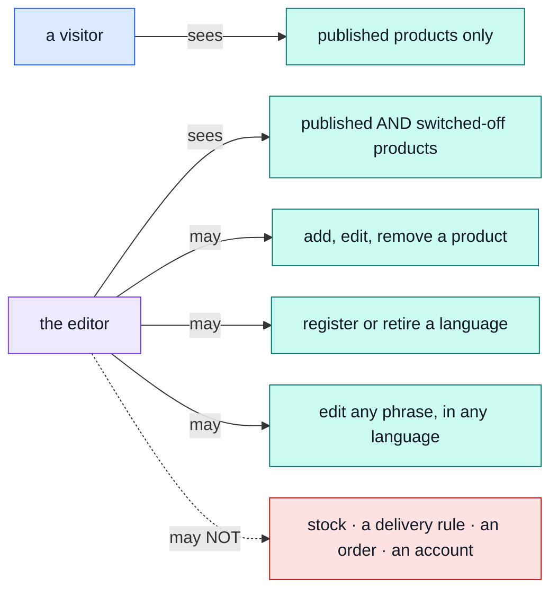

# The editor

Everything the shop **says and shows**: what a product is called, what it says, what it costs and
what it looks like — plus the words on every screen, in every language the shop speaks.

Sign in as the editor, a real, narrower account, not the owner's (see [Test it yourself](./test-me.md)).

<!-- IMG: the product edit form with its translated fields · the product form with the language tabs -->

Every role's full rights are in [the role table](./start.md#what-that-actually-grants).

## Three areas, one job

| Area         | What the editor may do      | What it grants                                                                                                 |
| ------------ | --------------------------- | -------------------------------------------------------------------------------------------------------------- |
| Products     | see, create, change, delete | The whole product record, price included, drafts included.                                                     |
| Languages    | see, create, change, delete | The shop's own dictionary: every phrase, every language, and adding a language the shop has not spoken before. |
| Translations | read, change                | A product's own words (title and description), per language.                                                   |

::: tip Yes, the editor can change a price
It is tempting to read "editor" as "words and pictures only", but there is no separate key for
that — a product's price is a field on the same record as its title, and the permission to update a product
grants the record, not a subset of it. If a deployment wants price locked to someone else, that is
a new, narrower key to add, not something this role already enforces.
:::

## The two doors onto a product's words

A product's copy can be reached two ways, and they are genuinely different endpoints:

| Where you edit          | Reaches                                                                     | Needs                                                     |
| ----------------------- | --------------------------------------------------------------------------- | --------------------------------------------------------- |
| The product form        | the whole record: price, stock flags, and every language's copy in one save | the product permission **and** the translation permission |
| The translations screen | that product's words only, never a price                                    | the translation permission                                |

The second is generic: the same screen would translate a category description or a
page were one added. A product is simply the only thing the shop registers as translatable
today. See [products](../modules/products.md#writing-translated-content) for the split.

## What this role cannot reach, and why each one is a different reason

| Cannot touch           | Because                                                                                         |
| ---------------------- | ----------------------------------------------------------------------------------------------- |
| **Stock**              | A different area, which this role holds no permission in.                                       |
| **A delivery rule**    | Delivery pricing is a fixed table, not a product field.                                         |
| **An order**           | No permission to see every order: an editor reads only its own orders, and has none.            |
| **An account**         | No permission on users: cannot see who bought anything.                                         |
| **The action history** | No access to the audit log: that is [the moderator's](./moderator.md) permission, not this one. |

Try it: sign in as the editor and open the list of users. It is refused, and that is not a bug in the demo: it is the whole
reason this account exists rather than everyone sharing the owner's. The order list answers differently:
every signed-in account may read its OWN orders, and the editor has
placed none, so the list comes back empty, the
same as a shop with no orders. Open one specific order
by its link and it is "not found" instead, for the same underlying reason.

## Existing wording only

Editing replaces what a phrase, or a product's copy, currently says. It never invents a new field
or a new screen — that is a developer's job in both cases; this role only decides what an existing
slot currently reads, in whichever language it is editing.

The demo ships Spanish, Italian, French and Japanese screens in deliberately different states of
completeness, so a half-translated shop can be seen behaving. Product copy is seeded only in English
and Italian, so in Spanish, French and Japanese the catalogue falls back to English until this role
writes the copy — fixing either is this role's job.

## Switching a language on or off

A language has one switch. **On**, shoppers can pick it and it applies everywhere at once: the screens,
the product names and descriptions, the search and the emails. **Off**, it is a draft: the editor
can keep writing into it, shoppers never see it, and anyone who had it saved gets the shop's default
language, in the page and in the emails. Switching it back on needs no deploy and takes effect on the
next page load.

**Off** hides a language and keeps the work; **Delete** destroys the language and every string
translated into it. Delete works on a live language too, so a language that is on loses its
visitors at once. The confirm says so.

A language added by hand has no translation file for the shop's own error messages, so those few
messages show in the default language until a developer adds the file. Everything the editor
writes (screens, product names) shows in the new language straight away.

::: warning One role holds both jobs
The editor holds the product permissions and the translation permissions together, so a mistranslation CAN
become a mischarge: the same account that rewrites a title can reach the price.

The separation still exists at the level of permissions. Translation is its own permission,
separate from product, so it grants no way to touch a price by itself. A
deployment that wants a words-only person cuts a role holding the language and translation
permissions and gets exactly that.
:::

## The words we used

| Word                       | In plain terms                                                                                                            |
| -------------------------- | ------------------------------------------------------------------------------------------------------------------------- |
| **Product permission**     | The whole Product record, unconditionally — price included.                                                               |
| **Language permission**    | Every language, every screen phrase, unconditionally.                                                                     |
| **Translation permission** | Write a translatable entity's words. Never grants a read or write on the entity's own record.                             |
| **Switched off**           | Not deleted, just not currently for sale — an editor sees these, a visitor does not. → [products](../modules/products.md) |
| **Soft delete**            | Hidden from customers, kept in the records, restorable.                                                                   |
| **Locale**                 | One language the shop can speak. → [locales](../modules/locales.md)                                                       |
| **Entry**                  | One phrase, in one language, in the shop's own dictionary — not a product's words.                                        |
| **Translation**            | One entity's words, in one language — a product's title and description.                                                  |

## Read next

- [The shop manager](./manager.md): who prices and releases what you write.
- [The support desk](./support.md#languages): what happens when a customer cannot read the shop.
- [Test it yourself](./test-me.md#things-to-try): change a price, then try to open the list of users.
