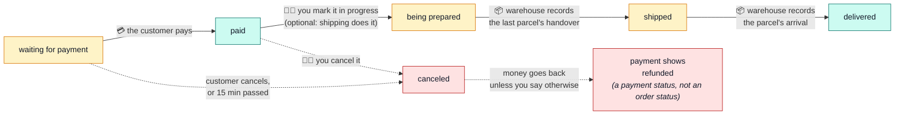
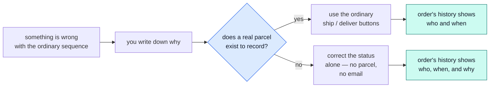
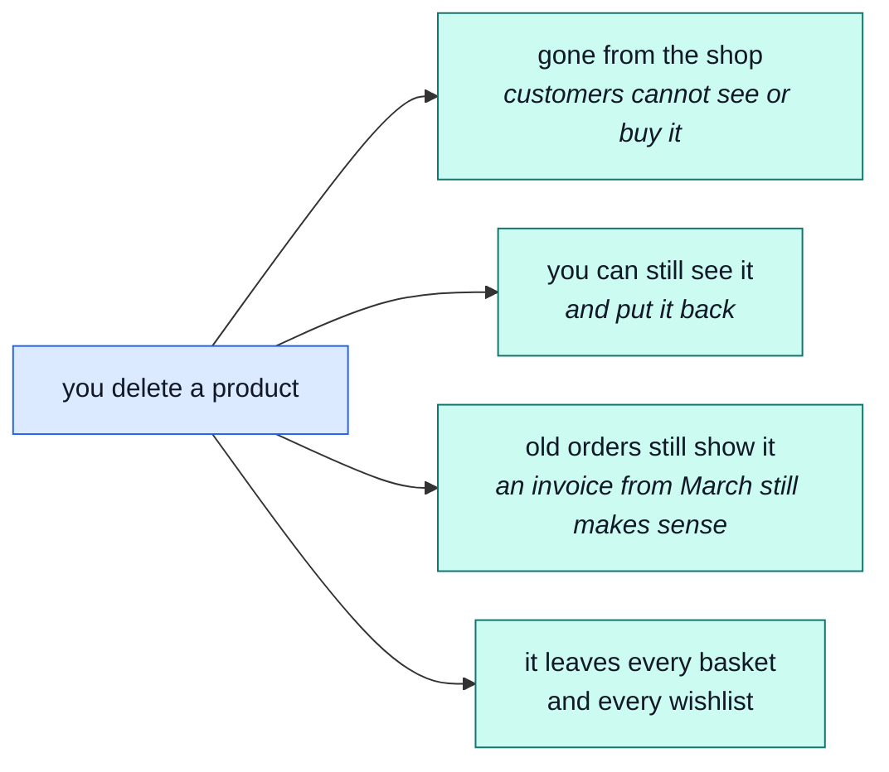
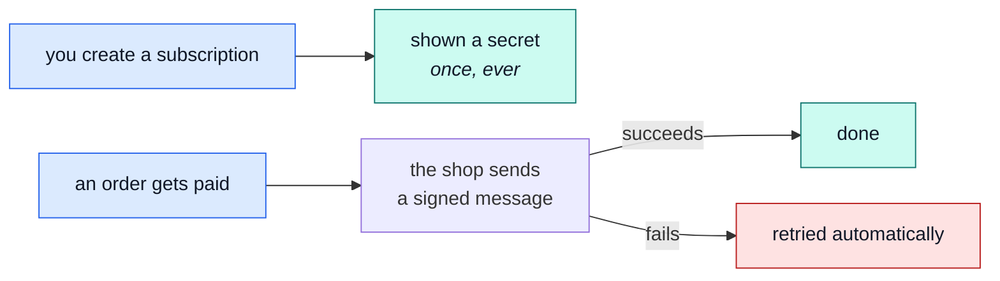

# The shop manager

Running the shop: what is for sale, at what price, and what happens to orders after they arrive.

Sign in as the shop manager, or as the admin, who can do this job too. The accounts and passwords are on [Test it yourself](./test-me.md).

<!-- IMG: the shop manager's dashboard after signing in · the shop manager's dashboard with orders and the catalogue -->

::: tip When something goes wrong
Odd cases that land on you: [an order stuck in processing](./when-something-goes-wrong-orders-and-delivery.md#stuck-in-processing), [fewer on the shelf than promised](./when-something-goes-wrong-orders-and-delivery.md#fewer-on-shelf), [a refund owed by hand](./when-something-goes-wrong-refunds.md#refund-owed-by-hand).
:::

## An order's life

An order is never edited. It **moves**, one step at a time, and everyone can see where it is:

Four kinds of hands move an order along — colour-coded below: the **customer** (blue), the
**payment system** (green, nobody clicks anything), the **warehouse** (amber), and **you**, the
shop manager (purple).

One of those steps happens without anyone at the shop pressing anything — the payment confirming is
a fact from outside the application, not a button:

- **The warehouse marks it shipped by recording the handover**, not the other way around — they
  scan or type the tracking code (when the method has one; it may come later) into the shipment screen, and THAT is
  what creates the parcel record, moves the order to **shipped**, and sends the customer their
  tracking email. There is no separate "mark shipped" switch to forget. The order moves from
  processing to shipped only when nothing remains to ship; until then it stays in processing, and
  the shipment group reads "Partly shipped" after a first partial shipment.
- Cancelling a **paid** order refunds it by default. Cancelling an unpaid one has nothing to refund,
  so it does not try.

::: tip Fixing a mistake
If a parcel was scanned against the wrong order, or a status needs correcting outside the normal
sequence, you can force a move with a reason — see "Correcting a mistake" below. It is deliberately
a separate, logged action, not a quiet edit.
:::

::: warning Who cancelled decides whether the money goes back
If the **customer** cancels, they are always refunded. That is the promise a paid order is
cancellable on, and staff cannot override it.

If **you** cancel, the refund still happens unless you say otherwise — because sometimes it should
not: a replacement is going out, a correction is being made, or the money is being returned some
other way. Cancelling and refunding are one action by default and two when you need them to be.
:::

### A counter sale, or an order for a buyer with no account {#counter-sale}

A buyer stands at the counter, or phones, or paid you outside the shop. Make the order yourself:
**Sales → Orders → New order**. Pick the products and quantities. The buyer is **No account
(walk-in)** unless the customer has an account (picking one needs the permission to see users); the
**email** is where the confirmation goes, so type theirs, or the shop's own address if they would
rather not give one. The order opens as any other, **waiting for payment**.

1. **Record the money straight away.** A new order holds its stock for about 15 minutes, like a
   checkout, and is canceled when the time runs out. Whoever may record payments (the
   [moderator](./moderator.md#recording-a-transfer-and-why-a-paid-order-refuses-it) or the admin)
   opens the order and records the cash, card-terminal slip or transfer. A manager can make the order but
   not record the money: hand over to a colleague who can.
2. **Hand the goods over.** On the order, **Ship** without a tracking code, then **Mark delivered**.
3. A walk-in order has no account behind it, so the buyer cannot see it online. A return is opened by
   staff for them.

A walk-in buyer's email is cleaned up by the same retention rule as an erased account's, once the
order is past its claim window ([why](../understand/data-retention-orders.md#walk-in-orders)).
The money did not arrive in time and the order was canceled? Make a new one: a canceled order is
never brought back.

→ [Orders](../modules/orders.md) · [Payments](../modules/payments.md) · [A card charged in the provider's dashboard](./when-something-goes-wrong-orders-and-delivery.md#dashboard-charge)

## Correcting a mistake

The ordinary sequence above sometimes cannot be followed — a parcel was scanned against the wrong
order, or fulfilment needs to be corrected out of the normal order. If a real parcel exists, record it
with the ordinary ship and deliver buttons: there is no separate "forced" version of either. If there
is no parcel to record, staff with the right permission can correct the status alone, which always
needs a reason and is always written down:

Neither path can move an order backward, and neither can ever mark one **paid** by hand — money
landing is still the one fact only the payment system reports. Every correction is written down
with who, when and why, and read back on the order's timeline (an entry visible to staff only) and in the admin-only audit trail — the
customer's own view of the order never shows it, so a customer support question is answered from
the timeline, not the customer's order page.

**A wrong name, address or VAT number on an invoice** is not corrected by editing the invoice: an
invoice is a numbered legal record. Once your accountant agrees, open the order and use **Edit
billing address**. The shop cancels the old invoice with a credit note and issues a new one to the
corrected buyer by itself: two new numbers, no money moves, both documents on the order. If part of the
order was already refunded, only what is still invoiced is reissued. A buyer cannot do this
themselves: they ask, you check.

## The catalogue

Adding, editing and removing what the shop sells, one product at a time.

**Deleting a product does not really delete it.** It disappears from the shop immediately, but the
record stays:

::: tip Why it works this way
If deleting really erased a product, every past order that contained it would become unreadable —
an invoice with a blank line on it. So the shop hides products instead of destroying them, and
orders keep their own copy of what was bought at the price it was bought for.

Changing a price today does **not** change what a customer was charged last month.
:::

There is a separate, permanent delete for when a record genuinely has to go.

## Hidden two different ways

The demo has one of each, which is why the shop shows 137 products but the manager sees all 139:

| Product                                              | State            | What it means                                           |
| ---------------------------------------------------- | ---------------- | ------------------------------------------------------- |
| 150W Ceramic Heat Emitter                            | **deleted**      | removed, but recoverable and still on old orders        |
| Rabbit Starter Bundle — Hutch, Feeder & Water Bottle | **switched off** | not deleted, just not for sale right now — flip it back |

"Switched off" is for a seasonal item or one you are still writing the description for.
→ [Products](../modules/products.md)

::: tip Selling an off-sale item by hand
An order you raise for a customer may include a product that is hidden or switched
off for shoppers: no need to flip it live for a minute and back. Only a deleted product is refused.
:::

## Redirecting the rest of an order

A buyer moved after the first parcel left? On the order page, correct the shipping address: it applies
to everything not yet shipped (held items and items waiting for stock included). The parcel that
already left keeps the address it went to, shown on its shipment. The country must be one the shop
ships to.

## What you cannot do from here

**You cannot type a new stock number into a product.** Stock is only ever changed by recording a
reason — a delivery arrived, or a count was corrected. That is deliberate, and it is
[the warehouse's page](./warehouse.md).

The one exception is creating a brand-new product, where an administrator can give an opening
quantity. It is not typed into the product either: the product is made first and the count is
recorded as its first delivery.

**You can see an order's payment, but you cannot return money by hand.** That is the moderator's and
the admin's job; cancelling a paid order still refunds it.

## Late orders

A preorder or backorder is **late** when its expected date has passed and units remain. The preorder
board's **Late** view lists them. The shop already told the buyer by email (the new date, or "no
new date yet", and how to cancel), and it never cancels on its own: a buyer who says nothing keeps
waiting. So the routine is a person's:

1. **About once a week**, open the **Late** filter.
2. For an order that is **very late** (30 days past the agreed date, the threshold this shop starts
   from; [FTC 16 CFR 435.2(b)](https://www.ecfr.gov/current/title-16/section-435.2)), write to the buyer and ask whether they still want it.
3. If they do not, or the goods will not come, **cancel and refund** with the ordinary staff cancel.

The board lists the earliest expected date first. When stock arrives it goes to the earliest **payment** first, automatically, so the **Paid** column is the order stock is handed out in.

Before you move a release or restock date, the product form shows how many orders would get an
email. → [Delivery](../modules/delivery.md#what-staff-do-about-a-late-order)

## Prices and delivery

Product prices are set per product. Delivery prices are fixed rules, not settings:

| Delivery   | Costs | Rule                        |
| ---------- | ----- | --------------------------- |
| Standard   | €5    | free from €100 up           |
| Express    | €15   | only for baskets up to 5 kg |
| Pick it up | €0    | —                           |

The customer's basket is priced by those same rules, so what they are quoted at checkout and what
they are charged cannot disagree. → [Delivery](../modules/delivery.md)

::: tip Why the invoice splits shipping across rates
Delivery has no VAT rate of its own — it is taxed as part of what it delivers. A basket with a
standard-rated item and a reduced-rated item splits the €5 shipping fee between the two,
proportionally to what each item cost, and each half is taxed at ITS OWN item's rate.

The invoice still prints one summary line per rate, so a customer sees "22%: €X" and "10%: €Y"
rather than one shipping line they have to reconcile by hand.
:::

## Customers

The staff side can list, search and open a customer account — enough to answer "who is this" while
looking at their orders. Editing an account is [the support desk's](./support.md) job; erasing one
needs the right to delete a user, which support does not hold but the moderator does alongside the admin,
and it asks the person to prove who they are again either way.
→ [Users](../modules/users.md)

## Notifying other systems

A **webhook subscription** tells the shop to send a message to some other system — your
accounting software, a mailing-list tool — the moment something happens: an order is paid, an
order ships, a payment fails. You pick the URL and which events it cares about.

::: warning The secret is shown exactly once
When you create a subscription, or rotate its secret, the secret itself is shown on screen a
single time and never again — not even to you. It proves to the other system that a message really
came from this shop. Copy it somewhere safe immediately; if you lose it, rotate for a new one.
:::

**Rotating** a secret does not break anything mid-flight: the old one keeps working until you
separately remove it, so the other system has time to switch over. If a delivery keeps failing —
the other system was down, its URL changed — that shows up in the delivery log, which you read (and can
replay from) yourself; [the support desk](./support.md) cannot open it and will pass the complaint to you.
→ [Webhooks](../modules/webhooks.md)

## An alarm: a paid order with no stock set aside

The alert mailbox can get "a paid order has no stock held". It is the one stock alarm that cannot wait: an order is paid,
or shipping, and nothing was set aside for it. It does not come from a late payment (those fix themselves: the goods are
taken again, or the customer is refunded). It means somebody edited the data by hand or restored a backup.

The mail names the order and the step (the audit entry behind it is for an admin), so ask the warehouse to check the shelf and decide:
restore the reservation, cancel and refund, or record a correction if the parcel is already gone. Until the webhook
for the phone is set up, **only the email** reaches anyone, so someone must read that mailbox.

→ [the detail](../modules/inventory-reservations.md#orphaned-hold)

## Everything is written down

Every staff action — a price change, a cancellation, a deleted product — is recorded with who did
it and when; only an admin reads the record. The record is kept for **180 days** and then disappears on its own.

Nobody can turn this off from inside the application, which is the point.
→ [Audit logs](../modules/audit-logs.md)

## The words we used

| Word             | In plain terms                                                                                             |
| ---------------- | ---------------------------------------------------------------------------------------------------------- |
| **Soft delete**  | Hidden from customers, kept in the records, restorable. → [Products](../modules/products.md)               |
| **Switched off** | Not deleted, just not currently for sale.                                                                  |
| **Refund**       | Money returned. Happens automatically when a paid order is cancelled. → [Payments](../modules/payments.md) |
| **Audit log**    | The 180-day record of who did what, for admins. → [Audit logs](../modules/audit-logs.md)                   |
| **Webhook**      | A message the shop sends to another system when something happens. → [Webhooks](../modules/webhooks.md)    |
| **Secret**       | The one-time-shown key that proves a webhook message came from this shop.                                  |

## Read next

- [The warehouse](./warehouse.md): the person who packs and ships what you release.
- [The support desk](./support.md): who answers the customer.
- [When something goes wrong](./when-something-goes-wrong.md): the fix for a stuck order, a refund owed by hand or a lost parcel.
