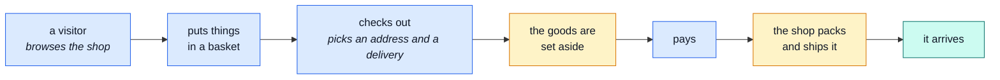

# The demo shop

**A small online shop that really works.** You can browse it, fill a basket, pay and watch the
parcel go out, with pretend money and a pretend courier.

::: tip Who this section is for
Staff and owners: people who need to know **what the shop does**, not how it is built. No code on
these pages. Developers: the rest of this site is yours, start at [Modules](../modules/start.md).
:::

Blue is the customer acting. Amber is the shop working in the background. Each page in this
section opens one of those boxes.

## Which page do you want

| You are…                                              | Read                                                        |
| ----------------------------------------------------- | ----------------------------------------------------------- |
| Wanting to log in and click around                    | [Test it yourself](./test-me.md)                            |
| Wondering what a customer experiences                 | [The customer](./shopper.md)                                |
| Running the shop: products, prices, orders            | [The shop manager](./manager.md)                            |
| Looking after stock and getting parcels out           | [The warehouse](./warehouse.md)                             |
| Answering emails, resets, complaints                  | [The support desk](./support.md)                            |
| Writing and photographing products, and pricing them  | [The editor](./editor.md)                                   |
| Translating the shop's screens, and a product's words | [The editor](./editor.md)                                   |
| Handling accounts, disputed orders and refunds        | [The moderator](./moderator.md)                             |
| Something odd happened and you need the fix           | [When something goes wrong](./when-something-goes-wrong.md) |
| Checking what the shop does and does not do           | [What this demo models](./scope.md)                         |
| Thinking of selling for real                          | [Before you sell for real](./before-you-sell.md)            |
| A developer who took a wrong turn                     | [Modules](../modules/start.md)                              |

This section describes the example shop built on the reusable starting point. The parts it is
assembled from are under [Modules](../modules/start.md).

## What the shop sells

139 products, a pet-supply retailer. Eleven are hand-picked, each there to show the shop behaving
differently. The other 128 are a generated grid (six animals × seven product types × three quality
tiers) plus two downloadable guides, so lists, pages and filters have enough rows to work with.
Three of the grid's product types have their own VAT treatment: supplements reduced, bowls
zero-rated, dispensers exempt.

Every product starts with no stock. The shelf is filled the way a real shop's is, with an opening
stock receipt per product, so every unit is accounted for.

| Product                                              | Price | In stock | Why it exists                                        |
| ---------------------------------------------------- | ----- | -------- | ---------------------------------------------------- |
| Premium Grain-Free Dog Food, 15kg                    | €68   | 30       | a completely normal product                          |
| Orthopedic Memory Foam Dog Bed                       | €84   | 45       | another normal one, so baskets can have two lines    |
| Heavy-Duty Cat Scratching Post                       | €45   | **0**    | shows what "out of stock" looks like                 |
| Universal Small Animal Water Bottle                  | €9    | 9        | has only a name and a price, nothing else            |
| 150W Ceramic Heat Emitter                            | €55   | 12       | **deleted**: proves a deleted product disappears     |
| Rabbit Starter Bundle — Hutch, Feeder & Water Bottle | €96   | 18       | **switched off**: visible to staff, not to buyers    |
| Online Puppy Training Course — Video Access          | €29   | 50       | **digital**: never shipped                           |
| Limited-Edition Brass Pet Bowl                       | €24   | **1**    | the last unit: one checkout holds it, a second fails |
| Hand-Painted Personalised Pet Bowl                   | €80   | 20       | made to order: no right of withdrawal                |
| Extra-Large Cat Tree, 12kg                           | €40   | 10       | too heavy for express delivery                       |
| Heated Orthopedic Pet Bed — Winter Edition           | €120  | 15       | **off sale**: the cart takes it, checkout refuses it |
| _...128 more_                                        | —     | —        | a generated catalogue, e.g. "Premium Bird Carrier"   |

A visitor sees **137** products (the nine public named ones plus all 128 generated). Staff see all 139. The difference is deliberate: see [the shop manager](./manager.md).

## Money and delivery

Prices are in **euros**. The customer picks the delivery at checkout:

| Delivery   | Costs | Note                               |
| ---------- | ----- | ---------------------------------- |
| Standard   | €5    | **free** from €100 up; up to 30 kg |
| Express    | €15   | always €15; up to 5 kg             |
| Pick it up | €0    | the customer collects it           |

Paying is fake. No real card is processed and no real money moves: any made-up card is accepted,
and the test card `pm_card_declined` is always refused, so the "your card was declined" path can be
shown on demand.

## The people in it

Every role has its own account with a password you can type. They are all listed, with things to
try as each one, on [Test it yourself](./test-me.md).

Each staff account holds **exactly one role**, on purpose. An account that can do everything cannot
show a restriction. A narrow one, refused when it reaches past its own job, can. Sign in as the
editor and try to open the list of users: the refusal is the reason that account exists. The same
account's order list shows the limit another way: empty instead of refused. See
[the editor's own page](./editor.md#what-this-role-cannot-reach-and-why-each-one-is-a-different-reason).

A further ten customer accounts hold an order history (mostly one small order each) so the staff
screens have more than one shopper's activity to look at. Nobody signs in as them.

### What each role may do {#what-each-role-may-do}

| Role                        | What it is                                                                                                  |
| --------------------------- | ----------------------------------------------------------------------------------------------------------- |
| Guest, unverified, customer | Not roles anybody is given: who the visitor is right now (signed out, signed in but unconfirmed, signed in) |
| Manager, warehouse, support | The shop's day-to-day jobs                                                                                  |
| Editor, moderator           | The words and pictures, and the accounts and disputes                                                       |
| Admin                       | Everything inside the shop, and the only one who can give someone a role                                    |
| Operator                    | Runs the installation, sees its health, reads no order                                                      |

A role is a bundle of permissions, and nothing ranks above another. Staff work on customers: only
an administrator changes an account that holds a role, or hands one out. Every signed-in account is
a customer too, staff included, so a staff member shops like anyone else. The rules behind this are
in [Authorization](../understand/authorization.md#protecting-people).

### What that actually grants

<!-- role-matrix:start -->

The roles above after the evaluator has had them, the `customer` audience folded into every
signed-in row. This is what a route guard and a listing actually answer.

| Role         | products    | cart | orders             | payments  | inventory | delivery | returns   | tasks | locales     | core | users   | access | audit-logs | webhooks | api-keys | observability | example          | stats |
| ------------ | ----------- | ---- | ------------------ | --------- | --------- | -------- | --------- | ----- | ----------- | ---- | ------- | ------ | ---------- | -------- | -------- | ------------- | ---------------- | ----- |
| `guest`      | r           | —    | —                  | —         | —         | —        | —         | —     | r           | —    | —       | —      | —          | —        | —        | —             | —                | —     |
| `unverified` | r           | —    | r                  | r         | —         | —        | —         | —     | r           | —    | —       | —      | —          | —        | —        | —             | —                | —     |
| `customer`   | r           | X    | r                  | r         | —         | —        | —         | —     | r           | —    | —       | —      | —          | —        | —        | —             | —                | —     |
| `manager`    | RDISPLAYCUD | X    | RDISPLAYCUDEXPORT  | RDISPLAY  | R         | START    | RURECEIVE | R     | RDISPLAYCUD | RU   | —       | —      | —          | RCUD     | —        | —             | rCud             | R     |
| `warehouse`  | RDISPLAY    | X    | RDISPLAY           | r         | RCU       | USTART   | RRECEIVE  | —     | r           | —    | —       | —      | —          | —        | —        | —             | rCud             | —     |
| `support`    | r           | X    | RDISPLAY           | RDISPLAY  | —         | —        | RU        | RUD   | r           | —    | RU      | —      | —          | —        | —        | —             | rCud             | —     |
| `editor`     | RDISPLAYCUD | X    | r                  | r         | —         | —        | —         | —     | RDISPLAYCUD | RU   | —       | —      | —          | —        | —        | —             | rCud             | —     |
| `moderator`  | r           | X    | RDISPLAYU          | RDISPLAYC | —         | —        | RU        | —     | r           | —    | RCUBAND | —      | —          | —        | —        | —             | RCudDISPLAY      | —     |
| `admin`      | RDISPLAYCUD | X    | RDISPLAYCUDOEXPORT | RDISPLAYC | RCUS      | USTART   | RURECEIVE | RUD   | RDISPLAYCUD | RU   | RCUBAND | ASSIGN | R          | RCUD     | RCD      | —             | RCUDDISPLAYADMIN | R     |
| `operator`   | —           | —    | —                  | —         | —         | —        | —         | —     | —           | —    | —       | —      | —          | —        | —        | R             | —                | —     |

UPPERCASE — a rule with no condition, every row · lowercase — narrowed to the caller’s own or the published rows · `r` read · `c` create · `u` update · `d` delete · `x` checkout · `s` sweep · `o` override · — nothing

Read down a column to see who touches one part of the shop; read across a row to see one
person’s whole job. `operator` is the only row outside the shop entirely: it runs the
installation and reads no shop’s rows, which is why its row is empty everywhere else and
why `admin` — unrestricted **inside one shop** — cannot reach observability either.

<!-- role-matrix:end -->

The rules behind them, and why a role cannot span both scopes, are in
[Authorization](../understand/authorization.md).

## Opening it yourself

Setup and sign-in are one short page: [Test it yourself](./test-me.md). The demo is a throwaway
shop: close it and it all disappears, start it again and it is back as it was. Nothing you click
breaks anything for good.

## Read next

- [Test it yourself](./test-me.md): sign in as each role.
- [What this demo models](./scope.md): what the shop does, will do and never will.
- [Before you sell for real](./before-you-sell.md): every legal text here is an example.
