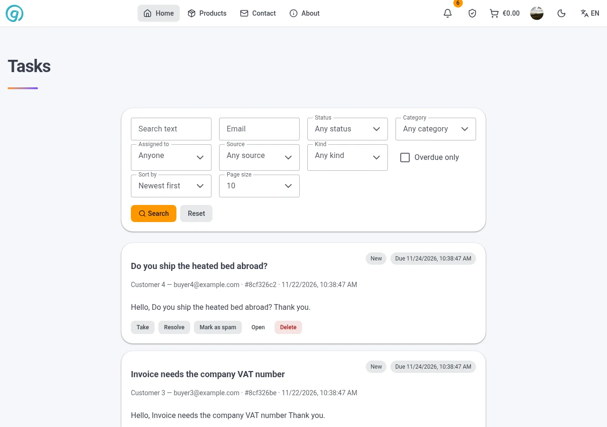
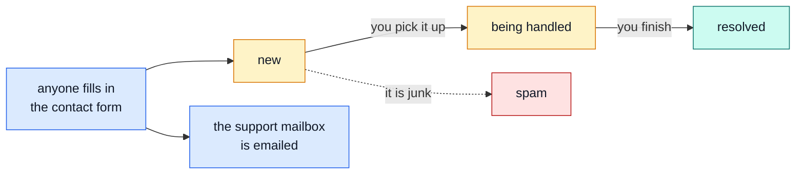
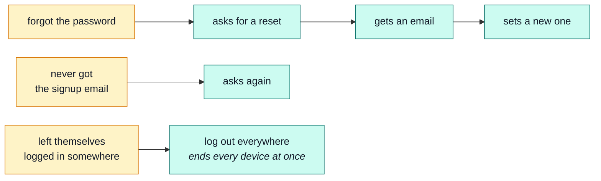
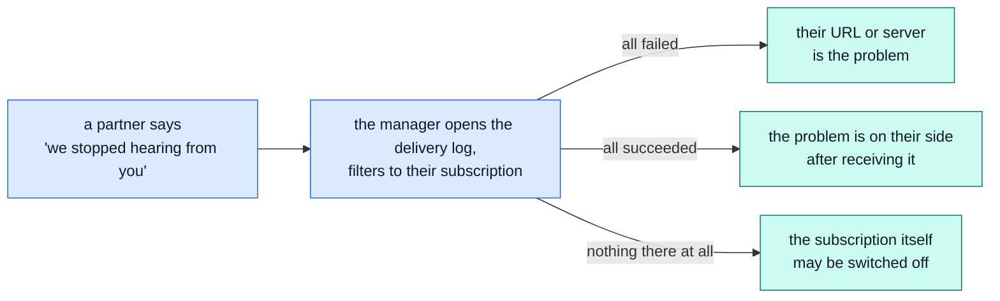

# The support desk

Messages from people, accounts that need help, and knowing whether the shop is actually broken.

Sign in as the support account (see [Test it yourself](./test-me.md)).

::: tip When something goes wrong
When a buyer asks where their parcel is: [shipped but not arrived](./when-something-goes-wrong-orders-and-delivery.md#shipped-not-arrived), [an order stuck in processing](./when-something-goes-wrong-orders-and-delivery.md#stuck-in-processing).
:::

## The contact form

Anyone can send a message — no account needed. Along with signing up and logging in, it is one of the few things a complete stranger can write to.

Four states, and that is the entire workflow. Private notes can be attached to a message; the person
who sent it never sees them on screen, but their data export includes them.

::: tip The form works without an account, and remembers one if there is one
The form asks for an email rather than requiring a login, because the people most likely to need
help are the ones who cannot get in. A message sent while signed in is attached to that account, so
**when the account is finally erased its messages go with it**, and so do the messages sent under its
confirmed email address. Messages typed under an old or different address are not matched: find
those in the inbox by hand.
:::

### Working a task

Open a task to see its notes, who has it and what else was asked about the same order. **Take** it
to put your name on it (it becomes _in progress_); **Resolve** it when it is done; **Mark as spam**
when it is not a real message. Both can be undone with **Reopen**, which puts it back where it was
(with you, if you had it). If **Reopen** says a newer task already covers the situation, that
task is the one to work: the message names it. Every note is kept with the time it was written;
write each as if the customer will read it, because their data export includes them (without your
name). A task stays in the inbox for 24 months after it was closed, then goes.

### Answering from the support mailbox {#answering-a-message}

Every message also lands in the support mailbox, and **Reply** there reaches the customer. The
mailbox is where you answer; the task is how the team knows who is answering.

1. Open the task first. The mail links to it, and the task shows its reference number, the same one as in the
   mail subject.
2. A name on it? It is theirs: ask before stepping in.
3. Nobody's? Press **Take**.
4. Reply from the mailbox. Keep the reference number in the subject.
5. Back on the task, add a note: what you answered, in a line or two.
6. Press **Resolve**. They write back? **Reopen**.

::: warning The customer can read your note
Their data export includes every note, without your name. Write a summary, not a copy. No phone
numbers, addresses or health details.
:::

::: tip Two people, one customer
**Take** on someone else's task moves it to you, and they are not told: agree first. Two replies
went out? Add a note. If they disagree, the second person sends one line saying which answer
stands.
:::

### With the help desk on {#helpdesk}

When your shop runs a help desk (Zammad), messages from the contact form arrive there as tickets
and you answer them there. This inbox then holds only what could not be handed over. Five things are
yours to do by hand:

- **A to-do that says "do not reply".** The help desk did not take the message after every retry,
  so the message waits here. Answer it from this admin as before, then **Resolve** it. The mail you
  got carries only the reference and a link: the customer's words are in the task, not the mail.
- **The same person twice.** If one customer ends up with two entries in the help desk, merge the
  tickets there by hand. Zammad cannot merge customers.
- **"Email address already used" after a customer changed their email.** The new address already
  belongs to another customer in the help desk, so their profile did not follow. Move their tickets
  to the right customer by hand.
- **Suspected spam.** A message the email check refused is filed in the help desk already closed and
  tagged `suspected-spam`, and nobody is mailed. Look at the **Suspected spam** view there now and then
  to rescue a real person who was caught by mistake (reopen the ticket); the rest is deleted after
  30 days. A honeypot catch is a closed spam to-do in this inbox and goes after 30 days too.
- **Writing about a person in a ticket.** Write the order number, not the name: a mention on someone
  else's ticket cannot be found and erased with the person.

### How long you have {#deadlines}

| What the message is about | You have  |
| ------------------------- | --------- |
| Personal data             | one month |
| Anything else             | 48 hours  |

- A task shows **Due …**, and a red **Overdue since …** once it is late. In the inbox, filter
  **Overdue only** or sort by **Due soonest**.
- Late: one reminder, by bell and to the support mailbox.
- A personal-data request warns **3 days before** it is due, by bell and to the mailbox. Its subject
  carries the word "privacy" in brackets. Reminders arrive in the same thread as the first mail.

::: warning The GDPR extension has a deadline too
A personal-data request may take two more months only if you tell the person **within the first
month**, and why. Write to them, then add a note with when and why: the shop's proof.
:::

::: warning "Cancellation" may be a withdrawal
If the message clearly says so, record it on the order the same day
([Record withdrawal](#withdraws-by-phone)), with the day they **sent** it. The money is owed within
14 days of the shop **receiving** it.
:::

### Someone is erased: clean the mailbox {#mailbox-after-erasure}

When an account is erased (an admin's hard delete, the purge after the owner asked, the inactivity
erasure, or a restore replaying the erasure ledger), the shop deletes their messages, to-dos and notes. It cannot delete the
copies in the support mailbox, so it mails the mailbox ONE notice listing the reference numbers of the
deleted messages (no address, name or text). Do this the same week:

1. Search the mailbox for each ref, and for the address if you know it.
2. Delete every match in every folder: inbox, Sent, archive, your own folders. Then empty the Trash.
3. Forwarded copies too.
4. Move the notice to an **Erasures** folder, with the date and your initials. Never write the
   address or name there.

The provider's backups age out on its contract schedule.

**Every month:** delete every mail older than 24 months in every folder (a mail rule can do it).

→ [Tasks](../modules/tasks.md) · [data retention](../understand/data-retention.md#the-support-mailbox)

## "I can't get in"

Most of what a support desk does, and none of it needs staff intervention:

::: tip What the desk may and may not do to an account
Support fixes a customer's details (a phone number, a name) and nothing that is the customer's own
to prove: there is no password, email or second-factor reset on anyone's behalf, because those are
the owner's alone. It cannot ban or reactivate an account either: that is the
[moderator's](./moderator.md) permission. And it works only on customers: another staff member's account
holds a role only a role manager may touch, so the edit is refused.
:::

A person can see every device currently signed in to their account and end any of them, or all of
them, themselves. → [Account](../modules/account.md)

::: warning An unverified account still works
Signing up sends a verification email. An unverified customer can browse, fill a basket, keep a
wishlist and read their own orders, but cannot check out until the address is proven. If someone
says "I never got the email and I cannot order" — that is correct, not a bug: resend the email.
:::

## A buyer phones in a return {#phones-in-a-return}

The buyer cannot log in, or would rather ask. Open the order, then **Open return**: pick the lines,
the reason, and — if they asked a few days ago — the day they asked. The return is born
**approved** (you are the answer), and the buyer gets one email with the address to send the goods
to. No fresh login: nothing is paid until the goods arrive.
→ [Returns](../modules/returns.md#staff-open-a-return-for-the-buyer)

**A buyer complains by phone or email, but wants nothing back yet.** That is a complaint, not a bank
dispute: no money moved. Note it on the order (the staff note), then use the tool the outcome needs:
broken goods, open the return as **Defective goods**; a change of mind in time, **Record withdrawal**;
a gesture, a goodwill **Refund**. A bank dispute is different: it arrives from the provider.
→ [A card dispute](./when-something-goes-wrong-refunds.md#card-dispute)

## A buyer withdraws by phone, email or letter {#withdraws-by-phone}

The law accepts any clear statement, and counts it from the day it was **sent**, not the day you read
it. On the order press **Record withdrawal**, give the day the buyer sent it and how (phone, email,
letter, other). The shop then does everything their own button does, and emails them the day they
stated it and the day you recorded it: their proof.

The shop asks you to confirm your password first: it is a legal record, and before dispatch it
cancels the order and sends the money back (that needs the refund and order keys, which the
[moderator](./moderator.md) holds). A withdrawal sent after the window really closed is refused:
that one is not yours to waive.
→ [Returns](../modules/returns.md#staff-open-a-return-for-the-buyer)

## A goodwill return after the deadline {#goodwill-after-deadline}

Day 40, the buyer is a regular, you say yes: open the return with reason **Other**. The deadline
does not stop you, and the return shows, for the next person, that it was an exception. Made-to-order
goods can be taken back this way too. Write nothing you do not want: the note is optional.

A defect that appeared within the two years but was reported later is **not** goodwill, it is the
legal guarantee: open it as **Defective goods** with the day the buyer reported it. Some countries
give more than two years; the same door covers it.

## Declining a return {#declining-a-return}

Pick the reason from the list: the period ended, not returnable, no defect found, or other. The
buyer reads one sentence in their own language. Write to the buyer only when you pick **Other**; the
shop then needs your message, because "other" alone tells them nothing.
→ [Returns](../modules/returns.md#declining-a-request)

## Declined by mistake? {#declined-by-mistake}

A decline is final, on purpose: a decision stays a record. To fix a wrong one, open a **new return
for the same lines** from the order ([a buyer phones in a return](#phones-in-a-return)). The old
decline holds no units, so nothing is blocked. Set the day they asked to the day of the first
request, and put the declined return's number in the note (the buyer reads the note). The buyer
will have two emails: the decline, then the approval.
→ [Returns](../modules/returns.md#staff-open-a-return-for-the-buyer)

## "Where is my order?"

Everything a customer might ask has an answer they can already see themselves: their order list, its
current step, the tracking code once it ships, and a PDF invoice to download.

A customer who writes in quotes the order number from their mail (for example 2026-000041, often typed 2026-41).
Paste it into the Orders list's order number box: the list finds that one order.

If they want to cancel, they can — and a paid order refunds itself when they do. Nobody has to
process it.
→ [The customer](./shopper.md) · [Orders](../modules/orders.md)

## "My order is late"

The customer already got an email and an inbox note when the date moved or would be missed. It says the new
date (or that there is none yet), and that they can **cancel from their order page for a full
refund** any time before it ships. Nothing is asked of them and the shop never cancels for them:
silence means they keep waiting. Staff look at the **Late** list weekly
([the weekly routine](./manager.md#late-orders)). A customer who writes in about it is told the same,
and if they want out, a staff member cancels and refunds with the ordinary cancel.
→ [Delivery](../modules/delivery.md#what-staff-do-about-a-late-order)

## Leaving a note on an order {#order-notes}

Spoke to a customer, or agreed something outside the shop? Write it on the order, so the next person
sees it. Open the order, and in its history type the note in the box (anyone who may edit orders has
it) and press **Add note**. The note shows in the history with your name and the time, marked as
staff-only.

- **The customer does not see it on their order.** They do get it if they ask for their data, so write
  it as if they will read it. Do not write phone numbers, addresses or health details.
- **Wrote the wrong thing?** The order page has no button to remove a note yet. A developer can blank a note's
  text, and the line stays in the history.
- **It goes by itself.** The text is removed after three years, and sooner if the customer's data is
  erased.

→ [Orders](../modules/orders.md#staff-notes)

## "My checkout is paused"

If a customer writes that they cannot place an order, the cause may be a **purchase pause**: the
shop pauses checkout for at most **seven days** after several unpaid orders were cancelled or left
to expire. The customer sees a notice on their cart and profile that says why and until when, and
gets an email with a link to write to you. Paying an order they already have, cancelling, returning
and their own data rights all still work.

Support **cannot lift it**: that is the [moderator's](./moderator.md) permission. Pass the case
on with the customer's address and what they told you; the moderator checks the account (it shows as
"Needs review") and lifts the pause or keeps it. Tell the customer a person will look at it, and that
it ends by itself within seven days at the latest. They may also object to it (GDPR Art. 21): say so in
the same task.
→ [Orders](../modules/orders.md#the-purchase-hold)

## Languages

The shop's buttons, labels and messages speak more than one language, and **that wording can be
changed without a developer** — the [editor](./editor.md) does exactly this, and needs no other
access to do it.

Someone in that role can edit the text customers see on-screen, and register or retire a language.
The demo ships with Spanish, Italian, French and Japanese in deliberately different states of
completeness, so a half-translated shop can be seen behaving.

::: tip You can change what a phrase says, not invent new ones — and not what a product says
Editing replaces existing wording. A brand-new label still needs a developer — the application
decides _what text exists_, the editor decides _what it says_. A product's own title and
description are translated too, but through a different door — see
[Products](../modules/products.md#writing-translated-content).
:::

A shopper who says "the shop is in English, I picked Spanish" is looking at a language that is switched
off, or one whose screens are not translated yet. Ask the [editor](./editor.md) to check the language's
switch; nothing on the shopper's side needs fixing.

→ [Locales](../modules/locales.md)

## "Is the shop down?"

There is a health page that answers plainly. The live activity view that updates by itself is the
platform operator's, not this desk's (the support role holds no observability permission).

And there is the **180-day record of every staff action**: who changed that price, who cancelled that
order, when. Most "what happened here?" questions end there, but not from this desk: the record is
[the moderator's](./moderator.md) and [the manager's](./manager.md) to read, and the desk asks one
of them. Neither is the platform-wide view a developer or operator would use instead.

→ [Observability](../modules/observability.md) · [Audit logs](../modules/audit-logs.md)

## "Our other system stopped getting notified"

When a shop is wired up to notify another system — accounting software, a mailing list — every
attempt to deliver that notification is logged: what event, when, whether it succeeded, and why it
didn't when it didn't.

::: warning Not readable from this desk
The support role holds no webhook permission: the delivery log (and replaying a delivery) belongs to
[the manager](./manager.md) and the administrator. This desk's part is to pass the partner's
complaint on, and to know what the manager will look at.
:::

Filtering the log by subscription and by status is usually the whole investigation — the error
column says what actually went wrong (timed out, refused, a wrong status code back).

::: tip Replay does not wait for the retry schedule (manager and administrator only)
A failed delivery retries itself automatically for a while, then gives up. Once whatever was
wrong is fixed, **replay** sends that exact attempt again immediately, right now, without waiting
for a next scheduled try or asking the other system to trigger the event over again.
:::

→ [The shop manager](./manager.md) · [Webhooks](../modules/webhooks.md)

## What is pretend here

Worth knowing before promising anything to a customer:

| Thing              | In the demo                                                     |
| ------------------ | --------------------------------------------------------------- |
| Card payments      | Fake. No money moves. One test method always refuses.           |
| The courier        | Fake. Staff record the handover and the arrival by hand.        |
| Emails             | Not actually sent — they are collected where you can read them. |
| The whole database | Thrown away when the demo stops.                                |

→ [Demo profile](../build/demo-profile.md)

## The words we used

| Word             | In plain terms                                                                                        |
| ---------------- | ----------------------------------------------------------------------------------------------------- |
| **Triage**       | Deciding what a new message is and who deals with it. → [Tasks](../modules/tasks.md)                  |
| **Verified**     | Confirmed their email. Until then an account can shop but not check out.                              |
| **Session**      | One signed-in device. → [Account](../modules/account.md)                                              |
| **Audit log**    | The 180-day record of staff actions, read by the admin only. → [Audit logs](../modules/audit-logs.md) |
| **Health check** | A page that says whether the shop is running. → [Observability](../modules/observability.md)          |
| **Delivery**     | One attempt to notify another system of one event. → [Webhooks](../modules/webhooks.md)               |
| **Replay**       | Resending a delivery right now, instead of waiting for its next automatic retry. Manager only.        |

## Read next

- [The customer](./shopper.md): what the buyer sees.
- [The moderator](./moderator.md): who bans, and who checks a flagged account.
- [When something goes wrong](./when-something-goes-wrong.md): refunds, returns and late parcels.
