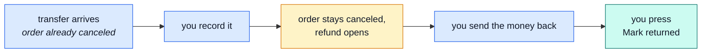

# Orders, stock and parcels that need a person

**For staff when an order, a stock count or a parcel is not where the shop expected.** Each entry has the same three parts: what you see, what to do, whose job it is.

| Something odd happened                                                 | Go to                                                |
| ---------------------------------------------------------------------- | ---------------------------------------------------- |
| Money arrived by bank transfer for an order that was already cancelled | [A transfer for a cancelled order](#late-transfer)   |
| A card was charged in the provider's own dashboard for an order        | [A card charged in the dashboard](#dashboard-charge) |
| The shelf holds fewer units than the orders promised                   | [Fewer on the shelf than promised](#fewer-on-shelf)  |
| An order stays in "being prepared" and nothing moves                   | [An order stuck in processing](#stuck-in-processing) |
| A parcel left a long time ago and nobody recorded its arrival          | [Shipped but not arrived](#shipped-not-arrived)      |
| A parcel was lost, or damaged on the way, and the buyer never got it   | [A parcel lost or damaged](#lost-parcel)             |
| A parcel was lost and the shelf has none left to send again            | [Lost, and none left](#lost-none-left)               |
| A parcel marked lost has arrived after all                             | [The lost parcel arrived](#lost-parcel-arrived)      |
| A parcel came back to the shop (returned to sender)                    | [It came back to us](#parcel-came-back)              |

## A transfer for a cancelled order {#late-transfer}

**What you see.** The buyer's bank transfer arrives after their order was cancelled (they waited
too long, or somebody cancelled it). The money is real, the order is not payable any more.

**What to do.**

1. Record the transfer the usual way (see [Recording a transfer](./moderator.md#recording-a-transfer-and-why-a-paid-order-refuses-it)).
   The shop accepts it even though the order is cancelled.
2. The order **stays cancelled** and a refund for the full amount opens, owed by hand.
3. Send the money back, then press **Mark returned** (as in the entry above).

If the buyer still wants the goods, they order again. A cancelled order is never brought back.

**Whose job.** The [moderator](./moderator.md) or the admin: both record payments and refunds.
→ [Payments](../modules/payments.md#offline-payments)

## A card charged in the provider's dashboard {#dashboard-charge}

**What you see.** Somebody charged the buyer's card by typing it into the card provider's own
website (Stripe's dashboard), instead of the buyer paying in the shop. The money is real; the order
in the shop is still unpaid, or was already canceled when its 15 minutes ran out.

**What to do.**

1. **Prefer to let the buyer pay in the shop**: the order's **Pay** button while it is open, or a
   [new order](./manager.md#counter-sale) they pay themselves. The shop then knows the payment and handles
   its refunds and disputes by itself. (The provider itself advises against typing a card in by hand:
   it is off until you ask for it, costs more and skips the bank's check.)
2. If you did charge in the dashboard: open the order. If it was canceled meanwhile, make a
   [new one](./manager.md#counter-sale) for the buyer first. Then **Record a payment by hand**, method **Other**,
   reference = the provider's payment id (`pi_...`).
3. **A refund for it:** press **Refund** in the shop, refund the amount in the provider's dashboard, then
   press **Mark returned** (see [a refund owed by hand](./when-something-goes-wrong-refunds.md#refund-owed-by-hand)).
   Refunding only in the dashboard leaves the shop without its credit note and the buyer without the mail.
4. **A dispute on it:** the shop does not see it. Answer it in the dashboard. While it is open, or after
   it is lost, **do not refund it in the shop**: the bank already took the money back, and **Mark returned**
   would issue a credit note for money the shop never paid out.

**Whose job.** The [moderator](./moderator.md) or the admin: both record payments and refunds.
→ [Payments](../modules/payments.md#offline-payments)

## Fewer on the shelf than promised {#fewer-on-shelf}

**What you see.** You count the shelf, it holds fewer units than orders are waiting on, and the
correction is refused with a conflict: the stock figure cannot drop below what is already **set
aside** for orders that exist.

**What to do.**

1. Decide which orders you cannot fill.
2. Ask the [manager](./manager.md#an-order-s-life) to cancel them. The cancelled units come off
   "set aside" and a paid order is refunded.
3. Then record the count again as a correction.

::: warning The refusal is on purpose
The shop is saying "you have promised these units to real people". Cancel the orders first, then
correct the count. Never the other way round.
:::

**Whose job.** The warehouse counts and records. The manager cancels.
→ [The three numbers](./warehouse.md#three-numbers-not-one)

## An order stuck in processing {#stuck-in-processing}

**What you see.** An order is "being prepared" and stays there: nobody recorded a handover.

**What to do.** There are three honest ways out:

| The truth                                    | Do this                                                                                               |
| -------------------------------------------- | ----------------------------------------------------------------------------------------------------- |
| The parcel left, nobody recorded it          | The warehouse [records the handover](./warehouse.md#getting-parcels-out-of-the-door)                  |
| The goods cannot be sent                     | The manager cancels the order (a paid order is refunded unless they say otherwise)                    |
| A parcel was scanned against the wrong order | An admin [corrects the status](./manager.md#correcting-a-mistake), with a reason that is written down |

**Whose job.** The warehouse for the first, the manager for the second, an admin for the third.

## Shipped but not arrived {#shipped-not-arrived}

**What you see.** The order says **shipped**, the parcel left a while ago, and nobody has recorded
its arrival. Nothing in the shop reminds you: it is a habit, not an alarm.

**What to do.** Look through the shipped orders about once a week. When a courier confirms the
delivery, the warehouse records the arrival with **Mark delivered**.

**Why it matters.** The order only moves to **delivered** after the last arrival is recorded. The
buyer's right to withdraw, and their legal guarantee, both count from that moment. Until it is
recorded, the clock has not started and the buyer's return window is still closed.

**Whose job.** The warehouse records; the [support desk](./support.md#where-is-my-order) is who
hears about it first, from a buyer asking where the parcel is.
→ [Delivery](../modules/delivery.md#delivering)

## A parcel lost or damaged {#lost-parcel}

**What you see.** The carrier says the parcel is lost, or the buyer says it never came, or it was
damaged **on the way** and never handed over. The order says **shipped** and the parcel will not
arrive.

**What to do.**

1. Check the tracking code on the shipment first: the carrier's page is the proof.
2. On the shipment, press **Report lost / damaged**. Choose _lost_ or _damaged_. _Damaged_ means damaged
   in transit and never handed over; damage the buyer found after they had the goods is a
   [return](./support.md), not this.
3. Write the **message**: this is what the buyer reads, in the mail and on their order. Say what you will
   do and when ("we are sending a new one on Monday"). The **note** is for your colleagues and the
   buyer never sees it.
4. The units are open again on the **same order**. Either **ship them again** with the **Ship items** button
   (the order goes back to _being prepared_ and forward again), or **cancel the rest** and refund the
   buyer if they would rather have the money. If nothing of the order ever arrived, a full refund makes
   the order show **Cancelled**, and its history reads **Lost in transit, refunded**, not _Delivered_.
5. Claim the loss with the carrier in the carrier's own portal. The shipment, its tracking code and your
   note are the paper trail.

**Never.** Create a new order for the replacement, or mark the lost parcel as delivered. The shop already
has the order, the invoice and the payment; a second order would count the sale twice.

::: tip For the accountant
The shipment with its tracking code and note documents the loss. In Italy goods that went missing are
presumed sold unless the loss is documented (DPR 441/1997), so keep that record.
:::

**Whose job.** The warehouse reports and ships again; the manager decides on a refund.
→ [Delivery](../modules/delivery.md#lost-in-transit)

## Lost, and none left {#lost-none-left}

**What you see.** After you report a parcel lost, the order shows a second part **waiting for stock**,
with a date. The shelf had fewer units than the parcel carried.

**What to do.** Nothing is lost by waiting: the units the shelf had are ready to ship now, and the rest
are owed to this buyer **before** any new customer, in the order of the original payment. The date is the
product's restock date or, when it has none, thirty days. The buyer is told both in the mail.

1. Ship what the shelf covers (the **Ship items** button).
2. When stock arrives, the rest is released by itself, as for any waiting order.
3. If the buyer would rather have a refund, cancel the waiting part.
4. Check the **Preorders** page after a loss on a popular product: the owed units count there with the
   other promises, and they are not limited by the product's backorder limit.

**Whose job.** The warehouse ships; the manager handles a refund.
→ [Inventory](../modules/inventory-reservations.md#owed-after-a-loss)

## The lost parcel arrived {#lost-parcel-arrived}

**What you see.** A parcel you reported lost shows up at the buyer's after all (the carrier updates, or
the buyer writes).

**What to do.** Open the shipment and press **Mark delivered**, like any arrival. It works when every unit
on it is still open: the replacement was not sent and the rest was not cancelled. The shop then counts
the original parcel as the delivery and gives back the stock it had set aside again.

If the button is gone, the replacement already went (or the rest was cancelled) and the shop refuses to
count the goods twice. **Ask the buyer to send one back, or let them keep it: that is your call.** If
units come back to you, [record them as received](./warehouse.md#the-two-things-you-do-by-hand) with a
note.

**Whose job.** The warehouse records the arrival; the manager decides about the second parcel.
→ [Delivery](../modules/delivery.md#the-lost-parcel-turns-up)

## It came back to us {#parcel-came-back}

**What you see.** The carrier returned the parcel to the shop (returned to sender, wrong address, refused).

**What to do.** Record the units as **received** with a note ("returned to sender, parcel 12"), so the
shelf is true again. Then ship them again with the **Ship items** button, or cancel and refund. If the
parcel was reported lost earlier, ship again from the same order: you do not need to report anything
else.

**Whose job.** The warehouse.

## Still stuck

- [When something goes wrong](./when-something-goes-wrong.md): the other groups, and the server crash case.
- [The shop manager](./manager.md) · [The support desk](./support.md) · [The moderator](./moderator.md): who owns each job.
