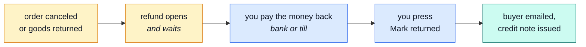

# Refunds that need a person

**For staff when a refund or a card dispute does not go the usual way.** Each entry has the same three parts: what you see, what to do, whose job it is.

| Something odd happened                                              | Go to                                                                                                  |
| ------------------------------------------------------------------- | ------------------------------------------------------------------------------------------------------ |
| A refund is owed and the money must be paid back by hand            | [A refund owed by hand](#refund-owed-by-hand)                                                          |
| I already paid the buyer back myself (cash, transfer)               | [Paid the buyer back already](#paid-outside)                                                           |
| The provider emailed a dispute the order does not show              | [A card dispute](#card-dispute)                                                                        |
| The card refused to take a refund back                              | [A card refund the card refused](#card-refund-refused)                                                 |
| The bank sent a refund back after the shop had marked it paid       | [A refund the bank sent back](#refund-bounced)                                                         |
| A buyer asked their bank to take a card payment back (a dispute)    | [A card dispute](#card-dispute)                                                                        |
| The buyer was asked how they want their money and has not answered  | [The buyer does not answer](#buyer-silent)                                                             |
| A refund was also made in the provider's own dashboard              | [Refunded in the dashboard as well](#refund-covered-elsewhere)                                         |
| A card was charged in the provider's dashboard, and needs refunding | [A card charged in the dashboard](./when-something-goes-wrong-orders-and-delivery.md#dashboard-charge) |
| Two refunds were opened by mistake                                  | [Two refunds by mistake](#two-refunds)                                                                 |
| An order was canceled but no refund opened                          | [A canceled order with no refund](#no-refund-opened)                                                   |

## A refund owed by hand {#refund-owed-by-hand}

**What you see.** A cancelled or returned order was paid in cash or by bank transfer. The order's
payment shows a refund that is still **open**, and the order is listed on the payment
"needs attention" list. The shop cannot send money out of your bank, so it waits for you.

**What to do.**

1. Pay the money back from the bank (or the till), for the amount shown.
2. Only then press **Mark returned** on that refund.

Pressing it is what closes the refund: the buyer gets the "your money is back" email and the credit
note is issued. Nothing is sent before you press it.

::: warning Never press Mark returned before the money has left
The button only records that you paid. If the bank transfer then fails, the shop and the buyer both
believe they were paid back and nobody is left to notice.
:::

**Whose job.** Whoever holds the refund permission: the [moderator](./moderator.md) or the admin.
A card payment is different: the shop refunds the card itself, and has no hand step, unless you
already paid the buyer yourself (next section).
→ [Payments](../modules/payments.md)

## Paid the buyer back already {#paid-outside}

**What you see.** A buyer paid by card, you gave the money back at the counter or by bank transfer,
and the shop would still send the same money to the card. That would pay the buyer twice.

**What to do.** On the order page, in the refund block, switch on **Already paid outside the app**,
pick how it went back (cash, bank transfer, other), add a reference if you have one, and press
**Refund only**. The refund is recorded as paid at once: nothing is sent to the card, the credit
note is issued, the buyer gets the "your money is back" email, and there is no **Mark returned** step.
For a returned parcel, tick the same choice when you receive it.

::: warning It is your word
The shop does not check that the money left. Switch it on only once it has. A refund goes back by
the buyer's own means of payment unless they agreed to another one (EU Directive 2011/83, Art. 13).
:::

To cancel an order and give cash, refund with the switch first, then cancel: the cancel then finds
nothing left to refund. **Cancel and refund** still goes to the card.

If a refund was also made in the provider's dashboard on top, the order appears on **Needs attention**
as **Refunded more than was paid**. The money really moved, so nothing is held and the row does not
clear by itself: check the books.

## A card refund the card refused {#card-refund-refused}

**What you see.** You refunded a card payment (or cancelled an order, or received a return), and
the refund sits **open**. On the payment, the refund reads **Failed** with a reason. If the reason
is one of the clear ones (the bank declined it, the card expired or was reported lost or stolen, or
the shop's own provider balance was too low), the payment's **Mark returned** button is offered and
the order is on the **Needs attention** list at once. The shop does not keep sending a refund the bank
has refused for good.

**What to do.**

1. Agree with the buyer how to pay them back, for example a bank transfer to an account in their
   name. The shop does not store bank details: keep them in your mailbox and your bank, under your
   usual retention.
2. Pay the money back from your bank, for the amount shown.
3. Only then press **Mark returned** on that refund.

Pressing it closes the refund: the credit note is issued, a waiting return closes, and the buyer is
told their money is back.

If the refund pays a return or a withdrawal, the "needs attention" list also shows **how many days are
left** to pay it back. The law (EU Consumer Rights Directive, Art. 13) gives you 14 days from the
day you were told of the withdrawal (the goods arriving later never moves that date); after that
the row says how late it is. The row also says which rule the date follows: **withdrawal**, or
**faulty item**, which is due as soon as the goods or the buyer's proof of sending came. Any other refund shows only its age.

If the reason reads **provider unavailable** or **no usable reason**, there is no Mark returned
button on purpose. The refund may have gone through, and the shop keeps asking the provider under
the same key until it has an answer. If it stays open for an hour, it shows up on the "needs
attention" list: check the provider's own dashboard (or its support) to see whether the money left.
If the provider is gone for good, that is a technician's job in the database, not a button.

If the payment's provider was removed from the shop, the reason reads **The payment provider is no
longer installed**: nothing was asked, so pay the buyer back yourself and press **Mark returned**.

::: warning Never press Mark returned before the money has left
The button only records that you paid. If the bank transfer then fails, the shop and the buyer both
believe they were paid back and nobody is left to notice.
:::

**Whose job.** Whoever holds the refund permission: the [moderator](./moderator.md) or the admin.
→ [Payments](../modules/payments.md#when-a-card-refund-cannot-go-back)

## A refund the bank sent back {#refund-bounced}

**What you see.** A refund read **succeeded** (the buyer was told, the credit note was issued), and
days later the order is on the **Needs attention** list as **Sent back by the bank: return the money another way**. On the
payment the refund reads **Failed** again, with a "Reversed on" date. The buyer was emailed
automatically: their bank returned the money, we still owe it, and they are asked how they would
like to receive it.

**What to do.**

1. Wait for the buyer's answer by email, and agree a method with them, for example a bank transfer
   to an account in their name. The shop does not store bank details: keep them in your mailbox and
   your bank, under your usual retention.
2. Pay the money back from your bank, for the amount shown.
3. Only then press **Mark returned** on that refund.

The credit note stays as it was: the sale was reduced, and a returned payout is money you owe, not
a new sale. The legal clock (EU Consumer Rights Directive, Art. 13) is 14 days; the list shows how
many are left when the refund paid a return or a withdrawal.

::: warning Never pick a method for the buyer
EU law lets you change the way the money goes back only when the buyer expressly agrees. Mark the
refund returned after you paid them, never before.
:::

**Whose job.** Whoever holds the refund permission: the [moderator](./moderator.md) or the admin.
→ [Payments](../modules/payments.md#when-the-bank-sends-a-refund-back)

## A card dispute {#card-dispute}

**What you see.** The order is on the **Needs attention** list as **Dispute to answer in the provider's dashboard**, with a
deadline. On the order's payment a banner shows the dispute: its kind (a question from the bank, or
a **chargeback**, where the bank has already taken the money back), the reason the buyer gave, the
amount and the day your evidence is due. The **Refund** button is off while a chargeback is open.
If you had already refunded part of the payment, the row says how much: that refund is evidence.

**What to do.**

1. Open the dispute in your payment provider's dashboard (the banner links to it) before the deadline.
2. Send the evidence there: proof of delivery, the tracking page, the order and the emails, and any
   refund you already made.
3. Wait for the bank. The banner updates by itself when the provider reports a decision. Your to-do
   changes with it: once the provider says the evidence is under review, the "send proof" to-do closes
   and a quiet "waiting for the bank" one takes its place, closed when the bank decides.

If the shop **wins**, the money comes back to you and the refund button returns. If it **loses**, the
bank keeps the money: what you can still refund is reduced by that amount. If the goods came back,
the credit note follows as usual.

A refund that was refused because of the dispute stays untouched while any dispute is open. Once none
is, you have two buttons on it (**Mark returned** and **Cancel refund**), and the dispute's outcome tells you which:

- **Lost:** the bank paid the buyer. If the buyer has it all, press **Mark returned**. If the bank
  took less than the refund, pay the small rest outside the app first, then press it.
- **Won:** the shop kept the money. Press **Cancel refund**, then refund by card.

The same holds when the refusal came with no dispute on file: the to-do says so; check the dispute in
the provider's dashboard first, then choose as above. A refund the bank sent back after it had
settled can only be marked returned, never voided.

**The provider emailed a dispute, but the order does not show it.** The shop hears of a dispute only
from the provider's event, and the shop never reads disputes back by itself. In the provider's
dashboard, **Resend** the `charge.dispute.*` event (Stripe keeps it 15 days in the dashboard, 30 from
the command line, counted from each event, not from the dispute's start). Past that window, refund
in the dashboard, press **Re-sync refunds** on the payment, and close the to-do. A dispute is never
typed in by hand: closing one would unlock **Mark returned** and **Cancel refund** by mistake.

A dispute in **another currency** than the payment is shown like any other, but the shop does not
subtract it from what you can refund. When it ends lost, its to-do closes with "check the amount":
look at it in the provider's dashboard before any refund or return.

::: warning Do not refund a payment under a chargeback
The bank already took the money back. A refund on top pays the buyer twice, and the shop cannot get
the second payment back. The shop refuses it for you; the dashboard may too.
:::

::: tip The shop does not hold the goods by itself
If the parcel has not left yet, use the usual **hold** on the shipment ("high risk") and decide.
:::

**Whose job.** Whoever holds the refund permission: the [moderator](./moderator.md) or the admin.
A lost chargeback with no goods returned is a non-payment, not a credit note; ask your accountant
how your country books it (in Italy: DPR 633/72 art. 26 allows a credit-note adjustment only inside
insolvency).
→ [Payments](../modules/payments.md#disputes)

## The buyer does not answer {#buyer-silent}

**What you see.** A refund the card could not take back (refused for good, or sent back by the
bank) is open, and the buyer was emailed asking how they would like the money. Days pass with no
reply. The order stays on the **Needs attention** list.

**What to do.**

1. Write to the buyer again around day 7, from your own mailbox.
2. Note each try on the order or in the task, so the next person sees it.
3. Keep the refund open. If the refund pays a return or a withdrawal, the list shows how many days
   are left of the 14 the law gives you.

::: warning Never mark it returned, or pick a method, for the buyer
EU law lets you change the way the money goes back only when the buyer expressly agrees. Press
**Mark returned** after you have actually paid them, never to make the row disappear.
:::

**Whose job.** The [moderator](./moderator.md) or the admin.
→ [Payments](../modules/payments.md#telling-the-buyer)

## Refunded in the dashboard as well {#refund-covered-elsewhere}

**What you see.** Somebody refunded the buyer straight from the card provider's dashboard. The shop
notices by itself: the refund appears on the payment as **Refunded in the provider's dashboard**,
with the credit note and the buyer's email like any other refund. Nothing to do for that one.

If it does not appear, and you get a to-do **Refund made at the provider, not recorded**, the shop
could not record it: two refunds were being written at the same moment and it gave up. Open the
payment and press **Re-sync refunds**. The shop reads the provider's refunds again and records the
missing one; pressing it twice records nothing twice. Then close the to-do. A refund in **another
currency** than the payment is never converted: **Re-sync refunds** will not record it. Record it
outside the app (your accountant), then close the to-do. A later re-sync or refund on that payment reminds you again, because the shop's books still lack it.

If the shop also held its own refund for the same money, the payment may now be refunded for more
than was paid. The shop records the dashboard refund anyway (the money really left), keeps its own
refund **unsent**, and puts the order on the **Needs attention** list as **A refund made elsewhere left
no room**, with by how much. On the payment, the shop's refund reads **open**, and the payment's
**Cancel refund** button is offered.

**What to do.**

1. Open the provider's dashboard and confirm the money really went back to the buyer.
2. Press **Cancel refund** on the shop's own refund and write who refunded it, and where, in the
   note. (If you paid the buyer a third way instead, press **Mark returned**.)

Cancelling is a void inside the shop only. Nothing is sent to the provider, no credit note is issued
and the buyer is not emailed: the money never moved from here. The amount becomes refundable again.
If the refund still reads **provider unavailable** or **no usable reason** and it fits, there is no
Cancel button on purpose: the shop may still be sending it, so wait for its answer first.

::: warning Never cancel a refund the shop already paid
A refund that reads **succeeded** cannot be cancelled: the money left, and voiding it would make
the books lie. If it was paid twice, the buyer holds the extra money: ask them for it.
:::

**Whose job.** Whoever holds the refund permission: the [moderator](./moderator.md) or the admin.
→ [Payments](../modules/payments.md#cancelling-a-refund)

## Two refunds by mistake {#two-refunds}

**What you see.** Two partial refunds were opened for the same goods (the Refund button stays
available on purpose, so a double click can do it). The payment shows both.

**What to do.**

1. Open the payment's **Refunds** tab and read both refunds first.
2. A duplicate that is still **open** (waiting, or refused for a clear reason): press **Cancel
   refund** on it, with a note.
3. A duplicate that already shows **succeeded** is the buyer's money now. Write to them and ask for
   it back.

::: warning Never refund a negative amount to fix a duplicate
There is no such thing as a refund backwards. Cancel the open one, or ask the buyer.
:::

**Whose job.** The [moderator](./moderator.md) or the admin.
→ [Payments](../modules/payments.md#cancelling-a-refund)

## A canceled order with no refund {#no-refund-opened}

**What you see.** A paid order was canceled, but its payment shows no refund. You were alerted
twice before this: the **Outbox events dead** alert reached the operator, and the dead-events bell
reached the administrators (a moderator gets neither). The message that opens the refund failed every
retry.

**What to do.** Press **Refund** on the payment for the amount the buyer paid. If a developer
revives the dead event instead, the refund opens by itself. Either way, the shop checks the amount
still left to refund, so doing both never pays the buyer twice.

**Whose job.** The [moderator](./moderator.md) or the admin; the dead event itself is a technician's.
→ [Payments](../modules/payments.md#when-a-card-refund-cannot-go-back)

## Still stuck

- [When something goes wrong](./when-something-goes-wrong.md): the other groups, and the server crash case.
- [The shop manager](./manager.md) · [The support desk](./support.md) · [The moderator](./moderator.md): who owns each job.
