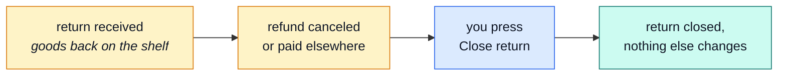

# Returns that need a person

**For staff when a return cannot finish the usual way.** Each entry has the same three parts: what you see, what to do, whose job it is.

| Something odd happened                                             | Go to                                                            |
| ------------------------------------------------------------------ | ---------------------------------------------------------------- |
| A return was received but its refund will never come the usual way | [A return that cannot finish](#return-cannot-finish)             |
| A return was received but the payment had less to give than owed   | [A return whose refund came up short](#refund-short)             |
| A return was approved but the buyer never sent the goods           | [The buyer never sent it back](#buyer-never-sent-it)             |
| A return parcel was lost on its way back to the shop               | [The return parcel was lost](#return-parcel-lost)                |
| A return for a faulty or wrong item needs a decision               | [A faulty item: repair, replace, refund or reduce](#faulty-item) |

## A return that cannot finish {#return-cannot-finish}

**What you see.** A return was **received** and its goods are back on the shelf, but it never turns
**closed**: its refund was cancelled, or the money went back outside the shop, so the shop will
never see the refund land.

**What to do.** Press **Close return** on the return and, if you like, write why. The return
becomes closed and the order's history says so.

Closing is bookkeeping only: no money moves, no stock moves, no credit note is issued and the
buyer is not emailed that their money is back. If money is still owed, settle it first through the
refund (see [A refund owed by hand](./when-something-goes-wrong-refunds.md#refund-owed-by-hand)).

::: warning A return nobody has received yet is not closed
A request is approved or declined. Close is for a return whose goods have arrived.
:::

**Whose job.** Whoever receives returns: the [warehouse](./warehouse.md) or the manager.
→ [Returns](../modules/returns.md#closing-a-return-by-hand)

## A return whose refund came up short {#refund-short}

**What you see.** A to-do "Return refund smaller than owed" on a return: _100.00 EUR was owed, 70.00
EUR could be sent_. Part of the payment had already gone back (a goodwill refund, a refund made in
the provider's dashboard, a lost chargeback), so the refund could not be the whole amount. If it
was _0.00_ sent, the return stays **received** and the buyer was **not** emailed that their money is
back. The same happens when no payment stands behind the order at all.

If you tick **Already paid outside the app** when you receive the goods and the payment has less
left than the return owes, the refund is recorded for what is left and the return closes by itself.
This to-do stays open: **Close return** is no longer offered, so once you have checked the rest,
close the to-do yourself.

**What to do.** Check whether the money that already went back was for this return. If it was, the
buyer has what they are owed. If not, pay the rest outside the shop (it is not on the payment any
more). Then press **Close return** on the return: the to-do clears itself. If the return closed on
its own because the part that could be sent did settle, close the to-do yourself.

A cancelled remainder has no return to close by hand (it is born closed): close its to-do yourself.

**Whose job.** Whoever receives returns: the [warehouse](./warehouse.md) or the manager.
→ [Shop to-dos](../modules/shop-tasks-todos.md)

## The buyer never sent it back {#buyer-never-sent-it}

**What you see.** A return is **approved**, the order reads "return in progress", and weeks later no
parcel has come.

**What to do.** Press **Cancel return** on the return and, if you like, write why. The return becomes
canceled: its units can be returned again and the order stops reading "return in progress".

Canceling is bookkeeping only: no money, no stock, no email. It is not a close, because the goods did
not come back.

::: warning If the buyer has proof of posting, do not cancel
A buyer who shows a posting receipt sent the goods. This shop's policy is to bear the risk of the
parcel on its way back and refund on proof of sending, so the refund is owed. Press **Proof of
sending** and enter what the receipt says. See [The return parcel was lost](#return-parcel-lost).
:::

::: warning A withdrawal has 14 days to send the goods
Do not cancel a withdrawal before the buyer's 14 days to send the goods have passed (CRD Art.
14(1)). If the goods turn up after a cancel, record the withdrawal again as a new return with the
original date as "requested at" (the same fix as
[Declined by mistake](./support.md#declined-by-mistake)).
:::

**Whose job.** The [manager](./manager.md), the moderator or support: whoever may update a return.
→ [Returns](../modules/returns.md#canceling-a-return)

## The return parcel was lost {#return-parcel-lost}

**What you see.** The buyer says they posted the goods back, and shows it. The carrier lost the
parcel. A return is **approved** and nothing arrives.

**What to do.** Do not cancel.

1. Press **Proof of sending** on the return and enter the date on the carrier's document, the
   carrier and its reference. You can do this once per return.
2. On a **withdrawal** this opens the refund at once and the buyer is paid back, even though the
   parcel never arrives. On a **faulty or wrong item** it only records the proof: you still decide
   the remedy when you press **Goods received**, and a refund picked then is due immediately.
3. Press **Goods received** with the restock count of every line set to **0**. The units count as
   back, but nothing goes on sale: there is nothing on the shelf. After a proof on a withdrawal this
   opens no second refund and closes the return once the refund has been paid.

This shop's policy is to carry the risk of the parcel on its way back and to refund on proof of
sending (the EU leaves the final risk to national law), so the money is owed; claim it from the
carrier if you wish. If the parcel turns up later and the goods are sellable, use **Receive stock**
with a note that it is a repaired or found return.

::: warning After a proof on a withdrawal, the return cannot be canceled
The proof opened a refund the buyer is owed, so **Cancel return** is refused. Press **Goods received**
instead (with 0 on every line if the parcel was lost).
:::

::: warning After a proof on a withdrawal, no handling deduction
Once the proof opened the refund you can no longer keep part of it back (CRD Art. 13(3)), so
**Goods received** with a handling deduction is refused. If the goods arrive damaged, claim the
amount from the buyer separately.
:::

**Whose job.** Whoever receives returns: the [warehouse](./warehouse.md) or the manager.
→ [Returns](../modules/returns.md#what-the-customer-gets-back)

## A faulty item: repair, replace, refund or reduce {#faulty-item}

**What you see.** A return for a "defective" or "wrong item" reason. The buyer may have said what
they would like (repair, replacement or money back).

**What to do.** Press **Goods received** and pick the remedy; the buyer's wish is preselected.

- **Replace it**: the same product goes out again on the same order. After you press, the order is back
  in processing: ship it from its fulfillment order like any other. If the shelf is short it waits on
  hold for stock.
- **Repair it**: you repair it and post it back with a tracking note. The return closes with no money
  moving, and the guarantee is extended by 12 months, once.
- **Refund me**: the money goes back, with the delivery. You cannot hold anything back for handling on a
  faulty item.
- **Keep it, partial refund** (price reduction): do not receive it. Use the Refund button on the
  payment for the part you agree.

The law lets the buyer choose between repair and replacement first; you may give another remedy only
when theirs is impossible or disproportionate. A defect that appeared within two years but was
reported later is a legal claim, not goodwill. Return postage for a defect is on the shop.

**Whose job.** Whoever receives returns: the [warehouse](./warehouse.md) or the manager.
→ [Returns](../modules/returns.md#the-remedy-ladder)

## Still stuck

- [When something goes wrong](./when-something-goes-wrong.md): the other groups, and the server crash case.
- [The shop manager](./manager.md) · [The support desk](./support.md) · [The moderator](./moderator.md): who owns each job.
